# 魔物一覧と戦闘画像

[ゲーム内の魔物図鑑を開く](https://tomtomyoung.github.io/adv/labyrinth-guide.html#monsters)

作品版1.34.0。配布中の敵は225定義、遭遇編成は123定義、敵が参照する画像ファイルは185点です。敵の定義数と、独自の外見を持つ魔物の数は同じではありません。

敵・技能・画像・通常ロードのマップと迷宮・スクリプトから全文を生成します。数値を重ねて手書きせず、原稿を更新してから `npm run build:docs` で反映します。

[固有環境の敵](#固有環境の敵)：6定義。
[個別デザインの通常魔物](#個別デザインの通常魔物)：151定義。
[依頼に追加した敵](#依頼に追加した敵)：48定義。
[地域の迷宮獣と守護者](#地域の迷宮獣と守護者)：20定義。

## 現在の読み方

ダメージは図鑑の基礎能力で防御10の相手に命中したときの目安です。耐性・防御姿勢・クリティカルなどで変わります。

通常遭遇候補、仕掛けからの参照、スクリプトの戦闘開始命令を分けて記載します。参照は配置・命令の存在を示し、出現条件の成立や全分岐の到達を保証するものではありません。配布DBに残っていても、通常ロードのこれらの経路から呼ばれていない遭遇があります。

AIは優先度の高い順に、条件成立・MP充足・環境による使用許可を満たした最初の規則を使います。同順位は定義順です。「代表技能」だけでは回復・防御・毒牙・対象選択を説明できないため、以下には全規則を載せます。属性倍率は未指定なら1で、実ダメージには式・防御・環境なども作用します。

現在のくらがり画像は `wraith` が参照する `assets/images/monsters/wraith.webp` です。同じ画像を地域4・5・9の迷宮獣／守護者、腐肉鬼、足跡の追跡者も共有しています。くらがりだけの専用画像IDへ分離された状態ではありません。旧PNGの保存と現行の参照は[適用記録](../../assets/source/characters/recovery-2026-09-24.json)で確認できます。

2026-09-25の素材更新第1便で、共通画像ID `slime`・`skeleton`・`construct` の3点を新しい魔物素材と同じタッチの透過WebPへ換装しました。同じIDを使う各敵も新画像へ切り替わります。[第1便の適用・透過検査記録](../../assets/source/monsters/refresh-2026-09-25-batch1.json)と[生成プロンプト](../../assets/source/monsters/refresh-2026-09-25-batch1-prompts.json)。

同日の第2便で残る `dragon` も換装し、このIDを共有する7定義へ反映しました。前日の `wraith` を含む共通5画像の更新が完了し、現行の敵が参照する旧共通PNGは0点です。旧PNGとAIPaint原稿は保持しています。[第2便の適用・透過検査記録](../../assets/source/monsters/refresh-2026-09-25-batch2.json)と[生成プロンプト](../../assets/source/monsters/refresh-2026-09-25-batch2-prompts.json)。

正常な1.25.0〜1.33.0のセーブを現行版へ検証後に移行し、その他の内容版や破損セーブは受け付けません。地域の迷宮獣・守護者は現行の依頼戦・通常遭遇から参照されているため残っています。保存方針は[SPEC.md](../SPEC.md)、調整と旧測定は[BALANCE_PLAN.md](BALANCE_PLAN.md)を参照してください。

## 編集元

[config/entities.json](../../config/entities.json)：個別デザイン20種の名称・発想・外見・数値・代表技能。AIの組立は[build-entities.mjs](../../tools/build-entities.mjs)です。参照した発想元は[RPGエンティティ生成モデル](https://app.notion.com/p/RPG-3d6c3c1966b380489592dbeafc72b9dd)と[魔物100](https://app.notion.com/p/3d6c3c1966b38172b0a6fd15e23be419)です。

[kagaribi-content.json](../../config/kagaribi-content.json)：くらがり、煤ネズミとその仲間を含む篝火の迷宮の通常魔物、炉守りの亡霊。[dungeon-content.json](../../config/dungeon-content.json)：水路の魚・ソルトイーター・境渡りの呪詠み。出現・特殊処理の設定は各 `config/dungeons/*.json` です。

[build-content.mjs](../../tools/build-content.mjs)：地域の迷宮獣・守護者。[build-scenarios.mjs](../../tools/build-scenarios.mjs)と `authoring/scenarios-*.mjs`：依頼ごとの追加敵。通常遭遇の原稿は[編集先の対応](../authoring/CONFIG_EDITOR_SOURCES.md)、画像IDと実ファイルの対応は[data/assets.json](../../data/assets.json)を確認してください。

## 固有環境の敵

### くらがり (kuragari)

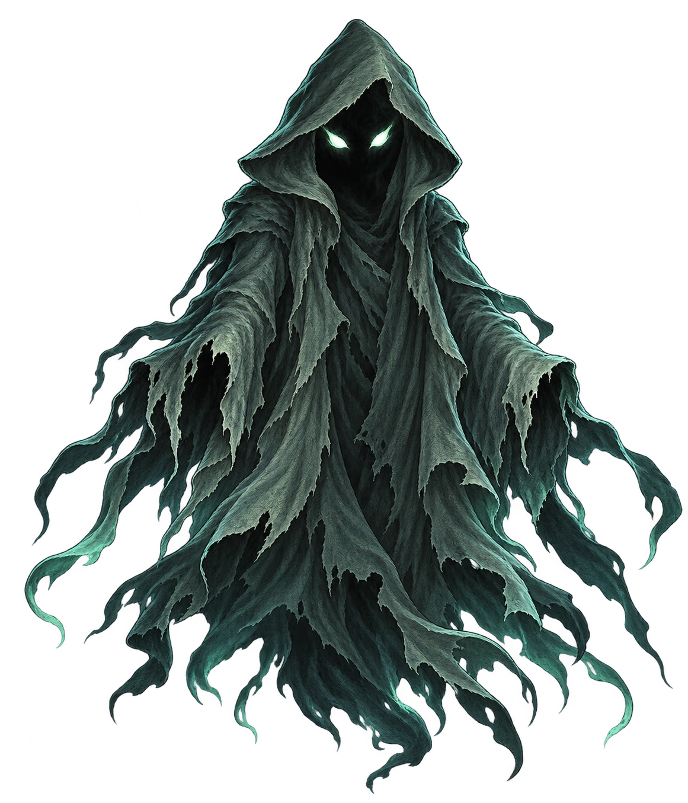

画像ID：wraith。実ファイル：[assets/images/monsters/wraith.webp](../../assets/images/monsters/wraith.webp)。
画像共有：鏡沈みの礼拝堂の迷宮獣・鏡沈みの礼拝堂の守護者・灰時計の書庫の迷宮獣・灰時計の書庫の守護者・星欠けの地下観測所の迷宮獣・星欠けの地下観測所の守護者・腐肉鬼・足跡の追跡者・炉守りの亡霊・祭壇の火守。

習性：なし。

通常点灯の守りが届かないときは7成功歩ごとに基本22％で歩行抽選し、現状の候補はくらがり100％です。普通の火で通常魔物まで消えることはなく、通常遭遇の完全抑止は深火の効果です。q001の老人同行中は北・南の帰路配置で同じイベント戦闘を起こし、途中の通常抽選でくらがりに遭遇した場合も、その実セルで同じ戦闘と新人救援へ進みます。火切れだけでは即戦闘にせず、救援後は繰り返しません。撃退・救助による強制終了と撃破を区別します。[火と遭遇仕様](../dungeons/KAGARIBI_DUNGEON.md)。

基礎能力：HP 1800 / MP 0 / STR 130 / VIT 70 / AGI 15 / INT 90。報酬：0G / 0EXP。
宝箱：なし（確率0）。
属性倍率：physical 0.5 / fire 1 / light 1.5 / dark 0。

行動と使用条件（AIの選択順）：

1. 攻撃 (attack)、MP0。優先度0、条件なし、対象は探索隊で現在HPの実数が最も低い1人。物理ダメージ（目安125）。

遭遇と参照先：

kuragari_hunt：くらがり×1。逃走可。
仕掛けからの参照：篝火の迷宮 / fires.threat.encounterPool.0.encounter。
戦闘開始命令：1スクリプト。q001.v11.outage。全配置の照合は[イベント一覧](../scenarios/EVENT_CATALOG.md)を参照してください。

### 境渡りの呪詠み (valley_hexer)

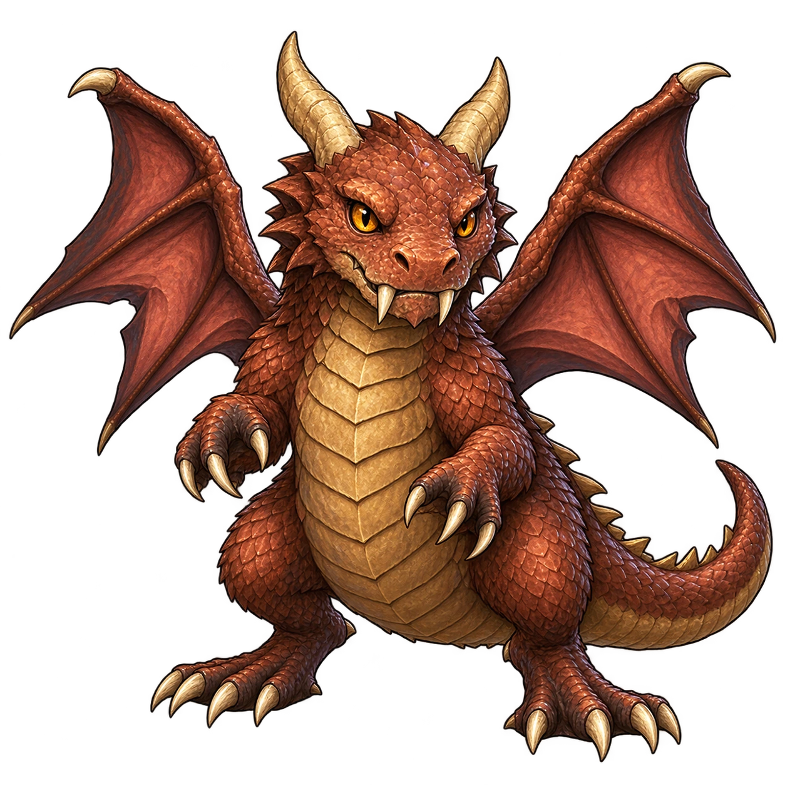

画像ID：dragon。実ファイル：[assets/images/monsters/dragon.webp](../../assets/images/monsters/dragon.webp)。
画像共有：黒潮の沈没城の迷宮獣・黒潮の沈没城の守護者・帰還者の深淵の迷宮獣・帰還者の深淵の守護者・谷の飛竜・荊角獣。

習性：なし。

基礎能力：HP 112 / MP 8 / STR 28 / VIT 13 / AGI 15 / INT 26。報酬：20G / 30EXP。
宝箱：解毒薬 1個 / 12.5％。
属性倍率：fire 1 / physical 1。

行動と使用条件（AIの選択順）：

1. 途切れぬ呪詠 (valley_curse)、MP2。優先度20、条件なし、対象は探索隊の生存者からランダムに1人。命中時100%で帰らぬ呪いLv1を付与（巡の終わりにHP−4、巡の終わりにMP−4、移動1歩でHP−2、移動1歩でMP−2）。
2. 攻撃 (attack)、MP0。優先度0、条件なし、対象は探索隊の生存者からランダムに1人。物理ダメージ（目安23）。

遭遇と参照先：

千変の迷宮の通常遭遇：地下45〜69階。

valley_roamers：境渡りの呪詠み×1。逃走可。
通常遭遇候補：祈りの届かない谷 (prayerless_valley_f1)、重み50。
仕掛けからの参照：祈りの届かない谷 / boundary.threat.encounter。

### 水路の小魚 (water_darter)

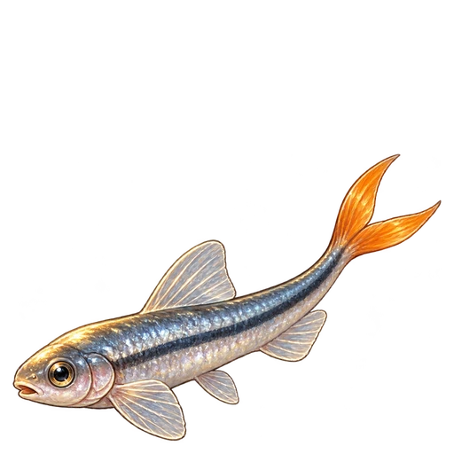

画像ID：monster_water_darter。実ファイル：[assets/images/monsters/water_darter.webp](../../assets/images/monsters/water_darter.webp)。
画像共有：他の敵定義との共有なし。

習性：なし。

旧地下水道の水位に応じて使う魚です。現在の2D区画給排水はこの水位別遭遇を使用しません。敵と遭遇定義は配布DBに残っていますが、退避した旧水道の通常出現と現行の水路を混同しません。

基礎能力：HP 22 / MP 0 / STR 7 / VIT 3 / AGI 10 / INT 4。報酬：5G / 6EXP。
宝箱：傷薬 1個 / 12.5％。
属性倍率：すべて既定値。

行動と使用条件（AIの選択順）：

1. 攻撃 (attack)、MP0。優先度1、条件なし、対象は探索隊の生存者からランダムに1人。物理ダメージ（目安2）。

遭遇と参照先：

water_small：水路の小魚×1。逃走可。
通常ロードのマップ候補・有効な仕掛け・戦闘開始命令からの参照なし。遭遇定義のみ保持しています。

### 水路の牙魚 (water_predator)

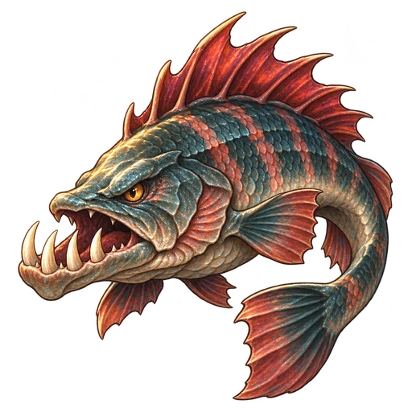

画像ID：monster_water_predator。実ファイル：[assets/images/monsters/water_predator.webp](../../assets/images/monsters/water_predator.webp)。
画像共有：他の敵定義との共有なし。

習性：なし。

旧地下水道の水位に応じて使う魚です。現在の2D区画給排水はこの水位別遭遇を使用しません。敵と遭遇定義は配布DBに残っていますが、退避した旧水道の通常出現と現行の水路を混同しません。

基礎能力：HP 55 / MP 0 / STR 13 / VIT 6 / AGI 9 / INT 8。報酬：12G / 15EXP。
宝箱：野営糧食 1個 / 12.5％。
属性倍率：すべて既定値。

行動と使用条件（AIの選択順）：

1. 攻撃 (attack)、MP0。優先度1、条件なし、対象は探索隊の生存者からランダムに1人。物理ダメージ（目安8）。

遭遇と参照先：

water_predator：水路の牙魚×1。逃走可。
通常ロードのマップ候補・有効な仕掛け・戦闘開始命令からの参照なし。遭遇定義のみ保持しています。

### 大水喰い (water_giant)

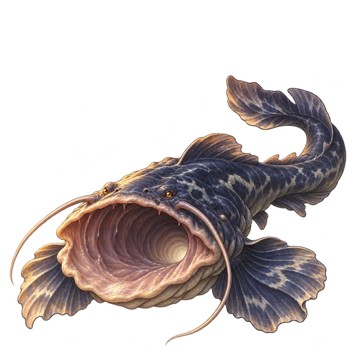

画像ID：monster_water_giant。実ファイル：[assets/images/monsters/water_giant.webp](../../assets/images/monsters/water_giant.webp)。
画像共有：他の敵定義との共有なし。

習性：なし。

旧地下水道の水位に応じて使う魚です。現在の2D区画給排水はこの水位別遭遇を使用しません。敵と遭遇定義は配布DBに残っていますが、退避した旧水道の通常出現と現行の水路を混同しません。

基礎能力：HP 145 / MP 0 / STR 26 / VIT 12 / AGI 7 / INT 16。報酬：24G / 35EXP。
宝箱：野営糧食 1個 / 25％。
属性倍率：すべて既定値。

行動と使用条件（AIの選択順）：

1. 攻撃 (attack)、MP0。優先度1、条件なし、対象は探索隊の生存者からランダムに1人。物理ダメージ（目安21）。

遭遇と参照先：

water_giant：大水喰い×1。逃走可。
通常ロードのマップ候補・有効な仕掛け・戦闘開始命令からの参照なし。遭遇定義のみ保持しています。

### ソルトイーター (salt_eater)

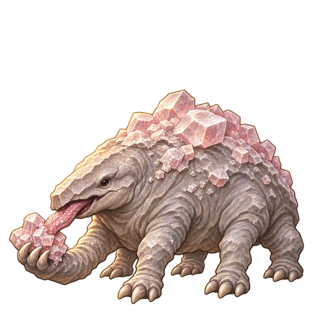

画像ID：monster_salt_eater。実ファイル：[assets/images/monsters/salt_eater.webp](../../assets/images/monsters/salt_eater.webp)。
画像共有：他の敵定義との共有なし。

習性：なし。

塩の蓄積した装備個体があると、廃坑の腐食部品が遭遇候補を切り替えます。敵ラウンド開始時、この敵が生存していれば閾値以上で塩が最も多い装備個体を1個消失させます。これは下記AIの攻撃とは別の `corrosion.battleRound` 処理です。[塩の仕様](../dungeons/WATERWAYS_SALT_MINE.md)。

基礎能力：HP 35 / MP 0 / STR 7 / VIT 3 / AGI 8 / INT 4。報酬：9G / 10EXP。
宝箱：解毒薬 1個 / 12.5％。
属性倍率：すべて既定値。

行動と使用条件（AIの選択順）：

1. 攻撃 (attack)、MP0。優先度1、条件なし、対象は探索隊の生存者からランダムに1人。物理ダメージ（目安2）。

遭遇と参照先：

salt_eater_feeding：ソルトイーター×1。逃走可。
仕掛けからの参照：塩哭きの廃坑 / salt.eater.encounter。

## 個別デザインの通常魔物

### 水車ビーバー (waterwheel_beaver)

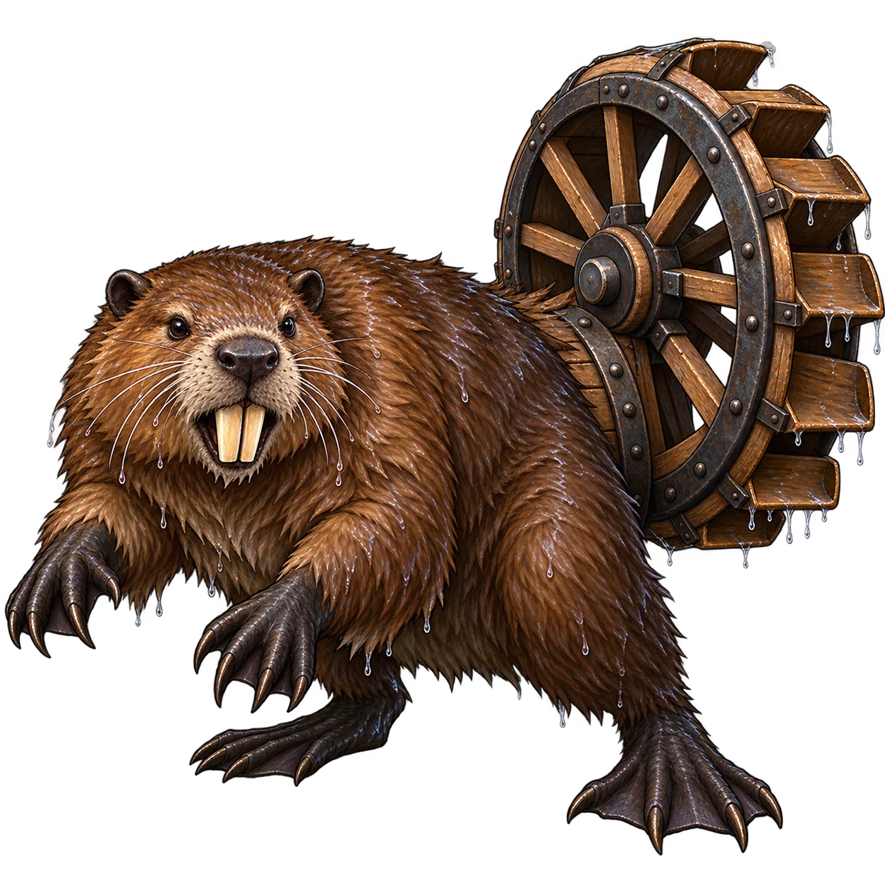

画像ID：monster_waterwheel_beaver。実ファイル：[assets/images/monsters/waterwheel_beaver.webp](../../assets/images/monsters/waterwheel_beaver.webp)。
画像共有：大水車ビーバー（低位）。

発想：ビーバー＋水車。参照：M006。地域分類：灯守の地下水道。

外見：丸い尾が木と鉄の水車。濡れた茶の毛と幅広い前歯。

習性：なし。

設計上の役割：水の尾で打つ低速の前衛

基礎能力：HP 32 / MP 6 / STR 9 / VIT 7 / AGI 5 / INT 4。報酬：7G / 13EXP。
宝箱：補修用の縄 1個 / 12.5％。
属性倍率：water 0.6 / lightning 1.4。

行動と使用条件（AIの選択順）：

1. 水車の尾 (water_tail)、MP3。優先度10、条件なし、対象は探索隊の生存者からランダムに1人。水ダメージ（目安5）。
2. 攻撃 (attack)、MP0。優先度0、条件なし、対象は探索隊の生存者からランダムに1人。物理ダメージ（目安4）。

遭遇と参照先：

千変の迷宮の通常遭遇：地下11〜24階。

wild_waterwheel_beaver：水車ビーバー×1。逃走可。
通常遭遇候補：灯守の地下水道・1F 入口操作室 (region_1_f1)、重み40 / 灯守の地下水道・6F 操作室 (region_1_f2)、重み40 / 灯守の地下水道・2F 第一水路 (region_1_canal_a)、重み40 / 灯守の地下水道・3F 荷揚げ場 (region_1_landing)、重み40 / 灯守の地下水道・4F 排水支路 (region_1_canal_b)、重み40 / 灯守の地下水道・5F 鐘と浮子の点検室 (region_1_inspection)、重み40 / 灯守の地下水道・10F 奥の水門詰所 (region_1_gatehouse)、重み40。

wild_pair_1：水車ビーバー×1・水門ワニ×1。逃走可。
通常ロードのマップ候補・有効な仕掛け・戦闘開始命令からの参照なし。遭遇定義のみ保持しています。

### 水門ワニ (sluice_crocodile)

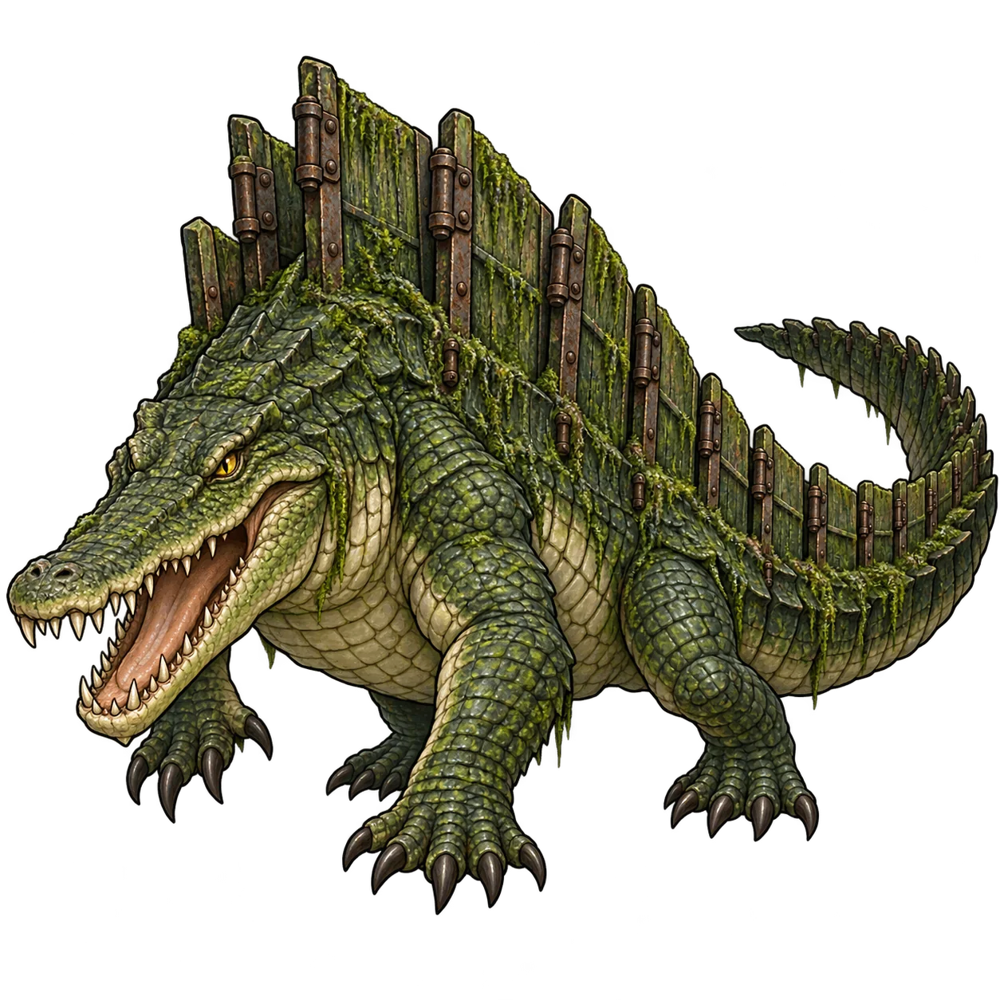

画像ID：monster_sluice_crocodile。実ファイル：[assets/images/monsters/sluice_crocodile.webp](../../assets/images/monsters/sluice_crocodile.webp)。
画像共有：水門獣・深水門ワニ（低位）。

発想：ワニ＋水門。参照：M024。地域分類：灯守の地下水道。

外見：背の板が縦に立つ水門。苔色の鱗と鉄の蝶番。

習性：なし。

設計上の役割：初手に背の門を閉じて防御する

基礎能力：HP 40 / MP 6 / STR 11 / VIT 9 / AGI 3 / INT 4。報酬：7G / 13EXP。
宝箱：傷薬 1個 / 12.5％。
属性倍率：physical 0.8 / fire 1.2。

行動と使用条件（AIの選択順）：

1. 防御 (guard)、MP0。優先度30、第1ラウンド、対象は自身。次の自分の手番まで防御し、受けるダメージを50%にする。
2. 水門落とし (gate_slam)、MP3。優先度10、条件なし、対象は探索隊の生存者からランダムに1人。物理ダメージ（目安8）。
3. 攻撃 (attack)、MP0。優先度0、条件なし、対象は探索隊の生存者からランダムに1人。物理ダメージ（目安6）。

遭遇と参照先：

wild_sluice_crocodile：水門ワニ×1。逃走可。
通常遭遇候補：灯守の地下水道・1F 入口操作室 (region_1_f1)、重み40 / 灯守の地下水道・2F 第一水路 (region_1_canal_a)、重み40 / 灯守の地下水道・3F 荷揚げ場 (region_1_landing)、重み40 / 灯守の地下水道・4F 排水支路 (region_1_canal_b)、重み40 / 灯守の地下水道・5F 鐘と浮子の点検室 (region_1_inspection)、重み40 / 灯守の地下水道・7F 給金箱の水路 (region_1_canal_c)、重み30 / 灯守の地下水道・10F 奥の水門詰所 (region_1_gatehouse)、重み40。

wild_pair_1：水車ビーバー×1・水門ワニ×1。逃走可。
通常ロードのマップ候補・有効な仕掛け・戦闘開始命令からの参照なし。遭遇定義のみ保持しています。

waterway_croc_eel：水門ワニ×1・通電ウナギの幼体×1。逃走可。
通常遭遇候補：灯守の地下水道・7F 給金箱の水路 (region_1_canal_c)、重み70 / 灯守の地下水道・8F 棺の待避場 (region_1_lower_landing)、重み35。

### ドリルモグラ (drill_mole)

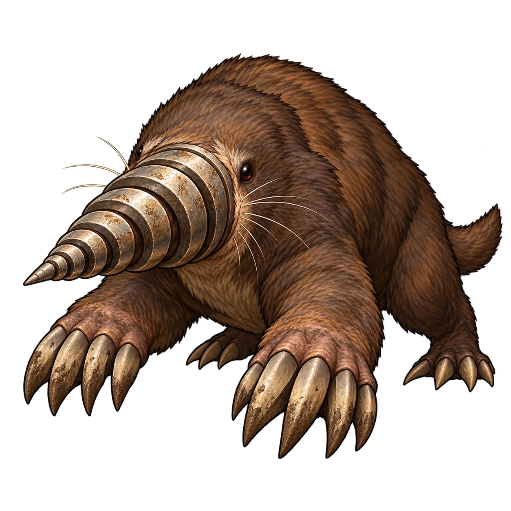

画像ID：monster_drill_mole。実ファイル：[assets/images/monsters/drill_mole.webp](../../assets/images/monsters/drill_mole.webp)。
画像共有：深掘りモグラ（低位）。

発想：モグラ＋回転掘削器。参照：M002。地域分類：塩哭きの廃坑。

外見：鼻先の大きな螺旋ドリルと短い掘削爪。土色の毛。

習性：なし。

設計上の役割：防御の一部を無視する鼻先の突進

基礎能力：HP 43 / MP 8 / STR 13 / VIT 6 / AGI 9 / INT 4。報酬：9G / 16EXP。
宝箱：発破薬 1個 / 6.25％。
属性倍率：physical 1 / ice 1.3。

行動と使用条件（AIの選択順）：

1. 螺旋突進 (drill_thrust)、MP4。優先度10、条件なし、対象は探索隊の生存者からランダムに1人。物理ダメージ（目安13）。
2. 攻撃 (attack)、MP0。優先度0、条件なし、対象は探索隊の生存者からランダムに1人。物理ダメージ（目安8）。

遭遇と参照先：

wild_drill_mole：ドリルモグラ×1。逃走可。
通常遭遇候補：塩哭きの廃坑・地下1層 (region_2_f1)、重み40 / 塩哭きの廃坑・地下2層 (region_2_f2)、重み35 / 塩哭きの廃坑・3F 砕石場 (region_2_f3)、重み40 / 塩哭きの廃坑・4F 選鉱詰所 (region_2_f4)、重み40 / 塩哭きの廃坑・5F 塩の吹溜まり (region_2_f5)、重み40 / 塩哭きの廃坑・6F 旧運搬線 (region_2_f6)、重み70 / 塩哭きの廃坑・10F 大選鉱室 (region_2_f10)、重み40。

wild_pair_2：ドリルモグラ×1・陶器アルマジロ×1。逃走可。
通常遭遇候補：塩哭きの廃坑・地下2層 (region_2_f2)、重み10 / 塩哭きの廃坑・3F 砕石場 (region_2_f3)、重み20 / 塩哭きの廃坑・4F 選鉱詰所 (region_2_f4)、重み20 / 塩哭きの廃坑・5F 塩の吹溜まり (region_2_f5)、重み20 / 塩哭きの廃坑・7F 巻上詰所 (region_2_f7)、重み40 / 塩哭きの廃坑・10F 大選鉱室 (region_2_f10)、重み20。

### 陶器アルマジロ (ceramic_armadillo)

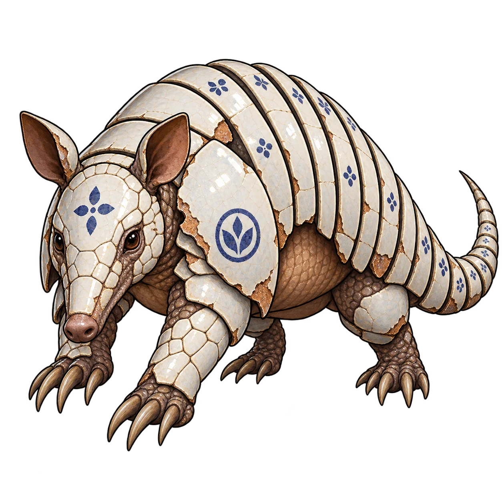

画像ID：monster_ceramic_armadillo。実ファイル：[assets/images/monsters/ceramic_armadillo.webp](../../assets/images/monsters/ceramic_armadillo.webp)。
画像共有：殻砕き獣・殻甲アルマジロ・厚殻アルマジロ（低位）。

発想：アルマジロ＋陶器。参照：M008。地域分類：塩哭きの廃坑。

外見：白い釉薬の鎧に藍の窯印、欠けた縁から柔らかな腹。

習性：なし。

設計上の役割：殻で物理に耐え、傷つくと丸まる

基礎能力：HP 50 / MP 0 / STR 10 / VIT 14 / AGI 4 / INT 3。報酬：9G / 16EXP。
宝箱：傷薬 1個 / 12.5％。
属性倍率：physical 0.6 / fire 1.4。

行動と使用条件（AIの選択順）：

1. 防御 (guard)、MP0。優先度30、偶数ラウンド、かつ自身のHPが50％未満、対象は自身。次の自分の手番まで防御し、受けるダメージを50%にする。
2. 殻の体当たり (shell_roll)、MP0。優先度10、条件なし、対象は探索隊の生存者からランダムに1人。物理ダメージ（目安5）。
3. 攻撃 (attack)、MP0。優先度0、条件なし、対象は探索隊の生存者からランダムに1人。物理ダメージ（目安5）。

遭遇と参照先：

wild_ceramic_armadillo：陶器アルマジロ×1。逃走可。
通常遭遇候補：塩哭きの廃坑・地下1層 (region_2_f1)、重み40 / 塩哭きの廃坑・地下2層 (region_2_f2)、重み35 / 塩哭きの廃坑・3F 砕石場 (region_2_f3)、重み40 / 塩哭きの廃坑・4F 選鉱詰所 (region_2_f4)、重み40 / 塩哭きの廃坑・5F 塩の吹溜まり (region_2_f5)、重み40 / 塩哭きの廃坑・10F 大選鉱室 (region_2_f10)、重み40。

wild_pair_2：ドリルモグラ×1・陶器アルマジロ×1。逃走可。
通常遭遇候補：塩哭きの廃坑・地下2層 (region_2_f2)、重み10 / 塩哭きの廃坑・3F 砕石場 (region_2_f3)、重み20 / 塩哭きの廃坑・4F 選鉱詰所 (region_2_f4)、重み20 / 塩哭きの廃坑・5F 塩の吹溜まり (region_2_f5)、重み20 / 塩哭きの廃坑・7F 巻上詰所 (region_2_f7)、重み40 / 塩哭きの廃坑・10F 大選鉱室 (region_2_f10)、重み20。

### 蜜蝋ランプバチ (candle_bee)

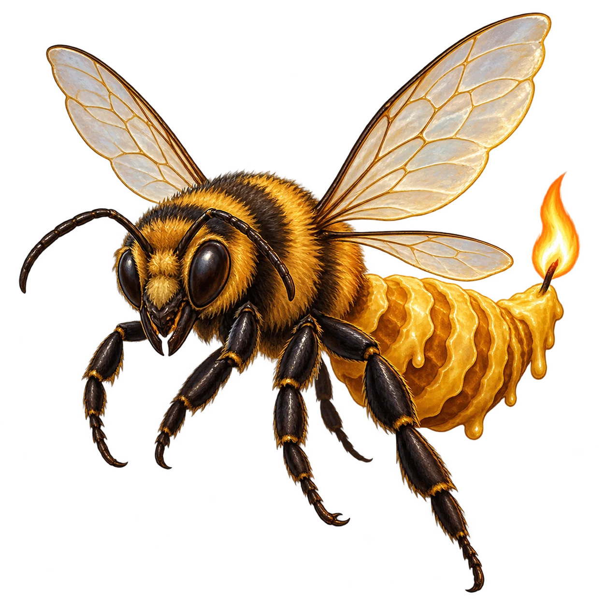

画像ID：monster_candle_bee。実ファイル：[assets/images/monsters/candle_bee.webp](../../assets/images/monsters/candle_bee.webp)。
画像共有：他の敵定義との共有なし。

発想：ハチ＋蝋燭。参照：M042。地域分類：根喰みの地下庭園。

外見：蜜蝋の腹と小さな琥珀の火。薄い羽と黒い脚。

習性：なし。

設計上の役割：灯った蜜蝋を飛ばす高速の炎術役

基礎能力：HP 38 / MP 12 / STR 9 / VIT 5 / AGI 15 / INT 12。報酬：11G / 19EXP。
宝箱：予備灯油 1個 / 12.5％。
属性倍率：fire 0.65 / ice 1.4。

行動と使用条件（AIの選択順）：

1. 蜜蝋の火 (wax_flame)、MP4。優先度10、条件なし、対象は探索隊の生存者からランダムに1人。炎ダメージ（目安20）。
2. 攻撃 (attack)、MP0。優先度0、条件なし、対象は探索隊の生存者からランダムに1人。物理ダメージ（目安4）。

遭遇と参照先：

wild_candle_bee：蜜蝋ランプバチ×1。逃走可。
通常遭遇候補：根喰みの地下庭園・地下1層 (region_3_f1)、重み40 / 根喰みの地下庭園・地下2層 (region_3_f2)、重み35 / 根喰みの地下庭園・3F 灌漑溝 (region_3_f3)、重み35 / 根喰みの地下庭園・4F 苗床詰所 (region_3_f4)、重み35 / 根喰みの地下庭園・5F 絡み根の道 (region_3_f5)、重み35 / 根喰みの地下庭園・6F 蜜の回廊 (region_3_f6)、重み35 / 根喰みの地下庭園・7F 庭師の休憩所 (region_3_f7)、重み35 / 根喰みの地下庭園・8F 虫媒棚 (region_3_f8)、重み35 / 根喰みの地下庭園・9F 薬草温室 (region_3_f9)、重み35 / 根喰みの地下庭園・10F 根門前庭 (region_3_f10)、重み35。

wild_pair_3：蜜蝋ランプバチ×1・鋸刃カマキリ×1。逃走可。
通常遭遇候補：根喰みの地下庭園・地下2層 (region_3_f2)、重み10 / 根喰みの地下庭園・3F 灌漑溝 (region_3_f3)、重み30 / 根喰みの地下庭園・4F 苗床詰所 (region_3_f4)、重み30 / 根喰みの地下庭園・5F 絡み根の道 (region_3_f5)、重み30 / 根喰みの地下庭園・6F 蜜の回廊 (region_3_f6)、重み30 / 根喰みの地下庭園・7F 庭師の休憩所 (region_3_f7)、重み30 / 根喰みの地下庭園・8F 虫媒棚 (region_3_f8)、重み30 / 根喰みの地下庭園・9F 薬草温室 (region_3_f9)、重み30 / 根喰みの地下庭園・10F 根門前庭 (region_3_f10)、重み30。

### 鋸刃カマキリ (saw_mantis)

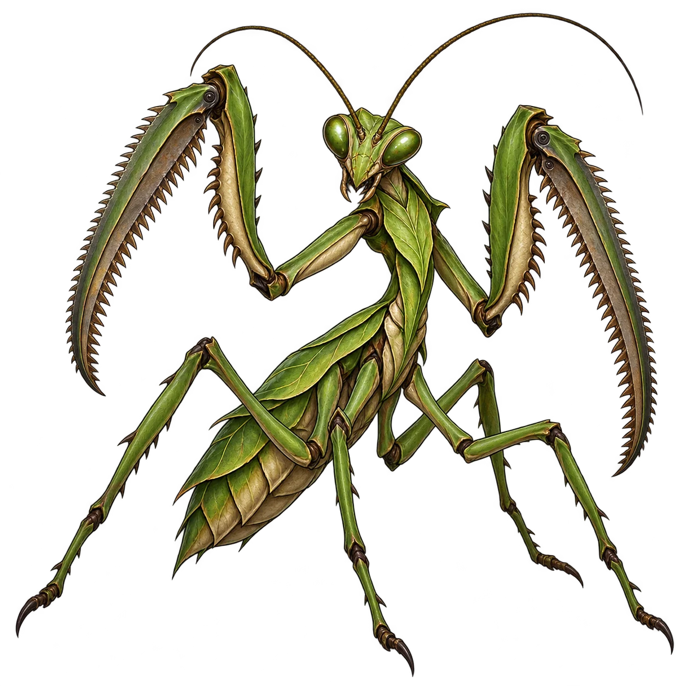

画像ID：monster_saw_mantis。実ファイル：[assets/images/monsters/saw_mantis.webp](../../assets/images/monsters/saw_mantis.webp)。
画像共有：大剪定虫。

発想：カマキリ＋往復のこぎり。参照：M041。地域分類：根喰みの地下庭園。

外見：細かな鋸歯の長い鎌、葉に似た緑の胴。

習性：なし。

設計上の役割：薄い守りと強打を持つ攻撃役

基礎能力：HP 49 / MP 9 / STR 16 / VIT 6 / AGI 12 / INT 5。報酬：11G / 19EXP。
宝箱：硬い茨 1個 / 12.5％。
属性倍率：physical 1 / fire 1.25。

行動と使用条件（AIの選択順）：

1. 引き鋸 (saw_cut)、MP3。優先度10、条件なし、対象は探索隊の生存者からランダムに1人。物理ダメージ（目安17）。
2. 攻撃 (attack)、MP0。優先度0、条件なし、対象は探索隊の生存者からランダムに1人。物理ダメージ（目安11）。

遭遇と参照先：

千変の迷宮の通常遭遇：地下6〜10階、地下25〜44階。

wild_saw_mantis：鋸刃カマキリ×1。逃走可。
通常遭遇候補：根喰みの地下庭園・地下1層 (region_3_f1)、重み40 / 根喰みの地下庭園・地下2層 (region_3_f2)、重み35 / 根喰みの地下庭園・3F 灌漑溝 (region_3_f3)、重み35 / 根喰みの地下庭園・4F 苗床詰所 (region_3_f4)、重み35 / 根喰みの地下庭園・5F 絡み根の道 (region_3_f5)、重み35 / 根喰みの地下庭園・6F 蜜の回廊 (region_3_f6)、重み35 / 根喰みの地下庭園・7F 庭師の休憩所 (region_3_f7)、重み35 / 根喰みの地下庭園・8F 虫媒棚 (region_3_f8)、重み35 / 根喰みの地下庭園・9F 薬草温室 (region_3_f9)、重み35 / 根喰みの地下庭園・10F 根門前庭 (region_3_f10)、重み35。

wild_pair_3：蜜蝋ランプバチ×1・鋸刃カマキリ×1。逃走可。
通常遭遇候補：根喰みの地下庭園・地下2層 (region_3_f2)、重み10 / 根喰みの地下庭園・3F 灌漑溝 (region_3_f3)、重み30 / 根喰みの地下庭園・4F 苗床詰所 (region_3_f4)、重み30 / 根喰みの地下庭園・5F 絡み根の道 (region_3_f5)、重み30 / 根喰みの地下庭園・6F 蜜の回廊 (region_3_f6)、重み30 / 根喰みの地下庭園・7F 庭師の休憩所 (region_3_f7)、重み30 / 根喰みの地下庭園・8F 虫媒棚 (region_3_f8)、重み30 / 根喰みの地下庭園・9F 薬草温室 (region_3_f9)、重み30 / 根喰みの地下庭園・10F 根門前庭 (region_3_f10)、重み30。

### 万華鏡フクロウ (kaleidoscope_owl)

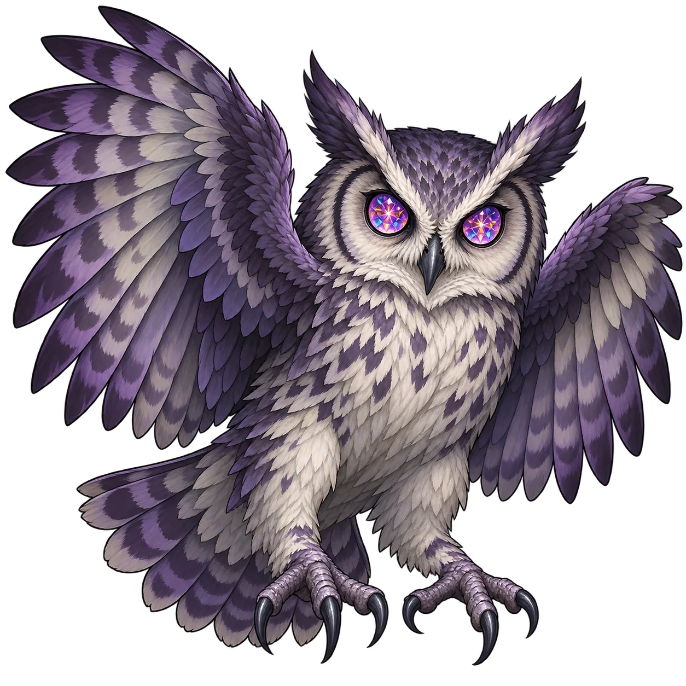

画像ID：monster_kaleidoscope_owl。実ファイル：[assets/images/monsters/kaleidoscope_owl.webp](../../assets/images/monsters/kaleidoscope_owl.webp)。
画像共有：他の敵定義との共有なし。

発想：フクロウ＋万華鏡。参照：M014。地域分類：鏡沈みの礼拝堂。

外見：紫灰の翼と幾何学的に光る二つの瞳。

習性：なし。

設計上の役割：光の術と翼の防御を交互に使う

基礎能力：HP 52 / MP 16 / STR 10 / VIT 7 / AGI 12 / INT 17。報酬：13G / 22EXP。
宝箱：青石の護符 1個 / 3.125％。
属性倍率：light 0.6 / physical 1.15。

行動と使用条件（AIの選択順）：

1. 防御 (guard)、MP0。優先度30、偶数ラウンド、対象は自身。次の自分の手番まで防御し、受けるダメージを50%にする。
2. 虹彩光線 (iris_ray)、MP4。優先度10、条件なし、対象は探索隊の生存者からランダムに1人。光ダメージ（目安28）。
3. 攻撃 (attack)、MP0。優先度0、条件なし、対象は探索隊の生存者からランダムに1人。物理ダメージ（目安5）。

遭遇と参照先：

千変の迷宮の通常遭遇：地下25〜44階、地下70〜100階。

wild_kaleidoscope_owl：万華鏡フクロウ×1。逃走可。
通常遭遇候補：鏡沈みの礼拝堂・地下1層 (region_4_f1)、重み40 / 鏡沈みの礼拝堂・地下2層 (region_4_f2)、重み35。

wild_pair_4：万華鏡フクロウ×1・硝子クラゲ×1。逃走可。
通常遭遇候補：鏡沈みの礼拝堂・地下2層 (region_4_f2)、重み10。

### 硝子クラゲ (glass_jellyfish)

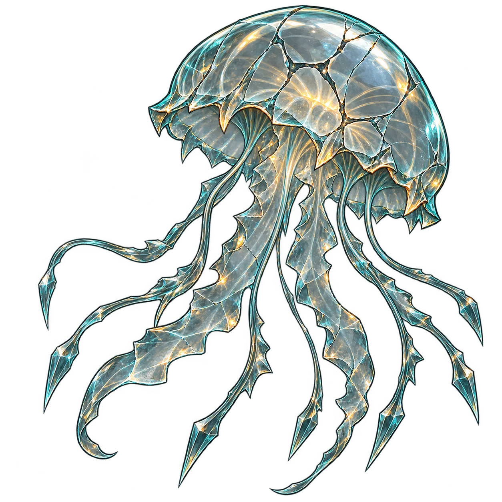

画像ID：monster_glass_jellyfish。実ファイル：[assets/images/monsters/glass_jellyfish.webp](../../assets/images/monsters/glass_jellyfish.webp)。
画像共有：他の敵定義との共有なし。

発想：クラゲ＋割れガラス。参照：M023。地域分類：鏡沈みの礼拝堂。

外見：亀裂の走る透明な傘と鋭い硝子の触手。

習性：なし。

設計上の役割：物理に強く炎に弱い硝子の刃

基礎能力：HP 58 / MP 9 / STR 13 / VIT 6 / AGI 6 / INT 14。報酬：13G / 22EXP。
宝箱：解毒薬 1個 / 12.5％。
属性倍率：physical 0.55 / fire 1.5。

行動と使用条件（AIの選択順）：

1. 硝子の刃 (glass_shards)、MP3。優先度10、条件なし、対象は探索隊の生存者からランダムに1人。物理ダメージ（目安12）。
2. 攻撃 (attack)、MP0。優先度0、条件なし、対象は探索隊の生存者からランダムに1人。物理ダメージ（目安8）。

遭遇と参照先：

wild_glass_jellyfish：硝子クラゲ×1。逃走可。
通常遭遇候補：鏡沈みの礼拝堂・地下1層 (region_4_f1)、重み40 / 鏡沈みの礼拝堂・地下2層 (region_4_f2)、重み35。

wild_pair_4：万華鏡フクロウ×1・硝子クラゲ×1。逃走可。
通常遭遇候補：鏡沈みの礼拝堂・地下2層 (region_4_f2)、重み10。

### 活字ヤマアラシ (type_porcupine)

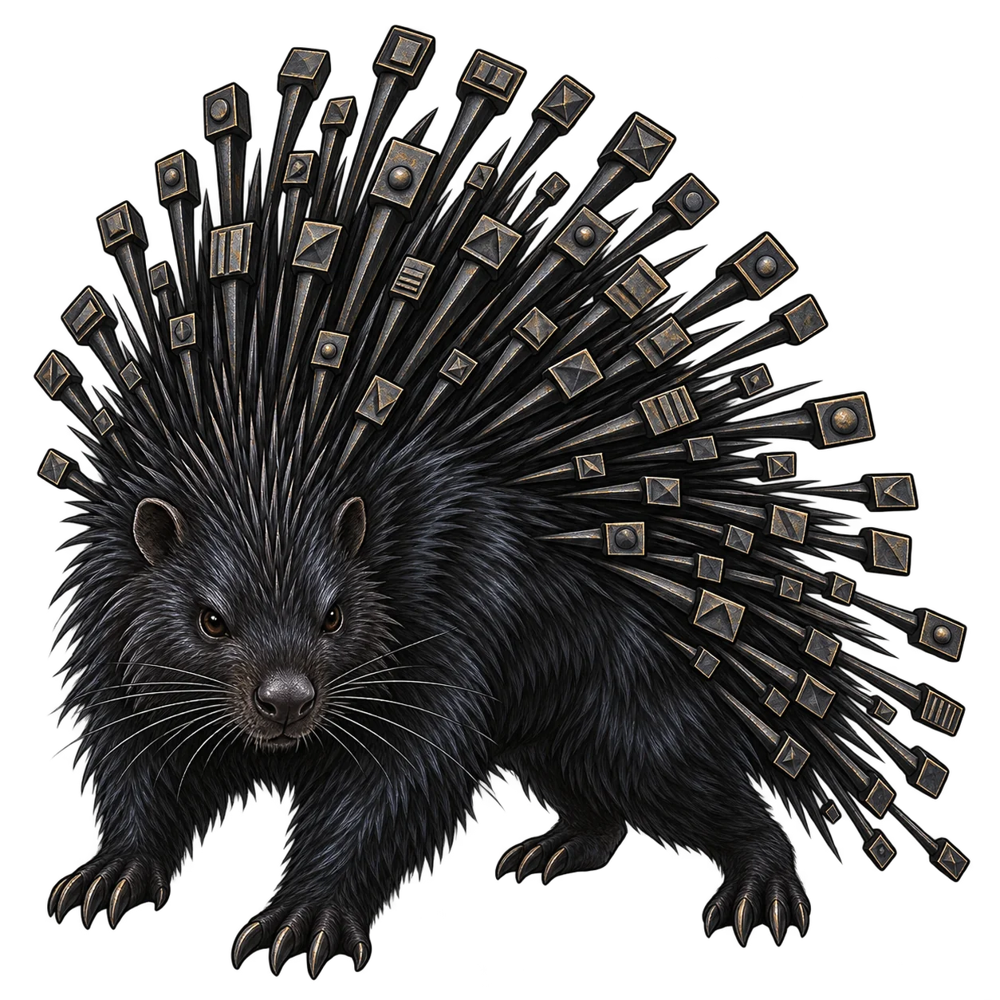

画像ID：monster_type_porcupine。実ファイル：[assets/images/monsters/type_porcupine.webp](../../assets/images/monsters/type_porcupine.webp)。
画像共有：他の敵定義との共有なし。

発想：ヤマアラシ＋活字。参照：M011。地域分類：灰時計の書庫。

外見：針先に活字の角面、黒鉄の針と墨色の毛。

習性：なし。

設計上の役割：活字の針を飛ばす硬い物理役

基礎能力：HP 63 / MP 9 / STR 18 / VIT 12 / AGI 7 / INT 8。報酬：15G / 25EXP。
宝箱：予備灯油 1個 / 12.5％。
属性倍率：physical 0.8 / fire 1.2。

行動と使用条件（AIの選択順）：

1. 活字の針 (type_needles)、MP3。優先度10、条件なし、対象は探索隊の生存者からランダムに1人。投射攻撃。物理ダメージ（目安20）。
2. 攻撃 (attack)、MP0。優先度0、条件なし、対象は探索隊の生存者からランダムに1人。物理ダメージ（目安13）。

遭遇と参照先：

wild_type_porcupine：活字ヤマアラシ×1。逃走可。
通常遭遇候補：灰時計の書庫・地下1層 (region_5_f1)、重み40 / 灰時計の書庫・地下2層 (region_5_f2)、重み35。

wild_pair_5：活字ヤマアラシ×1・書庫シミ×1。逃走可。
通常遭遇候補：灰時計の書庫・地下2層 (region_5_f2)、重み10。

### 書庫シミ (book_silverfish)

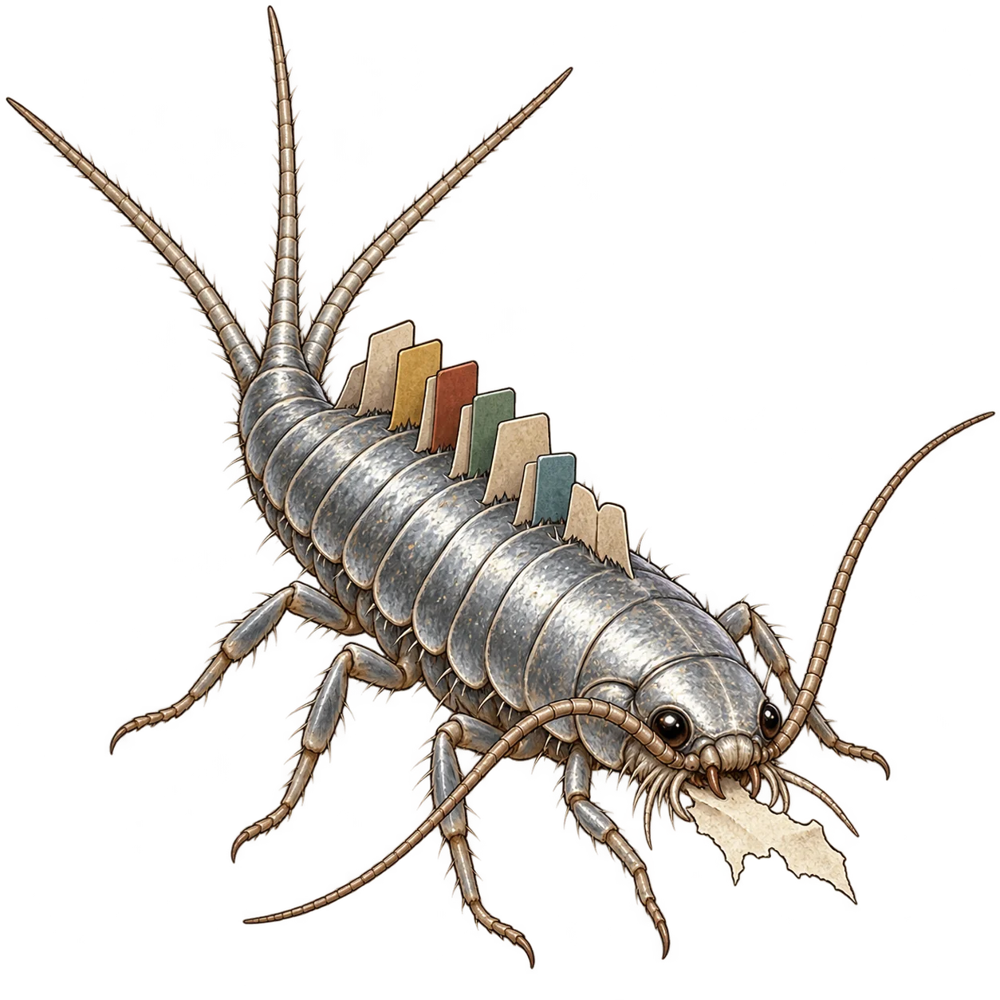

画像ID：monster_book_silverfish。実ファイル：[assets/images/monsters/book_silverfish.webp](../../assets/images/monsters/book_silverfish.webp)。
画像共有：他の敵定義との共有なし。

発想：紙を食べる虫＋書庫の索引。参照：M046。地域分類：灰時計の書庫。

外見：銀色の節と栞の背びれ、紙の薄片をかじる口。

習性：なし。

設計上の役割：墨の魔力を食べてMPを削る

基礎能力：HP 48 / MP 8 / STR 13 / VIT 6 / AGI 14 / INT 15。報酬：15G / 25EXP。
宝箱：静謐苔の胞子 1個 / 12.5％。
属性倍率：physical 1 / fire 1.4。

行動と使用条件（AIの選択順）：

1. 墨すすり (ink_sip)、MP2。優先度10、奇数ラウンド、対象は探索隊の生存者からランダムに1人。残りMPを最大4減らす。
2. 攻撃 (attack)、MP0。優先度0、条件なし、対象は探索隊の生存者からランダムに1人。物理ダメージ（目安8）。

遭遇と参照先：

wild_book_silverfish：書庫シミ×1。逃走可。
通常遭遇候補：灰時計の書庫・地下1層 (region_5_f1)、重み40 / 灰時計の書庫・地下2層 (region_5_f2)、重み35。

wild_pair_5：活字ヤマアラシ×1・書庫シミ×1。逃走可。
通常遭遇候補：灰時計の書庫・地下2層 (region_5_f2)、重み10。

### 金庫ネズミ (vault_mouse)

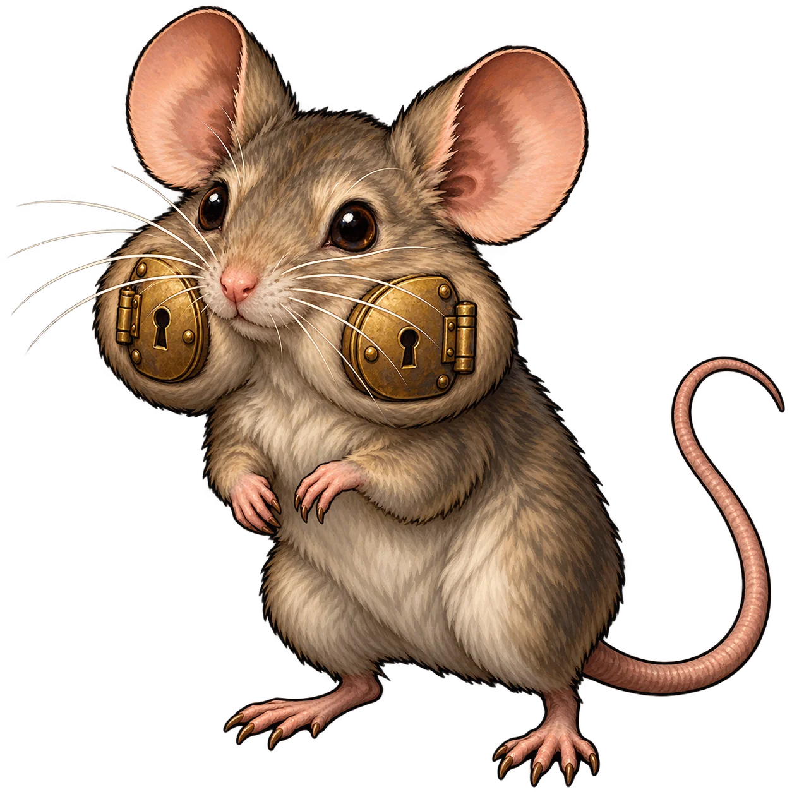

画像ID：monster_vault_mouse。実ファイル：[assets/images/monsters/vault_mouse.webp](../../assets/images/monsters/vault_mouse.webp)。
画像共有：油染みの煤ネズミ。

発想：ネズミ＋金庫。参照：M013。地域分類：眠れる地下市場。

外見：両頬に真鍮の小さな金庫扉と鍵穴。

習性：なし。

設計上の役割：頬の金庫を閉じて耐える

基礎能力：HP 67 / MP 0 / STR 16 / VIT 17 / AGI 12 / INT 7。報酬：17G / 28EXP。
宝箱：鉄の剣 1個 / 3.125％。
属性倍率：physical 0.7 / lightning 1.35。

行動と使用条件（AIの選択順）：

1. 防御 (guard)、MP0。優先度30、第1ラウンド、対象は自身。次の自分の手番まで防御し、受けるダメージを50%にする。
2. 金庫の歯 (vault_bite)、MP0。優先度10、条件なし、対象は探索隊の生存者からランダムに1人。物理ダメージ（目安11）。
3. 攻撃 (attack)、MP0。優先度0、条件なし、対象は探索隊の生存者からランダムに1人。物理ダメージ（目安11）。

遭遇と参照先：

wild_vault_mouse：金庫ネズミ×1。逃走可。
通常遭遇候補：眠れる地下市場・地下1層 (region_6_f1)、重み40 / 眠れる地下市場・地下2層 (region_6_f2)、重み35。

wild_pair_6：金庫ネズミ×1・裁縫ミノムシ×1。逃走可。
通常遭遇候補：眠れる地下市場・地下2層 (region_6_f2)、重み10。

### 裁縫ミノムシ (patchwork_bagworm)

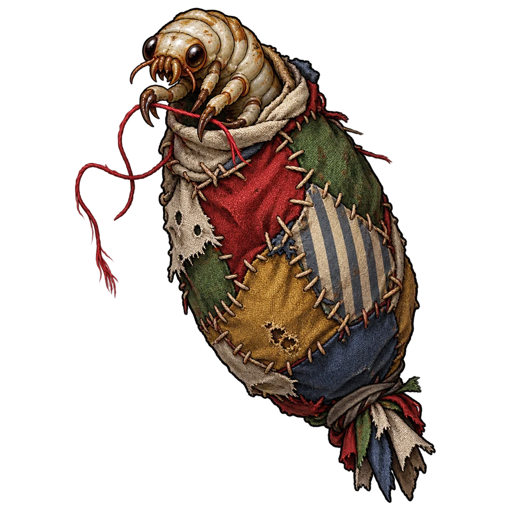

画像ID：monster_patchwork_bagworm。実ファイル：[assets/images/monsters/patchwork_bagworm.webp](../../assets/images/monsters/patchwork_bagworm.webp)。
画像共有：他の敵定義との共有なし。

発想：ミノムシ＋裁縫。参照：M049。地域分類：眠れる地下市場。

外見：色の違う布を縫った袋、糸をつかむ短い脚。

習性：なし。

設計上の役割：傷つくと袋を縫い直して回復する

基礎能力：HP 83 / MP 12 / STR 14 / VIT 12 / AGI 5 / INT 15。報酬：17G / 28EXP。
宝箱：柔らかな植物繊維 1個 / 25％。
属性倍率：physical 0.85 / fire 1.4。

行動と使用条件（AIの選択順）：

1. 縫い直し (stitch_mend)、MP4。優先度30、自身のHPが55％未満、対象は自身。HPを回復（基礎回復量35、最大HPまで）。
2. 攻撃 (attack)、MP0。優先度0、条件なし、対象は探索隊の生存者からランダムに1人。物理ダメージ（目安9）。

遭遇と参照先：

wild_patchwork_bagworm：裁縫ミノムシ×1。逃走可。
通常遭遇候補：眠れる地下市場・地下1層 (region_6_f1)、重み40 / 眠れる地下市場・地下2層 (region_6_f2)、重み35。

wild_pair_6：金庫ネズミ×1・裁縫ミノムシ×1。逃走可。
通常遭遇候補：眠れる地下市場・地下2層 (region_6_f2)、重み10。

### 骨くじら (bone_whale)

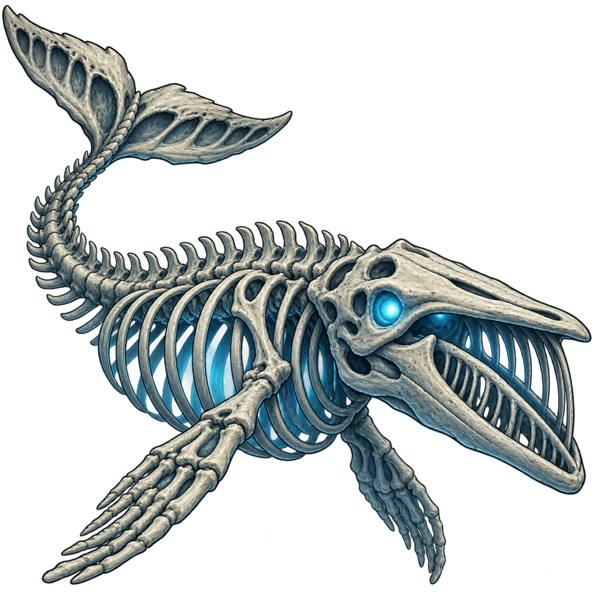

画像ID：monster_bone_whale。実ファイル：[assets/images/monsters/bone_whale.webp](../../assets/images/monsters/bone_whale.webp)。
画像共有：他の敵定義との共有なし。

発想：クジラ＋骨格。参照：M001。地域分類：黒潮の沈没城。

外見：空洞の巨大な肋骨と尾びれ。青白く光る眼窩。

習性：なし。

設計上の役割：骨片を隊全体へ撒く大型の敵

基礎能力：HP 112 / MP 12 / STR 18 / VIT 10 / AGI 4 / INT 12。報酬：19G / 31EXP。
宝箱：野営糧食 1個 / 12.5％。
属性倍率：physical 0.85 / light 1.3。

行動と使用条件（AIの選択順）：

1. 肋骨の雨 (bone_rain)、MP4。優先度10、条件なし、対象は探索隊の生存者全員。投射攻撃。物理ダメージ（目安4）。
2. 攻撃 (attack)、MP0。優先度0、条件なし、対象は探索隊の生存者からランダムに1人。物理ダメージ（目安13）。

遭遇と参照先：

wild_bone_whale：骨くじら×1。逃走可。
通常遭遇候補：黒潮の沈没城・地下1層 (region_7_f1)、重み40 / 黒潮の沈没城・地下2層 (region_7_f2)、重み35。

wild_pair_7：骨くじら×1・碇イカ×1。逃走可。
通常遭遇候補：黒潮の沈没城・地下2層 (region_7_f2)、重み10。

### 碇イカ (anchor_squid)

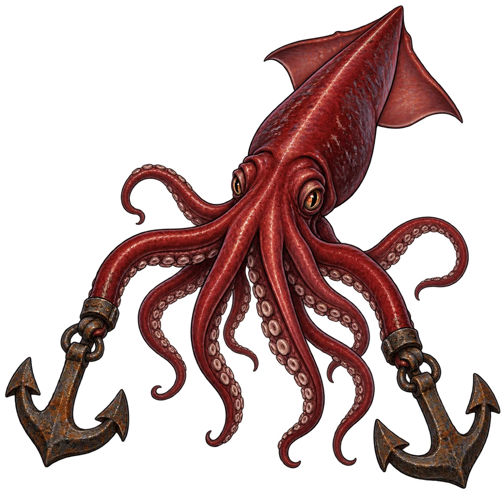

画像ID：monster_anchor_squid。実ファイル：[assets/images/monsters/anchor_squid.webp](../../assets/images/monsters/anchor_squid.webp)。
画像共有：他の敵定義との共有なし。

発想：イカ＋錨。参照：M028。地域分類：黒潮の沈没城。

外見：二本の腕の先が錆びた錨、深紅の胴と垂れる触腕。

習性：なし。

設計上の役割：錨腕の強打と固定姿勢の防御

基礎能力：HP 98 / MP 9 / STR 22 / VIT 12 / AGI 5 / INT 8。報酬：19G / 31EXP。
宝箱：補修用の縄 1個 / 12.5％。
属性倍率：water 0.6 / lightning 1.4。

行動と使用条件（AIの選択順）：

1. 防御 (guard)、MP0。優先度30、偶数ラウンド、対象は自身。次の自分の手番まで防御し、受けるダメージを50%にする。
2. 碇打ち (anchor_strike)、MP3。優先度10、条件なし、対象は探索隊の生存者からランダムに1人。物理ダメージ（目安27）。
3. 攻撃 (attack)、MP0。優先度0、条件なし、対象は探索隊の生存者からランダムに1人。物理ダメージ（目安17）。

遭遇と参照先：

wild_anchor_squid：碇イカ×1。逃走可。
通常遭遇候補：黒潮の沈没城・地下1層 (region_7_f1)、重み40 / 黒潮の沈没城・地下2層 (region_7_f2)、重み35。

wild_pair_7：骨くじら×1・碇イカ×1。逃走可。
通常遭遇候補：黒潮の沈没城・地下2層 (region_7_f2)、重み10。

### 蓄電ヤドカリ (battery_hermit)

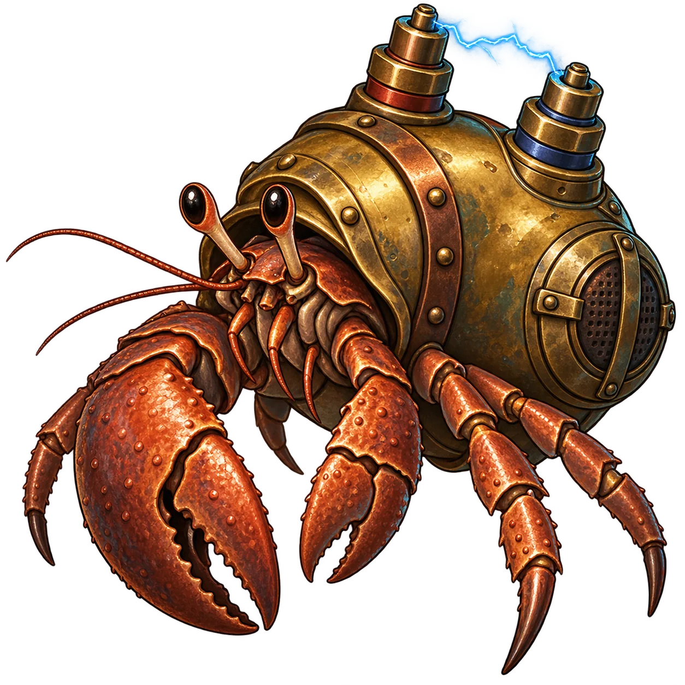

画像ID：monster_battery_hermit。実ファイル：[assets/images/monsters/battery_hermit.webp](../../assets/images/monsters/battery_hermit.webp)。
画像共有：他の敵定義との共有なし。

発想：ヤドカリ＋蓄電器。参照：M039。地域分類：鉄胎の機関廟。

外見：真鍮の殻に二本の電極、青い火花と銅の脚。

習性：なし。

設計上の役割：雷に耐え、放電の後は殻にこもる

基礎能力：HP 98 / MP 16 / STR 18 / VIT 14 / AGI 6 / INT 20。報酬：21G / 34EXP。
宝箱：機関部品 1個 / 12.5％。
属性倍率：lightning 0.4 / ice 1.3。

行動と使用条件（AIの選択順）：

1. 防御 (guard)、MP0。優先度30、偶数ラウンド、対象は自身。次の自分の手番まで防御し、受けるダメージを50%にする。
2. 殻の放電 (discharge)、MP4。優先度10、条件なし、対象は探索隊の生存者からランダムに1人。雷ダメージ（目安33）。
3. 攻撃 (attack)、MP0。優先度0、条件なし、対象は探索隊の生存者からランダムに1人。物理ダメージ（目安13）。

遭遇と参照先：

千変の迷宮の通常遭遇：地下11〜24階、地下70〜100階。

wild_battery_hermit：蓄電ヤドカリ×1。逃走可。
通常遭遇候補：鉄胎の機関廟・地下1層 (region_8_f1)、重み40 / 鉄胎の機関廟・地下2層 (region_8_f2)、重み35。

wild_pair_8：蓄電ヤドカリ×1・脱線ムカデ×1。逃走可。
通常遭遇候補：鉄胎の機関廟・地下2層 (region_8_f2)、重み10。

### 脱線ムカデ (derail_centipede)

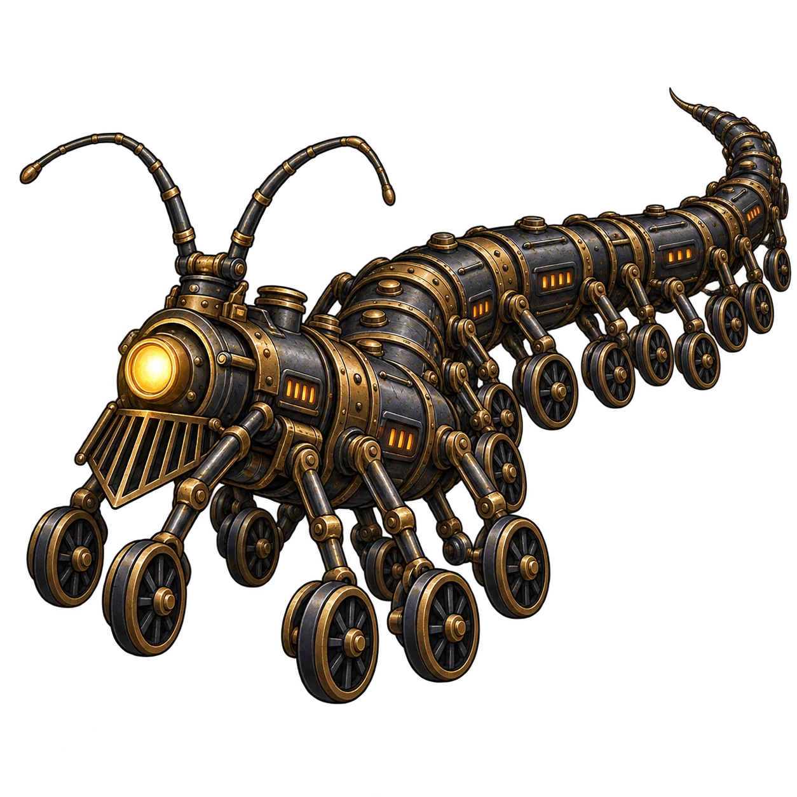

画像ID：monster_derail_centipede。実ファイル：[assets/images/monsters/derail_centipede.webp](../../assets/images/monsters/derail_centipede.webp)。
画像共有：他の敵定義との共有なし。

発想：ムカデ＋列車。参照：M052。地域分類：鉄胎の機関廟。

外見：車輪の脚が並ぶ鉄の節、先頭に小さな前照灯。

習性：なし。

設計上の役割：突進の次の手番は姿勢を立て直す

基礎能力：HP 107 / MP 12 / STR 25 / VIT 10 / AGI 14 / INT 6。報酬：21G / 34EXP。
宝箱：機関部品 1個 / 12.5％。
属性倍率：physical 0.85 / lightning 1.3。

行動と使用条件（AIの選択順）：

1. 姿勢を立て直す (recover_stance)、MP0。優先度30、偶数ラウンド、対象は自身。突進後の息継ぎで、この手番は休む。
2. 列車突進 (rail_charge)、MP4。優先度10、条件なし、対象は探索隊の生存者からランダムに1人。物理ダメージ（目安32）。
3. 攻撃 (attack)、MP0。優先度0、条件なし、対象は探索隊の生存者からランダムに1人。物理ダメージ（目安20）。

遭遇と参照先：

wild_derail_centipede：脱線ムカデ×1。逃走可。
通常遭遇候補：鉄胎の機関廟・地下1層 (region_8_f1)、重み40 / 鉄胎の機関廟・地下2層 (region_8_f2)、重み35。

wild_pair_8：蓄電ヤドカリ×1・脱線ムカデ×1。逃走可。
通常遭遇候補：鉄胎の機関廟・地下2層 (region_8_f2)、重み10。

### 虹彩チョウ (iris_butterfly)

画像ID：monster_iris_butterfly。実ファイル：[assets/images/monsters/iris_butterfly.webp](../../assets/images/monsters/iris_butterfly.webp)。
画像共有：他の敵定義との共有なし。

発想：チョウ＋虹彩絞り。参照：M050。地域分類：星欠けの地下観測所。

外見：翅の大きな目玉模様が絞り羽根になっている。

習性：なし。

設計上の役割：光線を絞って撃つ脆い魔術役

基礎能力：HP 87 / MP 20 / STR 13 / VIT 7 / AGI 17 / INT 25。報酬：23G / 37EXP。
宝箱：静謐苔の胞子 1個 / 12.5％。
属性倍率：light 0.6 / physical 1.2。

行動と使用条件（AIの選択順）：

1. 虹彩光線 (iris_ray)、MP4。優先度10、条件なし、対象は探索隊の生存者からランダムに1人。光ダメージ（目安41）。
2. 攻撃 (attack)、MP0。優先度0、条件なし、対象は探索隊の生存者からランダムに1人。物理ダメージ（目安8）。

遭遇と参照先：

千変の迷宮の通常遭遇：地下6〜10階。

wild_iris_butterfly：虹彩チョウ×1。逃走可。
通常遭遇候補：星欠けの地下観測所・地下1層 (region_9_f1)、重み40 / 星欠けの地下観測所・地下2層 (region_9_f2)、重み35。

wild_pair_9：虹彩チョウ×1・羅針盤カササギ×1。逃走可。
通常遭遇候補：星欠けの地下観測所・地下2層 (region_9_f2)、重み10。

### 羅針盤カササギ (compass_magpie)

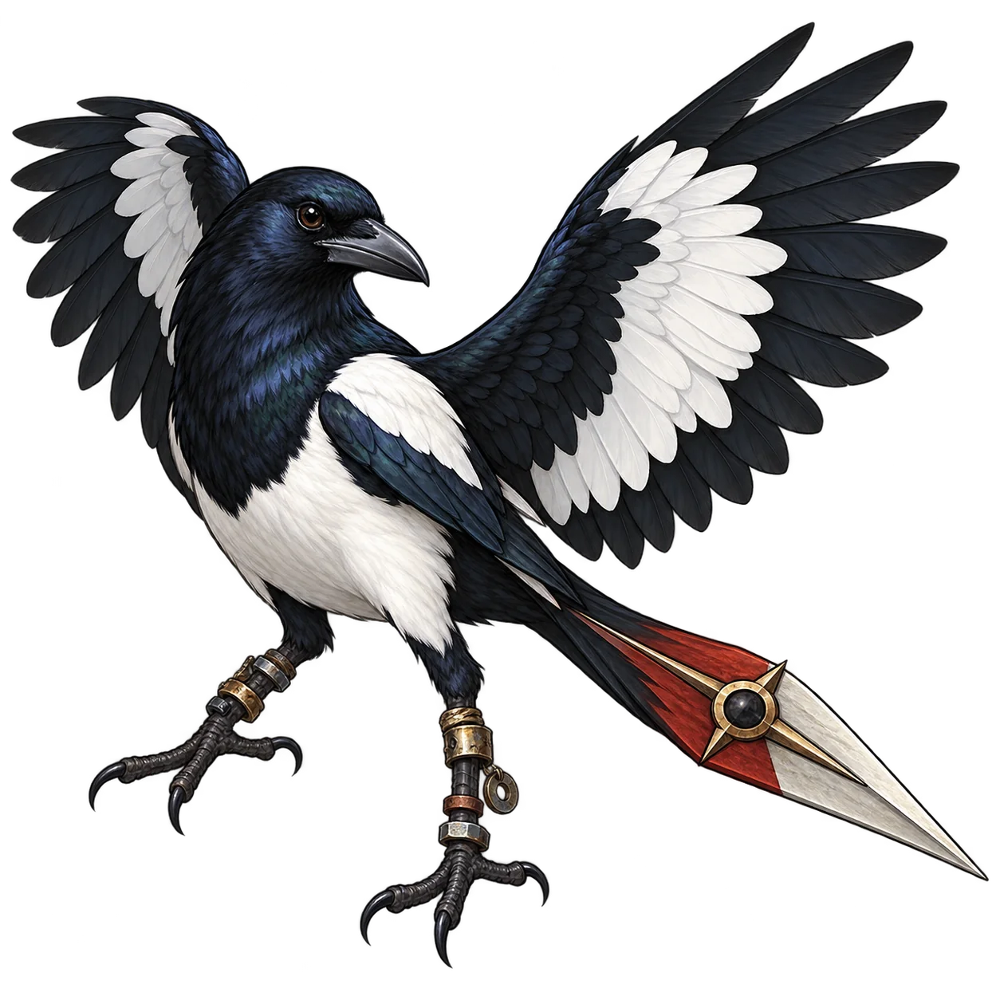

画像ID：monster_compass_magpie。実ファイル：[assets/images/monsters/compass_magpie.webp](../../assets/images/monsters/compass_magpie.webp)。
画像共有：他の敵定義との共有なし。

発想：カササギ＋方位磁針。参照：M015。地域分類：星欠けの地下観測所。

外見：黒白の翼、方位磁針のような尾、集めた金属の足輪。

習性：なし。

設計上の役割：尾針で守りの薄い相手を狙う

基礎能力：HP 98 / MP 12 / STR 24 / VIT 10 / AGI 19 / INT 12。報酬：23G / 37EXP。
宝箱：青石の護符 1個 / 3.125％。
属性倍率：physical 1 / lightning 1.3。

行動と使用条件（AIの選択順）：

1. 尾針突き (needle_lunge)、MP4。優先度10、条件なし、対象は探索隊で現在HPの実数が最も低い1人。物理ダメージ（目安27）。
2. 攻撃 (attack)、MP0。優先度0、条件なし、対象は探索隊の生存者からランダムに1人。物理ダメージ（目安19）。

遭遇と参照先：

wild_compass_magpie：羅針盤カササギ×1。逃走可。
通常遭遇候補：星欠けの地下観測所・地下1層 (region_9_f1)、重み40 / 星欠けの地下観測所・地下2層 (region_9_f2)、重み35。

wild_pair_9：虹彩チョウ×1・羅針盤カササギ×1。逃走可。
通常遭遇候補：星欠けの地下観測所・地下2層 (region_9_f2)、重み10。

### 月輪オオカミ (moon_wolf)

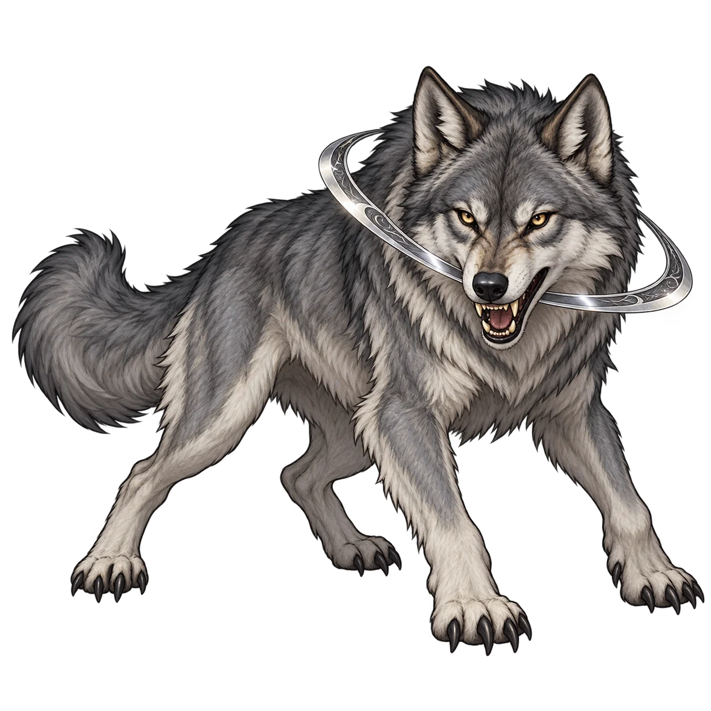

画像ID：monster_moon_wolf。実ファイル：[assets/images/monsters/moon_wolf.webp](../../assets/images/monsters/moon_wolf.webp)。
画像共有：荒野狼・鏡牙獣。

発想：オオカミ＋環状の刃。参照：M012。地域分類：帰還者の深淵。

外見：灰色の狼の首に浮く細い銀の輪。

習性：なし。

設計上の役割：月輪で隊全体を浅く切り、牙で追う

基礎能力：HP 117 / MP 12 / STR 26 / VIT 12 / AGI 17 / INT 10。報酬：25G / 40EXP。
宝箱：野営糧食 1個 / 12.5％。
属性倍率：physical 0.9 / fire 1.25。

行動と使用条件（AIの選択順）：

1. 月輪払い (moon_sweep)、MP4。優先度10、条件なし、対象は探索隊の生存者全員。物理ダメージ（目安9）。
2. 攻撃 (attack)、MP0。優先度0、条件なし、対象は探索隊の生存者からランダムに1人。物理ダメージ（目安21）。

遭遇と参照先：

千変の迷宮の通常遭遇：地下70〜100階。

wild_moon_wolf：月輪オオカミ×1。逃走可。
通常遭遇候補：帰還者の深淵・地下1層 (region_10_f1)、重み40 / 帰還者の深淵・地下2層 (region_10_f2)、重み35 / 祈りの届かない谷 (prayerless_valley_f1)、重み40 / 巨獣上の移動集落 (moving_village_f1)、重み40。

wild_pair_10：月輪オオカミ×1・ジャックナイフ×1。逃走可。
通常遭遇候補：帰還者の深淵・地下2層 (region_10_f2)、重み10。

### ジャックナイフ (jackknife)

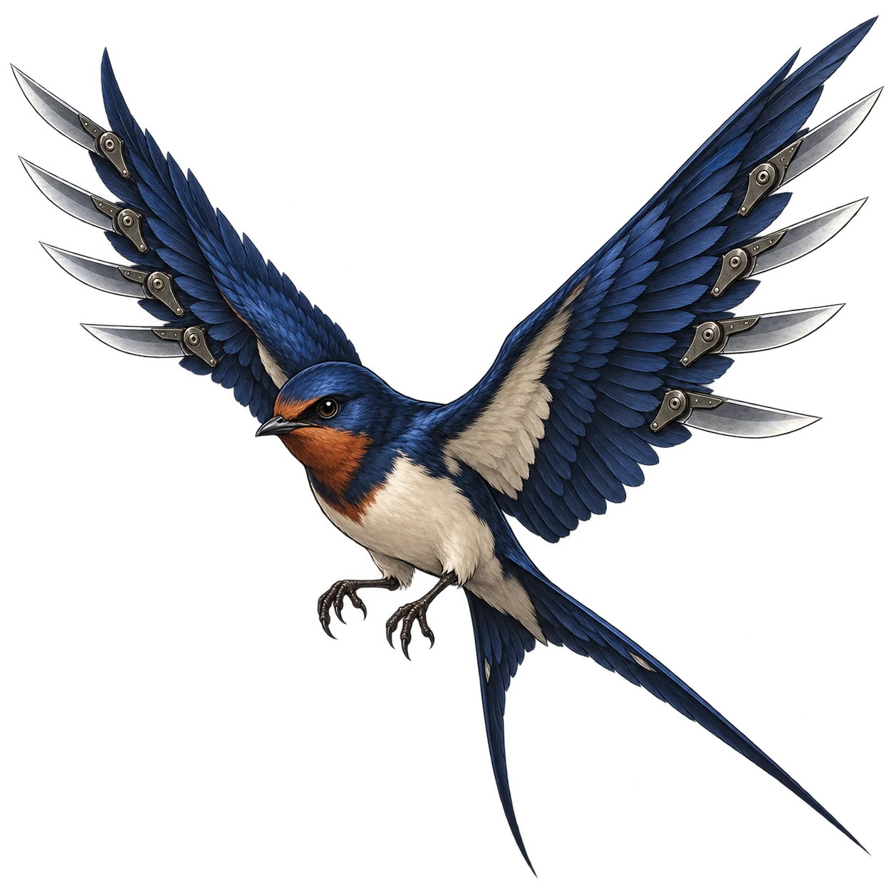

画像ID：monster_jackknife。実ファイル：[assets/images/monsters/jackknife.webp](../../assets/images/monsters/jackknife.webp)。
画像共有：他の敵定義との共有なし。

発想：ツバメ＋折り畳みナイフ。参照：M017。地域分類：帰還者の深淵。

外見：燕尾と紺の羽、翼の縁に開いた小さな銀刃。

習性：なし。

設計上の役割：高速の単体斬撃。火力と薄い装甲

基礎能力：HP 93 / MP 12 / STR 28 / VIT 8 / AGI 22 / INT 8。報酬：25G / 40EXP。
宝箱：鋼の短剣 1個 / 3.125％。
属性倍率：physical 1.15 / ice 1.35。

行動と使用条件（AIの選択順）：

1. すれ違い斬り (blade_pass)、MP3。優先度10、条件なし、対象は探索隊の生存者からランダムに1人。物理ダメージ（目安37）。
2. 攻撃 (attack)、MP0。優先度0、条件なし、対象は探索隊の生存者からランダムに1人。物理ダメージ（目安23）。

遭遇と参照先：

wild_jackknife：ジャックナイフ×1。逃走可。
通常遭遇候補：帰還者の深淵・地下1層 (region_10_f1)、重み40 / 帰還者の深淵・地下2層 (region_10_f2)、重み35 / 祈りの届かない谷 (prayerless_valley_f1)、重み40 / 巨獣上の移動集落 (moving_village_f1)、重み40。

wild_pair_10：月輪オオカミ×1・ジャックナイフ×1。逃走可。
通常遭遇候補：帰還者の深淵・地下2層 (region_10_f2)、重み10。

### 蜜蝋ランプバチ (garden_nectar_bee)

画像ID：monster_candle_bee。実ファイル：[assets/images/monsters/candle_bee.webp](../../assets/images/monsters/candle_bee.webp)。
画像共有：他の敵定義との共有なし。

発想：ハチ＋蝋燭。参照：M042。地域分類：根喰みの地下庭園。

外見：蜜蝋の腹と小さな琥珀の火。薄い羽と黒い脚。

習性：なし。

設計上の役割：灯った蜜蝋を飛ばす高速の炎術役

基礎能力：HP 120 / MP 30 / STR 15 / VIT 9 / AGI 17 / INT 22。報酬：20G / 80EXP。
宝箱：予備灯油 1個 / 12.5％。
属性倍率：fire 0.65 / ice 1.4。

行動と使用条件（AIの選択順）：

1. 蜜蝋の火 (wax_flame)、MP4。優先度10、条件なし、対象は探索隊の生存者からランダムに1人。炎ダメージ（目安36）。
2. 攻撃 (attack)、MP0。優先度0、条件なし、対象は探索隊の生存者からランダムに1人。物理ダメージ（目安10）。

遭遇と参照先：

garden_root_guardian：大剪定虫×1・殻甲アルマジロ×1。逃走可。
有限増援予定：蜜蝋ランプバチ（最短3巡、enemy_1撃破後、enemy_0生存中）。初期配置には含めません。
戦闘開始命令：1スクリプト。garden.root_gate.10。全配置の照合は[イベント一覧](../scenarios/EVENT_CATALOG.md)を参照してください。

### 苔虫 (moss_beetle)

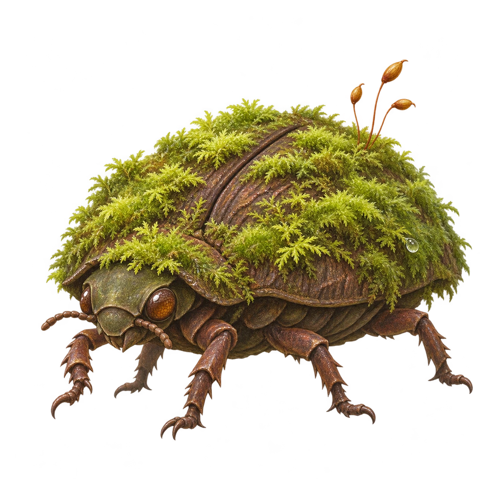

画像ID：monster_moss_beetle。実ファイル：[assets/images/monsters/moss_beetle.webp](../../assets/images/monsters/moss_beetle.webp)。
画像共有：他の敵定義との共有なし。

外見：丸い上翅に苔が二山に分かれて茂り、その間に褐色の継ぎ目が走っています。

習性：なし。

設計上の役割：六本の脚で身を押し出し、硬い殻で体当たりします。

基礎能力：HP 17 / MP 0 / STR 8 / VIT 4 / AGI 5 / INT 4。報酬：6G / 32EXP。
宝箱：薬効葉 1個 / 12.5％。
属性倍率：physical 1 / fire 1.25。

行動と使用条件（AIの選択順）：

1. 殻の体当たり (shell_roll)、MP0。優先度10、条件なし、対象は探索隊の生存者からランダムに1人。物理ダメージ（目安3）。
2. 攻撃 (attack)、MP0。優先度0、条件なし、対象は探索隊の生存者からランダムに1人。物理ダメージ（目安3）。

遭遇と参照先：

千変の迷宮の通常遭遇：地下1〜10階。

### 戦車ビーバー (tank_beaver)

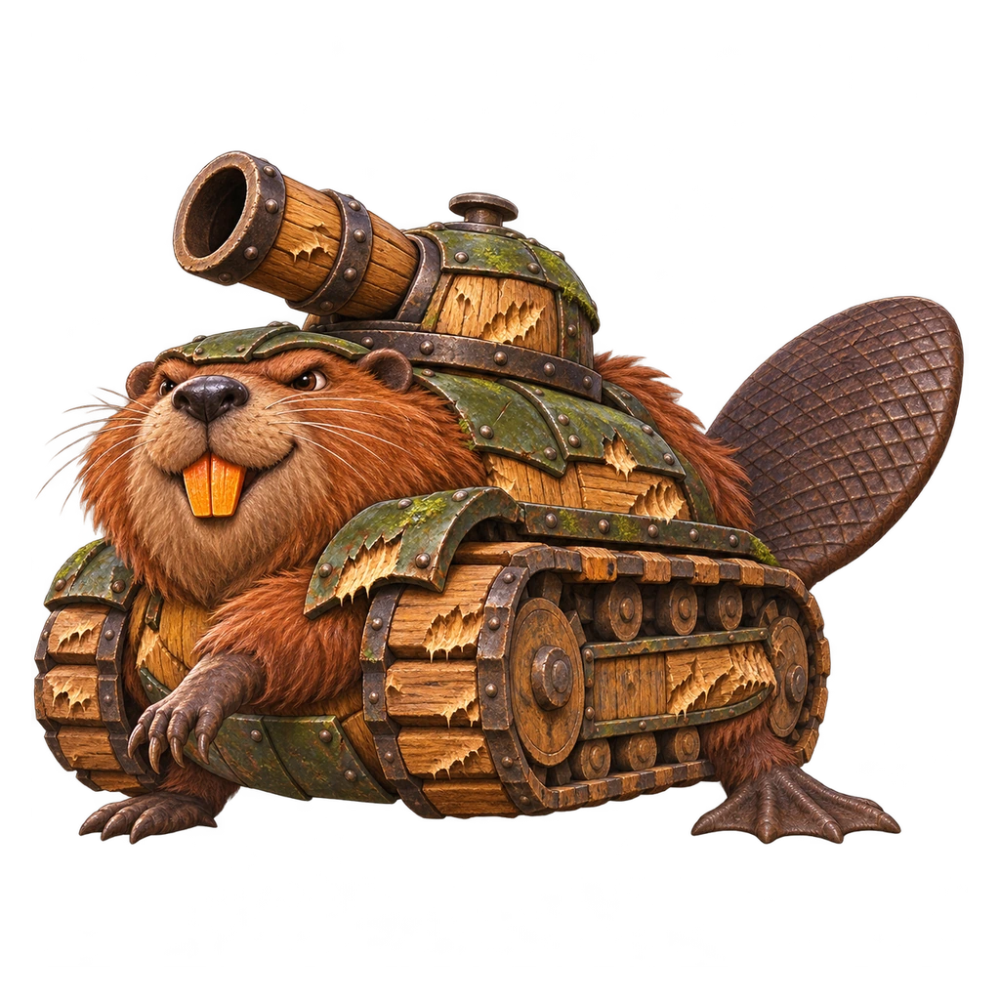

画像ID：monster_tank_beaver。実ファイル：[assets/images/monsters/tank_beaver.webp](../../assets/images/monsters/tank_beaver.webp)。
画像共有：他の敵定義との共有なし。

外見：前歯の跡が残る木製の砲塔と履帯を背負い、後ろへ平たい尾を張り出しています。

習性：なし。

設計上の役割：偶数ラウンドに丸太砲で敵1体を狙います。木の装甲は物理に強く、火に弱いです。

基礎能力：HP 69 / MP 4 / STR 12 / VIT 14 / AGI 5 / INT 8。報酬：6G / 32EXP。
宝箱：機関部品 1個 / 12.5％。
属性倍率：physical 0.85 / fire 1.25。

行動と使用条件（AIの選択順）：

1. 丸太砲 (beaver_log_shot)、MP2。優先度20、偶数ラウンド、対象は探索隊の生存者からランダムに1人。投射攻撃。物理ダメージ（目安10）。
2. 攻撃 (attack)、MP0。優先度0、条件なし、対象は探索隊の生存者からランダムに1人。物理ダメージ（目安7）。

遭遇と参照先：

千変の迷宮の通常遭遇：地下6〜24階。

### ゴブリン投石手 (goblin_5_slinger)

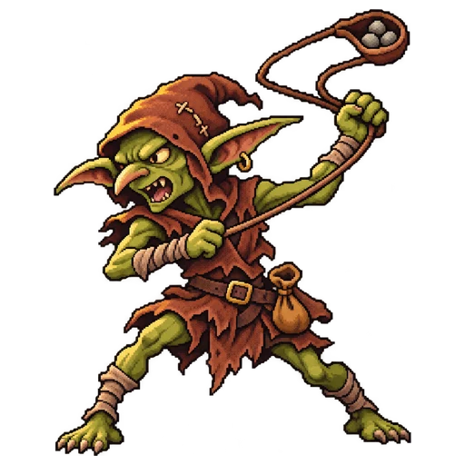

画像ID：monster_goblin_5_slinger。実ファイル：[assets/images/monsters/families/goblin_5_slinger.webp](../../assets/images/monsters/families/goblin_5_slinger.webp)。
画像共有：他の敵定義との共有なし。

レベル帯：Lv5　種名：ゴブリン。[種別図鑑で開く](https://tomtomyoung.github.io/adv/labyrinth-guide.html#monsters/goblin/goblin_5_slinger)。

習性：なし。

設計上の役割：味方越しに後列を優先して投石します。

基礎能力：HP 53 / MP 3 / STR 13 / VIT 6 / AGI 8 / INT 7。報酬：4G / 32EXP。
宝箱：薬効葉 1個 / 12.5％。
属性倍率：すべて既定値。

行動と使用条件（AIの選択順）：

1. 飛礫 (family_goblin_5_slinger)、MP0。味方越しに後列を優先して投石します。 投射攻撃。物理ダメージ（目安8）。
2. 攻撃 (attack)、MP0。優先度0、条件なし、対象は探索隊の生存者からランダムに1人。物理ダメージ（目安8）。

遭遇と参照先：

千変の迷宮の通常遭遇：地下5〜6階。

### ゴブリン罠師 (goblin_5_trapper)

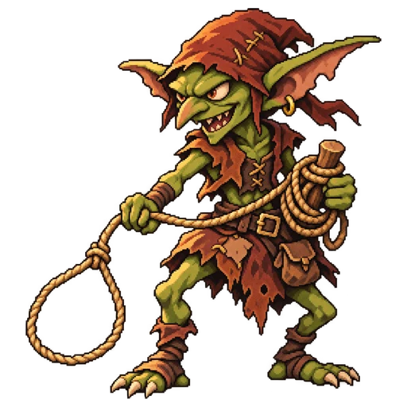

画像ID：monster_goblin_5_trapper。実ファイル：[assets/images/monsters/families/goblin_5_trapper.webp](../../assets/images/monsters/families/goblin_5_trapper.webp)。
画像共有：他の敵定義との共有なし。

レベル帯：Lv5　種名：ゴブリン。[種別図鑑で開く](https://tomtomyoung.github.io/adv/labyrinth-guide.html#monsters/goblin/goblin_5_trapper)。

習性：なし。

設計上の役割：縄で相手一人の移動を封じます。

基礎能力：HP 53 / MP 3 / STR 13 / VIT 6 / AGI 8 / INT 7。報酬：4G / 32EXP。
宝箱：薬効葉 1個 / 12.5％。
属性倍率：すべて既定値。

行動と使用条件（AIの選択順）：

1. 足くくり (family_goblin_5_trapper)、MP0。縄で相手一人の移動を封じます。 根留めを付与（自発移動と次のFrontline自動前進を阻止 / Classic命中率−10ポイント / 持続 1ターン）。
2. 攻撃 (attack)、MP0。優先度0、条件なし、対象は探索隊の生存者からランダムに1人。物理ダメージ（目安8）。

遭遇と参照先：

千変の迷宮の通常遭遇：地下5〜6階。

### ゴブリン短剣士 (goblin_5_dagger)

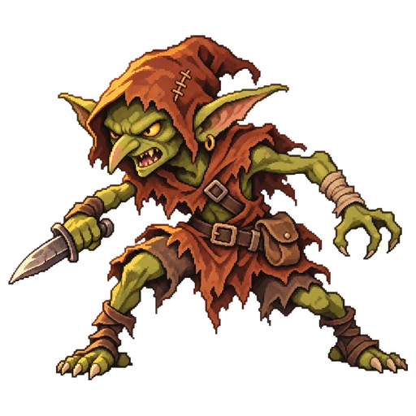

画像ID：monster_goblin_5_dagger。実ファイル：[assets/images/monsters/families/goblin_5_dagger.webp](../../assets/images/monsters/families/goblin_5_dagger.webp)。
画像共有：他の敵定義との共有なし。

レベル帯：Lv5　種名：ゴブリン。[種別図鑑で開く](https://tomtomyoung.github.io/adv/labyrinth-guide.html#monsters/goblin/goblin_5_dagger)。

習性：なし。

設計上の役割：仲間が直前に傷を負わせた相手へ短剣で追撃します。

基礎能力：HP 53 / MP 3 / STR 13 / VIT 6 / AGI 8 / INT 7。報酬：4G / 32EXP。
宝箱：薬効葉 1個 / 12.5％。
属性倍率：すべて既定値。

行動と使用条件（AIの選択順）：

1. 追い刃 (family_goblin_5_dagger)、MP0。仲間が直前に傷を負わせた相手へ短剣で追撃します。 物理ダメージ（目安8）。
2. 攻撃 (attack)、MP0。優先度0、条件なし、対象は探索隊の生存者からランダムに1人。物理ダメージ（目安8）。

遭遇と参照先：

千変の迷宮の通常遭遇：地下5〜6階。

### ゴブリン薬草師 (goblin_5_herbalist)

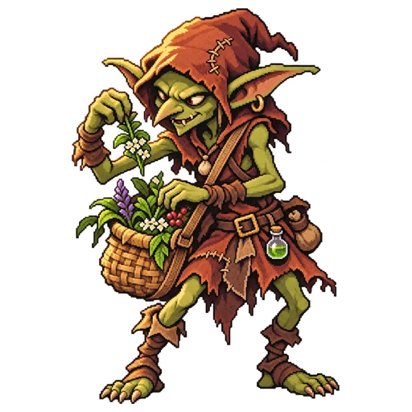

画像ID：monster_goblin_5_herbalist。実ファイル：[assets/images/monsters/families/goblin_5_herbalist.webp](../../assets/images/monsters/families/goblin_5_herbalist.webp)。
画像共有：他の敵定義との共有なし。

レベル帯：Lv5　種名：ゴブリン。[種別図鑑で開く](https://tomtomyoung.github.io/adv/labyrinth-guide.html#monsters/goblin/goblin_5_herbalist)。

習性：なし。

設計上の役割：傷ついた仲間を一度だけ回復します。

基礎能力：HP 35 / MP 8 / STR 9 / VIT 5 / AGI 8 / INT 10。報酬：4G / 32EXP。
宝箱：薬効葉 1個 / 12.5％。
属性倍率：すべて既定値。

行動と使用条件（AIの選択順）：

1. 薬草の手当 (family_goblin_5_herbalist)、MP0。傷ついた仲間を一度だけ回復します。 HPを回復（基礎回復量29、最大HPまで）。
2. 攻撃 (attack)、MP0。優先度0、条件なし、対象は探索隊の生存者からランダムに1人。物理ダメージ（目安4）。

遭遇と参照先：

千変の迷宮の通常遭遇：地下5〜6階。

### ゴブリン笛吹き (goblin_5_piper)

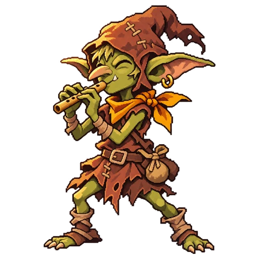

画像ID：monster_goblin_5_piper。実ファイル：[assets/images/monsters/families/goblin_5_piper.webp](../../assets/images/monsters/families/goblin_5_piper.webp)。
画像共有：他の敵定義との共有なし。

レベル帯：Lv5　種名：ゴブリン。[種別図鑑で開く](https://tomtomyoung.github.io/adv/labyrinth-guide.html#monsters/goblin/goblin_5_piper)。

習性：なし。

設計上の役割：標的に笛を吹き、次のゴブリンの攻撃を集中させます。

基礎能力：HP 35 / MP 8 / STR 9 / VIT 5 / AGI 8 / INT 10。報酬：4G / 32EXP。
宝箱：薬効葉 1個 / 12.5％。
属性倍率：すべて既定値。

行動と使用条件（AIの選択順）：

1. 合図笛 (family_goblin_5_piper)、MP0。標的に笛を吹き、次のゴブリンの攻撃を集中させます。
2. 攻撃 (attack)、MP0。優先度0、条件なし、対象は探索隊の生存者からランダムに1人。物理ダメージ（目安4）。

遭遇と参照先：

千変の迷宮の通常遭遇：地下5〜6階。

### 鉈戦士オーク (orc_5_cleaver)

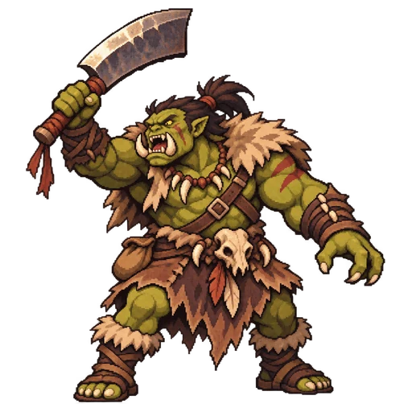

画像ID：monster_orc_5_cleaver。実ファイル：[assets/images/monsters/families/orc_5_cleaver.webp](../../assets/images/monsters/families/orc_5_cleaver.webp)。
画像共有：他の敵定義との共有なし。

レベル帯：Lv5　種名：ファングオーク。[種別図鑑で開く](https://tomtomyoung.github.io/adv/labyrinth-guide.html#monsters/orc/orc_5_cleaver)。

習性：なし。

設計上の役割：鉈を振りかぶった次の手番に強打します。

基礎能力：HP 60 / MP 4 / STR 11 / VIT 12 / AGI 5 / INT 7。報酬：4G / 32EXP。
宝箱：機関部品 1個 / 12.5％。
属性倍率：すべて既定値。

行動と使用条件（AIの選択順）：

1. 鉈おろし (family_orc_5_cleaver)、MP0。鉈を振りかぶった次の手番に強打します。 物理ダメージ（目安8）。
2. 攻撃 (attack)、MP0。優先度0、条件なし、対象は探索隊の生存者からランダムに1人。物理ダメージ（目安6）。

遭遇と参照先：

千変の迷宮の通常遭遇：地下7〜8階。

### 猪狩りオーク (orc_5_hunter)

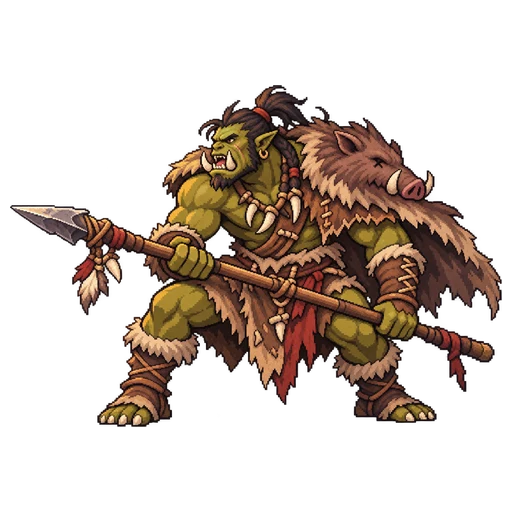

画像ID：monster_orc_5_hunter。実ファイル：[assets/images/monsters/families/orc_5_hunter.webp](../../assets/images/monsters/families/orc_5_hunter.webp)。
画像共有：他の敵定義との共有なし。

レベル帯：Lv5　種名：ファングオーク。[種別図鑑で開く](https://tomtomyoung.github.io/adv/labyrinth-guide.html#monsters/orc/orc_5_hunter)。

習性：退路狩り。探索隊員が後列へ退くと、その隊員を直ちに通常攻撃する。

設計上の役割：敵1体を狙って打つ。

基礎能力：HP 60 / MP 4 / STR 11 / VIT 12 / AGI 5 / INT 7。報酬：4G / 32EXP。
宝箱：機関部品 1個 / 12.5％。
属性倍率：すべて既定値。

行動と使用条件（AIの選択順）：

1. 狩人の一撃 (family_orc_5_hunter)、MP0。敵1体を狙って打つ。 物理ダメージ（目安6）。
2. 攻撃 (attack)、MP0。優先度0、条件なし、対象は探索隊の生存者からランダムに1人。物理ダメージ（目安6）。

遭遇と参照先：

千変の迷宮の通常遭遇：地下7〜8階。

### 骨太鼓オーク (orc_5_drummer)

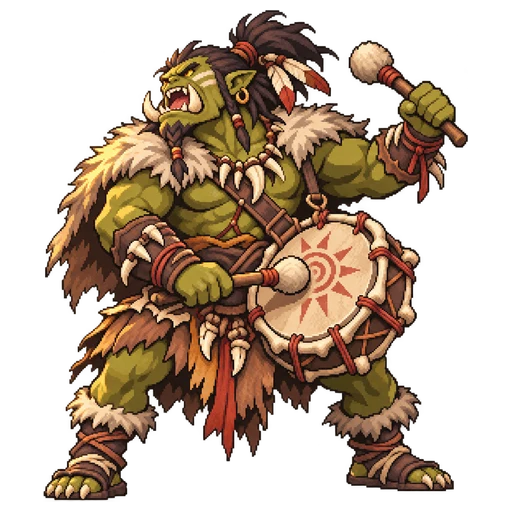

画像ID：monster_orc_5_drummer。実ファイル：[assets/images/monsters/families/orc_5_drummer.webp](../../assets/images/monsters/families/orc_5_drummer.webp)。
画像共有：他の敵定義との共有なし。

レベル帯：Lv5　種名：ファングオーク。[種別図鑑で開く](https://tomtomyoung.github.io/adv/labyrinth-guide.html#monsters/orc/orc_5_drummer)。

習性：なし。

設計上の役割：仲間の次の一撃を強化します。一人になると自ら攻撃します。

基礎能力：HP 35 / MP 8 / STR 9 / VIT 5 / AGI 8 / INT 10。報酬：4G / 32EXP。
宝箱：機関部品 1個 / 12.5％。
属性倍率：すべて既定値。

行動と使用条件（AIの選択順）：

1. 骨太鼓 (family_orc_5_drummer)、MP0。仲間の次の一撃を強化します。一人になると自ら攻撃します。 再起の呼吸（次の行動）を付与（次の行動の物理威力 ×1.3 / 次の本人の行動機会に消費）。
2. 攻撃 (attack)、MP0。優先度0、条件なし、対象は探索隊の生存者からランダムに1人。物理ダメージ（目安4）。

遭遇と参照先：

千変の迷宮の通常遭遇：地下7〜8階。

### 料理番オーク (orc_5_cook)

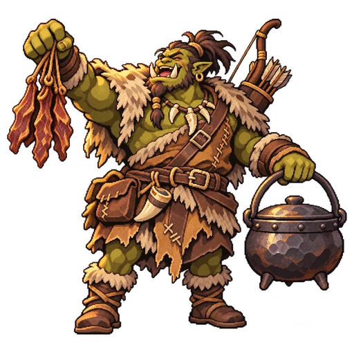

画像ID：monster_orc_5_cook。実ファイル：[assets/images/monsters/families/orc_5_cook.webp](../../assets/images/monsters/families/orc_5_cook.webp)。
画像共有：他の敵定義との共有なし。

レベル帯：Lv5　種名：ファングオーク。[種別図鑑で開く](https://tomtomyoung.github.io/adv/labyrinth-guide.html#monsters/orc/orc_5_cook)。

習性：なし。

設計上の役割：一戦に一度、HP割合が最も低い魔物1体を干し肉で回復します。その後は自身が防御し、次の自分の手番まで受けるダメージを半減します。

基礎能力：HP 35 / MP 8 / STR 9 / VIT 5 / AGI 8 / INT 10。報酬：4G / 32EXP。
宝箱：機関部品 1個 / 12.5％。
属性倍率：すべて既定値。

行動と使用条件（AIの選択順）：

1. 干し肉 (family_orc_5_cook)、MP0。一戦に一度、HP割合が最も低い魔物1体を干し肉で回復します。その後は自身が防御し、次の自分の手番まで受けるダメージを半減します。 HPを回復（基礎回復量29、最大HPまで）。
2. 攻撃 (attack)、MP0。優先度0、条件なし、対象は探索隊の生存者からランダムに1人。物理ダメージ（目安4）。

遭遇と参照先：

千変の迷宮の通常遭遇：地下7〜8階。

### 牙占いオーク (orc_5_diviner)

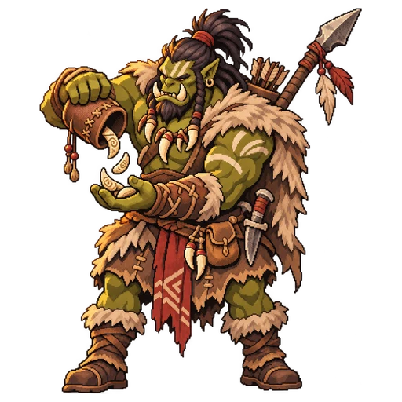

画像ID：monster_orc_5_diviner。実ファイル：[assets/images/monsters/families/orc_5_diviner.webp](../../assets/images/monsters/families/orc_5_diviner.webp)。
画像共有：他の敵定義との共有なし。

レベル帯：Lv5　種名：ファングオーク。[種別図鑑で開く](https://tomtomyoung.github.io/adv/labyrinth-guide.html#monsters/orc/orc_5_diviner)。

習性：なし。

設計上の役割：探索隊の1人を占いの標的にします。次にその相手にダメージを与えた魔物は、自分の最大HPの20%（端数切り上げ）を回復し、占いが消えます。

基礎能力：HP 35 / MP 8 / STR 9 / VIT 5 / AGI 8 / INT 10。報酬：4G / 32EXP。
宝箱：機関部品 1個 / 12.5％。
属性倍率：すべて既定値。

行動と使用条件（AIの選択順）：

1. 牙占い (family_orc_5_diviner)、MP0。探索隊の1人を占いの標的にします。次にその相手にダメージを与えた魔物は、自分の最大HPの20%（端数切り上げ）を回復し、占いが消えます。
2. 攻撃 (attack)、MP0。優先度0、条件なし、対象は探索隊の生存者からランダムに1人。物理ダメージ（目安4）。

遭遇と参照先：

千変の迷宮の通常遭遇：地下7〜8階。

### 棍棒オーガ (ogre_5_club)

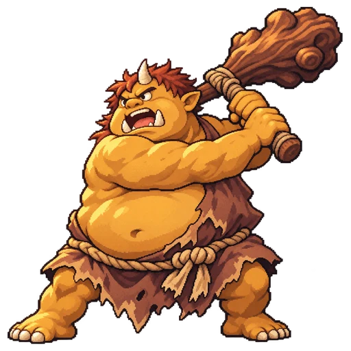

画像ID：monster_ogre_5_club。実ファイル：[assets/images/monsters/families/ogre_5_club.webp](../../assets/images/monsters/families/ogre_5_club.webp)。
画像共有：他の敵定義との共有なし。

レベル帯：Lv5　種名：ヤングオーガ。[種別図鑑で開く](https://tomtomyoung.github.io/adv/labyrinth-guide.html#monsters/ogre/ogre_5_club)。

習性：なし。

設計上の役割：一手構え、次の手番に前列を薙ぎ払います。

基礎能力：HP 60 / MP 4 / STR 11 / VIT 12 / AGI 5 / INT 7。報酬：4G / 32EXP。
宝箱：薬効葉 1個 / 12.5％。
属性倍率：すべて既定値。

行動と使用条件（AIの選択順）：

1. 棍棒薙ぎ (family_ogre_5_club)、MP0。一手構え、次の手番に前列を薙ぎ払います。 物理ダメージ（目安4）。
2. 攻撃 (attack)、MP0。優先度0、条件なし、対象は探索隊の生存者からランダムに1人。物理ダメージ（目安6）。

遭遇と参照先：

千変の迷宮の通常遭遇：地下9階。

### 岩投げオーガ (ogre_5_rock)

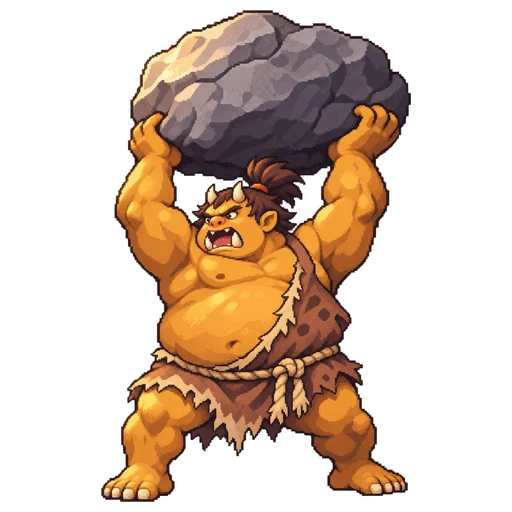

画像ID：monster_ogre_5_rock。実ファイル：[assets/images/monsters/families/ogre_5_rock.webp](../../assets/images/monsters/families/ogre_5_rock.webp)。
画像共有：他の敵定義との共有なし。

レベル帯：Lv5　種名：ヤングオーガ。[種別図鑑で開く](https://tomtomyoung.github.io/adv/labyrinth-guide.html#monsters/ogre/ogre_5_rock)。

習性：なし。

設計上の役割：一度だけ後列へ大岩を投げ、以後は身軽になります。

基礎能力：HP 60 / MP 4 / STR 11 / VIT 12 / AGI 5 / INT 7。報酬：4G / 32EXP。
宝箱：薬効葉 1個 / 12.5％。
属性倍率：すべて既定値。

行動と使用条件（AIの選択順）：

1. 大岩投げ (family_ogre_5_rock)、MP0。一度だけ後列へ大岩を投げ、以後は身軽になります。 投射攻撃。物理ダメージ（目安8）。
2. 攻撃 (attack)、MP0。優先度0、条件なし、対象は探索隊の生存者からランダムに1人。物理ダメージ（目安6）。

遭遇と参照先：

千変の迷宮の通常遭遇：地下9階。

### 門番オーガ (ogre_5_gate)

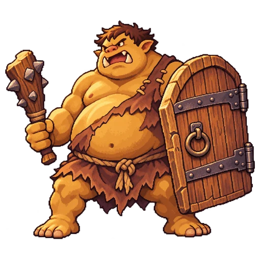

画像ID：monster_ogre_5_gate。実ファイル：[assets/images/monsters/families/ogre_5_gate.webp](../../assets/images/monsters/families/ogre_5_gate.webp)。
画像共有：他の敵定義との共有なし。

レベル帯：Lv5　種名：ヤングオーガ。[種別図鑑で開く](https://tomtomyoung.github.io/adv/labyrinth-guide.html#monsters/ogre/ogre_5_gate)。

習性：なし。

設計上の役割：最も後ろにいる仲間1体に門扉の盾を構え、その仲間を狙う次の単体ダメージを1回引き受けます。

基礎能力：HP 60 / MP 4 / STR 11 / VIT 12 / AGI 5 / INT 7。報酬：4G / 32EXP。
宝箱：薬効葉 1個 / 12.5％。
属性倍率：すべて既定値。

行動と使用条件（AIの選択順）：

1. 扉の盾 (family_ogre_5_gate)、MP0。最も後ろにいる仲間1体に門扉の盾を構え、その仲間を狙う次の単体ダメージを1回引き受けます。
2. 攻撃 (attack)、MP0。優先度0、条件なし、対象は探索隊の生存者からランダムに1人。物理ダメージ（目安6）。

遭遇と参照先：

千変の迷宮の通常遭遇：地下9階。

### 力士オーガ (ogre_5_wrestler)

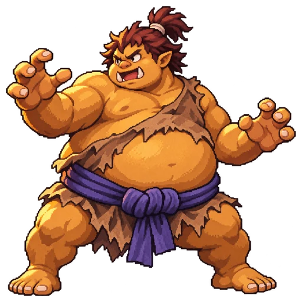

画像ID：monster_ogre_5_wrestler。実ファイル：[assets/images/monsters/families/ogre_5_wrestler.webp](../../assets/images/monsters/families/ogre_5_wrestler.webp)。
画像共有：他の敵定義との共有なし。

レベル帯：Lv5　種名：ヤングオーガ。[種別図鑑で開く](https://tomtomyoung.github.io/adv/labyrinth-guide.html#monsters/ogre/ogre_5_wrestler)。

習性：なし。

設計上の役割：最前列の相手1人を打ち、生き残った相手を1列後ろへ押します。自分は前列へ出ます。

基礎能力：HP 60 / MP 4 / STR 11 / VIT 12 / AGI 5 / INT 7。報酬：4G / 32EXP。
宝箱：薬効葉 1個 / 12.5％。
属性倍率：すべて既定値。

行動と使用条件（AIの選択順）：

1. 押し出し (family_ogre_5_wrestler)、MP0。最前列の相手1人を打ち、生き残った相手を1列後ろへ押します。自分は前列へ出ます。 物理ダメージ（目安6）。
2. 攻撃 (attack)、MP0。優先度0、条件なし、対象は探索隊の生存者からランダムに1人。物理ダメージ（目安6）。

遭遇と参照先：

千変の迷宮の通常遭遇：地下9階。

### 鐘撞きオーガ (ogre_5_bell)

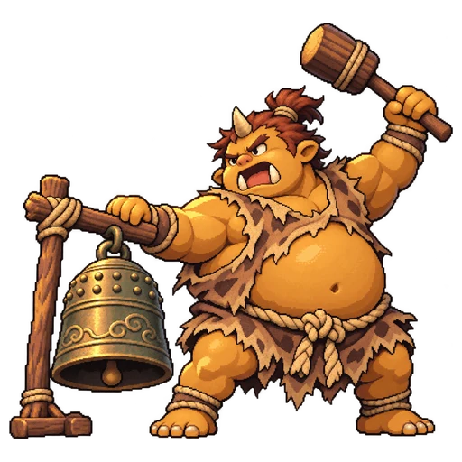

画像ID：monster_ogre_5_bell。実ファイル：[assets/images/monsters/families/ogre_5_bell.webp](../../assets/images/monsters/families/ogre_5_bell.webp)。
画像共有：他の敵定義との共有なし。

レベル帯：Lv5　種名：ヤングオーガ。[種別図鑑で開く](https://tomtomyoung.github.io/adv/labyrinth-guide.html#monsters/ogre/ogre_5_bell)。

習性：なし。

設計上の役割：一手かけて大鐘を据え、次に鳴らして敵全員をひるませます。

基礎能力：HP 60 / MP 4 / STR 11 / VIT 12 / AGI 5 / INT 7。報酬：4G / 32EXP。
宝箱：薬効葉 1個 / 12.5％。
属性倍率：すべて既定値。

行動と使用条件（AIの選択順）：

1. 鐘の一撞き (family_ogre_5_bell)、MP0。一手かけて大鐘を据え、次に鳴らして敵全員をひるませます。 命中時100%でスタンさせ、行動機会を1回失わせる。
2. 攻撃 (attack)、MP0。優先度0、条件なし、対象は探索隊の生存者からランダムに1人。物理ダメージ（目安6）。

遭遇と参照先：

千変の迷宮の通常遭遇：地下9階。

### ゴブリン盾兵 (goblin_10_shield)

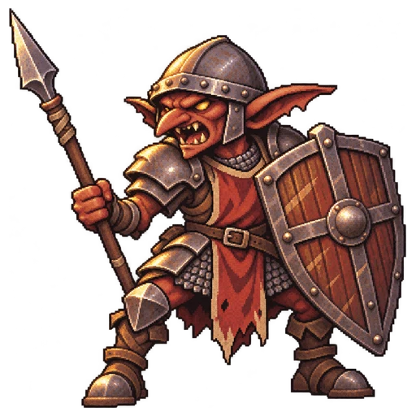

画像ID：monster_goblin_10_shield。実ファイル：[assets/images/monsters/families/goblin_10_shield.webp](../../assets/images/monsters/families/goblin_10_shield.webp)。
画像共有：他の敵定義との共有なし。

レベル帯：Lv10　種名：ゴブリン。[種別図鑑で開く](https://tomtomyoung.github.io/adv/labyrinth-guide.html#monsters/goblin/goblin_10_shield)。

習性：なし。

設計上の役割：最も後ろにいる仲間1体を盾でかばい、その仲間を狙う次の単体ダメージを1回引き受けます。

基礎能力：HP 93 / MP 3 / STR 20 / VIT 10 / AGI 9 / INT 10。報酬：6G / 32EXP。
宝箱：薬効葉 1個 / 12.5％。
属性倍率：すべて既定値。

行動と使用条件（AIの選択順）：

1. 盾構え (family_goblin_10_shield)、MP0。最も後ろにいる仲間1体を盾でかばい、その仲間を狙う次の単体ダメージを1回引き受けます。
2. 攻撃 (attack)、MP0。優先度0、条件なし、対象は探索隊の生存者からランダムに1人。物理ダメージ（目安15）。

遭遇と参照先：

千変の迷宮の通常遭遇：地下11〜14階。

### ゴブリン槍兵 (goblin_10_spear)

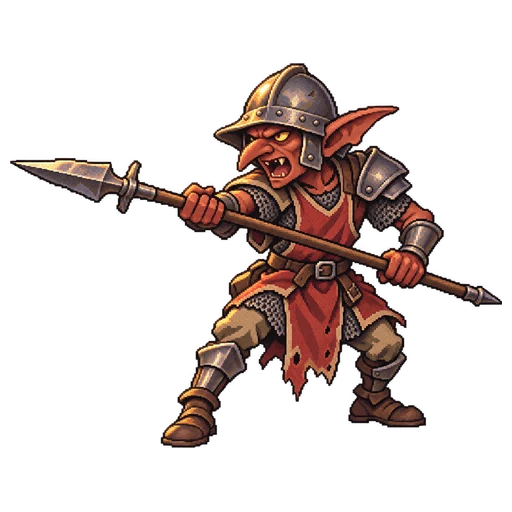

画像ID：monster_goblin_10_spear。実ファイル：[assets/images/monsters/families/goblin_10_spear.webp](../../assets/images/monsters/families/goblin_10_spear.webp)。
画像共有：他の敵定義との共有なし。

レベル帯：Lv10　種名：ゴブリン。[種別図鑑で開く](https://tomtomyoung.github.io/adv/labyrinth-guide.html#monsters/goblin/goblin_10_spear)。

習性：なし。

設計上の役割：仲間の背後から長槍で前列を突きます。

基礎能力：HP 93 / MP 3 / STR 20 / VIT 10 / AGI 9 / INT 10。報酬：6G / 32EXP。
宝箱：薬効葉 1個 / 12.5％。
属性倍率：すべて既定値。

行動と使用条件（AIの選択順）：

1. 盾越しの長槍 (family_goblin_10_spear)、MP0。仲間の背後から長槍で前列を突きます。 物理ダメージ（目安22）。
2. 攻撃 (attack)、MP0。優先度0、条件なし、対象は探索隊の生存者からランダムに1人。物理ダメージ（目安15）。

遭遇と参照先：

千変の迷宮の通常遭遇：地下11〜14階。

### ゴブリン旗手 (goblin_10_standard)

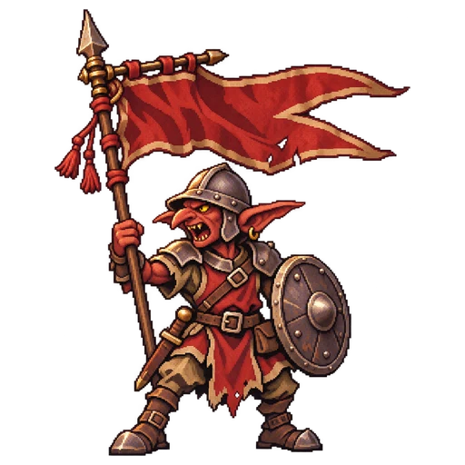

画像ID：monster_goblin_10_standard。実ファイル：[assets/images/monsters/families/goblin_10_standard.webp](../../assets/images/monsters/families/goblin_10_standard.webp)。
画像共有：他の敵定義との共有なし。

レベル帯：Lv10　種名：ゴブリン。[種別図鑑で開く](https://tomtomyoung.github.io/adv/labyrinth-guide.html#monsters/goblin/goblin_10_standard)。

習性：なし。

設計上の役割：軍旗を掲げます。旗手が生存し旗が立っている間、魔物側全員が受けるダメージは通常の75%になります。

基礎能力：HP 60 / MP 8 / STR 14 / VIT 7 / AGI 9 / INT 16。報酬：6G / 32EXP。
宝箱：薬効葉 1個 / 12.5％。
属性倍率：すべて既定値。

行動と使用条件（AIの選択順）：

1. 軍旗掲揚 (family_goblin_10_standard)、MP0。軍旗を掲げます。旗手が生存し旗が立っている間、魔物側全員が受けるダメージは通常の75%になります。
2. 攻撃 (attack)、MP0。優先度0、条件なし、対象は探索隊の生存者からランダムに1人。物理ダメージ（目安9）。

遭遇と参照先：

千変の迷宮の通常遭遇：地下11〜14階。

### ゴブリン軍曹 (goblin_10_sergeant)

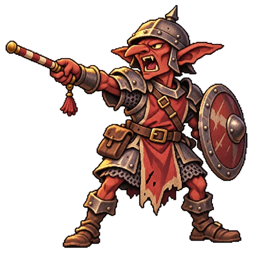

画像ID：monster_goblin_10_sergeant。実ファイル：[assets/images/monsters/families/goblin_10_sergeant.webp](../../assets/images/monsters/families/goblin_10_sergeant.webp)。
画像共有：他の敵定義との共有なし。

レベル帯：Lv10　種名：ゴブリン。[種別図鑑で開く](https://tomtomyoung.github.io/adv/labyrinth-guide.html#monsters/goblin/goblin_10_sergeant)。

習性：なし。

設計上の役割：押し出された兵を元の列へ戻します。

基礎能力：HP 60 / MP 8 / STR 14 / VIT 7 / AGI 9 / INT 16。報酬：6G / 32EXP。
宝箱：薬効葉 1個 / 12.5％。
属性倍率：すべて既定値。

行動と使用条件（AIの選択順）：

1. 整列号令 (family_goblin_10_sergeant)、MP0。押し出された兵を元の列へ戻します。
2. 攻撃 (attack)、MP0。優先度0、条件なし、対象は探索隊の生存者からランダムに1人。物理ダメージ（目安9）。

遭遇と参照先：

千変の迷宮の通常遭遇：地下11〜14階。

### ゴブリン工兵 (goblin_10_engineer)

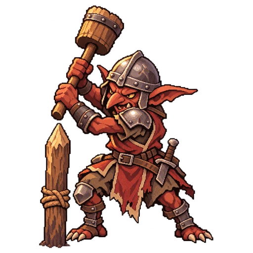

画像ID：monster_goblin_10_engineer。実ファイル：[assets/images/monsters/families/goblin_10_engineer.webp](../../assets/images/monsters/families/goblin_10_engineer.webp)。
画像共有：他の敵定義との共有なし。

レベル帯：Lv10　種名：ゴブリン。[種別図鑑で開く](https://tomtomyoung.github.io/adv/labyrinth-guide.html#monsters/goblin/goblin_10_engineer)。

習性：なし。

設計上の役割：杭柵で槍兵を守り、追加の一突きをさせます。

基礎能力：HP 93 / MP 3 / STR 20 / VIT 10 / AGI 9 / INT 10。報酬：6G / 32EXP。
宝箱：薬効葉 1個 / 12.5％。
属性倍率：すべて既定値。

行動と使用条件（AIの選択順）：

1. 杭柵づくり (family_goblin_10_engineer)、MP0。杭柵で槍兵を守り、追加の一突きをさせます。
2. 攻撃 (attack)、MP0。優先度0、条件なし、対象は探索隊の生存者からランダムに1人。物理ダメージ（目安15）。

遭遇と参照先：

千変の迷宮の通常遭遇：地下11〜14階。

### 炉番オーク (orc_10_stoker)

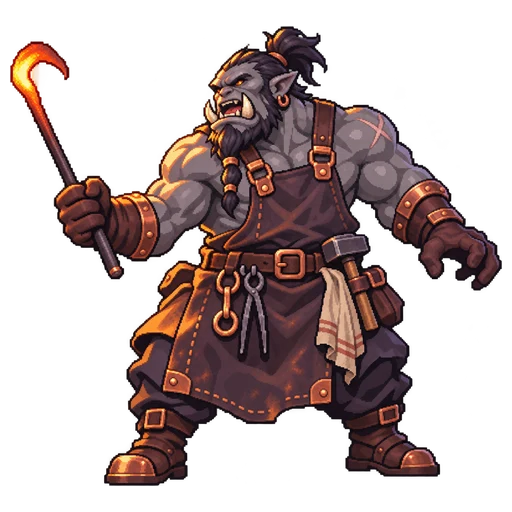

画像ID：monster_orc_10_stoker。実ファイル：[assets/images/monsters/families/orc_10_stoker.webp](../../assets/images/monsters/families/orc_10_stoker.webp)。
画像共有：他の敵定義との共有なし。

レベル帯：Lv10　種名：フォージオーク。[種別図鑑で開く](https://tomtomyoung.github.io/adv/labyrinth-guide.html#monsters/orc/orc_10_stoker)。

習性：なし。

設計上の役割：火かき棒を熱し、次の手番に熱傷を伴う一撃を放ちます。

基礎能力：HP 105 / MP 4 / STR 17 / VIT 19 / AGI 6 / INT 11。報酬：6G / 32EXP。
宝箱：機関部品 1個 / 12.5％。
属性倍率：すべて既定値。

行動と使用条件（AIの選択順）：

1. 赤鉄突き (family_orc_10_stoker)、MP0。火かき棒を熱し、次の手番に熱傷を伴う一撃を放ちます。 炎ダメージ（目安18）。続いて命中時100%で火傷Lv1を付与（2ターン、巡の終わりにHP−3）。
2. 攻撃 (attack)、MP0。優先度0、条件なし、対象は探索隊の生存者からランダムに1人。物理ダメージ（目安12）。

遭遇と参照先：

千変の迷宮の通常遭遇：地下11〜14階。

### 鍛冶屋オーク (orc_10_smith)

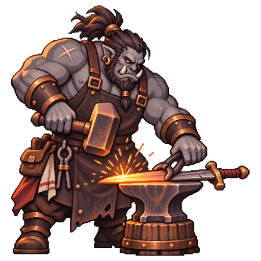

画像ID：monster_orc_10_smith。実ファイル：[assets/images/monsters/families/orc_10_smith.webp](../../assets/images/monsters/families/orc_10_smith.webp)。
画像共有：他の敵定義との共有なし。

レベル帯：Lv10　種名：フォージオーク。[種別図鑑で開く](https://tomtomyoung.github.io/adv/labyrinth-guide.html#monsters/orc/orc_10_smith)。

習性：なし。

設計上の役割：仲間の武器を打ち直し、次の一撃を強めます。

基礎能力：HP 60 / MP 8 / STR 14 / VIT 7 / AGI 9 / INT 16。報酬：6G / 32EXP。
宝箱：機関部品 1個 / 12.5％。
属性倍率：すべて既定値。

行動と使用条件（AIの選択順）：

1. 刃の打ち直し (family_orc_10_smith)、MP0。仲間の武器を打ち直し、次の一撃を強めます。 再起の呼吸（次の行動）を付与（次の行動の物理威力 ×1.3 / 次の本人の行動機会に消費）。
2. 攻撃 (attack)、MP0。優先度0、条件なし、対象は探索隊の生存者からランダムに1人。物理ダメージ（目安9）。

遭遇と参照先：

千変の迷宮の通常遭遇：地下11〜14階。

### 盾鍛冶オーク (orc_10_shieldsmith)

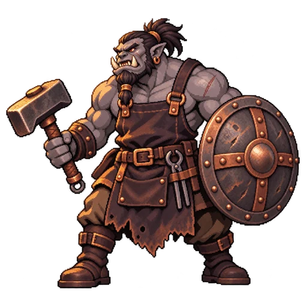

画像ID：monster_orc_10_shieldsmith。実ファイル：[assets/images/monsters/families/orc_10_shieldsmith.webp](../../assets/images/monsters/families/orc_10_shieldsmith.webp)。
画像共有：他の敵定義との共有なし。

レベル帯：Lv10　種名：フォージオーク。[種別図鑑で開く](https://tomtomyoung.github.io/adv/labyrinth-guide.html#monsters/orc/orc_10_shieldsmith)。

習性：なし。

設計上の役割：使い終えた仲間の盾を直し、再び攻撃を肩代わりできるようにします。

基礎能力：HP 60 / MP 8 / STR 14 / VIT 7 / AGI 9 / INT 16。報酬：6G / 32EXP。
宝箱：機関部品 1個 / 12.5％。
属性倍率：すべて既定値。

行動と使用条件（AIの選択順）：

1. 盾修理 (family_orc_10_shieldsmith)、MP0。使い終えた仲間の盾を直し、再び攻撃を肩代わりできるようにします。
2. 攻撃 (attack)、MP0。優先度0、条件なし、対象は探索隊の生存者からランダムに1人。物理ダメージ（目安9）。

遭遇と参照先：

千変の迷宮の通常遭遇：地下11〜14階。

### 炭焼きオーク (orc_10_charcoal)

画像ID：monster_orc_10_charcoal。実ファイル：[assets/images/monsters/families/orc_10_charcoal.webp](../../assets/images/monsters/families/orc_10_charcoal.webp)。
画像共有：他の敵定義との共有なし。

レベル帯：Lv10　種名：フォージオーク。[種別図鑑で開く](https://tomtomyoung.github.io/adv/labyrinth-guide.html#monsters/orc/orc_10_charcoal)。

習性：なし。

設計上の役割：この巡と次の巡は炭煙が中列・後列の魔物を隠し、その列を狙う攻撃の命中率が35ポイント下がります。

基礎能力：HP 60 / MP 8 / STR 14 / VIT 7 / AGI 9 / INT 16。報酬：6G / 32EXP。
宝箱：機関部品 1個 / 12.5％。
属性倍率：すべて既定値。

行動と使用条件（AIの選択順）：

1. 炭煙 (family_orc_10_charcoal)、MP0。この巡と次の巡は炭煙が中列・後列の魔物を隠し、その列を狙う攻撃の命中率が35ポイント下がります。
2. 攻撃 (attack)、MP0。優先度0、条件なし、対象は探索隊の生存者からランダムに1人。物理ダメージ（目安9）。

遭遇と参照先：

千変の迷宮の通常遭遇：地下11〜14階。

### トロッコオーク (orc_10_cart)

画像ID：monster_orc_10_cart。実ファイル：[assets/images/monsters/families/orc_10_cart.webp](../../assets/images/monsters/families/orc_10_cart.webp)。
画像共有：他の敵定義との共有なし。

レベル帯：Lv10　種名：フォージオーク。[種別図鑑で開く](https://tomtomyoung.github.io/adv/labyrinth-guide.html#monsters/orc/orc_10_cart)。

習性：なし。

設計上の役割：満載のトロッコで一度突進し、その後は鉱石を投げます。

基礎能力：HP 105 / MP 4 / STR 17 / VIT 19 / AGI 6 / INT 11。報酬：6G / 32EXP。
宝箱：機関部品 1個 / 12.5％。
属性倍率：すべて既定値。

行動と使用条件（AIの選択順）：

1. 鉱車突進 (family_orc_10_cart)、MP0。満載のトロッコで一度突進し、その後は鉱石を投げます。 物理ダメージ（目安18）。
2. 攻撃 (attack)、MP0。優先度0、条件なし、対象は探索隊の生存者からランダムに1人。物理ダメージ（目安12）。

遭遇と参照先：

千変の迷宮の通常遭遇：地下11〜14階。

### 石切りオーガ (ogre_10_quarry)

画像ID：monster_ogre_10_quarry。実ファイル：[assets/images/monsters/families/ogre_10_quarry.webp](../../assets/images/monsters/families/ogre_10_quarry.webp)。
画像共有：他の敵定義との共有なし。

レベル帯：Lv10　種名：ストーンバックオーガ。[種別図鑑で開く](https://tomtomyoung.github.io/adv/labyrinth-guide.html#monsters/ogre/ogre_10_quarry)。

習性：なし。

設計上の役割：同じ相手を続けて狙い、二打目で防御を崩します。

基礎能力：HP 105 / MP 4 / STR 17 / VIT 19 / AGI 6 / INT 11。報酬：6G / 32EXP。
宝箱：薬効葉 1個 / 12.5％。
属性倍率：すべて既定値。

行動と使用条件（AIの選択順）：

1. 二度割り (family_ogre_10_quarry)、MP0。同じ相手を続けて狙い、二打目で防御を崩します。 物理ダメージ（目安18）。
2. 攻撃 (attack)、MP0。優先度0、条件なし、対象は探索隊の生存者からランダムに1人。物理ダメージ（目安12）。

遭遇と参照先：

千変の迷宮の通常遭遇：地下10〜14階。

### 転がりオーガ (ogre_10_roller)

画像ID：monster_ogre_10_roller。実ファイル：[assets/images/monsters/families/ogre_10_roller.webp](../../assets/images/monsters/families/ogre_10_roller.webp)。
画像共有：他の敵定義との共有なし。

レベル帯：Lv10　種名：ストーンバックオーガ。[種別図鑑で開く](https://tomtomyoung.github.io/adv/labyrinth-guide.html#monsters/ogre/ogre_10_roller)。

習性：なし。

設計上の役割：体を丸めて前列を轢き、次の手番に起き上がります。

基礎能力：HP 105 / MP 4 / STR 17 / VIT 19 / AGI 6 / INT 11。報酬：6G / 32EXP。
宝箱：薬効葉 1個 / 12.5％。
属性倍率：すべて既定値。

行動と使用条件（AIの選択順）：

1. 岩転がり (family_ogre_10_roller)、MP0。体を丸めて前列を轢き、次の手番に起き上がります。 物理ダメージ（目安10）。
2. 攻撃 (attack)、MP0。優先度0、条件なし、対象は探索隊の生存者からランダムに1人。物理ダメージ（目安12）。

遭遇と参照先：

千変の迷宮の通常遭遇：地下10〜14階。

### 石積みオーガ (ogre_10_wall)

画像ID：monster_ogre_10_wall。実ファイル：[assets/images/monsters/families/ogre_10_wall.webp](../../assets/images/monsters/families/ogre_10_wall.webp)。
画像共有：他の敵定義との共有なし。

レベル帯：Lv10　種名：ストーンバックオーガ。[種別図鑑で開く](https://tomtomyoung.github.io/adv/labyrinth-guide.html#monsters/ogre/ogre_10_wall)。

習性：なし。

設計上の役割：石壁を築き、仲間へ向かう一撃を遮ります。

基礎能力：HP 105 / MP 4 / STR 17 / VIT 19 / AGI 6 / INT 11。報酬：6G / 32EXP。
宝箱：薬効葉 1個 / 12.5％。
属性倍率：すべて既定値。

行動と使用条件（AIの選択順）：

1. 石壁 (family_ogre_10_wall)、MP0。石壁を築き、仲間へ向かう一撃を遮ります。
2. 攻撃 (attack)、MP0。優先度0、条件なし、対象は探索隊の生存者からランダムに1人。物理ダメージ（目安12）。

遭遇と参照先：

千変の迷宮の通常遭遇：地下10〜14階。

### 石像番オーガ (ogre_10_statue)

画像ID：monster_ogre_10_statue。実ファイル：[assets/images/monsters/families/ogre_10_statue.webp](../../assets/images/monsters/families/ogre_10_statue.webp)。
画像共有：他の敵定義との共有なし。

レベル帯：Lv10　種名：ストーンバックオーガ。[種別図鑑で開く](https://tomtomyoung.github.io/adv/labyrinth-guide.html#monsters/ogre/ogre_10_statue)。

習性：見張り反撃。見張りの構え中、探索隊員が仲間を傷つけると、構えを解いてその隊員に一度反撃する。

設計上の役割：その場に静止して、仲間の方を見張る。

基礎能力：HP 60 / MP 8 / STR 14 / VIT 7 / AGI 9 / INT 16。報酬：6G / 32EXP。
宝箱：薬効葉 1個 / 12.5％。
属性倍率：すべて既定値。

行動と使用条件（AIの選択順）：

1. 石像の構え (family_ogre_10_statue)、MP0。その場に静止して、仲間の方を見張る。
2. 攻撃 (attack)、MP0。優先度0、条件なし、対象は探索隊の生存者からランダムに1人。物理ダメージ（目安9）。

遭遇と参照先：

千変の迷宮の通常遭遇：地下10〜14階。

### 岩笛オーガ (ogre_10_flute)

画像ID：monster_ogre_10_flute。実ファイル：[assets/images/monsters/families/ogre_10_flute.webp](../../assets/images/monsters/families/ogre_10_flute.webp)。
画像共有：他の敵定義との共有なし。

レベル帯：Lv10　種名：ストーンバックオーガ。[種別図鑑で開く](https://tomtomyoung.github.io/adv/labyrinth-guide.html#monsters/ogre/ogre_10_flute)。

習性：なし。

設計上の役割：背中の岩穴を鳴らし、転がった同族を即座に起こします。

基礎能力：HP 60 / MP 8 / STR 14 / VIT 7 / AGI 9 / INT 16。報酬：6G / 32EXP。
宝箱：薬効葉 1個 / 12.5％。
属性倍率：すべて既定値。

行動と使用条件（AIの選択順）：

1. 岩鳴らし (family_ogre_10_flute)、MP0。背中の岩穴を鳴らし、転がった同族を即座に起こします。
2. 攻撃 (attack)、MP0。優先度0、条件なし、対象は探索隊の生存者からランダムに1人。物理ダメージ（目安9）。

遭遇と参照先：

千変の迷宮の通常遭遇：地下10〜14階。

### ゴブリン灯消し (goblin_15_snuffer)

画像ID：monster_goblin_15_snuffer。実ファイル：[assets/images/monsters/families/goblin_15_snuffer.webp](../../assets/images/monsters/families/goblin_15_snuffer.webp)。
画像共有：他の敵定義との共有なし。

レベル帯：Lv15　種名：ナイトアイゴブリン。[種別図鑑で開く](https://tomtomyoung.github.io/adv/labyrinth-guide.html#monsters/goblin/goblin_15_snuffer)。

習性：夜目。戦場の灯りが消えても、暗闇による命中低下を受けない。

設計上の役割：この巡と次の巡は戦場の灯りが消え、夜目を持たない攻撃者の命中率が35ポイント下がります。

基礎能力：HP 85 / MP 8 / STR 19 / VIT 10 / AGI 11 / INT 22。報酬：10G / 32EXP。
宝箱：薬効葉 1個 / 12.5％。
属性倍率：すべて既定値。

行動と使用条件（AIの選択順）：

1. 闇とばり (family_goblin_15_snuffer)、MP0。この巡と次の巡は戦場の灯りが消え、夜目を持たない攻撃者の命中率が35ポイント下がります。
2. 攻撃 (attack)、MP0。優先度0、条件なし、対象は探索隊の生存者からランダムに1人。物理ダメージ（目安14）。

遭遇と参照先：

千変の迷宮の通常遭遇：地下15〜19階。

### ゴブリン蛍飼い (goblin_15_firefly)

画像ID：monster_goblin_15_firefly。実ファイル：[assets/images/monsters/families/goblin_15_firefly.webp](../../assets/images/monsters/families/goblin_15_firefly.webp)。
画像共有：他の敵定義との共有なし。

レベル帯：Lv15　種名：ナイトアイゴブリン。[種別図鑑で開く](https://tomtomyoung.github.io/adv/labyrinth-guide.html#monsters/goblin/goblin_15_firefly)。

習性：夜目。戦場の灯りが消えても、暗闇による命中低下を受けない。

設計上の役割：一人に蛍をまとわせ、暗闇でも仲間がその相手を外さず狙えます。

基礎能力：HP 85 / MP 8 / STR 19 / VIT 10 / AGI 11 / INT 22。報酬：10G / 32EXP。
宝箱：薬効葉 1個 / 12.5％。
属性倍率：すべて既定値。

行動と使用条件（AIの選択順）：

1. 蛍の目印 (family_goblin_15_firefly)、MP0。一人に蛍をまとわせ、暗闇でも仲間がその相手を外さず狙えます。
2. 攻撃 (attack)、MP0。優先度0、条件なし、対象は探索隊の生存者からランダムに1人。物理ダメージ（目安14）。

遭遇と参照先：

千変の迷宮の通常遭遇：地下15〜19階。

### ゴブリン影縫い (goblin_15_shadow)

画像ID：monster_goblin_15_shadow。実ファイル：[assets/images/monsters/families/goblin_15_shadow.webp](../../assets/images/monsters/families/goblin_15_shadow.webp)。
画像共有：他の敵定義との共有なし。

レベル帯：Lv15　種名：ナイトアイゴブリン。[種別図鑑で開く](https://tomtomyoung.github.io/adv/labyrinth-guide.html#monsters/goblin/goblin_15_shadow)。

習性：夜目。戦場の灯りが消えても、暗闇による命中低下を受けない。

設計上の役割：灯りが戻った瞬間に影を踏み、相手の列移動を封じます。

基礎能力：HP 133 / MP 3 / STR 26 / VIT 13 / AGI 10 / INT 14。報酬：10G / 32EXP。
宝箱：薬効葉 1個 / 12.5％。
属性倍率：すべて既定値。

行動と使用条件（AIの選択順）：

1. 影縫い (family_goblin_15_shadow)、MP0。灯りが戻った瞬間に影を踏み、相手の列移動を封じます。 根留めを付与（自発移動と次のFrontline自動前進を阻止 / Classic命中率−10ポイント / 持続 1ターン）。
2. 攻撃 (attack)、MP0。優先度0、条件なし、対象は探索隊の生存者からランダムに1人。物理ダメージ（目安21）。

遭遇と参照先：

千変の迷宮の通常遭遇：地下15〜19階。

### ゴブリン夜盗 (goblin_15_thief)

画像ID：monster_goblin_15_thief。実ファイル：[assets/images/monsters/families/goblin_15_thief.webp](../../assets/images/monsters/families/goblin_15_thief.webp)。
画像共有：他の敵定義との共有なし。

レベル帯：Lv15　種名：ナイトアイゴブリン。[種別図鑑で開く](https://tomtomyoung.github.io/adv/labyrinth-guide.html#monsters/goblin/goblin_15_thief)。

習性：夜目。戦場の灯りが消えても、暗闇による命中低下を受けない。

設計上の役割：暗闇に紛れて後列へ忍び込み、背後から狙います。

基礎能力：HP 133 / MP 3 / STR 26 / VIT 13 / AGI 10 / INT 14。報酬：10G / 32EXP。
宝箱：薬効葉 1個 / 12.5％。
属性倍率：すべて既定値。

行動と使用条件（AIの選択順）：

1. 暗がりの奇襲 (family_goblin_15_thief)、MP0。暗闇に紛れて後列へ忍び込み、背後から狙います。 物理ダメージ（目安30）。
2. 攻撃 (attack)、MP0。優先度0、条件なし、対象は探索隊の生存者からランダムに1人。物理ダメージ（目安21）。

遭遇と参照先：

千変の迷宮の通常遭遇：地下15〜19階。

### ゴブリン梟使い (goblin_15_owl)

画像ID：monster_goblin_15_owl。実ファイル：[assets/images/monsters/families/goblin_15_owl.webp](../../assets/images/monsters/families/goblin_15_owl.webp)。
画像共有：他の敵定義との共有なし。

レベル帯：Lv15　種名：ナイトアイゴブリン。[種別図鑑で開く](https://tomtomyoung.github.io/adv/labyrinth-guide.html#monsters/goblin/goblin_15_owl)。

習性：夜目。戦場の灯りが消えても、暗闇による命中低下を受けない。

設計上の役割：梟の警戒声で仲間が単体攻撃を一度回避します。

基礎能力：HP 85 / MP 8 / STR 19 / VIT 10 / AGI 11 / INT 22。報酬：10G / 32EXP。
宝箱：薬効葉 1個 / 12.5％。
属性倍率：すべて既定値。

行動と使用条件（AIの選択順）：

1. 梟の見張り (family_goblin_15_owl)、MP0。梟の警戒声で仲間が単体攻撃を一度回避します。
2. 攻撃 (attack)、MP0。優先度0、条件なし、対象は探索隊の生存者からランダムに1人。物理ダメージ（目安14）。

遭遇と参照先：

千変の迷宮の通常遭遇：地下15〜19階。

### 泥まきオーク (orc_15_mud)

画像ID：monster_orc_15_mud。実ファイル：[assets/images/monsters/families/orc_15_mud.webp](../../assets/images/monsters/families/orc_15_mud.webp)。
画像共有：他の敵定義との共有なし。

レベル帯：Lv15　種名：マーシュオーク。[種別図鑑で開く](https://tomtomyoung.github.io/adv/labyrinth-guide.html#monsters/orc/orc_15_mud)。

習性：なし。

設計上の役割：一列をぬかるませ、そこにいる相手の行動を遅らせます。

基礎能力：HP 150 / MP 4 / STR 23 / VIT 26 / AGI 7 / INT 15。報酬：10G / 32EXP。
宝箱：機関部品 1個 / 12.5％。
属性倍率：すべて既定値。

行動と使用条件（AIの選択順）：

1. 泥まき (family_orc_15_mud)、MP0。一列をぬかるませ、そこにいる相手の行動を遅らせます。 足払いを付与（速さ ×0.65 / 持続 2ターン）。
2. 攻撃 (attack)、MP0。優先度0、条件なし、対象は探索隊の生存者からランダムに1人。物理ダメージ（目安18）。

遭遇と参照先：

千変の迷宮の通常遭遇：地下15〜19階。

### 銛打ちオーク (orc_15_harpoon)

画像ID：monster_orc_15_harpoon。実ファイル：[assets/images/monsters/families/orc_15_harpoon.webp](../../assets/images/monsters/families/orc_15_harpoon.webp)。
画像共有：他の敵定義との共有なし。

レベル帯：Lv15　種名：マーシュオーク。[種別図鑑で開く](https://tomtomyoung.github.io/adv/labyrinth-guide.html#monsters/orc/orc_15_harpoon)。

習性：なし。

設計上の役割：後列の相手を銛で引き寄せ、手前のぬかるみへ引き込みます。

基礎能力：HP 150 / MP 4 / STR 23 / VIT 26 / AGI 7 / INT 15。報酬：10G / 32EXP。
宝箱：機関部品 1個 / 12.5％。
属性倍率：すべて既定値。

行動と使用条件（AIの選択順）：

1. 引き銛 (family_orc_15_harpoon)、MP0。後列の相手を銛で引き寄せ、手前のぬかるみへ引き込みます。 投射攻撃。物理ダメージ（目安26）。
2. 攻撃 (attack)、MP0。優先度0、条件なし、対象は探索隊の生存者からランダムに1人。物理ダメージ（目安18）。

遭遇と参照先：

千変の迷宮の通常遭遇：地下15〜19階。

### 猟犬使いオーク (orc_15_hound)

画像ID：monster_orc_15_hound。実ファイル：[assets/images/monsters/families/orc_15_hound.webp](../../assets/images/monsters/families/orc_15_hound.webp)。
画像共有：他の敵定義との共有なし。

レベル帯：Lv15　種名：マーシュオーク。[種別図鑑で開く](https://tomtomyoung.github.io/adv/labyrinth-guide.html#monsters/orc/orc_15_hound)。

習性：なし。

設計上の役割：ぬかるみに足を取られた相手へ猟犬を放ちます。

基礎能力：HP 150 / MP 4 / STR 23 / VIT 26 / AGI 7 / INT 15。報酬：10G / 32EXP。
宝箱：機関部品 1個 / 12.5％。
属性倍率：すべて既定値。

行動と使用条件（AIの選択順）：

1. 猟犬放ち (family_orc_15_hound)、MP0。ぬかるみに足を取られた相手へ猟犬を放ちます。 物理ダメージ（目安29）。
2. 攻撃 (attack)、MP0。優先度0、条件なし、対象は探索隊の生存者からランダムに1人。物理ダメージ（目安18）。

遭遇と参照先：

千変の迷宮の通常遭遇：地下15〜19階。

### 渡し守オーク (orc_15_ferry)

画像ID：monster_orc_15_ferry。実ファイル：[assets/images/monsters/families/orc_15_ferry.webp](../../assets/images/monsters/families/orc_15_ferry.webp)。
画像共有：他の敵定義との共有なし。

レベル帯：Lv15　種名：マーシュオーク。[種別図鑑で開く](https://tomtomyoung.github.io/adv/labyrinth-guide.html#monsters/orc/orc_15_ferry)。

習性：なし。

設計上の役割：平底舟で仲間一人を別の列へ運びます。

基礎能力：HP 85 / MP 8 / STR 19 / VIT 10 / AGI 11 / INT 22。報酬：10G / 32EXP。
宝箱：機関部品 1個 / 12.5％。
属性倍率：すべて既定値。

行動と使用条件（AIの選択順）：

1. 渡し舟 (family_orc_15_ferry)、MP0。平底舟で仲間一人を別の列へ運びます。
2. 攻撃 (attack)、MP0。優先度0、条件なし、対象は探索隊の生存者からランダムに1人。物理ダメージ（目安14）。

遭遇と参照先：

千変の迷宮の通常遭遇：地下15〜19階。

### 泥医者オーク (orc_15_doctor)

画像ID：monster_orc_15_doctor。実ファイル：[assets/images/monsters/families/orc_15_doctor.webp](../../assets/images/monsters/families/orc_15_doctor.webp)。
画像共有：他の敵定義との共有なし。

レベル帯：Lv15　種名：マーシュオーク。[種別図鑑で開く](https://tomtomyoung.github.io/adv/labyrinth-guide.html#monsters/orc/orc_15_doctor)。

習性：なし。

設計上の役割：仲間を薬泥で包み、一手休ませてHPを回復します。

基礎能力：HP 85 / MP 8 / STR 19 / VIT 10 / AGI 11 / INT 22。報酬：10G / 32EXP。
宝箱：機関部品 1個 / 12.5％。
属性倍率：すべて既定値。

行動と使用条件（AIの選択順）：

1. 薬泥包み (family_orc_15_doctor)、MP0。仲間を薬泥で包み、一手休ませてHPを回復します。 HPを回復（基礎回復量44、最大HPまで）。
2. 攻撃 (attack)、MP0。優先度0、条件なし、対象は探索隊の生存者からランダムに1人。物理ダメージ（目安14）。

遭遇と参照先：

千変の迷宮の通常遭遇：地下15〜19階。

### 突撃オーガ (ogre_15_charger)

画像ID：monster_ogre_15_charger。実ファイル：[assets/images/monsters/families/ogre_15_charger.webp](../../assets/images/monsters/families/ogre_15_charger.webp)。
画像共有：他の敵定義との共有なし。

レベル帯：Lv15　種名：レッドホーンオーガ。[種別図鑑で開く](https://tomtomyoung.github.io/adv/labyrinth-guide.html#monsters/ogre/ogre_15_charger)。

習性：赤角。被弾で怒りが一段階上がり、攻撃が強くなる。最大三段階。

設計上の役割：狙った列に角を向け、角が真紅に染まると列を貫きます。

基礎能力：HP 150 / MP 4 / STR 23 / VIT 26 / AGI 7 / INT 15。報酬：10G / 32EXP。
宝箱：薬効葉 1個 / 12.5％。
属性倍率：すべて既定値。

行動と使用条件（AIの選択順）：

1. 赤角突進 (family_ogre_15_charger)、MP0。狙った列に角を向け、角が真紅に染まると列を貫きます。 物理ダメージ（目安15）。
2. 攻撃 (attack)、MP0。優先度0、条件なし、対象は探索隊の生存者からランダムに1人。物理ダメージ（目安18）。

遭遇と参照先：

千変の迷宮の通常遭遇：地下15〜19階。

### 喧嘩屋オーガ (ogre_15_brawler)

画像ID：monster_ogre_15_brawler。実ファイル：[assets/images/monsters/families/ogre_15_brawler.webp](../../assets/images/monsters/families/ogre_15_brawler.webp)。
画像共有：他の敵定義との共有なし。

レベル帯：Lv15　種名：レッドホーンオーガ。[種別図鑑で開く](https://tomtomyoung.github.io/adv/labyrinth-guide.html#monsters/ogre/ogre_15_brawler)。

習性：赤角。被弾で怒りが一段階上がり、攻撃が強くなる。最大三段階。

設計上の役割：蓄えた怒りを拳に込め、単体を攻撃して怒りを使い切る。

基礎能力：HP 150 / MP 4 / STR 23 / VIT 26 / AGI 7 / INT 15。報酬：10G / 32EXP。
宝箱：薬効葉 1個 / 12.5％。
属性倍率：すべて既定値。

行動と使用条件（AIの選択順）：

1. 怒り拳 (family_ogre_15_brawler)、MP0。蓄えた怒りを拳に込め、単体を攻撃して怒りを使い切る。 物理ダメージ（目安18）。
2. 攻撃 (attack)、MP0。優先度0、条件なし、対象は探索隊の生存者からランダムに1人。物理ダメージ（目安18）。

遭遇と参照先：

千変の迷宮の通常遭遇：地下15〜19階。

### 盾割りオーガ (ogre_15_breaker)

画像ID：monster_ogre_15_breaker。実ファイル：[assets/images/monsters/families/ogre_15_breaker.webp](../../assets/images/monsters/families/ogre_15_breaker.webp)。
画像共有：他の敵定義との共有なし。

レベル帯：Lv15　種名：レッドホーンオーガ。[種別図鑑で開く](https://tomtomyoung.github.io/adv/labyrinth-guide.html#monsters/ogre/ogre_15_breaker)。

習性：赤角。被弾で怒りが一段階上がり、攻撃が強くなる。最大三段階。

設計上の役割：防御中の相手に蓄えた怒りを叩きつけます。

基礎能力：HP 150 / MP 4 / STR 23 / VIT 26 / AGI 7 / INT 15。報酬：10G / 32EXP。
宝箱：薬効葉 1個 / 12.5％。
属性倍率：すべて既定値。

行動と使用条件（AIの選択順）：

1. 怒角の盾割り (family_ogre_15_breaker)、MP0。防御中の相手に蓄えた怒りを叩きつけます。 物理ダメージ（目安29）。
2. 攻撃 (attack)、MP0。優先度0、条件なし、対象は探索隊の生存者からランダムに1人。物理ダメージ（目安18）。

遭遇と参照先：

千変の迷宮の通常遭遇：地下15〜19階。

### 火渡りオーガ (ogre_15_firewalker)

画像ID：monster_ogre_15_firewalker。実ファイル：[assets/images/monsters/families/ogre_15_firewalker.webp](../../assets/images/monsters/families/ogre_15_firewalker.webp)。
画像共有：他の敵定義との共有なし。

レベル帯：Lv15　種名：レッドホーンオーガ。[種別図鑑で開く](https://tomtomyoung.github.io/adv/labyrinth-guide.html#monsters/ogre/ogre_15_firewalker)。

習性：赤角。被弾で怒りが一段階上がり、攻撃が強くなる。最大三段階。

習性：炎怒り。火属性攻撃でダメージを受けると、怒りが一気に三段階まで上がる。

設計上の役割：単体に炎の一撃を放ち、蓄えた怒りを使い切る。

基礎能力：HP 150 / MP 4 / STR 23 / VIT 26 / AGI 7 / INT 15。報酬：10G / 32EXP。
宝箱：薬効葉 1個 / 12.5％。
属性倍率：すべて既定値。

行動と使用条件（AIの選択順）：

1. 火渡り (family_ogre_15_firewalker)、MP0。単体に炎の一撃を放ち、蓄えた怒りを使い切る。 炎ダメージ（目安25）。
2. 攻撃 (attack)、MP0。優先度0、条件なし、対象は探索隊の生存者からランダムに1人。物理ダメージ（目安18）。

遭遇と参照先：

千変の迷宮の通常遭遇：地下15〜19階。

### なだめ屋オーガ (ogre_15_peacemaker)

画像ID：monster_ogre_15_peacemaker。実ファイル：[assets/images/monsters/families/ogre_15_peacemaker.webp](../../assets/images/monsters/families/ogre_15_peacemaker.webp)。
画像共有：他の敵定義との共有なし。

レベル帯：Lv15　種名：レッドホーンオーガ。[種別図鑑で開く](https://tomtomyoung.github.io/adv/labyrinth-guide.html#monsters/ogre/ogre_15_peacemaker)。

習性：赤角。被弾で怒りが一段階上がり、攻撃が強くなる。最大三段階。

設計上の役割：同族をなだめ、鎮めた怒りに応じてHPを回復します。

基礎能力：HP 85 / MP 8 / STR 19 / VIT 10 / AGI 11 / INT 22。報酬：10G / 32EXP。
宝箱：薬効葉 1個 / 12.5％。
属性倍率：すべて既定値。

行動と使用条件（AIの選択順）：

1. 怒り鎮め (family_ogre_15_peacemaker)、MP0。同族をなだめ、鎮めた怒りに応じてHPを回復します。 HPを回復（基礎回復量44、最大HPまで）。
2. 攻撃 (attack)、MP0。優先度0、条件なし、対象は探索隊の生存者からランダムに1人。物理ダメージ（目安14）。

遭遇と参照先：

千変の迷宮の通常遭遇：地下15〜19階。

### ゴブリン重盾兵 (goblin_20_heavyshield)

画像ID：monster_goblin_20_heavyshield。実ファイル：[assets/images/monsters/families/goblin_20_heavyshield.webp](../../assets/images/monsters/families/goblin_20_heavyshield.webp)。
画像共有：他の敵定義との共有なし。

レベル帯：Lv20　種名：アイアンマスクゴブリン。[種別図鑑で開く](https://tomtomyoung.github.io/adv/labyrinth-guide.html#monsters/goblin/goblin_20_heavyshield)。

習性：なし。

設計上の役割：後列の味方と位置を入れ替え、その味方を重盾でかばいます。

基礎能力：HP 173 / MP 3 / STR 33 / VIT 17 / AGI 12 / INT 18。報酬：10G / 32EXP。
宝箱：薬効葉 1個 / 12.5％。
属性倍率：すべて既定値。

行動と使用条件（AIの選択順）：

1. 重盾交代 (family_goblin_20_heavyshield)、MP0。後列の味方と位置を入れ替え、その味方を重盾でかばいます。
2. 攻撃 (attack)、MP0。優先度0、条件なし、対象は探索隊の生存者からランダムに1人。物理ダメージ（目安28）。

遭遇と参照先：

千変の迷宮の通常遭遇：地下20〜24階。

### ゴブリン影武者 (goblin_20_double)

画像ID：monster_goblin_20_double。実ファイル：[assets/images/monsters/families/goblin_20_double.webp](../../assets/images/monsters/families/goblin_20_double.webp)。
画像共有：他の敵定義との共有なし。

レベル帯：Lv20　種名：アイアンマスクゴブリン。[種別図鑑で開く](https://tomtomyoung.github.io/adv/labyrinth-guide.html#monsters/goblin/goblin_20_double)。

習性：なし。

設計上の役割：傷ついた仲間の鉄仮面をかぶり、攻撃を一度引き受けます。

基礎能力：HP 173 / MP 3 / STR 33 / VIT 17 / AGI 12 / INT 18。報酬：10G / 32EXP。
宝箱：薬効葉 1個 / 12.5％。
属性倍率：すべて既定値。

行動と使用条件（AIの選択順）：

1. 替え面 (family_goblin_20_double)、MP0。傷ついた仲間の鉄仮面をかぶり、攻撃を一度引き受けます。
2. 攻撃 (attack)、MP0。優先度0、条件なし、対象は探索隊の生存者からランダムに1人。物理ダメージ（目安28）。

遭遇と参照先：

千変の迷宮の通常遭遇：地下20〜24階。

### ゴブリン鎖使い (goblin_20_chain)

画像ID：monster_goblin_20_chain。実ファイル：[assets/images/monsters/families/goblin_20_chain.webp](../../assets/images/monsters/families/goblin_20_chain.webp)。
画像共有：他の敵定義との共有なし。

レベル帯：Lv20　種名：アイアンマスクゴブリン。[種別図鑑で開く](https://tomtomyoung.github.io/adv/labyrinth-guide.html#monsters/goblin/goblin_20_chain)。

習性：なし。

設計上の役割：相手二人を鎖で結び、一人が列を移るともう一人も引きずります。

基礎能力：HP 110 / MP 8 / STR 24 / VIT 12 / AGI 13 / INT 28。報酬：10G / 32EXP。
宝箱：薬効葉 1個 / 12.5％。
属性倍率：すべて既定値。

行動と使用条件（AIの選択順）：

1. 双鉤鎖 (family_goblin_20_chain)、MP0。相手二人を鎖で結び、一人が列を移るともう一人も引きずります。
2. 攻撃 (attack)、MP0。優先度0、条件なし、対象は探索隊の生存者からランダムに1人。物理ダメージ（目安19）。

遭遇と参照先：

千変の迷宮の通常遭遇：地下20〜24階。

### ゴブリン仮面職人 (goblin_20_maskmaker)

画像ID：monster_goblin_20_maskmaker。実ファイル：[assets/images/monsters/families/goblin_20_maskmaker.webp](../../assets/images/monsters/families/goblin_20_maskmaker.webp)。
画像共有：他の敵定義との共有なし。

レベル帯：Lv20　種名：アイアンマスクゴブリン。[種別図鑑で開く](https://tomtomyoung.github.io/adv/labyrinth-guide.html#monsters/goblin/goblin_20_maskmaker)。

習性：なし。

設計上の役割：割れた鉄仮面を直して影武者を再び働かせます。

基礎能力：HP 110 / MP 8 / STR 24 / VIT 12 / AGI 13 / INT 28。報酬：10G / 32EXP。
宝箱：薬効葉 1個 / 12.5％。
属性倍率：すべて既定値。

行動と使用条件（AIの選択順）：

1. 仮面修繕 (family_goblin_20_maskmaker)、MP0。割れた鉄仮面を直して影武者を再び働かせます。
2. 攻撃 (attack)、MP0。優先度0、条件なし、対象は探索隊の生存者からランダムに1人。物理ダメージ（目安19）。

遭遇と参照先：

千変の迷宮の通常遭遇：地下20〜24階。

### ゴブリン鼓手 (goblin_20_cadence)

画像ID：monster_goblin_20_cadence。実ファイル：[assets/images/monsters/families/goblin_20_cadence.webp](../../assets/images/monsters/families/goblin_20_cadence.webp)。
画像共有：他の敵定義との共有なし。

レベル帯：Lv20　種名：アイアンマスクゴブリン。[種別図鑑で開く](https://tomtomyoung.github.io/adv/labyrinth-guide.html#monsters/goblin/goblin_20_cadence)。

習性：なし。

設計上の役割：陣太鼓に合わせて味方の前後列を入れ替えます。

基礎能力：HP 110 / MP 8 / STR 24 / VIT 12 / AGI 13 / INT 28。報酬：10G / 32EXP。
宝箱：薬効葉 1個 / 12.5％。
属性倍率：すべて既定値。

行動と使用条件（AIの選択順）：

1. 陣替え太鼓 (family_goblin_20_cadence)、MP0。陣太鼓に合わせて味方の前後列を入れ替えます。
2. 攻撃 (attack)、MP0。優先度0、条件なし、対象は探索隊の生存者からランダムに1人。物理ダメージ（目安19）。

遭遇と参照先：

千変の迷宮の通常遭遇：地下20〜24階。

### 大盾オーク (orc_20_greatshield)

画像ID：monster_orc_20_greatshield。実ファイル：[assets/images/monsters/families/orc_20_greatshield.webp](../../assets/images/monsters/families/orc_20_greatshield.webp)。
画像共有：他の敵定義との共有なし。

レベル帯：Lv20　種名：ブラックプレートオーク。[種別図鑑で開く](https://tomtomyoung.github.io/adv/labyrinth-guide.html#monsters/orc/orc_20_greatshield)。

習性：なし。

設計上の役割：盾を据え、その列へ向かう最初の一撃を止めます。

基礎能力：HP 110 / MP 8 / STR 24 / VIT 12 / AGI 13 / INT 28。報酬：10G / 32EXP。
宝箱：機関部品 1個 / 12.5％。
属性倍率：すべて既定値。

行動と使用条件（AIの選択順）：

1. 大盾設置 (family_orc_20_greatshield)、MP0。盾を据え、その列へ向かう最初の一撃を止めます。
2. 攻撃 (attack)、MP0。優先度0、条件なし、対象は探索隊の生存者からランダムに1人。物理ダメージ（目安19）。

遭遇と参照先：

千変の迷宮の通常遭遇：地下20〜24階。

### 破城槌オーク (orc_20_ram)

画像ID：monster_orc_20_ram。実ファイル：[assets/images/monsters/families/orc_20_ram.webp](../../assets/images/monsters/families/orc_20_ram.webp)。
画像共有：他の敵定義との共有なし。

レベル帯：Lv20　種名：ブラックプレートオーク。[種別図鑑で開く](https://tomtomyoung.github.io/adv/labyrinth-guide.html#monsters/orc/orc_20_ram)。

習性：なし。

設計上の役割：一手助走し、一列の防御を崩して打ちます。

基礎能力：HP 195 / MP 4 / STR 28 / VIT 33 / AGI 8 / INT 20。報酬：10G / 32EXP。
宝箱：機関部品 1個 / 12.5％。
属性倍率：すべて既定値。

行動と使用条件（AIの選択順）：

1. 破城突進 (family_orc_20_ram)、MP0。一手助走し、一列の防御を崩して打ちます。 物理ダメージ（目安20）。
2. 攻撃 (attack)、MP0。優先度0、条件なし、対象は探索隊の生存者からランダムに1人。物理ダメージ（目安23）。

遭遇と参照先：

千変の迷宮の通常遭遇：地下20〜24階。

### 戦斧オーク (orc_20_axe)

画像ID：monster_orc_20_axe。実ファイル：[assets/images/monsters/families/orc_20_axe.webp](../../assets/images/monsters/families/orc_20_axe.webp)。
画像共有：他の敵定義との共有なし。

レベル帯：Lv20　種名：ブラックプレートオーク。[種別図鑑で開く](https://tomtomyoung.github.io/adv/labyrinth-guide.html#monsters/orc/orc_20_axe)。

習性：なし。

設計上の役割：守りを崩された相手に限り、戦斧を二度振り下ろします。

基礎能力：HP 195 / MP 4 / STR 28 / VIT 33 / AGI 8 / INT 20。報酬：10G / 32EXP。
宝箱：機関部品 1個 / 12.5％。
属性倍率：すべて既定値。

行動と使用条件（AIの選択順）：

1. 戦斧連断 (family_orc_20_axe)、MP0。守りを崩された相手に限り、戦斧を二度振り下ろします。 物理ダメージ（目安37）。
2. 攻撃 (attack)、MP0。優先度0、条件なし、対象は探索隊の生存者からランダムに1人。物理ダメージ（目安23）。

遭遇と参照先：

千変の迷宮の通常遭遇：地下20〜24階。

### 甲冑師オーク (orc_20_armorer)

画像ID：monster_orc_20_armorer。実ファイル：[assets/images/monsters/families/orc_20_armorer.webp](../../assets/images/monsters/families/orc_20_armorer.webp)。
画像共有：他の敵定義との共有なし。

レベル帯：Lv20　種名：ブラックプレートオーク。[種別図鑑で開く](https://tomtomyoung.github.io/adv/labyrinth-guide.html#monsters/orc/orc_20_armorer)。

習性：なし。

設計上の役割：装甲を締め直し、味方の崩れた守りを回復します。

基礎能力：HP 110 / MP 8 / STR 24 / VIT 12 / AGI 13 / INT 28。報酬：10G / 32EXP。
宝箱：機関部品 1個 / 12.5％。
属性倍率：すべて既定値。

行動と使用条件（AIの選択順）：

1. 装甲修理 (family_orc_20_armorer)、MP0。装甲を締め直し、味方の崩れた守りを回復します。 鉱脈の補強を付与（防御 ×1.3 / 持続 2ターン）。
2. 攻撃 (attack)、MP0。優先度0、条件なし、対象は探索隊の生存者からランダムに1人。物理ダメージ（目安19）。

遭遇と参照先：

千変の迷宮の通常遭遇：地下20〜24階。

### オーク督戦官 (orc_20_marshal)

画像ID：monster_orc_20_marshal。実ファイル：[assets/images/monsters/families/orc_20_marshal.webp](../../assets/images/monsters/families/orc_20_marshal.webp)。
画像共有：他の敵定義との共有なし。

レベル帯：Lv20　種名：ブラックプレートオーク。[種別図鑑で開く](https://tomtomyoung.github.io/adv/labyrinth-guide.html#monsters/orc/orc_20_marshal)。

習性：なし。

設計上の役割：まだ行動していない兵を選び、その場で手番を取らせます。

基礎能力：HP 110 / MP 8 / STR 24 / VIT 12 / AGI 13 / INT 28。報酬：10G / 32EXP。
宝箱：機関部品 1個 / 12.5％。
属性倍率：すべて既定値。

行動と使用条件（AIの選択順）：

1. 督戦 (family_orc_20_marshal)、MP0。まだ行動していない兵を選び、その場で手番を取らせます。
2. 攻撃 (attack)、MP0。優先度0、条件なし、対象は探索隊の生存者からランダムに1人。物理ダメージ（目安19）。

遭遇と参照先：

千変の迷宮の通常遭遇：地下20〜24階。

### 双棍オーガ (ogre_20_twinclubs)

画像ID：monster_ogre_20_twinclubs。実ファイル：[assets/images/monsters/families/ogre_20_twinclubs.webp](../../assets/images/monsters/families/ogre_20_twinclubs.webp)。
画像共有：他の敵定義との共有なし。

レベル帯：Lv20　種名：黄土オーガ。[種別図鑑で開く](https://tomtomyoung.github.io/adv/labyrinth-guide.html#monsters/ogre/ogre_20_twinclubs)。

習性：なし。

設計上の役割：左の小振りと右の強打を同じ相手へ重ねます。

基礎能力：HP 195 / MP 4 / STR 28 / VIT 33 / AGI 8 / INT 20。報酬：10G / 32EXP。
宝箱：薬効葉 1個 / 12.5％。
属性倍率：すべて既定値。

行動と使用条件（AIの選択順）：

1. 左右打ち (family_ogre_20_twinclubs)、MP0。左の小振りと右の強打を同じ相手へ重ねます。 物理ダメージ（目安23）。続いて物理ダメージ（目安37）。
2. 攻撃 (attack)、MP0。優先度0、条件なし、対象は探索隊の生存者からランダムに1人。物理ダメージ（目安23）。

遭遇と参照先：

千変の迷宮の通常遭遇：地下20〜24階。

### 双頭門衛オーガ (ogre_20_warden)

画像ID：monster_ogre_20_warden。実ファイル：[assets/images/monsters/families/ogre_20_warden.webp](../../assets/images/monsters/families/ogre_20_warden.webp)。
画像共有：他の敵定義との共有なし。

レベル帯：Lv20　種名：黄土オーガ。[種別図鑑で開く](https://tomtomyoung.github.io/adv/labyrinth-guide.html#monsters/ogre/ogre_20_warden)。

習性：なし。

設計上の役割：片方の頭が敵をにらみ、もう片方が後方を見張ります。いちばん後ろの仲間への一撃を門扉の盾で受けます。

基礎能力：HP 195 / MP 4 / STR 28 / VIT 33 / AGI 8 / INT 20。報酬：10G / 32EXP。
宝箱：薬効葉 1個 / 12.5％。
属性倍率：すべて既定値。

行動と使用条件（AIの選択順）：

1. 双頭警戒 (family_ogre_20_warden)、MP0。片方の頭が敵をにらみ、もう片方が後方を見張ります。いちばん後ろの仲間への一撃を門扉の盾で受けます。
2. 攻撃 (attack)、MP0。優先度0、条件なし、対象は探索隊の生存者からランダムに1人。物理ダメージ（目安23）。

遭遇と参照先：

千変の迷宮の通常遭遇：地下20〜24階。

### 呪い師オーガ (ogre_20_hex)

画像ID：monster_ogre_20_hex。実ファイル：[assets/images/monsters/families/ogre_20_hex.webp](../../assets/images/monsters/families/ogre_20_hex.webp)。
画像共有：他の敵定義との共有なし。

レベル帯：Lv20　種名：黄土オーガ。[種別図鑑で開く](https://tomtomyoung.github.io/adv/labyrinth-guide.html#monsters/ogre/ogre_20_hex)。

習性：詠唱反撃。溜め動作中に探索隊員からダメージを受けると、その相手に通常攻撃で反撃する。

設計上の役割：棘杖に呪い紐を結び、次の手番に相手を呪う。

基礎能力：HP 195 / MP 4 / STR 28 / VIT 33 / AGI 8 / INT 20。報酬：10G / 32EXP。
宝箱：薬効葉 1個 / 12.5％。
属性倍率：すべて既定値。

行動と使用条件（AIの選択順）：

1. 結び呪い (family_ogre_20_hex)、MP0。棘杖に呪い紐を結び、次の手番に相手を呪う。 命中時100%で帰らぬ呪いLv1を付与（巡の終わりにHP−4、巡の終わりにMP−4、移動1歩でHP−2、移動1歩でMP−2）。
2. 攻撃 (attack)、MP0。優先度0、条件なし、対象は探索隊の生存者からランダムに1人。物理ダメージ（目安23）。

遭遇と参照先：

千変の迷宮の通常遭遇：地下20〜24階。

### 灰撒きオーガ (ogre_20_quarrel)

画像ID：monster_ogre_20_quarrel。実ファイル：[assets/images/monsters/families/ogre_20_ashsack.webp](../../assets/images/monsters/families/ogre_20_ashsack.webp)。
画像共有：他の敵定義との共有なし。

レベル帯：Lv20　種名：黄土オーガ。[種別図鑑で開く](https://tomtomyoung.github.io/adv/labyrinth-guide.html#monsters/ogre/ogre_20_quarrel)。

習性：なし。

設計上の役割：最初の手番に、相手がいる最前列へ袋の灰を一度だけ撒いて「くらやみ」にします。袋が空になると通常攻撃に切り替えます。

基礎能力：HP 110 / MP 8 / STR 24 / VIT 12 / AGI 13 / INT 28。報酬：10G / 32EXP。
宝箱：薬効葉 1個 / 12.5％。
属性倍率：すべて既定値。

行動と使用条件（AIの選択順）：

1. 灰かぶせ (family_ogre_20_quarrel)、MP0。最初の手番に、相手がいる最前列へ袋の灰を一度だけ撒いて「くらやみ」にします。袋が空になると通常攻撃に切り替えます。 命中時100%でくらやみLv1を付与（命中率×0.5）。
2. 攻撃 (attack)、MP0。優先度0、条件なし、対象は探索隊の生存者からランダムに1人。物理ダメージ（目安19）。

遭遇と参照先：

千変の迷宮の通常遭遇：地下20〜24階。

### 歌い手オーガ (ogre_20_singer)

画像ID：monster_ogre_20_singer。実ファイル：[assets/images/monsters/families/ogre_20_singer.webp](../../assets/images/monsters/families/ogre_20_singer.webp)。
画像共有：他の敵定義との共有なし。

レベル帯：Lv20　種名：黄土オーガ。[種別図鑑で開く](https://tomtomyoung.github.io/adv/labyrinth-guide.html#monsters/ogre/ogre_20_singer)。

習性：なし。

設計上の役割：傷ついた仲間がいると竪琴を爪弾き、次の手番に独唱で味方全員のHPを回復します。

基礎能力：HP 110 / MP 8 / STR 24 / VIT 12 / AGI 13 / INT 28。報酬：10G / 32EXP。
宝箱：薬効葉 1個 / 12.5％。
属性倍率：すべて既定値。

行動と使用条件（AIの選択順）：

1. 癒やしの独唱 (family_ogre_20_singer)、MP0。傷ついた仲間がいると竪琴を爪弾き、次の手番に独唱で味方全員のHPを回復します。 HPを回復（基礎回復量26、最大HPまで）。
2. 攻撃 (attack)、MP0。優先度0、条件なし、対象は探索隊の生存者からランダムに1人。物理ダメージ（目安19）。

遭遇と参照先：

千変の迷宮の通常遭遇：地下20〜24階。

### ゴブリン小王 (goblin_25_king)

画像ID：monster_goblin_25_king。実ファイル：[assets/images/monsters/families/goblin_25_king.webp](../../assets/images/monsters/families/goblin_25_king.webp)。
画像共有：他の敵定義との共有なし。

レベル帯：Lv25　種名：クラウンゴブリン。[種別図鑑で開く](https://tomtomyoung.github.io/adv/labyrinth-guide.html#monsters/goblin/goblin_25_king)。

習性：なし。

設計上の役割：王冠を掲げ、配下一人に追加行動を命じます。

基礎能力：HP 135 / MP 8 / STR 28 / VIT 15 / AGI 14 / INT 35。報酬：18G / 32EXP。
宝箱：薬効葉 1個 / 12.5％。
属性倍率：すべて既定値。

行動と使用条件（AIの選択順）：

1. 小王の号令 (family_goblin_25_king)、MP0。王冠を掲げ、配下一人に追加行動を命じます。
2. 攻撃 (attack)、MP0。優先度0、条件なし、対象は探索隊の生存者からランダムに1人。物理ダメージ（目安23）。

遭遇と参照先：

千変の迷宮の通常遭遇：地下25〜29階。

### ゴブリン近衛兵 (goblin_25_guard)

画像ID：monster_goblin_25_guard。実ファイル：[assets/images/monsters/families/goblin_25_guard.webp](../../assets/images/monsters/families/goblin_25_guard.webp)。
画像共有：他の敵定義との共有なし。

レベル帯：Lv25　種名：クラウンゴブリン。[種別図鑑で開く](https://tomtomyoung.github.io/adv/labyrinth-guide.html#monsters/goblin/goblin_25_guard)。

習性：なし。

設計上の役割：今の王冠の持ち主を狙った攻撃を肩代わりします。

基礎能力：HP 213 / MP 3 / STR 40 / VIT 20 / AGI 13 / INT 22。報酬：18G / 32EXP。
宝箱：薬効葉 1個 / 12.5％。
属性倍率：すべて既定値。

行動と使用条件（AIの選択順）：

1. 王冠護衛 (family_goblin_25_guard)、MP0。今の王冠の持ち主を狙った攻撃を肩代わりします。
2. 攻撃 (attack)、MP0。優先度0、条件なし、対象は探索隊の生存者からランダムに1人。物理ダメージ（目安35）。

遭遇と参照先：

千変の迷宮の通常遭遇：地下25〜29階。

### ゴブリン伝令兵 (goblin_25_herald)

画像ID：monster_goblin_25_herald。実ファイル：[assets/images/monsters/families/goblin_25_herald.webp](../../assets/images/monsters/families/goblin_25_herald.webp)。
画像共有：他の敵定義との共有なし。

レベル帯：Lv25　種名：クラウンゴブリン。[種別図鑑で開く](https://tomtomyoung.github.io/adv/labyrinth-guide.html#monsters/goblin/goblin_25_herald)。

習性：なし。

設計上の役割：小王の直近の号令を別の兵にも伝え、続けて行動させます。

基礎能力：HP 135 / MP 8 / STR 28 / VIT 15 / AGI 14 / INT 35。報酬：18G / 32EXP。
宝箱：薬効葉 1個 / 12.5％。
属性倍率：すべて既定値。

行動と使用条件（AIの選択順）：

1. 号令伝達 (family_goblin_25_herald)、MP0。小王の直近の号令を別の兵にも伝え、続けて行動させます。
2. 攻撃 (attack)、MP0。優先度0、条件なし、対象は探索隊の生存者からランダムに1人。物理ダメージ（目安23）。

遭遇と参照先：

千変の迷宮の通常遭遇：地下25〜29階。

### ゴブリン道化師 (goblin_25_jester)

画像ID：monster_goblin_25_jester。実ファイル：[assets/images/monsters/families/goblin_25_jester.webp](../../assets/images/monsters/families/goblin_25_jester.webp)。
画像共有：他の敵定義との共有なし。

レベル帯：Lv25　種名：クラウンゴブリン。[種別図鑑で開く](https://tomtomyoung.github.io/adv/labyrinth-guide.html#monsters/goblin/goblin_25_jester)。

習性：なし。

設計上の役割：偽の王冠で、近衛兵の護衛先を一時的に自分へ移します。

基礎能力：HP 135 / MP 8 / STR 28 / VIT 15 / AGI 14 / INT 35。報酬：18G / 32EXP。
宝箱：薬効葉 1個 / 12.5％。
属性倍率：すべて既定値。

行動と使用条件（AIの選択順）：

1. 偽の戴冠 (family_goblin_25_jester)、MP0。偽の王冠で、近衛兵の護衛先を一時的に自分へ移します。
2. 攻撃 (attack)、MP0。優先度0、条件なし、対象は探索隊の生存者からランダムに1人。物理ダメージ（目安23）。

遭遇と参照先：

千変の迷宮の通常遭遇：地下25〜29階。

### ゴブリン侍従長 (goblin_25_steward)

画像ID：monster_goblin_25_steward。実ファイル：[assets/images/monsters/families/goblin_25_steward.webp](../../assets/images/monsters/families/goblin_25_steward.webp)。
画像共有：他の敵定義との共有なし。

レベル帯：Lv25　種名：クラウンゴブリン。[種別図鑑で開く](https://tomtomyoung.github.io/adv/labyrinth-guide.html#monsters/goblin/goblin_25_steward)。

習性：なし。

設計上の役割：王が倒れると冠を生き残った兵に渡し、新王に号令を引き継がせます。

基礎能力：HP 135 / MP 8 / STR 28 / VIT 15 / AGI 14 / INT 35。報酬：18G / 32EXP。
宝箱：薬効葉 1個 / 12.5％。
属性倍率：すべて既定値。

行動と使用条件（AIの選択順）：

1. 王冠継承 (family_goblin_25_steward)、MP0。王が倒れると冠を生き残った兵に渡し、新王に号令を引き継がせます。
2. 攻撃 (attack)、MP0。優先度0、条件なし、対象は探索隊の生存者からランダムに1人。物理ダメージ（目安23）。

遭遇と参照先：

千変の迷宮の通常遭遇：地下25〜29階。

### 骨面戦士オーク (orc_25_bonemask)

画像ID：monster_orc_25_bonemask。実ファイル：[assets/images/monsters/families/orc_25_bonemask.webp](../../assets/images/monsters/families/orc_25_bonemask.webp)。
画像共有：他の敵定義との共有なし。

レベル帯：Lv25　種名：アンセストラルオーク。[種別図鑑で開く](https://tomtomyoung.github.io/adv/labyrinth-guide.html#monsters/orc/orc_25_bonemask)。

習性：なし。

設計上の役割：最初に倒れた仲間の攻撃技を継ぎ、その後も使い続けます。

基礎能力：HP 240 / MP 4 / STR 34 / VIT 40 / AGI 9 / INT 24。報酬：18G / 32EXP。
宝箱：機関部品 1個 / 12.5％。
属性倍率：すべて既定値。

行動と使用条件（AIの選択順）：

1. 戦技継承 (family_orc_25_bonemask)、MP0。最初に倒れた仲間の攻撃技を継ぎ、その後も使い続けます。 物理ダメージ（目安29）。
2. 攻撃 (attack)、MP0。優先度0、条件なし、対象は探索隊の生存者からランダムに1人。物理ダメージ（目安29）。

遭遇と参照先：

千変の迷宮の通常遭遇：地下25〜29階。

### 墓守オーク (orc_25_grave)

画像ID：monster_orc_25_grave。実ファイル：[assets/images/monsters/families/orc_25_grave.webp](../../assets/images/monsters/families/orc_25_grave.webp)。
画像共有：他の敵定義との共有なし。

レベル帯：Lv25　種名：アンセストラルオーク。[種別図鑑で開く](https://tomtomyoung.github.io/adv/labyrinth-guide.html#monsters/orc/orc_25_grave)。

習性：なし。

設計上の役割：倒れた仲間に骨杭を立て、生き残った一人の防御を固めます。

基礎能力：HP 135 / MP 8 / STR 28 / VIT 15 / AGI 14 / INT 35。報酬：18G / 32EXP。
宝箱：機関部品 1個 / 12.5％。
属性倍率：すべて既定値。

行動と使用条件（AIの選択順）：

1. 骨杭の守り (family_orc_25_grave)、MP0。倒れた仲間に骨杭を立て、生き残った一人の防御を固めます。 鉱脈の補強を付与（防御 ×1.3 / 持続 2ターン）。
2. 攻撃 (attack)、MP0。優先度0、条件なし、対象は探索隊の生存者からランダムに1人。物理ダメージ（目安23）。

遭遇と参照先：

千変の迷宮の通常遭遇：地下25〜29階。

### 戦詩人オーク (orc_25_poet)

画像ID：monster_orc_25_poet。実ファイル：[assets/images/monsters/families/orc_25_poet.webp](../../assets/images/monsters/families/orc_25_poet.webp)。
画像共有：他の敵定義との共有なし。

レベル帯：Lv25　種名：アンセストラルオーク。[種別図鑑で開く](https://tomtomyoung.github.io/adv/labyrinth-guide.html#monsters/orc/orc_25_poet)。

習性：なし。

設計上の役割：倒れた仲間が最後に放った大技を一度だけ再現します。

基礎能力：HP 135 / MP 8 / STR 28 / VIT 15 / AGI 14 / INT 35。報酬：18G / 32EXP。
宝箱：機関部品 1個 / 12.5％。
属性倍率：すべて既定値。

行動と使用条件（AIの選択順）：

1. 最期の武勲 (family_orc_25_poet)、MP0。倒れた仲間が最後に放った大技を一度だけ再現します。
2. 攻撃 (attack)、MP0。優先度0、条件なし、対象は探索隊の生存者からランダムに1人。物理ダメージ（目安23）。

遭遇と参照先：

千変の迷宮の通常遭遇：地下25〜29階。

### 魂呼びオーク (orc_25_spirit)

画像ID：monster_orc_25_spirit。実ファイル：[assets/images/monsters/families/orc_25_spirit.webp](../../assets/images/monsters/families/orc_25_spirit.webp)。
画像共有：他の敵定義との共有なし。

レベル帯：Lv25　種名：アンセストラルオーク。[種別図鑑で開く](https://tomtomyoung.github.io/adv/labyrinth-guide.html#monsters/orc/orc_25_spirit)。

習性：なし。

設計上の役割：戦死者の霊を呼び、最後の攻撃を一度だけさせます。

基礎能力：HP 135 / MP 8 / STR 28 / VIT 15 / AGI 14 / INT 35。報酬：18G / 32EXP。
宝箱：機関部品 1個 / 12.5％。
属性倍率：すべて既定値。

行動と使用条件（AIの選択順）：

1. 魂呼び (family_orc_25_spirit)、MP0。戦死者の霊を呼び、最後の攻撃を一度だけさせます。
2. 攻撃 (attack)、MP0。優先度0、条件なし、対象は探索隊の生存者からランダムに1人。物理ダメージ（目安23）。

遭遇と参照先：

千変の迷宮の通常遭遇：地下25〜29階。

### オーク族長 (orc_25_chief)

画像ID：monster_orc_25_chief。実ファイル：[assets/images/monsters/families/orc_25_chief.webp](../../assets/images/monsters/families/orc_25_chief.webp)。
画像共有：他の敵定義との共有なし。

レベル帯：Lv25　種名：アンセストラルオーク。[種別図鑑で開く](https://tomtomyoung.github.io/adv/labyrinth-guide.html#monsters/orc/orc_25_chief)。

習性：大斧継承。開戦時にオークの仲間一体を後継者に指名する。自身が倒れると、その仲間の攻撃が強くなる。

設計上の役割：敵1体に大斧を振り下ろす。

基礎能力：HP 240 / MP 4 / STR 34 / VIT 40 / AGI 9 / INT 24。報酬：18G / 32EXP。
宝箱：機関部品 1個 / 12.5％。
属性倍率：すべて既定値。

行動と使用条件（AIの選択順）：

1. 族長の大斧 (family_orc_25_chief)、MP0。敵1体に大斧を振り下ろす。 物理ダメージ（目安47）。
2. 攻撃 (attack)、MP0。優先度0、条件なし、対象は探索隊の生存者からランダムに1人。物理ダメージ（目安29）。

遭遇と参照先：

千変の迷宮の通常遭遇：地下25〜29階。

### 峰砕きオーガ (ogre_25_summit)

画像ID：monster_ogre_25_summit。実ファイル：[assets/images/monsters/families/ogre_25_summit.webp](../../assets/images/monsters/families/ogre_25_summit.webp)。
画像共有：他の敵定義との共有なし。

レベル帯：Lv25　種名：ハイランドオーガ。[種別図鑑で開く](https://tomtomyoung.github.io/adv/labyrinth-guide.html#monsters/ogre/ogre_25_summit)。

習性：なし。

設計上の役割：地面にひびを入れ、次の手番に予告した列の足場を砕きます。

基礎能力：HP 240 / MP 4 / STR 34 / VIT 40 / AGI 9 / INT 24。報酬：18G / 32EXP。
宝箱：薬効葉 1個 / 12.5％。
属性倍率：すべて既定値。

行動と使用条件（AIの選択順）：

1. 峰砕き (family_ogre_25_summit)、MP0。地面にひびを入れ、次の手番に予告した列の足場を砕きます。 物理ダメージ（目安25）。
2. 攻撃 (attack)、MP0。優先度0、条件なし、対象は探索隊の生存者からランダムに1人。物理ダメージ（目安29）。

遭遇と参照先：

千変の迷宮の通常遭遇：地下25〜29階。

### 橋大工オーガ (ogre_25_bridge)

画像ID：monster_ogre_25_bridge。実ファイル：[assets/images/monsters/families/ogre_25_bridge.webp](../../assets/images/monsters/families/ogre_25_bridge.webp)。
画像共有：他の敵定義との共有なし。

レベル帯：Lv25　種名：ハイランドオーガ。[種別図鑑で開く](https://tomtomyoung.github.io/adv/labyrinth-guide.html#monsters/ogre/ogre_25_bridge)。

習性：なし。

設計上の役割：大木を渡し、続く仲間一人を敵後列へ攻め込ませます。

基礎能力：HP 135 / MP 8 / STR 28 / VIT 15 / AGI 14 / INT 35。報酬：18G / 32EXP。
宝箱：薬効葉 1個 / 12.5％。
属性倍率：すべて既定値。

行動と使用条件（AIの選択順）：

1. 丸太橋 (family_ogre_25_bridge)、MP0。大木を渡し、続く仲間一人を敵後列へ攻め込ませます。
2. 攻撃 (attack)、MP0。優先度0、条件なし、対象は探索隊の生存者からランダムに1人。物理ダメージ（目安23）。

遭遇と参照先：

千変の迷宮の通常遭遇：地下25〜29階。

### 雪崩呼びオーガ (ogre_25_avalanche)

画像ID：monster_ogre_25_avalanche。実ファイル：[assets/images/monsters/families/ogre_25_avalanche.webp](../../assets/images/monsters/families/ogre_25_avalanche.webp)。
画像共有：他の敵定義との共有なし。

レベル帯：Lv25　種名：ハイランドオーガ。[種別図鑑で開く](https://tomtomyoung.github.io/adv/labyrinth-guide.html#monsters/ogre/ogre_25_avalanche)。

習性：なし。

設計上の役割：小石の落ちた列へ、次の手番に岩雪崩を起こします。

基礎能力：HP 240 / MP 4 / STR 34 / VIT 40 / AGI 9 / INT 24。報酬：18G / 32EXP。
宝箱：薬効葉 1個 / 12.5％。
属性倍率：すべて既定値。

行動と使用条件（AIの選択順）：

1. 岩雪崩 (family_ogre_25_avalanche)、MP0。小石の落ちた列へ、次の手番に岩雪崩を起こします。 物理ダメージ（目安25）。
2. 攻撃 (attack)、MP0。優先度0、条件なし、対象は探索隊の生存者からランダムに1人。物理ダメージ（目安29）。

遭遇と参照先：

千変の迷宮の通常遭遇：地下25〜29階。

### 大鐘守オーガ (ogre_25_greatbell)

画像ID：monster_ogre_25_greatbell。実ファイル：[assets/images/monsters/families/ogre_25_greatbell.webp](../../assets/images/monsters/families/ogre_25_greatbell.webp)。
画像共有：他の敵定義との共有なし。

レベル帯：Lv25　種名：ハイランドオーガ。[種別図鑑で開く](https://tomtomyoung.github.io/adv/labyrinth-guide.html#monsters/ogre/ogre_25_greatbell)。

習性：なし。

設計上の役割：二度の予鈴のあと、防御を構えなかった全員を転倒させます。

基礎能力：HP 240 / MP 4 / STR 34 / VIT 40 / AGI 9 / INT 24。報酬：18G / 32EXP。
宝箱：薬効葉 1個 / 12.5％。
属性倍率：すべて既定値。

行動と使用条件（AIの選択順）：

1. 山鐘三打 (family_ogre_25_greatbell)、MP0。二度の予鈴のあと、防御を構えなかった全員を転倒させます。 命中時100%でスタンさせ、行動機会を1回失わせる。
2. 攻撃 (attack)、MP0。優先度0、条件なし、対象は探索隊の生存者からランダムに1人。物理ダメージ（目安29）。

遭遇と参照先：

千変の迷宮の通常遭遇：地下25〜29階。

### 山王オーガ (ogre_25_mountainking)

画像ID：monster_ogre_25_mountainking。実ファイル：[assets/images/monsters/families/ogre_25_mountainking.webp](../../assets/images/monsters/families/ogre_25_mountainking.webp)。
画像共有：他の敵定義との共有なし。

レベル帯：Lv25　種名：ハイランドオーガ。[種別図鑑で開く](https://tomtomyoung.github.io/adv/labyrinth-guide.html#monsters/ogre/ogre_25_mountainking)。

習性：片足立ち。溜め動作中にダメージを受けると構えが崩れ、自分が一手スタンする。

設計上の役割：片足を上げ、次の手番に一列を踏みつける。

基礎能力：HP 240 / MP 4 / STR 34 / VIT 40 / AGI 9 / INT 24。報酬：18G / 32EXP。
宝箱：薬効葉 1個 / 12.5％。
属性倍率：すべて既定値。

行動と使用条件（AIの選択順）：

1. 山王踏み (family_ogre_25_mountainking)、MP0。片足を上げ、次の手番に一列を踏みつける。 物理ダメージ（目安25）。
2. 攻撃 (attack)、MP0。優先度0、条件なし、対象は探索隊の生存者からランダムに1人。物理ダメージ（目安29）。

遭遇と参照先：

千変の迷宮の通常遭遇：地下25〜29階。

### 石虫 (stone_beetle)

画像ID：monster_stone_beetle。実ファイル：[assets/images/monsters/stone_beetle.webp](../../assets/images/monsters/stone_beetle.webp)。
画像共有：他の敵定義との共有なし。

外見：平たい背中を覆う灰色の石板に、黄土色の鉱脈が一本走っています。短い六本脚の先には、岩場を踏ん張る鉤爪があります。

習性：なし。

設計上の役割：奇数ラウンドは脚を引っ込めて防御し、偶数ラウンドは岩殻突進で敵1体を狙います。石の殻は物理に強く、氷に弱いです。

基礎能力：HP 69 / MP 4 / STR 12 / VIT 14 / AGI 5 / INT 8。報酬：6G / 32EXP。
宝箱：青石の護符 1個 / 3.125％。
属性倍率：physical 0.85 / ice 1.25。

行動と使用条件（AIの選択順）：

1. 防御 (guard)、MP0。優先度20、奇数ラウンド、対象は自身。次の自分の手番まで防御し、受けるダメージを50%にする。
2. 岩殻突進 (stone_beetle_charge)、MP0。優先度10、条件なし、対象は探索隊の生存者からランダムに1人。物理ダメージ（目安10）。
3. 攻撃 (attack)、MP0。優先度0、条件なし、対象は探索隊の生存者からランダムに1人。物理ダメージ（目安7）。

遭遇と参照先：

千変の迷宮の通常遭遇：地下6〜14階。

### 煤虫 (soot_beetle)

画像ID：monster_soot_beetle。実ファイル：[assets/images/monsters/soot_beetle.webp](../../assets/images/monsters/soot_beetle.webp)。
画像共有：他の敵定義との共有なし。

外見：細長い黒い翅に灰色の筋が通り、橙色の小さな目が光ります。後脚の毛束には細かい煤がたまっています。

習性：なし。

設計上の役割：初手の煤払いで敵1体の目に煤を飛ばし、60%の確率でくらやみを与えます。次のラウンドからは顎でかみつきます。水に弱いです。

基礎能力：HP 45 / MP 3 / STR 12 / VIT 6 / AGI 7 / INT 6。報酬：4G / 32EXP。
宝箱：予備灯油 1個 / 12.5％。
属性倍率：water 1.25。

行動と使用条件（AIの選択順）：

1. 煤払い (soot_beetle_dust)、MP3。優先度20、第1ラウンド、対象は探索隊の生存者からランダムに1人。命中時60%でくらやみLv1を付与（命中率×0.5）。
2. 攻撃 (attack)、MP0。優先度0、条件なし、対象は探索隊の生存者からランダムに1人。物理ダメージ（目安7）。

遭遇と参照先：

千変の迷宮の通常遭遇：地下4〜9階。

### スケルトン剣士 (skeleton_5_blades)

画像ID：monster_skeleton_5_blades。実ファイル：[assets/images/monsters/families/skeleton_5_blades.webp](../../assets/images/monsters/families/skeleton_5_blades.webp)。
画像共有：他の敵定義との共有なし。

レベル帯：Lv5　種名：スケルトン。[種別図鑑で開く](https://tomtomyoung.github.io/adv/labyrinth-guide.html#monsters/skeleton/skeleton_5_blades)。

習性：骨の再生。HPが0になると仮死になり、3巡後に最大HPの半分で復活する。仮死中は鎮魂でとどめを刺せる。

設計上の役割：ときどき剣腕が外れ、次の手番に逆手で剣腕ごと強打する。

基礎能力：HP 60 / MP 4 / STR 11 / VIT 12 / AGI 5 / INT 7。報酬：4G / 32EXP。
宝箱：機関部品 1個 / 12.5％。
属性倍率：すべて既定値。

行動と使用条件（AIの選択順）：

1. 腕ごと強打 (family_skeleton_5_blades)、MP0。ときどき剣腕が外れ、次の手番に逆手で剣腕ごと強打する。 物理ダメージ（目安8）。
2. 攻撃 (attack)、MP0。優先度0、条件なし、対象は探索隊の生存者からランダムに1人。物理ダメージ（目安6）。

遭遇と参照先：

千変の迷宮の通常遭遇：地下5〜9階。

### スケルトン盾兵 (skeleton_5_buckler)

画像ID：monster_skeleton_5_buckler。実ファイル：[assets/images/monsters/families/skeleton_5_buckler.webp](../../assets/images/monsters/families/skeleton_5_buckler.webp)。
画像共有：他の敵定義との共有なし。

レベル帯：Lv5　種名：スケルトン。[種別図鑑で開く](https://tomtomyoung.github.io/adv/labyrinth-guide.html#monsters/skeleton/skeleton_5_buckler)。

習性：骨の再生。HPが0になると仮死になり、3巡後に最大HPの半分で復活する。仮死中は鎮魂でとどめを刺せる。

習性：もろい盾腕。防御を崩されると盾腕が外れる。骨拾いに直してもらうまで盾腕で防御できない。

設計上の役割：盾腕で防御し、偶数巡か盾腕を失っている間は通常攻撃する。

基礎能力：HP 60 / MP 4 / STR 11 / VIT 12 / AGI 5 / INT 7。報酬：4G / 32EXP。
宝箱：機関部品 1個 / 12.5％。
属性倍率：すべて既定値。

行動と使用条件（AIの選択順）：

1. 盾腕の構え (family_skeleton_5_buckler)、MP0。盾腕で防御し、偶数巡か盾腕を失っている間は通常攻撃する。 次の自分の手番まで防御し、受けるダメージを50%にする。
2. 攻撃 (attack)、MP0。優先度0、条件なし、対象は探索隊の生存者からランダムに1人。物理ダメージ（目安6）。

遭遇と参照先：

千変の迷宮の通常遭遇：地下5〜9階。

### スケルトン弓兵 (skeleton_5_ribbow)

画像ID：monster_skeleton_5_ribbow。実ファイル：[assets/images/monsters/families/skeleton_5_ribbow.webp](../../assets/images/monsters/families/skeleton_5_ribbow.webp)。
画像共有：他の敵定義との共有なし。

レベル帯：Lv5　種名：スケルトン。[種別図鑑で開く](https://tomtomyoung.github.io/adv/labyrinth-guide.html#monsters/skeleton/skeleton_5_ribbow)。

習性：骨の再生。HPが0になると仮死になり、3巡後に最大HPの半分で復活する。仮死中は鎮魂でとどめを刺せる。

設計上の役割：後列へ肋骨を射る。三本までは射るたびに物理防御が落ちる。

基礎能力：HP 53 / MP 3 / STR 13 / VIT 6 / AGI 8 / INT 7。報酬：4G / 32EXP。
宝箱：薬効葉 1個 / 12.5％。
属性倍率：すべて既定値。

行動と使用条件（AIの選択順）：

1. 肋骨矢 (family_skeleton_5_ribbow)、MP0。後列へ肋骨を射る。三本までは射るたびに物理防御が落ちる。 投射攻撃。物理ダメージ（目安8）。
2. 攻撃 (attack)、MP0。優先度0、条件なし、対象は探索隊の生存者からランダムに1人。物理ダメージ（目安8）。

遭遇と参照先：

千変の迷宮の通常遭遇：地下5〜9階。

### 髑髏投げ (skeleton_5_skullshot)

画像ID：monster_skeleton_5_skullshot。実ファイル：[assets/images/monsters/families/skeleton_5_skullshot.webp](../../assets/images/monsters/families/skeleton_5_skullshot.webp)。
画像共有：他の敵定義との共有なし。

レベル帯：Lv5　種名：スケルトン。[種別図鑑で開く](https://tomtomyoung.github.io/adv/labyrinth-guide.html#monsters/skeleton/skeleton_5_skullshot)。

習性：骨の再生。HPが0になると仮死になり、3巡後に最大HPの半分で復活する。仮死中は鎮魂でとどめを刺せる。

設計上の役割：自分の頭を後衛へ投げる。頭を拾い直すまで命中が下がる。

基礎能力：HP 53 / MP 3 / STR 13 / VIT 6 / AGI 8 / INT 7。報酬：4G / 32EXP。
宝箱：薬効葉 1個 / 12.5％。
属性倍率：すべて既定値。

行動と使用条件（AIの選択順）：

1. 髑髏投げ (family_skeleton_5_skullshot)、MP0。自分の頭を後衛へ投げる。頭を拾い直すまで命中が下がる。 投射攻撃。物理ダメージ（目安8）。
2. 攻撃 (attack)、MP0。優先度0、条件なし、対象は探索隊の生存者からランダムに1人。物理ダメージ（目安8）。

遭遇と参照先：

千変の迷宮の通常遭遇：地下5〜9階。

### 骨拾い (skeleton_5_collector)

画像ID：monster_skeleton_5_collector。実ファイル：[assets/images/monsters/families/skeleton_5_collector.webp](../../assets/images/monsters/families/skeleton_5_collector.webp)。
画像共有：他の敵定義との共有なし。

レベル帯：Lv5　種名：スケルトン。[種別図鑑で開く](https://tomtomyoung.github.io/adv/labyrinth-guide.html#monsters/skeleton/skeleton_5_collector)。

習性：骨の再生。HPが0になると仮死になり、3巡後に最大HPの半分で復活する。仮死中は鎮魂でとどめを刺せる。

設計上の役割：外れた骨を回収し、仲間の盾腕、頭、肋骨を修理する。

基礎能力：HP 53 / MP 3 / STR 13 / VIT 6 / AGI 8 / INT 7。報酬：4G / 32EXP。
宝箱：薬効葉 1個 / 12.5％。
属性倍率：すべて既定値。

行動と使用条件（AIの選択順）：

1. 骨拾い (family_skeleton_5_collector)、MP0。外れた骨を回収し、仲間の盾腕、頭、肋骨を修理する。
2. 攻撃 (attack)、MP0。優先度0、条件なし、対象は探索隊の生存者からランダムに1人。物理ダメージ（目安8）。

遭遇と参照先：

千変の迷宮の通常遭遇：地下5〜9階。

### 赤錆番兵 (skeleton_10_rustwall)

画像ID：monster_skeleton_10_rustwall。実ファイル：[assets/images/monsters/families/skeleton_10_rustwall.webp](../../assets/images/monsters/families/skeleton_10_rustwall.webp)。
画像共有：他の敵定義との共有なし。

レベル帯：Lv10　種名：ラストボーン。[種別図鑑で開く](https://tomtomyoung.github.io/adv/labyrinth-guide.html#monsters/skeleton/skeleton_10_rustwall)。

習性：骨の再生。HPが0になると仮死になり、3巡後に最大HPの半分で復活する。仮死中は鎮魂でとどめを刺せる。

習性：盾の割り込み。防御中、自分と同じ列か後ろにいる仲間を狙った単体攻撃を引き受ける。

習性：錆盾倒し。防御を崩されると、後ろの列にいる仲間一体もスタンする。

設計上の役割：二巡は防御し、三巡目は通常攻撃する。

基礎能力：HP 105 / MP 4 / STR 17 / VIT 19 / AGI 6 / INT 11。報酬：6G / 32EXP。
宝箱：機関部品 1個 / 12.5％。
属性倍率：すべて既定値。

行動と使用条件（AIの選択順）：

1. 錆盾の構え (family_skeleton_10_rustwall)、MP0。二巡は防御し、三巡目は通常攻撃する。 次の自分の手番まで防御し、受けるダメージを50%にする。
2. 攻撃 (attack)、MP0。優先度0、条件なし、対象は探索隊の生存者からランダムに1人。物理ダメージ（目安12）。

遭遇と参照先：

千変の迷宮の通常遭遇：地下10〜14階。

### 鎖引き骸骨 (skeleton_10_chainpull)

画像ID：monster_skeleton_10_chainpull。実ファイル：[assets/images/monsters/families/skeleton_10_chainpull.webp](../../assets/images/monsters/families/skeleton_10_chainpull.webp)。
画像共有：他の敵定義との共有なし。

レベル帯：Lv10　種名：ラストボーン。[種別図鑑で開く](https://tomtomyoung.github.io/adv/labyrinth-guide.html#monsters/skeleton/skeleton_10_chainpull)。

習性：骨の再生。HPが0になると仮死になり、3巡後に最大HPの半分で復活する。仮死中は鎮魂でとどめを刺せる。

設計上の役割：後列に鎖をかけ、次の手番で前列へ引く。スタンすると鎖が外れる。

基礎能力：HP 93 / MP 3 / STR 20 / VIT 10 / AGI 9 / INT 10。報酬：6G / 32EXP。
宝箱：薬効葉 1個 / 12.5％。
属性倍率：すべて既定値。

行動と使用条件（AIの選択順）：

1. 鎖の引き寄せ (family_skeleton_10_chainpull)、MP0。後列に鎖をかけ、次の手番で前列へ引く。スタンすると鎖が外れる。 物理ダメージ（目安15）。
2. 攻撃 (attack)、MP0。優先度0、条件なし、対象は探索隊の生存者からランダムに1人。物理ダメージ（目安15）。

遭遇と参照先：

千変の迷宮の通常遭遇：地下10〜14階。

### 錆槍兵 (skeleton_10_rustpike)

画像ID：monster_skeleton_10_rustpike。実ファイル：[assets/images/monsters/families/skeleton_10_rustpike.webp](../../assets/images/monsters/families/skeleton_10_rustpike.webp)。
画像共有：他の敵定義との共有なし。

レベル帯：Lv10　種名：ラストボーン。[種別図鑑で開く](https://tomtomyoung.github.io/adv/labyrinth-guide.html#monsters/skeleton/skeleton_10_rustpike)。

習性：骨の再生。HPが0になると仮死になり、3巡後に最大HPの半分で復活する。仮死中は鎮魂でとどめを刺せる。

設計上の役割：自分より前に防御中の仲間がいると、その後ろから強打する。

基礎能力：HP 93 / MP 3 / STR 20 / VIT 10 / AGI 9 / INT 10。報酬：6G / 32EXP。
宝箱：薬効葉 1個 / 12.5％。
属性倍率：すべて既定値。

行動と使用条件（AIの選択順）：

1. 盾越し突き (family_skeleton_10_rustpike)、MP0。自分より前に防御中の仲間がいると、その後ろから強打する。 物理ダメージ（目安24）。
2. 攻撃 (attack)、MP0。優先度0、条件なし、対象は探索隊の生存者からランダムに1人。物理ダメージ（目安15）。

遭遇と参照先：

千変の迷宮の通常遭遇：地下10〜14階。

### 首なし斧兵 (skeleton_10_headless)

画像ID：monster_skeleton_10_headless。実ファイル：[assets/images/monsters/families/skeleton_10_headless.webp](../../assets/images/monsters/families/skeleton_10_headless.webp)。
画像共有：他の敵定義との共有なし。

レベル帯：Lv10　種名：ラストボーン。[種別図鑑で開く](https://tomtomyoung.github.io/adv/labyrinth-guide.html#monsters/skeleton/skeleton_10_headless)。

習性：骨の再生。HPが0になると仮死になり、3巡後に最大HPの半分で復活する。仮死中は鎮魂でとどめを刺せる。

設計上の役割：最後に移動した相手を優先して斧を振るう。

基礎能力：HP 105 / MP 4 / STR 17 / VIT 19 / AGI 6 / INT 11。報酬：6G / 32EXP。
宝箱：機関部品 1個 / 12.5％。
属性倍率：すべて既定値。

行動と使用条件（AIの選択順）：

1. 足音割り (family_skeleton_10_headless)、MP0。最後に移動した相手を優先して斧を振るう。 物理ダメージ（目安18）。
2. 攻撃 (attack)、MP0。優先度0、条件なし、対象は探索隊の生存者からランダムに1人。物理ダメージ（目安12）。

遭遇と参照先：

千変の迷宮の通常遭遇：地下10〜14階。

### 鍵束番兵 (skeleton_10_keyring)

画像ID：monster_skeleton_10_keyring。実ファイル：[assets/images/monsters/families/skeleton_10_keyring.webp](../../assets/images/monsters/families/skeleton_10_keyring.webp)。
画像共有：他の敵定義との共有なし。

レベル帯：Lv10　種名：ラストボーン。[種別図鑑で開く](https://tomtomyoung.github.io/adv/labyrinth-guide.html#monsters/skeleton/skeleton_10_keyring)。

習性：骨の再生。HPが0になると仮死になり、3巡後に最大HPの半分で復活する。仮死中は鎮魂でとどめを刺せる。

設計上の役割：一戦に一度、鍵束を鳴らして赤錆番兵を一体呼ぶ。その後は持ち場で防御する。

基礎能力：HP 93 / MP 3 / STR 20 / VIT 10 / AGI 9 / INT 10。報酬：6G / 32EXP。
宝箱：薬効葉 1個 / 12.5％。
属性倍率：すべて既定値。

行動と使用条件（AIの選択順）：

1. 巡回兵招集 (family_skeleton_10_keyring)、MP0。一戦に一度、鍵束を鳴らして赤錆番兵を一体呼ぶ。その後は持ち場で防御する。
2. 攻撃 (attack)、MP0。優先度0、条件なし、対象は探索隊の生存者からランダムに1人。物理ダメージ（目安15）。

遭遇と参照先：

千変の迷宮の通常遭遇：地下10〜14階。

### 納骨堂残骸兵 (skeleton_15_remnant)

画像ID：monster_skeleton_15_remnant。実ファイル：[assets/images/monsters/families/skeleton_15_remnant.webp](../../assets/images/monsters/families/skeleton_15_remnant.webp)。
画像共有：他の敵定義との共有なし。

レベル帯：Lv15　種名：グレイブボーン。[種別図鑑で開く](https://tomtomyoung.github.io/adv/labyrinth-guide.html#monsters/skeleton/skeleton_15_remnant)。

習性：骨の再生。HPが0になると仮死になり、3巡後に最大HPの半分で復活する。仮死中は鎮魂でとどめを刺せる。

設計上の役割：弱った相手を優先して打つ。

基礎能力：HP 150 / MP 4 / STR 23 / VIT 26 / AGI 7 / INT 15。報酬：10G / 32EXP。
宝箱：機関部品 1個 / 12.5％。
属性倍率：すべて既定値。

行動と使用条件（AIの選択順）：

1. 骨打ち (family_skeleton_15_remnant)、MP0。弱った相手を優先して打つ。 物理ダメージ（目安18）。
2. 攻撃 (attack)、MP0。優先度0、条件なし、対象は探索隊の生存者からランダムに1人。物理ダメージ（目安18）。

遭遇と参照先：

千変の迷宮の通常遭遇：地下15〜19階。

### 棺担ぎ (skeleton_15_coffin)

画像ID：monster_skeleton_15_coffin。実ファイル：[assets/images/monsters/families/skeleton_15_coffin.webp](../../assets/images/monsters/families/skeleton_15_coffin.webp)。
画像共有：他の敵定義との共有なし。

レベル帯：Lv15　種名：グレイブボーン。[種別図鑑で開く](https://tomtomyoung.github.io/adv/labyrinth-guide.html#monsters/skeleton/skeleton_15_coffin)。

習性：骨の再生。HPが0になると仮死になり、3巡後に最大HPの半分で復活する。仮死中は鎮魂でとどめを刺せる。

設計上の役割：仮死の骨を棺に収め、次の手番に組み直す。棺を閉じる前に倒すか鎮魂すれば阻止できる。

基礎能力：HP 150 / MP 4 / STR 23 / VIT 26 / AGI 7 / INT 15。報酬：10G / 32EXP。
宝箱：機関部品 1個 / 12.5％。
属性倍率：すべて既定値。

行動と使用条件（AIの選択順）：

1. 棺収め (family_skeleton_15_coffin)、MP0。仮死の骨を棺に収め、次の手番に組み直す。棺を閉じる前に倒すか鎮魂すれば阻止できる。
2. 攻撃 (attack)、MP0。優先度0、条件なし、対象は探索隊の生存者からランダムに1人。物理ダメージ（目安18）。

遭遇と参照先：

千変の迷宮の通常遭遇：地下15〜19階。

### 骨継ぎ師 (skeleton_15_stitcher)

画像ID：monster_skeleton_15_stitcher。実ファイル：[assets/images/monsters/families/skeleton_15_stitcher.webp](../../assets/images/monsters/families/skeleton_15_stitcher.webp)。
画像共有：他の敵定義との共有なし。

レベル帯：Lv15　種名：グレイブボーン。[種別図鑑で開く](https://tomtomyoung.github.io/adv/labyrinth-guide.html#monsters/skeleton/skeleton_15_stitcher)。

習性：骨の再生。HPが0になると仮死になり、3巡後に最大HPの半分で復活する。仮死中は鎮魂でとどめを刺せる。

設計上の役割：仮死の仲間二体を一体に継ぐ。片方が全快して強くなり、もう片方は復活を失う。

基礎能力：HP 85 / MP 8 / STR 19 / VIT 10 / AGI 11 / INT 22。報酬：10G / 32EXP。
宝箱：薬効葉 1個 / 12.5％。
属性倍率：すべて既定値。

行動と使用条件（AIの選択順）：

1. 骨継ぎ (family_skeleton_15_stitcher)、MP0。仮死の仲間二体を一体に継ぐ。片方が全快して強くなり、もう片方は復活を失う。
2. 攻撃 (attack)、MP0。優先度0、条件なし、対象は探索隊の生存者からランダムに1人。物理ダメージ（目安14）。

遭遇と参照先：

千変の迷宮の通常遭遇：地下15〜19階。

### 墓鐘打ち (skeleton_15_bell)

画像ID：monster_skeleton_15_bell。実ファイル：[assets/images/monsters/families/skeleton_15_bell.webp](../../assets/images/monsters/families/skeleton_15_bell.webp)。
画像共有：他の敵定義との共有なし。

レベル帯：Lv15　種名：グレイブボーン。[種別図鑑で開く](https://tomtomyoung.github.io/adv/labyrinth-guide.html#monsters/skeleton/skeleton_15_bell)。

習性：骨の再生。HPが0になると仮死になり、3巡後に最大HPの半分で復活する。仮死中は鎮魂でとどめを刺せる。

設計上の役割：一回の仮死につき一度、残骸の腕を動かす。弓なら射撃、鎖なら引き寄せを行う。

基礎能力：HP 85 / MP 8 / STR 19 / VIT 10 / AGI 11 / INT 22。報酬：10G / 32EXP。
宝箱：薬効葉 1個 / 12.5％。
属性倍率：すべて既定値。

行動と使用条件（AIの選択順）：

1. 墓鐘 (family_skeleton_15_bell)、MP0。一回の仮死につき一度、残骸の腕を動かす。弓なら射撃、鎖なら引き寄せを行う。 物理ダメージ（目安14）。
2. 攻撃 (attack)、MP0。優先度0、条件なし、対象は探索隊の生存者からランダムに1人。物理ダメージ（目安14）。

遭遇と参照先：

千変の迷宮の通常遭遇：地下15〜19階。

### 墓守灯兵 (skeleton_15_lantern)

画像ID：monster_skeleton_15_lantern。実ファイル：[assets/images/monsters/families/skeleton_15_lantern.webp](../../assets/images/monsters/families/skeleton_15_lantern.webp)。
画像共有：他の敵定義との共有なし。

レベル帯：Lv15　種名：グレイブボーン。[種別図鑑で開く](https://tomtomyoung.github.io/adv/labyrinth-guide.html#monsters/skeleton/skeleton_15_lantern)。

習性：骨の再生。HPが0になると仮死になり、3巡後に最大HPの半分で復活する。仮死中は鎮魂でとどめを刺せる。

設計上の役割：仮死の仲間を照らす。灯兵が次に動くと、その仲間を早く復活させる。

基礎能力：HP 85 / MP 8 / STR 19 / VIT 10 / AGI 11 / INT 22。報酬：10G / 32EXP。
宝箱：薬効葉 1個 / 12.5％。
属性倍率：すべて既定値。

行動と使用条件（AIの選択順）：

1. 墓守灯 (family_skeleton_15_lantern)、MP0。仮死の仲間を照らす。灯兵が次に動くと、その仲間を早く復活させる。
2. 攻撃 (attack)、MP0。優先度0、条件なし、対象は探索隊の生存者からランダムに1人。物理ダメージ（目安14）。

遭遇と参照先：

千変の迷宮の通常遭遇：地下15〜19階。

### 四腕剣士 (skeleton_20_fourarms)

画像ID：monster_skeleton_20_fourarms。実ファイル：[assets/images/monsters/families/skeleton_20_fourarms.webp](../../assets/images/monsters/families/skeleton_20_fourarms.webp)。
画像共有：他の敵定義との共有なし。

レベル帯：Lv20　種名：キメラボーン。[種別図鑑で開く](https://tomtomyoung.github.io/adv/labyrinth-guide.html#monsters/skeleton/skeleton_20_fourarms)。

習性：骨の再生。HPが0になると仮死になり、3巡後に最大HPの半分で復活する。仮死中は鎮魂でとどめを刺せる。

設計上の役割：四本の腕で連撃する。HPが四分の一減るたびに攻撃回数が減る。

基礎能力：HP 110 / MP 8 / STR 24 / VIT 12 / AGI 13 / INT 28。報酬：10G / 32EXP。
宝箱：機関部品 1個 / 12.5％。
属性倍率：すべて既定値。

行動と使用条件（AIの選択順）：

1. 四腕連斬 (family_skeleton_20_fourarms)、MP0。四本の腕で連撃する。HPが四分の一減るたびに攻撃回数が減る。 物理ダメージ（目安19）。
2. 攻撃 (attack)、MP0。優先度0、条件なし、対象は探索隊の生存者からランダムに1人。物理ダメージ（目安19）。

遭遇と参照先：

千変の迷宮の通常遭遇：地下20〜24階。

### 百足槍兵 (skeleton_20_centipede)

画像ID：monster_skeleton_20_centipede。実ファイル：[assets/images/monsters/families/skeleton_20_centipede.webp](../../assets/images/monsters/families/skeleton_20_centipede.webp)。
画像共有：他の敵定義との共有なし。

レベル帯：Lv20　種名：キメラボーン。[種別図鑑で開く](https://tomtomyoung.github.io/adv/labyrinth-guide.html#monsters/skeleton/skeleton_20_centipede)。

習性：骨の再生。HPが0になると仮死になり、3巡後に最大HPの半分で復活する。仮死中は鎮魂でとどめを刺せる。

設計上の役割：胴を縮めた次の手番に、前列から後列まで各列一人を槍で貫く。

基礎能力：HP 173 / MP 3 / STR 33 / VIT 17 / AGI 12 / INT 18。報酬：10G / 32EXP。
宝箱：薬効葉 1個 / 12.5％。
属性倍率：すべて既定値。

行動と使用条件（AIの選択順）：

1. 百足貫き (family_skeleton_20_centipede)、MP0。胴を縮めた次の手番に、前列から後列まで各列一人を槍で貫く。 物理ダメージ（目安28）。
2. 攻撃 (attack)、MP0。優先度0、条件なし、対象は探索隊の生存者からランダムに1人。物理ダメージ（目安28）。

遭遇と参照先：

千変の迷宮の通常遭遇：地下20〜24階。

### 角盾獣 (skeleton_20_bullshield)

画像ID：monster_skeleton_20_bullshield。実ファイル：[assets/images/monsters/families/skeleton_20_bullshield.webp](../../assets/images/monsters/families/skeleton_20_bullshield.webp)。
画像共有：他の敵定義との共有なし。

レベル帯：Lv20　種名：キメラボーン。[種別図鑑で開く](https://tomtomyoung.github.io/adv/labyrinth-guide.html#monsters/skeleton/skeleton_20_bullshield)。

習性：骨の再生。HPが0になると仮死になり、3巡後に最大HPの半分で復活する。仮死中は鎮魂でとどめを刺せる。

習性：盾の割り込み。防御中、自分と同じ列か後ろにいる仲間を狙った単体攻撃を引き受ける。

設計上の役割：盾を構え、次の手番に角で相手を一列押し戻す。

基礎能力：HP 110 / MP 8 / STR 24 / VIT 12 / AGI 13 / INT 28。報酬：10G / 32EXP。
宝箱：機関部品 1個 / 12.5％。
属性倍率：すべて既定値。

行動と使用条件（AIの選択順）：

1. 角盾の構え (family_skeleton_20_bullshield)、MP0。盾を構え、次の手番に角で相手を一列押し戻す。 次の自分の手番まで防御し、受けるダメージを50%にする。
2. 攻撃 (attack)、MP0。優先度0、条件なし、対象は探索隊の生存者からランダムに1人。物理ダメージ（目安19）。

遭遇と参照先：

千変の迷宮の通常遭遇：地下20〜24階。

### 翼骨射手 (skeleton_20_wingbow)

画像ID：monster_skeleton_20_wingbow。実ファイル：[assets/images/monsters/families/skeleton_20_wingbow.webp](../../assets/images/monsters/families/skeleton_20_wingbow.webp)。
画像共有：他の敵定義との共有なし。

レベル帯：Lv20　種名：キメラボーン。[種別図鑑で開く](https://tomtomyoung.github.io/adv/labyrinth-guide.html#monsters/skeleton/skeleton_20_wingbow)。

習性：骨の再生。HPが0になると仮死になり、3巡後に最大HPの半分で復活する。仮死中は鎮魂でとどめを刺せる。

設計上の役割：翼で矢を射ち、翼を組み直して前列と後列を行き来する。

基礎能力：HP 173 / MP 3 / STR 33 / VIT 17 / AGI 12 / INT 18。報酬：10G / 32EXP。
宝箱：薬効葉 1個 / 12.5％。
属性倍率：すべて既定値。

行動と使用条件（AIの選択順）：

1. 翼骨矢 (family_skeleton_20_wingbow)、MP0。翼で矢を射ち、翼を組み直して前列と後列を行き来する。 投射攻撃。物理ダメージ（目安28）。
2. 攻撃 (attack)、MP0。優先度0、条件なし、対象は探索隊の生存者からランダムに1人。物理ダメージ（目安28）。

遭遇と参照先：

千変の迷宮の通常遭遇：地下20〜24階。

### 双頭呪術師 (skeleton_20_twoheads)

画像ID：monster_skeleton_20_twoheads。実ファイル：[assets/images/monsters/families/skeleton_20_twoheads.webp](../../assets/images/monsters/families/skeleton_20_twoheads.webp)。
画像共有：他の敵定義との共有なし。

レベル帯：Lv20　種名：キメラボーン。[種別図鑑で開く](https://tomtomyoung.github.io/adv/labyrinth-guide.html#monsters/skeleton/skeleton_20_twoheads)。

習性：骨の再生。HPが0になると仮死になり、3巡後に最大HPの半分で復活する。仮死中は鎮魂でとどめを刺せる。

設計上の役割：光った頭が次の手番に火か氷を放つ。HP半分以下で氷の頭が落ちる。

基礎能力：HP 173 / MP 3 / STR 33 / VIT 17 / AGI 12 / INT 18。報酬：10G / 32EXP。
宝箱：薬効葉 1個 / 12.5％。
属性倍率：すべて既定値。

行動と使用条件（AIの選択順）：

1. 双頭詠唱 (family_skeleton_20_twoheads)、MP0。光った頭が次の手番に火か氷を放つ。HP半分以下で氷の頭が落ちる。 火の頭：炎ダメージ（目安29）。 氷の頭：氷ダメージ（目安29）。
2. 攻撃 (attack)、MP0。優先度0、条件なし、対象は探索隊の生存者からランダムに1人。物理ダメージ（目安28）。

遭遇と参照先：

千変の迷宮の通常遭遇：地下20〜24階。

### 白骨近衛 (skeleton_25_royalguard)

画像ID：monster_skeleton_25_royalguard。実ファイル：[assets/images/monsters/families/skeleton_25_royalguard.webp](../../assets/images/monsters/families/skeleton_25_royalguard.webp)。
画像共有：他の敵定義との共有なし。

レベル帯：Lv25　種名：ロイヤルボーン。[種別図鑑で開く](https://tomtomyoung.github.io/adv/labyrinth-guide.html#monsters/skeleton/skeleton_25_royalguard)。

習性：骨の再生。HPが0になると仮死になり、3巡後に最大HPの半分で復活する。仮死中は鎮魂でとどめを刺せる。

習性：王冠守護。防御中、骸骨の王冠を持つ仲間を狙った単体攻撃を引き受ける。

設計上の役割：王冠をかぶった仲間がいる間は防御し、単独では通常攻撃する。

基礎能力：HP 240 / MP 4 / STR 34 / VIT 40 / AGI 9 / INT 24。報酬：18G / 32EXP。
宝箱：機関部品 1個 / 12.5％。
属性倍率：すべて既定値。

行動と使用条件（AIの選択順）：

1. 近衛の構え (family_skeleton_25_royalguard)、MP0。王冠をかぶった仲間がいる間は防御し、単独では通常攻撃する。 次の自分の手番まで防御し、受けるダメージを50%にする。
2. 攻撃 (attack)、MP0。優先度0、条件なし、対象は探索隊の生存者からランダムに1人。物理ダメージ（目安29）。

遭遇と参照先：

千変の迷宮の通常遭遇：地下25〜29階。

### 弔旗騎士 (skeleton_25_standard)

画像ID：monster_skeleton_25_standard。実ファイル：[assets/images/monsters/families/skeleton_25_standard.webp](../../assets/images/monsters/families/skeleton_25_standard.webp)。
画像共有：他の敵定義との共有なし。

レベル帯：Lv25　種名：ロイヤルボーン。[種別図鑑で開く](https://tomtomyoung.github.io/adv/labyrinth-guide.html#monsters/skeleton/skeleton_25_standard)。

習性：骨の再生。HPが0になると仮死になり、3巡後に最大HPの半分で復活する。仮死中は鎮魂でとどめを刺せる。

設計上の役割：黒旗を掲げ、次の手番に同じ列の骸骨を一列前進させる。

基礎能力：HP 135 / MP 8 / STR 28 / VIT 15 / AGI 14 / INT 35。報酬：18G / 32EXP。
宝箱：薬効葉 1個 / 12.5％。
属性倍率：すべて既定値。

行動と使用条件（AIの選択順）：

1. 弔旗進軍 (family_skeleton_25_standard)、MP0。黒旗を掲げ、次の手番に同じ列の骸骨を一列前進させる。
2. 攻撃 (attack)、MP0。優先度0、条件なし、対象は探索隊の生存者からランダムに1人。物理ダメージ（目安23）。

遭遇と参照先：

千変の迷宮の通常遭遇：地下25〜29階。

### 宮廷骨楽師 (skeleton_25_musician)

画像ID：monster_skeleton_25_musician。実ファイル：[assets/images/monsters/families/skeleton_25_musician.webp](../../assets/images/monsters/families/skeleton_25_musician.webp)。
画像共有：他の敵定義との共有なし。

レベル帯：Lv25　種名：ロイヤルボーン。[種別図鑑で開く](https://tomtomyoung.github.io/adv/labyrinth-guide.html#monsters/skeleton/skeleton_25_musician)。

習性：骨の再生。HPが0になると仮死になり、3巡後に最大HPの半分で復活する。仮死中は鎮魂でとどめを刺せる。

習性：乱れ拍子。肋骨で演奏している途中にダメージを受けると、それまでの音数を失う。

設計上の役割：手番ごとに肋骨を鳴らし、三音で近衛を追撃させる。

基礎能力：HP 135 / MP 8 / STR 28 / VIT 15 / AGI 14 / INT 35。報酬：18G / 32EXP。
宝箱：薬効葉 1個 / 12.5％。
属性倍率：すべて既定値。

行動と使用条件（AIの選択順）：

1. 肋骨三重奏 (family_skeleton_25_musician)、MP0。手番ごとに肋骨を鳴らし、三音で近衛を追撃させる。
2. 攻撃 (attack)、MP0。優先度0、条件なし、対象は探索隊の生存者からランダムに1人。物理ダメージ（目安23）。

遭遇と参照先：

千変の迷宮の通常遭遇：地下25〜29階。

### 骸骨処刑人 (skeleton_25_headsman)

画像ID：monster_skeleton_25_headsman。実ファイル：[assets/images/monsters/families/skeleton_25_headsman.webp](../../assets/images/monsters/families/skeleton_25_headsman.webp)。
画像共有：他の敵定義との共有なし。

レベル帯：Lv25　種名：ロイヤルボーン。[種別図鑑で開く](https://tomtomyoung.github.io/adv/labyrinth-guide.html#monsters/skeleton/skeleton_25_headsman)。

習性：骨の再生。HPが0になると仮死になり、3巡後に最大HPの半分で復活する。仮死中は鎮魂でとどめを刺せる。

設計上の役割：一人の位置に印を刻み、次の手番にその位置へ大剣を振り下ろす。移動するとかわせる。

基礎能力：HP 240 / MP 4 / STR 34 / VIT 40 / AGI 9 / INT 24。報酬：18G / 32EXP。
宝箱：機関部品 1個 / 12.5％。
属性倍率：すべて既定値。

行動と使用条件（AIの選択順）：

1. 処刑の印 (family_skeleton_25_headsman)、MP0。一人の位置に印を刻み、次の手番にその位置へ大剣を振り下ろす。移動するとかわせる。 物理ダメージ（目安47）。
2. 攻撃 (attack)、MP0。優先度0、条件なし、対象は探索隊の生存者からランダムに1人。物理ダメージ（目安29）。

遭遇と参照先：

千変の迷宮の通常遭遇：地下25〜29階。

### 骸骨王 (skeleton_25_crowned)

画像ID：monster_skeleton_25_crowned。実ファイル：[assets/images/monsters/families/skeleton_25_crowned.webp](../../assets/images/monsters/families/skeleton_25_crowned.webp)。
画像共有：他の敵定義との共有なし。

レベル帯：Lv25　種名：ロイヤルボーン。[種別図鑑で開く](https://tomtomyoung.github.io/adv/labyrinth-guide.html#monsters/skeleton/skeleton_25_crowned)。

習性：骨の再生。HPが0になると仮死になり、3巡後に最大HPの半分で復活する。仮死中は鎮魂でとどめを刺せる。

習性：王冠渡り。開戦時に王冠をかぶる。仮死になると一戦に一度、別の仮死の骸骨を復活させて王冠を渡す。

設計上の役割：弱った相手を優先して打つ。

基礎能力：HP 135 / MP 8 / STR 28 / VIT 15 / AGI 14 / INT 35。報酬：18G / 32EXP。
宝箱：薬効葉 1個 / 12.5％。
属性倍率：すべて既定値。

行動と使用条件（AIの選択順）：

1. 王杖打ち (family_skeleton_25_crowned)、MP0。弱った相手を優先して打つ。 物理ダメージ（目安23）。
2. 攻撃 (attack)、MP0。優先度0、条件なし、対象は探索隊の生存者からランダムに1人。物理ダメージ（目安23）。

遭遇と参照先：

千変の迷宮の通常遭遇：地下25〜29階。

### しずくスライム (slime_5_drop)

画像ID：monster_slime_5_drop。実ファイル：[assets/images/monsters/families/slime_5_drop.webp](../../assets/images/monsters/families/slime_5_drop.webp)。
画像共有：他の敵定義との共有なし。

レベル帯：Lv5　種名：しずく種。[種別図鑑で開く](https://tomtomyoung.github.io/adv/labyrinth-guide.html#monsters/slime/slime_5_drop)。

習性：なし。

設計上の役割：体当たりの後に長く伸び上がり、次の手番に鞭のように強打します。

基礎能力：HP 60 / MP 4 / STR 11 / VIT 12 / AGI 5 / INT 7。報酬：4G / 32EXP。
宝箱：薬効葉 1個 / 12.5％。
属性倍率：すべて既定値。

行動と使用条件（AIの選択順）：

1. しずく鞭 (family_slime_5_drop)、MP0。体当たりの後に長く伸び上がり、次の手番に鞭のように強打します。 物理ダメージ（目安8）。
2. 攻撃 (attack)、MP0。優先度0、条件なし、対象は探索隊の生存者からランダムに1人。物理ダメージ（目安6）。

遭遇と参照先：

千変の迷宮の通常遭遇：地下5階。

### もちスライム (slime_5_mochi)

画像ID：monster_slime_5_mochi。実ファイル：[assets/images/monsters/families/slime_5_mochi.webp](../../assets/images/monsters/families/slime_5_mochi.webp)。
画像共有：他の敵定義との共有なし。

レベル帯：Lv5　種名：しずく種。[種別図鑑で開く](https://tomtomyoung.github.io/adv/labyrinth-guide.html#monsters/slime/slime_5_mochi)。

習性：なし。

設計上の役割：平たく縮んだ次の手番に後列へ跳びます。防御で受け止められると床に貼りつき、一手休みます。

基礎能力：HP 60 / MP 4 / STR 11 / VIT 12 / AGI 5 / INT 7。報酬：4G / 32EXP。
宝箱：薬効葉 1個 / 12.5％。
属性倍率：すべて既定値。

行動と使用条件（AIの選択順）：

1. もち跳び (family_slime_5_mochi)、MP0。平たく縮んだ次の手番に後列へ跳びます。防御で受け止められると床に貼りつき、一手休みます。 物理ダメージ（目安8）。
2. 攻撃 (attack)、MP0。優先度0、条件なし、対象は探索隊の生存者からランダムに1人。物理ダメージ（目安6）。

遭遇と参照先：

千変の迷宮の通常遭遇：地下6階。

### くっつきスライム (slime_5_sticky)

画像ID：monster_slime_5_sticky。実ファイル：[assets/images/monsters/families/slime_5_sticky.webp](../../assets/images/monsters/families/slime_5_sticky.webp)。
画像共有：他の敵定義との共有なし。

レベル帯：Lv5　種名：しずく種。[種別図鑑で開く](https://tomtomyoung.github.io/adv/labyrinth-guide.html#monsters/slime/slime_5_sticky)。

習性：粘着肌。最初に直接物理攻撃を当てた探索隊員の武器に付着し、その隊員の手番を遅らせる。別の敵を通常攻撃すると外れ、同じダメージを受ける。

設計上の役割：敵1体に粘液をまとった体でぶつかる。

基礎能力：HP 60 / MP 4 / STR 11 / VIT 12 / AGI 5 / INT 7。報酬：4G / 32EXP。
宝箱：薬効葉 1個 / 12.5％。
属性倍率：すべて既定値。

行動と使用条件（AIの選択順）：

1. 粘液体当たり (family_slime_5_sticky)、MP0。敵1体に粘液をまとった体でぶつかる。 物理ダメージ（目安6）。
2. 攻撃 (attack)、MP0。優先度0、条件なし、対象は探索隊の生存者からランダムに1人。物理ダメージ（目安6）。

遭遇と参照先：

千変の迷宮の通常遭遇：地下7階。

### 木の実スライム (slime_5_berry)

画像ID：monster_slime_5_berry。実ファイル：[assets/images/monsters/families/slime_5_berry.webp](../../assets/images/monsters/families/slime_5_berry.webp)。
画像共有：他の敵定義との共有なし。

レベル帯：Lv5　種名：しずく種。[種別図鑑で開く](https://tomtomyoung.github.io/adv/labyrinth-guide.html#monsters/slime/slime_5_berry)。

習性：なし。

設計上の役割：傷つくと一度だけ体内の赤い木の実で回復します。食べる前に倒すと実が手に入ります。

基礎能力：HP 60 / MP 4 / STR 11 / VIT 12 / AGI 5 / INT 7。報酬：4G / 32EXP。
宝箱：赤い木の実 1個 / 100％。
属性倍率：すべて既定値。

行動と使用条件（AIの選択順）：

1. 木の実の消化 (family_slime_5_berry)、MP0。傷つくと一度だけ体内の赤い木の実で回復します。食べる前に倒すと実が手に入ります。 HPを回復（基礎回復量25、最大HPまで）。
2. 攻撃 (attack)、MP0。優先度0、条件なし、対象は探索隊の生存者からランダムに1人。物理ダメージ（目安6）。

遭遇と参照先：

千変の迷宮の通常遭遇：地下8階。

### 泡吹きスライム (slime_5_bubble)

画像ID：monster_slime_5_bubble。実ファイル：[assets/images/monsters/families/slime_5_bubble.webp](../../assets/images/monsters/families/slime_5_bubble.webp)。
画像共有：他の敵定義との共有なし。

レベル帯：Lv5　種名：しずく種。[種別図鑑で開く](https://tomtomyoung.github.io/adv/labyrinth-guide.html#monsters/slime/slime_5_bubble)。

習性：なし。

設計上の役割：近くの仲間を大きな泡で包み、次に受ける一撃を防ぎます。連撃の二発目は通ります。

基礎能力：HP 60 / MP 4 / STR 11 / VIT 12 / AGI 5 / INT 7。報酬：4G / 32EXP。
宝箱：薬効葉 1個 / 12.5％。
属性倍率：すべて既定値。

行動と使用条件（AIの選択順）：

1. 泡のひと張り (family_slime_5_bubble)、MP0。近くの仲間を大きな泡で包み、次に受ける一撃を防ぎます。連撃の二発目は通ります。
2. 攻撃 (attack)、MP0。優先度0、条件なし、対象は探索隊の生存者からランダムに1人。物理ダメージ（目安6）。

遭遇と参照先：

千変の迷宮の通常遭遇：地下8階。

### 油玉 (slime_5_oil)

画像ID：monster_slime_5_oil。実ファイル：[assets/images/monsters/families/slime_5_oil.webp](../../assets/images/monsters/families/slime_5_oil.webp)。
画像共有：他の敵定義との共有なし。

レベル帯：Lv5　種名：しずく種。[種別図鑑で開く](https://tomtomyoung.github.io/adv/labyrinth-guide.html#monsters/slime/slime_5_oil)。

習性：油膜。直接物理攻撃で触れた探索隊員と、自身の通常攻撃が命中してダメージを与えた相手に油が付く。

習性：易燃体。火属性ダメージを受けて生き残ると火だるまになる。火だるまのまま巡が終わると燃え尽きる。

設計上の役割：油まみれ体当たりで相手に油を付け、火だるまの手番には自爆を狙う。

基礎能力：HP 60 / MP 4 / STR 11 / VIT 12 / AGI 5 / INT 7。報酬：4G / 32EXP。
宝箱：薬効葉 1個 / 12.5％。
属性倍率：fire 2。

行動と使用条件（AIの選択順）：

1. 油玉の自爆 (slime_burst)、MP0。優先度30、自身が火だるまの間、対象は探索隊の生存者全員。火だるまの油玉が燃え尽きる前に行動すると爆発し、相手全体に火属性ダメージを与えて倒れます。 炎ダメージ（目安12）。
2. 油まみれ体当たり (family_slime_5_oil)、MP0。優先度20、条件なし、対象は探索隊の生存者からランダムに1人。敵1体に体当たりし、油状態を付与する。 物理ダメージ（目安6）。続いて命中時100%で油状態Lv1を付与（3ターン、火属性ダメージを受けると、その一撃が2倍になり、油状態が火だるまに変わります。 自分が火属性攻撃を実行した場合も、攻撃後に油に引火して火だるまになります。）。
3. 攻撃 (attack)、MP0。優先度0、条件なし、対象は探索隊の生存者からランダムに1人。物理ダメージ（目安6）。

遭遇と参照先：

千変の迷宮の通常遭遇：地下9階。

### 石呑みスライム (slime_10_stones)

画像ID：monster_slime_10_stones。実ファイル：[assets/images/monsters/families/slime_10_stones.webp](../../assets/images/monsters/families/slime_10_stones.webp)。
画像共有：他の敵定義との共有なし。

レベル帯：Lv10　種名：呑み込み種。[種別図鑑で開く](https://tomtomyoung.github.io/adv/labyrinth-guide.html#monsters/slime/slime_10_stones)。

習性：なし。

設計上の役割：後列へ三つの石を順に吐きます。一つ吐くごとに素早くなり、最後は体当たりに切り替えます。

基礎能力：HP 105 / MP 4 / STR 17 / VIT 19 / AGI 6 / INT 11。報酬：6G / 32EXP。
宝箱：薬効葉 1個 / 12.5％。
属性倍率：すべて既定値。

行動と使用条件（AIの選択順）：

1. 腹石飛ばし (family_slime_10_stones)、MP0。後列へ三つの石を順に吐きます。一つ吐くごとに素早くなり、最後は体当たりに切り替えます。 投射攻撃。物理ダメージ（目安12）。
2. 攻撃 (attack)、MP0。優先度0、条件なし、対象は探索隊の生存者からランダムに1人。物理ダメージ（目安12）。

遭遇と参照先：

千変の迷宮の通常遭遇：地下10階。

### 瓶詰めスライム (slime_10_bottle)

画像ID：monster_slime_10_bottle。実ファイル：[assets/images/monsters/families/slime_10_bottle.webp](../../assets/images/monsters/families/slime_10_bottle.webp)。
画像共有：他の敵定義との共有なし。

レベル帯：Lv10　種名：呑み込み種。[種別図鑑で開く](https://tomtomyoung.github.io/adv/labyrinth-guide.html#monsters/slime/slime_10_bottle)。

習性：ガラス瓶。瓶が割れるまで打撃以外の被害を半減する。打撃で割れると相手の列へ中身が飛び散り、以後の被害は1.5倍になる。

設計上の役割：敵1体へ転がってぶつかる。

基礎能力：HP 105 / MP 4 / STR 17 / VIT 19 / AGI 6 / INT 11。報酬：6G / 32EXP。
宝箱：薬効葉 1個 / 12.5％。
属性倍率：すべて既定値。

行動と使用条件（AIの選択順）：

1. 瓶転がり (family_slime_10_bottle)、MP0。敵1体へ転がってぶつかる。 物理ダメージ（目安12）。
2. 攻撃 (attack)、MP0。優先度0、条件なし、対象は探索隊の生存者からランダムに1人。物理ダメージ（目安12）。

遭遇と参照先：

千変の迷宮の通常遭遇：地下11階。

### 砂鉄スライム (slime_10_iron)

画像ID：monster_slime_10_iron。実ファイル：[assets/images/monsters/families/slime_10_iron.webp](../../assets/images/monsters/families/slime_10_iron.webp)。
画像共有：他の敵定義との共有なし。

レベル帯：Lv10　種名：呑み込み種。[種別図鑑で開く](https://tomtomyoung.github.io/adv/labyrinth-guide.html#monsters/slime/slime_10_iron)。

習性：砂鉄の鎧。砂鉄を放って丸裸の間、受けるダメージが1.5倍になる。

設計上の役割：砂鉄の針を撃ち、次の手番に床の砂鉄を集め直す。

基礎能力：HP 105 / MP 4 / STR 17 / VIT 19 / AGI 6 / INT 11。報酬：6G / 32EXP。
宝箱：薬効葉 1個 / 12.5％。
属性倍率：すべて既定値。

行動と使用条件（AIの選択順）：

1. 砂鉄針 (family_slime_10_iron)、MP0。砂鉄の針を撃ち、次の手番に床の砂鉄を集め直す。 投射攻撃。物理ダメージ（目安12）。
2. 攻撃 (attack)、MP0。優先度0、条件なし、対象は探索隊の生存者からランダムに1人。物理ダメージ（目安12）。

遭遇と参照先：

千変の迷宮の通常遭遇：地下12階。

### 灯芯スライム (slime_10_wick)

画像ID：monster_slime_10_wick。実ファイル：[assets/images/monsters/families/slime_10_wick.webp](../../assets/images/monsters/families/slime_10_wick.webp)。
画像共有：他の敵定義との共有なし。

レベル帯：Lv10　種名：呑み込み種。[種別図鑑で開く](https://tomtomyoung.github.io/adv/labyrinth-guide.html#monsters/slime/slime_10_wick)。

習性：溶ける蝋。火属性ダメージで蝋が溶け、打撃の被害が2倍になる。

設計上の役割：通常攻撃する。蝋が溶けている手番には、熱い蝋を最前列へ浴びせる。

基礎能力：HP 105 / MP 4 / STR 17 / VIT 19 / AGI 6 / INT 11。報酬：6G / 32EXP。
宝箱：薬効葉 1個 / 12.5％。
属性倍率：すべて既定値。

行動と使用条件（AIの選択順）：

1. 熱蝋まき (family_slime_10_wick)、MP0。通常攻撃する。蝋が溶けている手番には、熱い蝋を最前列へ浴びせる。 炎ダメージ（目安18）。
2. 攻撃 (attack)、MP0。優先度0、条件なし、対象は探索隊の生存者からランダムに1人。物理ダメージ（目安12）。

遭遇と参照先：

千変の迷宮の通常遭遇：地下13階。

### 鈴呑みスライム (slime_10_chime)

画像ID：monster_slime_10_chime。実ファイル：[assets/images/monsters/families/slime_10_chime.webp](../../assets/images/monsters/families/slime_10_chime.webp)。
画像共有：他の敵定義との共有なし。

レベル帯：Lv10　種名：呑み込み種。[種別図鑑で開く](https://tomtomyoung.github.io/adv/labyrinth-guide.html#monsters/slime/slime_10_chime)。

習性：目覚まし鈴。打撃を受けると、生存中の魔物全員が眠りから覚める。

設計上の役割：敵1体を鈴で打つ。

基礎能力：HP 105 / MP 4 / STR 17 / VIT 19 / AGI 6 / INT 11。報酬：6G / 32EXP。
宝箱：薬効葉 1個 / 12.5％。
属性倍率：すべて既定値。

行動と使用条件（AIの選択順）：

1. 鈴打ち (family_slime_10_chime)、MP0。敵1体を鈴で打つ。 物理ダメージ（目安12）。
2. 攻撃 (attack)、MP0。優先度0、条件なし、対象は探索隊の生存者からランダムに1人。物理ダメージ（目安12）。

遭遇と参照先：

千変の迷宮の通常遭遇：地下14階。

### 傘スライム (slime_15_parasol)

画像ID：monster_slime_15_parasol。実ファイル：[assets/images/monsters/families/slime_15_parasol.webp](../../assets/images/monsters/families/slime_15_parasol.webp)。
画像共有：他の敵定義との共有なし。

レベル帯：Lv15　種名：変形種。[種別図鑑で開く](https://tomtomyoung.github.io/adv/labyrinth-guide.html#monsters/slime/slime_15_parasol)。

習性：傘受け。傘を差しかけた後ろの仲間への飛び道具を遮る。傘を開くと自身が受ける近接物理ダメージは1.75倍になる。

設計上の役割：後ろの仲間一体に傘を差しかけ、その間は通常攻撃する。

基礎能力：HP 150 / MP 4 / STR 23 / VIT 26 / AGI 7 / INT 15。報酬：10G / 32EXP。
宝箱：薬効葉 1個 / 12.5％。
属性倍率：すべて既定値。

行動と使用条件（AIの選択順）：

1. 傘開き (family_slime_15_parasol)、MP0。後ろの仲間一体に傘を差しかけ、その間は通常攻撃する。
2. 攻撃 (attack)、MP0。優先度0、条件なし、対象は探索隊の生存者からランダムに1人。物理ダメージ（目安18）。

遭遇と参照先：

千変の迷宮の通常遭遇：地下15階。

### ゴムまりスライム (slime_15_rubber)

画像ID：monster_slime_15_rubber。実ファイル：[assets/images/monsters/families/slime_15_rubber.webp](../../assets/images/monsters/families/slime_15_rubber.webp)。
画像共有：他の敵定義との共有なし。

レベル帯：Lv15　種名：変形種。[種別図鑑で開く](https://tomtomyoung.github.io/adv/labyrinth-guide.html#monsters/slime/slime_15_rubber)。

習性：弾む体。打撃で一列下がる。移動先に仲間がいると衝突し、双方がダメージを受ける。

設計上の役割：敵1体に弾みをつけてぶつかる。

基礎能力：HP 150 / MP 4 / STR 23 / VIT 26 / AGI 7 / INT 15。報酬：10G / 32EXP。
宝箱：薬効葉 1個 / 12.5％。
属性倍率：すべて既定値。

行動と使用条件（AIの選択順）：

1. 弾み打ち (family_slime_15_rubber)、MP0。敵1体に弾みをつけてぶつかる。 物理ダメージ（目安18）。
2. 攻撃 (attack)、MP0。優先度0、条件なし、対象は探索隊の生存者からランダムに1人。物理ダメージ（目安18）。

遭遇と参照先：

千変の迷宮の通常遭遇：地下16階。

### 糸引きスライム (slime_15_thread)

画像ID：monster_slime_15_thread。実ファイル：[assets/images/monsters/families/slime_15_thread.webp](../../assets/images/monsters/families/slime_15_thread.webp)。
画像共有：他の敵定義との共有なし。

レベル帯：Lv15　種名：変形種。[種別図鑑で開く](https://tomtomyoung.github.io/adv/labyrinth-guide.html#monsters/slime/slime_15_thread)。

習性：糸づたい。糸で結んだ仲間が前の列へ動くと、糸が外れ、自分も同じだけ前へ引かれる。

設計上の役割：後ろの仲間一体と糸を結び、その間は通常攻撃する。

基礎能力：HP 150 / MP 4 / STR 23 / VIT 26 / AGI 7 / INT 15。報酬：10G / 32EXP。
宝箱：薬効葉 1個 / 12.5％。
属性倍率：すべて既定値。

行動と使用条件（AIの選択順）：

1. 糸つなぎ (family_slime_15_thread)、MP0。後ろの仲間一体と糸を結び、その間は通常攻撃する。
2. 攻撃 (attack)、MP0。優先度0、条件なし、対象は探索隊の生存者からランダムに1人。物理ダメージ（目安18）。

遭遇と参照先：

千変の迷宮の通常遭遇：地下17階。

### 鏡面スライム (slime_15_mirror)

画像ID：monster_slime_15_mirror。実ファイル：[assets/images/monsters/families/slime_15_mirror.webp](../../assets/images/monsters/families/slime_15_mirror.webp)。
画像共有：他の敵定義との共有なし。

レベル帯：Lv15　種名：変形種。[種別図鑑で開く](https://tomtomyoung.github.io/adv/labyrinth-guide.html#monsters/slime/slime_15_mirror)。

習性：術返し。鏡面を張っている間、探索隊の単体攻撃魔法を一度反射する。物理攻撃を受けても鏡面は崩れる。

設計上の役割：表面を鏡のように張り、次の手番には解いて攻撃する。

基礎能力：HP 150 / MP 4 / STR 23 / VIT 26 / AGI 7 / INT 15。報酬：10G / 32EXP。
宝箱：薬効葉 1個 / 12.5％。
属性倍率：すべて既定値。

行動と使用条件（AIの選択順）：

1. 鏡張り (family_slime_15_mirror)、MP0。表面を鏡のように張り、次の手番には解いて攻撃する。
2. 攻撃 (attack)、MP0。優先度0、条件なし、対象は探索隊の生存者からランダムに1人。物理ダメージ（目安18）。

遭遇と参照先：

千変の迷宮の通常遭遇：地下18階。

### 抜け殻スライム (slime_15_molt)

画像ID：monster_slime_15_molt。実ファイル：[assets/images/monsters/families/slime_15_molt.webp](../../assets/images/monsters/families/slime_15_molt.webp)。
画像共有：他の敵定義との共有なし。

レベル帯：Lv15　種名：変形種。[種別図鑑で開く](https://tomtomyoung.github.io/adv/labyrinth-guide.html#monsters/slime/slime_15_molt)。

習性：脱皮逃れ。探索隊からの最初の一撃を外皮で受け流し、一列下がる。

設計上の役割：敵1体へ滑り込む。

基礎能力：HP 150 / MP 4 / STR 23 / VIT 26 / AGI 7 / INT 15。報酬：10G / 32EXP。
宝箱：薬効葉 1個 / 12.5％。
属性倍率：すべて既定値。

行動と使用条件（AIの選択順）：

1. 滑り込み (family_slime_15_molt)、MP0。敵1体へ滑り込む。 物理ダメージ（目安18）。
2. 攻撃 (attack)、MP0。優先度0、条件なし、対象は探索隊の生存者からランダムに1人。物理ダメージ（目安18）。

遭遇と参照先：

千変の迷宮の通常遭遇：地下19階。

### 双子スライム (slime_20_twins)

画像ID：monster_slime_20_twins。実ファイル：[assets/images/monsters/families/slime_20_twins.webp](../../assets/images/monsters/families/slime_20_twins.webp)。
画像共有：他の敵定義との共有なし。

レベル帯：Lv20　種名：群生種。[種別図鑑で開く](https://tomtomyoung.github.io/adv/labyrinth-guide.html#monsters/slime/slime_20_twins)。

習性：二核分裂。被弾後に残りHPが半分以下になると、一戦に一度だけ残りHPを二分し、前後に分裂する。

設計上の役割：敵1体を打つ。後列の分体は前列の分体が傷つくと回復する。

基礎能力：HP 195 / MP 4 / STR 28 / VIT 33 / AGI 8 / INT 20。報酬：10G / 32EXP。
宝箱：薬効葉 1個 / 12.5％。
属性倍率：すべて既定値。

行動と使用条件（AIの選択順）：

1. 双核打ち (family_slime_20_twins)、MP0。敵1体を打つ。後列の分体は前列の分体が傷つくと回復する。 打撃：物理ダメージ（目安23）。 後列の分体による回復：HPを回復（基礎回復量42、最大HPまで）。
2. 攻撃 (attack)、MP0。優先度0、条件なし、対象は探索隊の生存者からランダムに1人。物理ダメージ（目安23）。

遭遇と参照先：

千変の迷宮の通常遭遇：地下20階。

### 包帯スライム (slime_20_bandage)

画像ID：monster_slime_20_bandage。実ファイル：[assets/images/monsters/families/slime_20_bandage.webp](../../assets/images/monsters/families/slime_20_bandage.webp)。
画像共有：他の敵定義との共有なし。

レベル帯：Lv20　種名：群生種。[種別図鑑で開く](https://tomtomyoung.github.io/adv/labyrinth-guide.html#monsters/slime/slime_20_bandage)。

習性：ほどけ包帯。仲間に巻きついている間は打撃の被害が2倍になり、打撃で包帯がほどける。

設計上の役割：傷ついた仲間一体に巻きつき、手番ごとに回復する。

基礎能力：HP 195 / MP 4 / STR 28 / VIT 33 / AGI 8 / INT 20。報酬：10G / 32EXP。
宝箱：薬効葉 1個 / 12.5％。
属性倍率：すべて既定値。

行動と使用条件（AIの選択順）：

1. 包帯巻き (family_slime_20_bandage)、MP0。傷ついた仲間一体に巻きつき、手番ごとに回復する。 HPを回復（基礎回復量42、最大HPまで）。
2. 攻撃 (attack)、MP0。優先度0、条件なし、対象は探索隊の生存者からランダムに1人。物理ダメージ（目安23）。

遭遇と参照先：

千変の迷宮の通常遭遇：地下21階。

### こぼれ玉スライム (slime_20_beads)

画像ID：monster_slime_20_beads。実ファイル：[assets/images/monsters/families/slime_20_beads.webp](../../assets/images/monsters/families/slime_20_beads.webp)。
画像共有：他の敵定義との共有なし。

レベル帯：Lv20　種名：群生種。[種別図鑑で開く](https://tomtomyoung.github.io/adv/labyrinth-guide.html#monsters/slime/slime_20_beads)。

習性：こぼれ玉。ダメージを受けると自分の列に粒を落とす。次にその列へ移動した者はスタンする。

設計上の役割：敵1体に粒をぶつける。

基礎能力：HP 195 / MP 4 / STR 28 / VIT 33 / AGI 8 / INT 20。報酬：10G / 32EXP。
宝箱：薬効葉 1個 / 12.5％。
属性倍率：すべて既定値。

行動と使用条件（AIの選択順）：

1. 玉打ち (family_slime_20_beads)、MP0。敵1体に粒をぶつける。 物理ダメージ（目安23）。
2. 攻撃 (attack)、MP0。優先度0、条件なし、対象は探索隊の生存者からランダムに1人。物理ダメージ（目安23）。

遭遇と参照先：

千変の迷宮の通常遭遇：地下22階。

### 風船スライム (slime_20_balloon)

画像ID：monster_slime_20_balloon。実ファイル：[assets/images/monsters/families/slime_20_balloon.webp](../../assets/images/monsters/families/slime_20_balloon.webp)。
画像共有：他の敵定義との共有なし。

レベル帯：Lv20　種名：群生種。[種別図鑑で開く](https://tomtomyoung.github.io/adv/labyrinth-guide.html#monsters/slime/slime_20_balloon)。

習性：空気漏れ。膨張中に突き攻撃を受けると空気を失い、後ろにいる最寄りの仲間に衝撃が当たる。

設計上の役割：手番を使って三回吸気し、両陣営の最前列を吹き飛ばす。

基礎能力：HP 195 / MP 4 / STR 28 / VIT 33 / AGI 8 / INT 20。報酬：10G / 32EXP。
宝箱：薬効葉 1個 / 12.5％。
属性倍率：すべて既定値。

行動と使用条件（AIの選択順）：

1. 破裂風 (family_slime_20_balloon)、MP0。手番を使って三回吸気し、両陣営の最前列を吹き飛ばす。 物理ダメージ（目安20）。
2. 攻撃 (attack)、MP0。優先度0、条件なし、対象は探索隊の生存者からランダムに1人。物理ダメージ（目安23）。

遭遇と参照先：

千変の迷宮の通常遭遇：地下23階。

### 壺運びスライム (slime_20_porter)

画像ID：monster_slime_20_porter。実ファイル：[assets/images/monsters/families/slime_20_porter.webp](../../assets/images/monsters/families/slime_20_porter.webp)。
画像共有：他の敵定義との共有なし。

レベル帯：Lv20　種名：群生種。[種別図鑑で開く](https://tomtomyoung.github.io/adv/labyrinth-guide.html#monsters/slime/slime_20_porter)。

習性：割れ壺。回復壺を運んでいる途中で倒れると、壺が割れて同じ列の敵味方が回復する。

設計上の役割：回復壺を傷ついた仲間へ運び、次の手番に一度だけ届ける。

基礎能力：HP 195 / MP 4 / STR 28 / VIT 33 / AGI 8 / INT 20。報酬：10G / 32EXP。
宝箱：薬効葉 1個 / 12.5％。
属性倍率：すべて既定値。

行動と使用条件（AIの選択順）：

1. 壺の配達 (family_slime_20_porter)、MP0。回復壺を傷ついた仲間へ運び、次の手番に一度だけ届ける。 HPを回復（基礎回復量42、最大HPまで）。
2. 攻撃 (attack)、MP0。優先度0、条件なし、対象は探索隊の生存者からランダムに1人。物理ダメージ（目安23）。

遭遇と参照先：

千変の迷宮の通常遭遇：地下24階。

### 地層スライム (slime_25_strata)

画像ID：monster_slime_25_strata。実ファイル：[assets/images/monsters/families/slime_25_strata.webp](../../assets/images/monsters/families/slime_25_strata.webp)。
画像共有：他の敵定義との共有なし。

レベル帯：Lv25　種名：大粘体種。[種別図鑑で開く](https://tomtomyoung.github.io/adv/labyrinth-guide.html#monsters/slime/slime_25_strata)。

習性：なし。

設計上の役割：残りHPに応じて砂、粘土、水の順に層が剝がれ、最前列を目潰し、押し潰し、激流で襲います。

基礎能力：HP 240 / MP 4 / STR 34 / VIT 40 / AGI 9 / INT 24。報酬：18G / 32EXP。
宝箱：薬効葉 1個 / 12.5％。
属性倍率：すべて既定値。

行動と使用条件（AIの選択順）：

1. 地層崩し (family_slime_25_strata)、MP0。残りHPに応じて砂、粘土、水の順に層が剝がれ、最前列を目潰し、押し潰し、激流で襲います。 HPが2/3超：命中時100%でくらやみLv1を付与（命中率×0.5）。 HPが1/3超〜2/3：物理ダメージ（目安25）。 HPが1/3以下：水ダメージ（目安39）。
2. 攻撃 (attack)、MP0。優先度0、条件なし、対象は探索隊の生存者からランダムに1人。物理ダメージ（目安29）。

遭遇と参照先：

千変の迷宮の通常遭遇：地下25階。

### 宝石核スライム (slime_25_gem)

画像ID：monster_slime_25_gem。実ファイル：[assets/images/monsters/families/slime_25_gem.webp](../../assets/images/monsters/families/slime_25_gem.webp)。
画像共有：他の敵定義との共有なし。

レベル帯：Lv25　種名：大粘体種。[種別図鑑で開く](https://tomtomyoung.github.io/adv/labyrinth-guide.html#monsters/slime/slime_25_gem)。

習性：硬い晶核。通常の被害を半減する。詠唱で核が露出すると軽減を失い、打撃の被害が2.5倍になって詠唱が中断する。

設計上の役割：青い核を浮かせて光を集め、次の手番に放射する。

基礎能力：HP 240 / MP 4 / STR 34 / VIT 40 / AGI 9 / INT 24。報酬：18G / 32EXP。
宝箱：薬効葉 1個 / 12.5％。
属性倍率：すべて既定値。

行動と使用条件（AIの選択順）：

1. 蒼晶放射 (family_slime_25_gem)、MP0。青い核を浮かせて光を集め、次の手番に放射する。 光ダメージ（目安39）。
2. 攻撃 (attack)、MP0。優先度0、条件なし、対象は探索隊の生存者からランダムに1人。物理ダメージ（目安29）。

遭遇と参照先：

千変の迷宮の通常遭遇：地下26階。

### 大釜スライム (slime_25_pot)

画像ID：monster_slime_25_pot。実ファイル：[assets/images/monsters/families/slime_25_pot.webp](../../assets/images/monsters/families/slime_25_pot.webp)。
画像共有：他の敵定義との共有なし。

レベル帯：Lv25　種名：大粘体種。[種別図鑑で開く](https://tomtomyoung.github.io/adv/labyrinth-guide.html#monsters/slime/slime_25_pot)。

習性：煮こぼれ。赤または緑の薬を煮ている途中に打撃を受けると、釜が返ってその薬を自分で浴びる。

設計上の役割：赤い攻撃薬と緑の回復薬を交互に煮て使う。

基礎能力：HP 240 / MP 4 / STR 34 / VIT 40 / AGI 9 / INT 24。報酬：18G / 32EXP。
宝箱：薬効葉 1個 / 12.5％。
属性倍率：すべて既定値。

行動と使用条件（AIの選択順）：

1. 煮え薬 (family_slime_25_pot)、MP0。赤い攻撃薬と緑の回復薬を交互に煮て使う。 赤い薬：炎ダメージ（目安39）。 緑の薬：HPを回復（基礎回復量47、最大HPまで）。
2. 攻撃 (attack)、MP0。優先度0、条件なし、対象は探索隊の生存者からランダムに1人。物理ダメージ（目安29）。

遭遇と参照先：

千変の迷宮の通常遭遇：地下27階。

### 滝スライム (slime_25_falls)

画像ID：monster_slime_25_falls。実ファイル：[assets/images/monsters/families/slime_25_falls.webp](../../assets/images/monsters/families/slime_25_falls.webp)。
画像共有：他の敵定義との共有なし。

レベル帯：Lv25　種名：大粘体種。[種別図鑑で開く](https://tomtomyoung.github.io/adv/labyrinth-guide.html#monsters/slime/slime_25_falls)。

習性：露出した核。倒れ込んだ後、水たまりの姿でいる間は受けるダメージが2倍になる。

設計上の役割：狙った列へ次の手番で倒れ込み、一列押し流す。その次の手番に流れを集め直す。

基礎能力：HP 240 / MP 4 / STR 34 / VIT 40 / AGI 9 / INT 24。報酬：18G / 32EXP。
宝箱：薬効葉 1個 / 12.5％。
属性倍率：すべて既定値。

行動と使用条件（AIの選択順）：

1. 滝倒し (family_slime_25_falls)、MP0。狙った列へ次の手番で倒れ込み、一列押し流す。その次の手番に流れを集め直す。 水ダメージ（目安39）。
2. 攻撃 (attack)、MP0。優先度0、条件なし、対象は探索隊の生存者からランダムに1人。物理ダメージ（目安29）。

遭遇と参照先：

千変の迷宮の通常遭遇：地下28階。

### 底なしスライム (slime_25_abyss)

画像ID：monster_slime_25_abyss。実ファイル：[assets/images/monsters/families/slime_25_abyss.webp](../../assets/images/monsters/families/slime_25_abyss.webp)。
画像共有：他の敵定義との共有なし。

レベル帯：Lv25　種名：大粘体種。[種別図鑑で開く](https://tomtomyoung.github.io/adv/labyrinth-guide.html#monsters/slime/slime_25_abyss)。

習性：遺物こぼし。遺物が浮上しているときに重い一撃を受けると、その遺物を失う。

設計上の役割：剣、盾、杖を順に浮かせて使う。三つとも失うとのしかかる。

基礎能力：HP 240 / MP 4 / STR 34 / VIT 40 / AGI 9 / INT 24。報酬：18G / 32EXP。
宝箱：薬効葉 1個 / 12.5％。
属性倍率：すべて既定値。

行動と使用条件（AIの選択順）：

1. 遺物浮かし (family_slime_25_abyss)、MP0。剣、盾、杖を順に浮かせて使う。三つとも失うとのしかかる。 剣で最前列を攻撃：物理ダメージ（目安25）。 盾：次の自分の手番まで防御し、受けるダメージを50%にする。 杖で1体を攻撃：光ダメージ（目安39）。 遺物を全て失った後：物理ダメージ（目安47）。
2. 攻撃 (attack)、MP0。優先度0、条件なし、対象は探索隊の生存者からランダムに1人。物理ダメージ（目安29）。

遭遇と参照先：

千変の迷宮の通常遭遇：地下29階。

## 依頼に追加した敵

### 荒野狼 (moor_wolf)

画像ID：monster_moon_wolf。実ファイル：[assets/images/monsters/moon_wolf.webp](../../assets/images/monsters/moon_wolf.webp)。
画像共有：月輪オオカミ・鏡牙獣。

習性：なし。

基礎能力：HP 49 / MP 8 / STR 14 / VIT 6 / AGI 8 / INT 12。報酬：11G / 17EXP。
宝箱：野営糧食 1個 / 12.5％。
属性倍率：fire 1.3 / physical 1。

行動と使用条件（AIの選択順）：

1. 毒牙 (poison_bite)、MP0。優先度20、自身のHPが100％と等しい、対象は探索隊で現在HPの実数が最も低い1人。物理ダメージ（目安9）。続いて命中時25%で毒Lv1を付与（巡の終わりにHP−3、移動1歩でHP−1）。
2. 攻撃 (attack)、MP0。優先度10、条件なし、対象は探索隊の生存者からランダムに1人。物理ダメージ（目安9）。
3. 攻撃 (attack)、MP0。優先度0、条件なし、対象は探索隊の生存者からランダムに1人。物理ダメージ（目安9）。

遭遇と参照先：

千変の迷宮の通常遭遇：地下25〜44階。

story_121：荒野狼×1。逃走可。
戦闘開始命令：1スクリプト。q121.scene.talk。全配置の照合は[イベント一覧](../scenarios/EVENT_CATALOG.md)を参照してください。

### 谷の飛竜 (valley_drake)

画像ID：dragon。実ファイル：[assets/images/monsters/dragon.webp](../../assets/images/monsters/dragon.webp)。
画像共有：黒潮の沈没城の迷宮獣・黒潮の沈没城の守護者・帰還者の深淵の迷宮獣・帰還者の深淵の守護者・荊角獣・境渡りの呪詠み。

習性：なし。

基礎能力：HP 49 / MP 8 / STR 14 / VIT 6 / AGI 8 / INT 12。報酬：11G / 17EXP。
宝箱：予備灯油 1個 / 12.5％。
属性倍率：fire 1.3 / physical 1。

行動と使用条件（AIの選択順）：

1. 毒牙 (poison_bite)、MP0。優先度20、自身のHPが100％と等しい、対象は探索隊で現在HPの実数が最も低い1人。物理ダメージ（目安9）。続いて命中時25%で毒Lv1を付与（巡の終わりにHP−3、移動1歩でHP−1）。
2. 攻撃 (attack)、MP0。優先度10、条件なし、対象は探索隊の生存者からランダムに1人。物理ダメージ（目安9）。
3. 攻撃 (attack)、MP0。優先度0、条件なし、対象は探索隊の生存者からランダムに1人。物理ダメージ（目安9）。

遭遇と参照先：

story_122：谷の飛竜×1。逃走可。
戦闘開始命令：1スクリプト。q122.scene.nest。全配置の照合は[イベント一覧](../scenarios/EVENT_CATALOG.md)を参照してください。

### 腐肉鬼 (carrion_ghoul)

画像ID：wraith。実ファイル：[assets/images/monsters/wraith.webp](../../assets/images/monsters/wraith.webp)。
画像共有：鏡沈みの礼拝堂の迷宮獣・鏡沈みの礼拝堂の守護者・灰時計の書庫の迷宮獣・灰時計の書庫の守護者・星欠けの地下観測所の迷宮獣・星欠けの地下観測所の守護者・足跡の追跡者・くらがり・炉守りの亡霊・祭壇の火守。

習性：なし。

基礎能力：HP 49 / MP 8 / STR 14 / VIT 6 / AGI 8 / INT 12。報酬：11G / 17EXP。
宝箱：解毒薬 1個 / 12.5％。
属性倍率：fire 1.3 / physical 1。

行動と使用条件（AIの選択順）：

1. 毒牙 (poison_bite)、MP0。優先度20、自身のHPが100％と等しい、対象は探索隊で現在HPの実数が最も低い1人。物理ダメージ（目安9）。続いて命中時25%で毒Lv1を付与（巡の終わりにHP−3、移動1歩でHP−1）。
2. 攻撃 (attack)、MP0。優先度10、条件なし、対象は探索隊の生存者からランダムに1人。物理ダメージ（目安9）。
3. 攻撃 (attack)、MP0。優先度0、条件なし、対象は探索隊の生存者からランダムに1人。物理ダメージ（目安9）。

遭遇と参照先：

story_123：腐肉鬼×1。逃走可。
戦闘開始命令：1スクリプト。q123.scene.gate。全配置の照合は[イベント一覧](../scenarios/EVENT_CATALOG.md)を参照してください。

### 荊角獣 (thorn_stag)

画像ID：dragon。実ファイル：[assets/images/monsters/dragon.webp](../../assets/images/monsters/dragon.webp)。
画像共有：黒潮の沈没城の迷宮獣・黒潮の沈没城の守護者・帰還者の深淵の迷宮獣・帰還者の深淵の守護者・谷の飛竜・境渡りの呪詠み。

習性：なし。

基礎能力：HP 49 / MP 8 / STR 14 / VIT 6 / AGI 8 / INT 12。報酬：11G / 17EXP。
宝箱：硬い茨 1個 / 12.5％。
属性倍率：fire 1.3 / physical 1。

行動と使用条件（AIの選択順）：

1. 毒牙 (poison_bite)、MP0。優先度20、自身のHPが100％と等しい、対象は探索隊で現在HPの実数が最も低い1人。物理ダメージ（目安9）。続いて命中時25%で毒Lv1を付与（巡の終わりにHP−3、移動1歩でHP−1）。
2. 攻撃 (attack)、MP0。優先度10、条件なし、対象は探索隊の生存者からランダムに1人。物理ダメージ（目安9）。
3. 攻撃 (attack)、MP0。優先度0、条件なし、対象は探索隊の生存者からランダムに1人。物理ダメージ（目安9）。

遭遇と参照先：

千変の迷宮の通常遭遇：地下45〜69階。

story_125：荊角獣×1。逃走可。
戦闘開始命令：6スクリプト。q125.scene.entry・q125.flow.entry・q125.flow.after・q125.flow.village・q126.scene.entry・q126.flow.entry。全配置の照合は[イベント一覧](../scenarios/EVENT_CATALOG.md)を参照してください。

### 借証の泥人形 (debt_golem)

画像ID：construct。実ファイル：[assets/images/monsters/construct.webp](../../assets/images/monsters/construct.webp)。
画像共有：眠れる地下市場の迷宮獣・眠れる地下市場の守護者・鉄胎の機関廟の迷宮獣・鉄胎の機関廟の守護者・砦の守護獣・詰所の擬態箱・石喰い獣・灰積みゴーレム・炭焼き場の灰積み・塩噴き蟹（低位）・鉱脈の見張り（低位）・結晶ハサミ（低位）。

習性：なし。

基礎能力：HP 49 / MP 8 / STR 14 / VIT 6 / AGI 8 / INT 12。報酬：11G / 17EXP。
宝箱：傷薬 1個 / 12.5％。
属性倍率：fire 1.3 / physical 1。

行動と使用条件（AIの選択順）：

1. 毒牙 (poison_bite)、MP0。優先度20、自身のHPが100％と等しい、対象は探索隊で現在HPの実数が最も低い1人。物理ダメージ（目安9）。続いて命中時25%で毒Lv1を付与（巡の終わりにHP−3、移動1歩でHP−1）。
2. 攻撃 (attack)、MP0。優先度10、条件なし、対象は探索隊の生存者からランダムに1人。物理ダメージ（目安9）。
3. 攻撃 (attack)、MP0。優先度0、条件なし、対象は探索隊の生存者からランダムに1人。物理ダメージ（目安9）。

遭遇と参照先：

story_127：借証の泥人形×1。逃走可。
戦闘開始命令：2スクリプト。q127.scene.entry・q127.scene.terms。全配置の照合は[イベント一覧](../scenarios/EVENT_CATALOG.md)を参照してください。

### 鉄喰い蛾 (iron_moth)

画像ID：monster_iron_moth。実ファイル：[assets/images/monsters/iron_moth.webp](../../assets/images/monsters/iron_moth.webp)。
画像共有：他の敵定義との共有なし。

習性：なし。

基礎能力：HP 49 / MP 8 / STR 14 / VIT 6 / AGI 8 / INT 12。報酬：11G / 17EXP。
宝箱：機関部品 1個 / 12.5％。
属性倍率：fire 1.3 / physical 1。

行動と使用条件（AIの選択順）：

1. 毒牙 (poison_bite)、MP0。優先度20、自身のHPが100％と等しい、対象は探索隊で現在HPの実数が最も低い1人。物理ダメージ（目安9）。続いて命中時25%で毒Lv1を付与（巡の終わりにHP−3、移動1歩でHP−1）。
2. 攻撃 (attack)、MP0。優先度10、条件なし、対象は探索隊の生存者からランダムに1人。物理ダメージ（目安9）。
3. 攻撃 (attack)、MP0。優先度0、条件なし、対象は探索隊の生存者からランダムに1人。物理ダメージ（目安9）。

遭遇と参照先：

千変の迷宮の通常遭遇：地下6〜10階、地下70〜100階。

story_128：鉄喰い蛾×1。逃走可。
戦闘開始命令：2スクリプト。q128.scene.entry・q128.scene.test。全配置の照合は[イベント一覧](../scenarios/EVENT_CATALOG.md)を参照してください。

### 砦の守護獣 (last_fort_guard)

画像ID：construct。実ファイル：[assets/images/monsters/construct.webp](../../assets/images/monsters/construct.webp)。
画像共有：眠れる地下市場の迷宮獣・眠れる地下市場の守護者・鉄胎の機関廟の迷宮獣・鉄胎の機関廟の守護者・借証の泥人形・詰所の擬態箱・石喰い獣・灰積みゴーレム・炭焼き場の灰積み・塩噴き蟹（低位）・鉱脈の見張り（低位）・結晶ハサミ（低位）。

習性：なし。

基礎能力：HP 49 / MP 8 / STR 14 / VIT 6 / AGI 8 / INT 12。報酬：11G / 17EXP。
宝箱：鎖帷子 1個 / 3.125％。
属性倍率：fire 1.3 / physical 1。

行動と使用条件（AIの選択順）：

1. 毒牙 (poison_bite)、MP0。優先度20、自身のHPが100％と等しい、対象は探索隊で現在HPの実数が最も低い1人。物理ダメージ（目安9）。続いて命中時25%で毒Lv1を付与（巡の終わりにHP−3、移動1歩でHP−1）。
2. 攻撃 (attack)、MP0。優先度10、条件なし、対象は探索隊の生存者からランダムに1人。物理ダメージ（目安9）。
3. 攻撃 (attack)、MP0。優先度0、条件なし、対象は探索隊の生存者からランダムに1人。物理ダメージ（目安9）。

遭遇と参照先：

story_129：砦の守護獣×1。逃走可。
戦闘開始命令：1スクリプト。q129.scene.plan。全配置の照合は[イベント一覧](../scenarios/EVENT_CATALOG.md)を参照してください。

### 苔冠の小魔 (moss_crawler)

画像ID：monster_moss_crawler。実ファイル：[assets/images/monsters/moss_crawler.webp](../../assets/images/monsters/moss_crawler.webp)。
画像共有：他の敵定義との共有なし。

習性：なし。

基礎能力：HP 49 / MP 8 / STR 14 / VIT 6 / AGI 8 / INT 12。報酬：11G / 17EXP。
宝箱：薬効葉 1個 / 12.5％。
属性倍率：fire 1.3 / physical 1。

行動と使用条件（AIの選択順）：

1. 毒牙 (poison_bite)、MP0。優先度20、自身のHPが100％と等しい、対象は探索隊で現在HPの実数が最も低い1人。物理ダメージ（目安9）。続いて命中時25%で毒Lv1を付与（巡の終わりにHP−3、移動1歩でHP−1）。
2. 攻撃 (attack)、MP0。優先度10、条件なし、対象は探索隊の生存者からランダムに1人。物理ダメージ（目安9）。
3. 攻撃 (attack)、MP0。優先度0、条件なし、対象は探索隊の生存者からランダムに1人。物理ダメージ（目安9）。

遭遇と参照先：

千変の迷宮の通常遭遇：地下11〜24階。

story_130：苔冠の小魔×1。逃走可。
戦闘開始命令：2スクリプト。q130.scene.entry・q130.scene.crown。全配置の照合は[イベント一覧](../scenarios/EVENT_CATALOG.md)を参照してください。

### 詰所の擬態箱 (watchbox_mimic)

画像ID：construct。実ファイル：[assets/images/monsters/construct.webp](../../assets/images/monsters/construct.webp)。
画像共有：眠れる地下市場の迷宮獣・眠れる地下市場の守護者・鉄胎の機関廟の迷宮獣・鉄胎の機関廟の守護者・借証の泥人形・砦の守護獣・石喰い獣・灰積みゴーレム・炭焼き場の灰積み・塩噴き蟹（低位）・鉱脈の見張り（低位）・結晶ハサミ（低位）。

習性：なし。

基礎能力：HP 58 / MP 8 / STR 16 / VIT 7 / AGI 9 / INT 14。報酬：13G / 20EXP。
宝箱：鉄の剣 1個 / 6.25％。
属性倍率：fire 1 / physical 1。

行動と使用条件（AIの選択順）：

1. 攻撃 (attack)、MP0。優先度20、自身のHPが100％と等しい、対象は探索隊で現在HPの実数が最も低い1人。物理ダメージ（目安11）。
2. 強打 (power)、MP3。優先度10、条件なし、対象は探索隊の生存者からランダムに1人。物理ダメージ（目安17）。
3. 攻撃 (attack)、MP0。優先度0、条件なし、対象は探索隊の生存者からランダムに1人。物理ダメージ（目安11）。

遭遇と参照先：

story_132：詰所の擬態箱×1。逃走可。
戦闘開始命令：3スクリプト。q132.scene.entry・q132.scene.test・q132.scene.isolate。全配置の照合は[イベント一覧](../scenarios/EVENT_CATALOG.md)を参照してください。

### 石喰い獣 (stone_eater)

画像ID：construct。実ファイル：[assets/images/monsters/construct.webp](../../assets/images/monsters/construct.webp)。
画像共有：眠れる地下市場の迷宮獣・眠れる地下市場の守護者・鉄胎の機関廟の迷宮獣・鉄胎の機関廟の守護者・借証の泥人形・砦の守護獣・詰所の擬態箱・灰積みゴーレム・炭焼き場の灰積み・塩噴き蟹（低位）・鉱脈の見張り（低位）・結晶ハサミ（低位）。

習性：なし。

基礎能力：HP 85 / MP 8 / STR 22 / VIT 10 / AGI 12 / INT 20。報酬：19G / 29EXP。
宝箱：発破薬 1個 / 6.25％。
属性倍率：fire 1 / physical 1。

行動と使用条件（AIの選択順）：

1. 攻撃 (attack)、MP0。優先度20、自身のHPが100％と等しい、対象は探索隊で現在HPの実数が最も低い1人。物理ダメージ（目安17）。
2. 攻撃 (attack)、MP0。優先度10、条件なし、対象は探索隊の生存者からランダムに1人。物理ダメージ（目安17）。
3. 攻撃 (attack)、MP0。優先度0、条件なし、対象は探索隊の生存者からランダムに1人。物理ダメージ（目安17）。

遭遇と参照先：

story_166：石喰い獣×1。逃走可。
戦闘開始命令：1スクリプト。q166.scene.trial。全配置の照合は[イベント一覧](../scenarios/EVENT_CATALOG.md)を参照してください。

### 足跡の追跡者 (footstep_stalker)

画像ID：wraith。実ファイル：[assets/images/monsters/wraith.webp](../../assets/images/monsters/wraith.webp)。
画像共有：鏡沈みの礼拝堂の迷宮獣・鏡沈みの礼拝堂の守護者・灰時計の書庫の迷宮獣・灰時計の書庫の守護者・星欠けの地下観測所の迷宮獣・星欠けの地下観測所の守護者・腐肉鬼・くらがり・炉守りの亡霊・祭壇の火守。

習性：なし。

基礎能力：HP 94 / MP 8 / STR 24 / VIT 11 / AGI 13 / INT 22。報酬：21G / 32EXP。
宝箱：傷薬 1個 / 12.5％。
属性倍率：fire 1 / physical 0.85。

行動と使用条件（AIの選択順）：

1. 攻撃 (attack)、MP0。優先度20、自身のHPが100％と等しい、対象は探索隊で現在HPの実数が最も低い1人。物理ダメージ（目安19）。
2. 強打 (power)、MP3。優先度10、条件なし、対象は探索隊の生存者からランダムに1人。物理ダメージ（目安30）。
3. 攻撃 (attack)、MP0。優先度0、条件なし、対象は探索隊の生存者からランダムに1人。物理ダメージ（目安19）。

遭遇と参照先：

story_171：足跡の追跡者×1。逃走可。
戦闘開始命令：1スクリプト。q171.scene.watch。全配置の照合は[イベント一覧](../scenarios/EVENT_CATALOG.md)を参照してください。

### 鏡牙獣 (mirror_fang)

画像ID：monster_moon_wolf。実ファイル：[assets/images/monsters/moon_wolf.webp](../../assets/images/monsters/moon_wolf.webp)。
画像共有：月輪オオカミ・荒野狼。

習性：なし。

基礎能力：HP 94 / MP 8 / STR 24 / VIT 11 / AGI 13 / INT 22。報酬：21G / 32EXP。
宝箱：青石の護符 1個 / 3.125％。
属性倍率：fire 1 / physical 0.85。

行動と使用条件（AIの選択順）：

1. 攻撃 (attack)、MP0。優先度20、自身のHPが100％と等しい、対象は探索隊で現在HPの実数が最も低い1人。物理ダメージ（目安19）。
2. 強打 (power)、MP3。優先度10、条件なし、対象は探索隊の生存者からランダムに1人。物理ダメージ（目安30）。
3. 攻撃 (attack)、MP0。優先度0、条件なし、対象は探索隊の生存者からランダムに1人。物理ダメージ（目安19）。

遭遇と参照先：

千変の迷宮の通常遭遇：地下45〜69階。

story_175：鏡牙獣×1。逃走可。
戦闘開始命令：3スクリプト。q175.scene.entry・q175.flow.hidden・q175.flow.warning。全配置の照合は[イベント一覧](../scenarios/EVENT_CATALOG.md)を参照してください。

### 戦場の骸骨獣 (battlefield_bonebeast)

画像ID：monster_battlefield_bonebeast。実ファイル：[assets/images/monsters/battlefield_bonebeast.webp](../../assets/images/monsters/battlefield_bonebeast.webp)。
画像共有：他の敵定義との共有なし。

習性：骨の再生。HPが0になると仮死になり、3巡後に最大HPの半分で復活する。仮死中は鎮魂でとどめを刺せる。

基礎能力：HP 103 / MP 8 / STR 26 / VIT 12 / AGI 14 / INT 24。報酬：23G / 35EXP。
宝箱：旅の槍 1個 / 3.125％。
属性倍率：fire 1 / physical 1。

行動と使用条件（AIの選択順）：

1. 毒牙 (poison_bite)、MP0。優先度20、自身のHPが100％と等しい、対象は探索隊で現在HPの実数が最も低い1人。物理ダメージ（目安21）。続いて命中時25%で毒Lv1を付与（巡の終わりにHP−3、移動1歩でHP−1）。
2. 攻撃 (attack)、MP0。優先度10、条件なし、対象は探索隊の生存者からランダムに1人。物理ダメージ（目安21）。
3. 攻撃 (attack)、MP0。優先度0、条件なし、対象は探索隊の生存者からランダムに1人。物理ダメージ（目安21）。

遭遇と参照先：

story_190：戦場の骸骨獣×1。逃走可。
戦闘開始命令：1スクリプト。q190.scene.entry。全配置の照合は[イベント一覧](../scenarios/EVENT_CATALOG.md)を参照してください。

### 煤ネズミ (kagaribi_soot_rat)

画像ID：monster_kagaribi_soot_rat。実ファイル：[assets/images/monsters/kagaribi_soot_rat.webp](../../assets/images/monsters/kagaribi_soot_rat.webp)。
画像共有：他の敵定義との共有なし。

外見：額から背に乾いた煤がこびりつき、喉と脇腹には灰褐色の地毛がのぞきます。

習性：なし。

基礎能力：HP 27 / MP 0 / STR 8 / VIT 3 / AGI 8 / INT 3。報酬：4G / 9EXP。
宝箱：予備灯油 1個 / 12.5％。
属性倍率：physical 1 / fire 1 / light 1 / dark 1。

行動と使用条件（AIの選択順）：

1. 攻撃 (attack)、MP0。優先度0、条件なし、対象は探索隊で現在HPの実数が最も低い1人。物理ダメージ（目安3）。

遭遇と参照先：

千変の迷宮の通常遭遇：地下1〜5階。

kagaribi_roaming：煤ネズミ×1。逃走可。
通常遭遇候補：篝火の迷宮・1F 灯番の巡回路 (kagaribi_f1)、重み40。

kagaribi_pests：煤ネズミ×1・燭蝋スライム×1。逃走可。
通常遭遇候補：篝火の迷宮・1F 灯番の巡回路 (kagaribi_f1)、重み15。
戦闘開始命令：1スクリプト。q205.v11.ash。全配置の照合は[イベント一覧](../scenarios/EVENT_CATALOG.md)を参照してください。

kagaribi_manifold_pair：煤ネズミ×1・灯蛾×1。逃走可。
通常ロードのマップ候補・有効な仕掛け・戦闘開始命令からの参照なし。遭遇定義のみ保持しています。

### 燭蝋スライム (kagaribi_wax_slime)

画像ID：monster_kagaribi_wax_slime。実ファイル：[assets/images/monsters/kagaribi_wax_slime.webp](../../assets/images/monsters/kagaribi_wax_slime.webp)。
画像共有：他の敵定義との共有なし。

習性：なし。

基礎能力：HP 31 / MP 0 / STR 9 / VIT 4 / AGI 4 / INT 5。報酬：5G / 11EXP。
宝箱：傷薬 1個 / 12.5％。
属性倍率：physical 1 / fire 1 / light 1 / dark 1。

行動と使用条件（AIの選択順）：

1. 攻撃 (attack)、MP0。優先度0、条件なし、対象は探索隊で現在HPの実数が最も低い1人。物理ダメージ（目安4）。

遭遇と参照先：

kagaribi_wax：燭蝋スライム×1。逃走可。
通常遭遇候補：篝火の迷宮・1F 灯番の巡回路 (kagaribi_f1)、重み35。
戦闘開始命令：1スクリプト。q209.v11.challenge。全配置の照合は[イベント一覧](../scenarios/EVENT_CATALOG.md)を参照してください。

kagaribi_pests：煤ネズミ×1・燭蝋スライム×1。逃走可。
通常遭遇候補：篝火の迷宮・1F 灯番の巡回路 (kagaribi_f1)、重み15。
戦闘開始命令：1スクリプト。q205.v11.ash。全配置の照合は[イベント一覧](../scenarios/EVENT_CATALOG.md)を参照してください。

### 灯蛾 (kagaribi_ember_moth)

画像ID：monster_kagaribi_ember_moth。実ファイル：[assets/images/monsters/kagaribi_ember_moth.webp](../../assets/images/monsters/kagaribi_ember_moth.webp)。
画像共有：他の敵定義との共有なし。

習性：引火爆弾。火属性の攻撃が命中すると即死する。散り際に爆ぜ、生存中の味方からランダムに1人を選び、灯火の術に相当する火属性ダメージを与える。

基礎能力：HP 42 / MP 8 / STR 11 / VIT 5 / AGI 12 / INT 10。報酬：7G / 17EXP。
宝箱：予備灯油 1個 / 12.5％。
属性倍率：physical 1 / fire 1 / light 1 / dark 1。

行動と使用条件（AIの選択順）：

1. 灯火の術 (fire)、MP4。優先度10、自身のMPが4以上、対象は探索隊の生存者からランダムに1人。炎ダメージ（目安17）。
2. 攻撃 (attack)、MP0。優先度0、条件なし、対象は探索隊で現在HPの実数が最も低い1人。物理ダメージ（目安6）。

遭遇と参照先：

千変の迷宮の通常遭遇：地下1〜100階。

kagaribi_moths：灯蛾×1。逃走可。
通常ロードのマップ候補・有効な仕掛け・戦闘開始命令からの参照なし。遭遇定義のみ保持しています。

kagaribi_patrol_pair：灯蛾×1・赤錆の番兵×1。逃走可。
通常ロードのマップ候補・有効な仕掛け・戦闘開始命令からの参照なし。遭遇定義のみ保持しています。

kagaribi_manifold_pair：煤ネズミ×1・灯蛾×1。逃走可。
通常ロードのマップ候補・有効な仕掛け・戦闘開始命令からの参照なし。遭遇定義のみ保持しています。

kagaribi_prankster_pair：火つけ小僧×1・灯蛾×1。逃走可。
通常遭遇候補：篝火の迷宮・4F 交差路の詰所前 (kagaribi_crossroads)、重み10。

kagaribi_oil_beetle_moth：油虫×1・灯蛾×1。逃走可。
通常遭遇候補：篝火の迷宮・4F 交差路の詰所前 (kagaribi_crossroads)、重み10。

### 赤錆の番兵 (kagaribi_ash_guard)

画像ID：monster_kagaribi_ash_guard。実ファイル：[assets/images/monsters/kagaribi_ash_guard.webp](../../assets/images/monsters/kagaribi_ash_guard.webp)。
画像共有：他の敵定義との共有なし。

習性：骨の再生。HPが0になると仮死になり、3巡後に最大HPの半分で復活する。仮死中は鎮魂でとどめを刺せる。

基礎能力：HP 57 / MP 0 / STR 13 / VIT 8 / AGI 5 / INT 5。報酬：10G / 21EXP。
宝箱：野営糧食 1個 / 12.5％。
属性倍率：physical 1 / fire 1 / light 1 / dark 1。

行動と使用条件（AIの選択順）：

1. 攻撃 (attack)、MP0。優先度0、条件なし、対象は探索隊で現在HPの実数が最も低い1人。物理ダメージ（目安8）。

遭遇と参照先：

kagaribi_guards：赤錆の番兵×1。逃走可。
通常ロードのマップ候補・有効な仕掛け・戦闘開始命令からの参照なし。遭遇定義のみ保持しています。

kagaribi_patrol_pair：灯蛾×1・赤錆の番兵×1。逃走可。
通常ロードのマップ候補・有効な仕掛け・戦闘開始命令からの参照なし。遭遇定義のみ保持しています。

### 灰積みゴーレム (kagaribi_cinder_golem)

画像ID：construct。実ファイル：[assets/images/monsters/construct.webp](../../assets/images/monsters/construct.webp)。
画像共有：眠れる地下市場の迷宮獣・眠れる地下市場の守護者・鉄胎の機関廟の迷宮獣・鉄胎の機関廟の守護者・借証の泥人形・砦の守護獣・詰所の擬態箱・石喰い獣・炭焼き場の灰積み・塩噴き蟹（低位）・鉱脈の見張り（低位）・結晶ハサミ（低位）。

習性：なし。

基礎能力：HP 70 / MP 0 / STR 14 / VIT 10 / AGI 3 / INT 5。報酬：12G / 25EXP。
宝箱：傷薬 1個 / 12.5％。
属性倍率：physical 1 / fire 1 / light 1 / dark 1。

行動と使用条件（AIの選択順）：

1. 攻撃 (attack)、MP0。優先度0、条件なし、対象は探索隊で現在HPの実数が最も低い1人。物理ダメージ（目安9）。

遭遇と参照先：

kagaribi_golem：灰積みゴーレム×1。逃走可。
通常ロードのマップ候補・有効な仕掛け・戦闘開始命令からの参照なし。遭遇定義のみ保持しています。

kagaribi_deep_pair：鎖引き骸骨×1・灰積みゴーレム×1。逃走可。
通常ロードのマップ候補・有効な仕掛け・戦闘開始命令からの参照なし。遭遇定義のみ保持しています。

### 鎖引き骸骨 (kagaribi_chain_bone)

画像ID：monster_kagaribi_chain_bone。実ファイル：[assets/images/monsters/kagaribi_chain_bone.webp](../../assets/images/monsters/kagaribi_chain_bone.webp)。
画像共有：他の敵定義との共有なし。

習性：骨の再生。HPが0になると仮死になり、3巡後に最大HPの半分で復活する。仮死中は鎮魂でとどめを刺せる。

基礎能力：HP 68 / MP 0 / STR 15 / VIT 9 / AGI 7 / INT 7。報酬：12G / 26EXP。
宝箱：補修用の縄 1個 / 12.5％。
属性倍率：physical 1 / fire 1 / light 1 / dark 1。

行動と使用条件（AIの選択順）：

1. 攻撃 (attack)、MP0。優先度0、条件なし、対象は探索隊で現在HPの実数が最も低い1人。物理ダメージ（目安10）。

遭遇と参照先：

kagaribi_bones：鎖引き骸骨×1。逃走可。
通常ロードのマップ候補・有効な仕掛け・戦闘開始命令からの参照なし。遭遇定義のみ保持しています。

kagaribi_deep_pair：鎖引き骸骨×1・灰積みゴーレム×1。逃走可。
通常ロードのマップ候補・有効な仕掛け・戦闘開始命令からの参照なし。遭遇定義のみ保持しています。

### 炉守りの亡霊 (kagaribi_kiln_warden)

画像ID：wraith。実ファイル：[assets/images/monsters/wraith.webp](../../assets/images/monsters/wraith.webp)。
画像共有：鏡沈みの礼拝堂の迷宮獣・鏡沈みの礼拝堂の守護者・灰時計の書庫の迷宮獣・灰時計の書庫の守護者・星欠けの地下観測所の迷宮獣・星欠けの地下観測所の守護者・腐肉鬼・足跡の追跡者・くらがり・祭壇の火守。

習性：なし。

基礎能力：HP 95 / MP 8 / STR 16 / VIT 9 / AGI 8 / INT 14。報酬：20G / 48EXP。
宝箱：予備灯油 1個 / 12.5％。
属性倍率：physical 1 / fire 1 / light 1 / dark 1。

行動と使用条件（AIの選択順）：

1. 灯火の術 (fire)、MP4。優先度10、自身のMPが4以上、対象は探索隊の生存者からランダムに1人。炎ダメージ（目安23）。
2. 攻撃 (attack)、MP0。優先度0、条件なし、対象は探索隊で現在HPの実数が最も低い1人。物理ダメージ（目安11）。

遭遇と参照先：

kagaribi_kiln_guard：炉守りの亡霊×1。逃走可。
戦闘開始命令：1スクリプト。kagaribi.kiln_hunt。全配置の照合は[イベント一覧](../scenarios/EVENT_CATALOG.md)を参照してください。

### 祭壇の火守 (kagaribi_altar_keeper)

画像ID：wraith。実ファイル：[assets/images/monsters/wraith.webp](../../assets/images/monsters/wraith.webp)。
画像共有：鏡沈みの礼拝堂の迷宮獣・鏡沈みの礼拝堂の守護者・灰時計の書庫の迷宮獣・灰時計の書庫の守護者・星欠けの地下観測所の迷宮獣・星欠けの地下観測所の守護者・腐肉鬼・足跡の追跡者・くらがり・炉守りの亡霊。

習性：なし。

基礎能力：HP 650 / MP 120 / STR 32 / VIT 20 / AGI 9 / INT 30。報酬：100G / 1200EXP。
宝箱：傷薬 1個 / 100％。
属性倍率：physical 1 / fire 1 / light 1 / dark 1。

行動と使用条件（AIの選択順）：

1. 炎嵐 (firestorm)、MP9。優先度30、第3ラウンドから3ラウンドごと、対象は探索隊の生存者全員。炎ダメージ（目安36）。
2. 灯火の術 (fire)、MP4。優先度20、第2ラウンドから3ラウンドごと、対象は探索隊の生存者からランダムに1人。炎ダメージ（目安49）。
3. 防御 (guard)、MP0。優先度10、条件なし、対象は自身。次の自分の手番まで防御し、受けるダメージを50%にする。

遭遇と参照先：

kagaribi_altar_guardian：祭壇の火守×1。逃走可。
戦闘開始命令：1スクリプト。kagaribi.altar_keeper。全配置の照合は[イベント一覧](../scenarios/EVENT_CATALOG.md)を参照してください。

### 油染みの煤ネズミ (kagaribi_oil_rat)

画像ID：monster_vault_mouse。実ファイル：[assets/images/monsters/vault_mouse.webp](../../assets/images/monsters/vault_mouse.webp)。
画像共有：金庫ネズミ。

習性：なし。

基礎能力：HP 54 / MP 0 / STR 10 / VIT 5 / AGI 8 / INT 3。報酬：12G / 50EXP。
宝箱：予備灯油 1個 / 12.5％。
属性倍率：physical 1 / fire 1 / light 1 / dark 1。

行動と使用条件（AIの選択順）：

1. 攻撃 (attack)、MP0。優先度0、条件なし、対象は探索隊で現在HPの実数が最も低い1人。物理ダメージ（目安5）。

遭遇と参照先：

kagaribi_oil_roaming：油染みの煤ネズミ×1。逃走可。
通常遭遇候補：篝火の迷宮・2F 油蔵 (kagaribi_oilstore)、重み35 / 篝火の迷宮・4F 交差路の詰所前 (kagaribi_crossroads)、重み20 / 篝火の迷宮・3F 配油分岐室 (kagaribi_manifold)、重み20。

kagaribi_oil_pair：油染みの煤ネズミ×1・油蔵の燭蝋スライム×1。逃走可。
通常遭遇候補：篝火の迷宮・2F 油蔵 (kagaribi_oilstore)、重み15 / 篝火の迷宮・4F 交差路の詰所前 (kagaribi_crossroads)、重み15 / 篝火の迷宮・3F 配油分岐室 (kagaribi_manifold)、重み60。

kagaribi_shallow_manifold_pair：油染みの煤ネズミ×1・煤けた灯蛾×1。逃走可。
通常遭遇候補：篝火の迷宮・3F 配油分岐室 (kagaribi_manifold)、重み40。

### 油蔵の燭蝋スライム (kagaribi_oil_wax)

画像ID：monster_kagaribi_oil_wax。実ファイル：[assets/images/monsters/kagaribi_oil_wax.webp](../../assets/images/monsters/kagaribi_oil_wax.webp)。
画像共有：他の敵定義との共有なし。

習性：なし。

基礎能力：HP 65 / MP 0 / STR 11 / VIT 5 / AGI 4 / INT 5。報酬：14G / 60EXP。
宝箱：傷薬 1個 / 12.5％。
属性倍率：physical 1 / fire 1 / light 1 / dark 1。

行動と使用条件（AIの選択順）：

1. 攻撃 (attack)、MP0。優先度0、条件なし、対象は探索隊で現在HPの実数が最も低い1人。物理ダメージ（目安6）。

遭遇と参照先：

kagaribi_oil_slime：油蔵の燭蝋スライム×1。逃走可。
通常遭遇候補：篝火の迷宮・2F 油蔵 (kagaribi_oilstore)、重み35 / 篝火の迷宮・4F 交差路の詰所前 (kagaribi_crossroads)、重み35。

kagaribi_oil_pair：油染みの煤ネズミ×1・油蔵の燭蝋スライム×1。逃走可。
通常遭遇候補：篝火の迷宮・2F 油蔵 (kagaribi_oilstore)、重み15 / 篝火の迷宮・4F 交差路の詰所前 (kagaribi_crossroads)、重み15 / 篝火の迷宮・3F 配油分岐室 (kagaribi_manifold)、重み60。

### 煤けた灯蛾 (kagaribi_soot_moth)

画像ID：monster_kagaribi_soot_moth。実ファイル：[assets/images/monsters/kagaribi_soot_moth.webp](../../assets/images/monsters/kagaribi_soot_moth.webp)。
画像共有：他の敵定義との共有なし。

習性：なし。

基礎能力：HP 95 / MP 12 / STR 16 / VIT 7 / AGI 12 / INT 14。報酬：16G / 95EXP。
宝箱：予備灯油 1個 / 12.5％。
属性倍率：physical 1 / fire 1 / light 1 / dark 1。

行動と使用条件（AIの選択順）：

1. 灯火の術 (fire)、MP4。優先度10、自身のMPが4以上、対象は探索隊の生存者からランダムに1人。炎ダメージ（目安23）。
2. 攻撃 (attack)、MP0。優先度0、条件なし、対象は探索隊で現在HPの実数が最も低い1人。物理ダメージ（目安11）。

遭遇と参照先：

kagaribi_shallow_moths：煤けた灯蛾×1。逃走可。
通常遭遇候補：篝火の迷宮・5F 煤けた回廊 (kagaribi_f2)、重み50 / 篝火の迷宮・6F 旧炭焼き場 (kagaribi_kilns)、重み25 / 篝火の迷宮・7F 中継篝火の広間 (kagaribi_relay)、重み40。

kagaribi_shallow_patrol_pair：煤けた灯蛾×1・巡回路の赤錆番兵×1。逃走可。
通常遭遇候補：篝火の迷宮・5F 煤けた回廊 (kagaribi_f2)、重み15 / 篝火の迷宮・6F 旧炭焼き場 (kagaribi_kilns)、重み15 / 篝火の迷宮・7F 中継篝火の広間 (kagaribi_relay)、重み15。

kagaribi_shallow_manifold_pair：油染みの煤ネズミ×1・煤けた灯蛾×1。逃走可。
通常遭遇候補：篝火の迷宮・3F 配油分岐室 (kagaribi_manifold)、重み40。

### 巡回路の赤錆番兵 (kagaribi_patrol_guard)

画像ID：monster_kagaribi_patrol_guard。実ファイル：[assets/images/monsters/kagaribi_patrol_guard.webp](../../assets/images/monsters/kagaribi_patrol_guard.webp)。
画像共有：他の敵定義との共有なし。

習性：骨の再生。HPが0になると仮死になり、3巡後に最大HPの半分で復活する。仮死中は鎮魂でとどめを刺せる。

基礎能力：HP 125 / MP 0 / STR 18 / VIT 10 / AGI 5 / INT 5。報酬：22G / 110EXP。
宝箱：野営糧食 1個 / 12.5％。
属性倍率：physical 1 / fire 1 / light 1 / dark 1。

行動と使用条件（AIの選択順）：

1. 攻撃 (attack)、MP0。優先度0、条件なし、対象は探索隊で現在HPの実数が最も低い1人。物理ダメージ（目安13）。

遭遇と参照先：

kagaribi_shallow_guards：巡回路の赤錆番兵×1。逃走可。
通常遭遇候補：篝火の迷宮・5F 煤けた回廊 (kagaribi_f2)、重み35 / 篝火の迷宮・7F 中継篝火の広間 (kagaribi_relay)、重み35。

kagaribi_shallow_patrol_pair：煤けた灯蛾×1・巡回路の赤錆番兵×1。逃走可。
通常遭遇候補：篝火の迷宮・5F 煤けた回廊 (kagaribi_f2)、重み15 / 篝火の迷宮・6F 旧炭焼き場 (kagaribi_kilns)、重み15 / 篝火の迷宮・7F 中継篝火の広間 (kagaribi_relay)、重み15。

### 炭焼き場の灰積み (kagaribi_kiln_golem)

画像ID：construct。実ファイル：[assets/images/monsters/construct.webp](../../assets/images/monsters/construct.webp)。
画像共有：眠れる地下市場の迷宮獣・眠れる地下市場の守護者・鉄胎の機関廟の迷宮獣・鉄胎の機関廟の守護者・借証の泥人形・砦の守護獣・詰所の擬態箱・石喰い獣・灰積みゴーレム・塩噴き蟹（低位）・鉱脈の見張り（低位）・結晶ハサミ（低位）。

習性：なし。

基礎能力：HP 175 / MP 0 / STR 22 / VIT 13 / AGI 3 / INT 5。報酬：28G / 150EXP。
宝箱：傷薬 1個 / 12.5％。
属性倍率：physical 1 / fire 1 / light 1 / dark 1。

行動と使用条件（AIの選択順）：

1. 攻撃 (attack)、MP0。優先度0、条件なし、対象は探索隊で現在HPの実数が最も低い1人。物理ダメージ（目安17）。

遭遇と参照先：

kagaribi_shallow_golem：炭焼き場の灰積み×1。逃走可。
通常遭遇候補：篝火の迷宮・10F 深火の祭壇 (kagaribi_f3)、重み35 / 篝火の迷宮・6F 旧炭焼き場 (kagaribi_kilns)、重み50 / 篝火の迷宮・8F 最後の巡回路 (kagaribi_last_patrol)、重み35 / 篝火の迷宮・9F 帰らずの納骨堂 (kagaribi_ossuary)、重み35。

kagaribi_shallow_deep_pair：納骨堂の鎖引き×1・炭焼き場の灰積み×1。逃走可。
通常遭遇候補：篝火の迷宮・10F 深火の祭壇 (kagaribi_f3)、重み15 / 篝火の迷宮・8F 最後の巡回路 (kagaribi_last_patrol)、重み15。

kagaribi_ossuary_deep_pair：納骨堂の残骸兵×1・炭焼き場の灰積み×1。逃走可。
通常遭遇候補：篝火の迷宮・9F 帰らずの納骨堂 (kagaribi_ossuary)、重み15。

### 納骨堂の鎖引き (kagaribi_ossuary_bone)

画像ID：monster_kagaribi_ossuary_bone。実ファイル：[assets/images/monsters/kagaribi_ossuary_bone.webp](../../assets/images/monsters/kagaribi_ossuary_bone.webp)。
画像共有：他の敵定義との共有なし。

習性：骨の再生。HPが0になると仮死になり、3巡後に最大HPの半分で復活する。仮死中は鎮魂でとどめを刺せる。

基礎能力：HP 150 / MP 0 / STR 23 / VIT 11 / AGI 11 / INT 7。報酬：26G / 140EXP。
宝箱：補修用の縄 1個 / 12.5％。
属性倍率：physical 1 / fire 1 / light 1 / dark 1。

行動と使用条件（AIの選択順）：

1. 攻撃 (attack)、MP0。優先度0、条件なし、対象は探索隊で現在HPの実数が最も低い1人。物理ダメージ（目安18）。

遭遇と参照先：

kagaribi_shallow_bones：納骨堂の鎖引き×1。逃走可。
通常遭遇候補：篝火の迷宮・10F 深火の祭壇 (kagaribi_f3)、重み50 / 篝火の迷宮・8F 最後の巡回路 (kagaribi_last_patrol)、重み50。

kagaribi_shallow_deep_pair：納骨堂の鎖引き×1・炭焼き場の灰積み×1。逃走可。
通常遭遇候補：篝火の迷宮・10F 深火の祭壇 (kagaribi_f3)、重み15 / 篝火の迷宮・8F 最後の巡回路 (kagaribi_last_patrol)、重み15。

### 納骨堂の残骸兵 (kagaribi_ossuary_remnant)

画像ID：monster_kagaribi_ossuary_remnant。実ファイル：[assets/images/monsters/kagaribi_ossuary_remnant.webp](../../assets/images/monsters/kagaribi_ossuary_remnant.webp)。
画像共有：他の敵定義との共有なし。

習性：骨の再生。HPが0になると仮死になり、3巡後に最大HPの半分で復活する。仮死中は鎮魂でとどめを刺せる。

基礎能力：HP 150 / MP 0 / STR 23 / VIT 11 / AGI 11 / INT 7。報酬：26G / 140EXP。
宝箱：補修用の縄 1個 / 12.5％。
属性倍率：physical 1 / fire 1 / light 1 / dark 1。

行動と使用条件（AIの選択順）：

1. 攻撃 (attack)、MP0。優先度0、条件なし、対象は探索隊で現在HPの実数が最も低い1人。物理ダメージ（目安18）。

遭遇と参照先：

kagaribi_ossuary_bones：納骨堂の残骸兵×1。逃走可。
通常遭遇候補：篝火の迷宮・9F 帰らずの納骨堂 (kagaribi_ossuary)、重み50。

kagaribi_ossuary_deep_pair：納骨堂の残骸兵×1・炭焼き場の灰積み×1。逃走可。
通常遭遇候補：篝火の迷宮・9F 帰らずの納骨堂 (kagaribi_ossuary)、重み15。

### 水門獣 (waterway_sluice_beast)

画像ID：monster_sluice_crocodile。実ファイル：[assets/images/monsters/sluice_crocodile.webp](../../assets/images/monsters/sluice_crocodile.webp)。
画像共有：水門ワニ・深水門ワニ（低位）。

習性：なし。

基礎能力：HP 800 / MP 120 / STR 34 / VIT 24 / AGI 8 / INT 30。報酬：100G / 600EXP。
宝箱：傷薬 1個 / 12.5％。
属性倍率：physical 1 / water 0.6 / lightning 1.2。

行動と使用条件（AIの選択順）：

1. 防御 (guard)、MP0。優先度20、奇数ラウンド、対象は自身。次の自分の手番まで防御し、受けるダメージを50%にする。
2. 水門落とし (gate_slam)、MP3。優先度10、条件なし、対象は探索隊の生存者からランダムに1人。物理ダメージ（目安47）。
3. 攻撃 (attack)、MP0。優先度0、条件なし、対象は探索隊の生存者からランダムに1人。物理ダメージ（目安29）。

遭遇と参照先：

waterway_sluice_guardian：水門獣×1。逃走可。
戦闘開始命令：1スクリプト。waterway.sluice_beast。全配置の照合は[イベント一覧](../scenarios/EVENT_CATALOG.md)を参照してください。

### 殻砕き獣 (mine_shellbreaker)

画像ID：monster_ceramic_armadillo。実ファイル：[assets/images/monsters/ceramic_armadillo.webp](../../assets/images/monsters/ceramic_armadillo.webp)。
画像共有：陶器アルマジロ・殻甲アルマジロ・厚殻アルマジロ（低位）。

習性：なし。

基礎能力：HP 850 / MP 0 / STR 40 / VIT 30 / AGI 8 / INT 18。報酬：110G / 650EXP。
宝箱：傷薬 1個 / 12.5％。
属性倍率：physical 1 / ice 1.2。

行動と使用条件（AIの選択順）：

1. 防御 (guard)、MP0。優先度30、第1ラウンドから3ラウンドごと、対象は自身。次の自分の手番まで防御し、受けるダメージを50%にする。
2. 殻を開いて息継ぎ (mine_shell_recover)、MP0。優先度20、第3ラウンドから3ラウンドごと、対象は自身。殻を開いた息継ぎを付与（防御 ×0.7 / 持続 1ターン）。
3. 殻砕きの突進 (mine_shell_charge)、MP0。優先度10、条件なし、対象は探索隊の生存者からランダムに1人。物理ダメージ（目安58）。 行動後、自身に開いた殻を付与（防御 ×0.7 / 持続 2ターン）。
4. 攻撃 (attack)、MP0。優先度0、条件なし、対象は探索隊の生存者からランダムに1人。物理ダメージ（目安35）。

遭遇と参照先：

mine_shell_guardian：殻砕き獣×1。逃走可。
戦闘開始命令：1スクリプト。mine.shellbreaker.10。全配置の照合は[イベント一覧](../scenarios/EVENT_CATALOG.md)を参照してください。

### 大剪定虫 (garden_great_pruner)

画像ID：monster_saw_mantis。実ファイル：[assets/images/monsters/saw_mantis.webp](../../assets/images/monsters/saw_mantis.webp)。
画像共有：鋸刃カマキリ。

習性：なし。

基礎能力：HP 760 / MP 0 / STR 38 / VIT 20 / AGI 15 / INT 28。報酬：100G / 700EXP。
宝箱：薬効葉 1個 / 12.5％。
属性倍率：physical 1 / fire 1.1。

行動と使用条件（AIの選択順）：

1. 大枝刈り (garden_prune)、MP0。優先度0、条件なし、対象は探索隊の生存者からランダムに1人。物理ダメージ（目安54）。

遭遇と参照先：

garden_root_guardian：大剪定虫×1・殻甲アルマジロ×1。逃走可。
有限増援予定：蜜蝋ランプバチ（最短3巡、enemy_1撃破後、enemy_0生存中）。初期配置には含めません。
戦闘開始命令：1スクリプト。garden.root_gate.10。全配置の照合は[イベント一覧](../scenarios/EVENT_CATALOG.md)を参照してください。

### 殻甲アルマジロ (garden_root_shell)

画像ID：monster_ceramic_armadillo。実ファイル：[assets/images/monsters/ceramic_armadillo.webp](../../assets/images/monsters/ceramic_armadillo.webp)。
画像共有：陶器アルマジロ・殻砕き獣・厚殻アルマジロ（低位）。

習性：転がり甲羅。防御中、仲間を狙った単体の物理攻撃に転がり込んで引き受ける。各巡1回。

基礎能力：HP 160 / MP 0 / STR 24 / VIT 18 / AGI 7 / INT 8。報酬：24G / 100EXP。
宝箱：柔らかな植物繊維 1個 / 12.5％。
属性倍率：physical 0.8 / fire 1.3。

行動と使用条件（AIの選択順）：

1. 防御 (guard)、MP0。優先度10、連続防御が2手番未満、対象は自身。次の自分の手番まで防御し、受けるダメージを50%にする。
2. 攻撃 (attack)、MP0。優先度0、条件なし、対象は探索隊の生存者からランダムに1人。物理ダメージ（目安19）。

遭遇と参照先：

千変の迷宮の通常遭遇：地下4〜10階、地下45〜69階。

garden_root_guardian：大剪定虫×1・殻甲アルマジロ×1。逃走可。
有限増援予定：蜜蝋ランプバチ（最短3巡、enemy_1撃破後、enemy_0生存中）。初期配置には含めません。
戦闘開始命令：1スクリプト。garden.root_gate.10。全配置の照合は[イベント一覧](../scenarios/EVENT_CATALOG.md)を参照してください。

### 通電ウナギの幼体 (waterway_young_eel)

画像ID：monster_waterway_young_eel。実ファイル：[assets/images/monsters/waterway_young_eel.webp](../../assets/images/monsters/waterway_young_eel.webp)。
画像共有：他の敵定義との共有なし。

習性：なし。

設計上の役割：6〜7Fの単体雷術役。MP切れは弱い遠隔攻撃。

基礎能力：HP 38 / MP 12 / STR 9 / VIT 5 / AGI 10 / INT 13。報酬：8G / 20EXP。
宝箱：機関部品 1個 / 12.5％。
属性倍率：lightning 0.6 / ice 1.3。

行動と使用条件（AIの選択順）：

1. 水路の放電 (waterway_spark)、MP4。優先度10、条件なし、対象は探索隊の生存者からランダムに1人。雷ダメージ（目安12）。
2. 細い水弾 (waterway_spit)、MP0。優先度0、条件なし、対象は探索隊の生存者からランダムに1人。投射攻撃。物理ダメージ（目安3）。

遭遇と参照先：

waterway_eel_lesson：通電ウナギの幼体×1。逃走可。
通常遭遇候補：灯守の地下水道・6F 操作室 (region_1_f2)、重み60。

waterway_croc_eel：水門ワニ×1・通電ウナギの幼体×1。逃走可。
通常遭遇候補：灯守の地下水道・7F 給金箱の水路 (region_1_canal_c)、重み70 / 灯守の地下水道・8F 棺の待避場 (region_1_lower_landing)、重み35。

### 深水門ワニ（低位） (waterway_low_crocodile)

画像ID：monster_sluice_crocodile。実ファイル：[assets/images/monsters/sluice_crocodile.webp](../../assets/images/monsters/sluice_crocodile.webp)。
画像共有：水門ワニ・水門獣。

習性：なし。

設計上の役割：初回だけ防御する前衛。火が弱点。

基礎能力：HP 115 / MP 12 / STR 24 / VIT 25 / AGI 6 / INT 7。報酬：12G / 45EXP。
宝箱：機関部品 1個 / 12.5％。
属性倍率：physical 0.8 / fire 1.2。

行動と使用条件（AIの選択順）：

1. 防御 (guard)、MP0。優先度30、第1ラウンド、対象は自身。次の自分の手番まで防御し、受けるダメージを50%にする。
2. 攻撃 (attack)、MP0。優先度0、条件なし、対象は探索隊の生存者からランダムに1人。物理ダメージ（目安19）。

遭遇と参照先：

waterway_shallow_a：深水門ワニ（低位）×2・通電ウナギ（低位）×1。逃走可。
通常遭遇候補：灯守の地下水道・8F 棺の待避場 (region_1_lower_landing)、重み65 / 灯守の地下水道・9F 避難水路 (region_1_canal_d)、重み40。

waterway_shallow_b：深水門ワニ（低位）×1・大水車ビーバー（低位）×1・通電ウナギ（低位）×1・泥濾し貝（低位）×1。逃走可。
通常遭遇候補：灯守の地下水道・9F 避難水路 (region_1_canal_d)、重み60。

### 大水車ビーバー（低位） (waterway_low_beaver)

画像ID：monster_waterwheel_beaver。実ファイル：[assets/images/monsters/waterwheel_beaver.webp](../../assets/images/monsters/waterwheel_beaver.webp)。
画像共有：水車ビーバー。

習性：なし。

設計上の役割：2・5・8…巡目に尾を構え、次の攻撃が強打になる。防御・妨害・先行撃破で対処。

基礎能力：HP 79 / MP 18 / STR 31 / VIT 14 / AGI 11 / INT 9。報酬：12G / 40EXP。
宝箱：柔らかな植物繊維 1個 / 12.5％。
属性倍率：water 0.7 / lightning 1.3。

行動と使用条件（AIの選択順）：

1. 尾を引く構え（次は強打） (waterway_tail_ready)、MP0。優先度20、第2ラウンドから3ラウンドごと、対象は自身。尾の構え（次の攻撃は強打）を付与（次の行動の物理威力 ×1.6 / 次の本人の行動機会に消費）。
2. 攻撃 (attack)、MP0。優先度0、条件なし、対象は探索隊の生存者からランダムに1人。物理ダメージ（目安26）。

遭遇と参照先：

waterway_shallow_b：深水門ワニ（低位）×1・大水車ビーバー（低位）×1・通電ウナギ（低位）×1・泥濾し貝（低位）×1。逃走可。
通常遭遇候補：灯守の地下水道・9F 避難水路 (region_1_canal_d)、重み60。

### 通電ウナギ（低位） (waterway_low_eel)

画像ID：monster_waterway_low_eel。実ファイル：[assets/images/monsters/waterway_low_eel.webp](../../assets/images/monsters/waterway_low_eel.webp)。
画像共有：他の敵定義との共有なし。

習性：なし。

設計上の役割：中列から単体雷術。濡れは付けず、MP切れは弱い遠隔攻撃。

基礎能力：HP 60 / MP 36 / STR 16 / VIT 12 / AGI 16 / INT 28。報酬：12G / 40EXP。
宝箱：機関部品 1個 / 12.5％。
属性倍率：lightning 0.6 / ice 1.3。

行動と使用条件（AIの選択順）：

1. 水路の放電 (waterway_spark)、MP4。優先度10、条件なし、対象は探索隊の生存者からランダムに1人。雷ダメージ（目安24）。
2. 細い水弾 (waterway_spit)、MP0。優先度0、条件なし、対象は探索隊の生存者からランダムに1人。投射攻撃。物理ダメージ（目安8）。

遭遇と参照先：

waterway_shallow_a：深水門ワニ（低位）×2・通電ウナギ（低位）×1。逃走可。
通常遭遇候補：灯守の地下水道・8F 棺の待避場 (region_1_lower_landing)、重み65 / 灯守の地下水道・9F 避難水路 (region_1_canal_d)、重み40。

waterway_shallow_b：深水門ワニ（低位）×1・大水車ビーバー（低位）×1・通電ウナギ（低位）×1・泥濾し貝（低位）×1。逃走可。
通常遭遇候補：灯守の地下水道・9F 避難水路 (region_1_canal_d)、重み60。

### 泥濾し貝（低位） (waterway_low_clam)

画像ID：monster_waterway_low_clam。実ファイル：[assets/images/monsters/waterway_low_clam.webp](../../assets/images/monsters/waterway_low_clam.webp)。
画像共有：他の敵定義との共有なし。

習性：なし。

設計上の役割：偶数巡だけ、生存する仲間一体の通常状態異常を一つ解除。回復はしない。

基礎能力：HP 63 / MP 32 / STR 15 / VIT 12 / AGI 9 / INT 24。報酬：10G / 35EXP。
宝箱：柔らかな植物繊維 1個 / 12.5％。
属性倍率：water 0.7。

行動と使用条件（AIの選択順）：

1. 泥濾し (waterway_filter)、MP4。優先度20、偶数ラウンド、対象は敵側の生存者のうち、解除可能な状態異常を持つ1体（遭遇順）。次の順に、かかっている状態を1つ解除（毒・帰らぬ呪い・濡れ・衰弱・重度衰弱・魔力障害・劇毒・呪毒・まひ・くらやみ・呪文封印・スキル封印・アイテム封印・こんらん・ねむり・鈍重・狂暴化・暴発・被クリティカルアップ・被確定クリティカル）。
2. 細い水弾 (waterway_spit)、MP0。優先度0、条件なし、対象は探索隊の生存者からランダムに1人。投射攻撃。物理ダメージ（目安7）。

遭遇と参照先：

waterway_shallow_b：深水門ワニ（低位）×1・大水車ビーバー（低位）×1・通電ウナギ（低位）×1・泥濾し貝（低位）×1。逃走可。
通常遭遇候補：灯守の地下水道・9F 避難水路 (region_1_canal_d)、重み60。

### 厚殻アルマジロ（低位） (mine_low_armadillo)

画像ID：monster_ceramic_armadillo。実ファイル：[assets/images/monsters/ceramic_armadillo.webp](../../assets/images/monsters/ceramic_armadillo.webp)。
画像共有：陶器アルマジロ・殻砕き獣・殻甲アルマジロ。

習性：なし。

設計上の役割：初回だけ防御。硬い殻には火が有効。

基礎能力：HP 115 / MP 12 / STR 24 / VIT 25 / AGI 6 / INT 7。報酬：12G / 45EXP。
宝箱：機関部品 1個 / 12.5％。
属性倍率：physical 0.6 / fire 1.4。

行動と使用条件（AIの選択順）：

1. 防御 (guard)、MP0。優先度30、第1ラウンド、対象は自身。次の自分の手番まで防御し、受けるダメージを50%にする。
2. 攻撃 (attack)、MP0。優先度0、条件なし、対象は探索隊の生存者からランダムに1人。物理ダメージ（目安19）。

遭遇と参照先：

千変の迷宮の通常遭遇：地下25〜44階。

mine_shallow_a：厚殻アルマジロ（低位）×1・深掘りモグラ（低位）×1・塩噴き蟹（低位）×1。逃走可。
通常遭遇候補：塩哭きの廃坑・7F 巻上詰所 (region_2_f7)、重み60 / 塩哭きの廃坑・8F 割晶坑 (region_2_f8)、重み40。

mine_shallow_b：厚殻アルマジロ（低位）×2・塩噴き蟹（低位）×1・鉱脈の見張り（低位）×1。逃走可。
通常遭遇候補：塩哭きの廃坑・8F 割晶坑 (region_2_f8)、重み60 / 塩哭きの廃坑・9F 試錐場 (region_2_f9)、重み40。

### 深掘りモグラ（低位） (mine_low_mole)

画像ID：monster_drill_mole。実ファイル：[assets/images/monsters/drill_mole.webp](../../assets/images/monsters/drill_mole.webp)。
画像共有：ドリルモグラ。

習性：なし。

設計上の役割：2・5・8…巡目に構え、次の行動で防御の一部を貫く突進。防御行動は有効。突進後は次巡まで自身の防御が低下。

基礎能力：HP 79 / MP 18 / STR 31 / VIT 14 / AGI 11 / INT 9。報酬：12G / 40EXP。
宝箱：機関部品 1個 / 12.5％。
属性倍率：ice 1.3。

行動と使用条件（AIの選択順）：

1. 低位の貫通突進 (mine_drill_charge)、MP0。優先度30、自身に「低い構え（次は貫通突進）」がある間、対象は探索隊の生存者からランダムに1人。物理ダメージ（目安44）。 行動後、自身に突進後の隙を付与（防御 ×0.7 / 持続 2ターン）。
2. 低く身構える（次は突進） (mine_drill_ready)、MP0。優先度20、第2ラウンドから3ラウンドごと、対象は自身。この手番は攻撃せず、次の行動に貫通突進を準備する。スタンで構えを妨げるか、準備後の手番を止めると突進を使わない。 低い構え（次は貫通突進）を付与（次の行動の物理威力 ×1 / 次の本人の行動機会に消費）。
3. 攻撃 (attack)、MP0。優先度0、条件なし、対象は探索隊の生存者からランダムに1人。物理ダメージ（目安26）。

遭遇と参照先：

mine_mole_lesson：深掘りモグラ（低位）×1。逃走可。
通常遭遇候補：塩哭きの廃坑・6F 旧運搬線 (region_2_f6)、重み30。

mine_shallow_a：厚殻アルマジロ（低位）×1・深掘りモグラ（低位）×1・塩噴き蟹（低位）×1。逃走可。
通常遭遇候補：塩哭きの廃坑・7F 巻上詰所 (region_2_f7)、重み60 / 塩哭きの廃坑・8F 割晶坑 (region_2_f8)、重み40。

mine_shallow_c：深掘りモグラ（低位）×1・結晶ハサミ（低位）×1・塩噴き蟹（低位）×1・鉱脈の見張り（低位）×1。逃走可。
通常遭遇候補：塩哭きの廃坑・9F 試錐場 (region_2_f9)、重み60。

### 塩噴き蟹（低位） (mine_low_crab)

画像ID：construct。実ファイル：[assets/images/monsters/construct.webp](../../assets/images/monsters/construct.webp)。
画像共有：眠れる地下市場の迷宮獣・眠れる地下市場の守護者・鉄胎の機関廟の迷宮獣・鉄胎の機関廟の守護者・借証の泥人形・砦の守護獣・詰所の擬態箱・石喰い獣・灰積みゴーレム・炭焼き場の灰積み・鉱脈の見張り（低位）・結晶ハサミ（低位）。

習性：なし。

設計上の役割：中列から単体の土術。MP切れは弱い晶片投げ。装備の塩は戦闘開始時以外に増やさない。

基礎能力：HP 60 / MP 36 / STR 16 / VIT 12 / AGI 16 / INT 28。報酬：12G / 40EXP。
宝箱：機関部品 1個 / 12.5％。
属性倍率：ice 1.2。

行動と使用条件（AIの選択順）：

1. 塩晶弾 (mine_salt_bolt)、MP4。優先度10、条件なし、対象は探索隊の生存者からランダムに1人。投射攻撃。地ダメージ（目安24）。
2. 細い晶片投げ (mine_shard_shot)、MP0。優先度0、条件なし、対象は探索隊の生存者からランダムに1人。投射攻撃。物理ダメージ（目安8）。

遭遇と参照先：

mine_shallow_a：厚殻アルマジロ（低位）×1・深掘りモグラ（低位）×1・塩噴き蟹（低位）×1。逃走可。
通常遭遇候補：塩哭きの廃坑・7F 巻上詰所 (region_2_f7)、重み60 / 塩哭きの廃坑・8F 割晶坑 (region_2_f8)、重み40。

mine_shallow_b：厚殻アルマジロ（低位）×2・塩噴き蟹（低位）×1・鉱脈の見張り（低位）×1。逃走可。
通常遭遇候補：塩哭きの廃坑・8F 割晶坑 (region_2_f8)、重み60 / 塩哭きの廃坑・9F 試錐場 (region_2_f9)、重み40。

mine_shallow_c：深掘りモグラ（低位）×1・結晶ハサミ（低位）×1・塩噴き蟹（低位）×1・鉱脈の見張り（低位）×1。逃走可。
通常遭遇候補：塩哭きの廃坑・9F 試錐場 (region_2_f9)、重み60。

### 鉱脈の見張り（低位） (mine_low_sentinel)

画像ID：construct。実ファイル：[assets/images/monsters/construct.webp](../../assets/images/monsters/construct.webp)。
画像共有：眠れる地下市場の迷宮獣・眠れる地下市場の守護者・鉄胎の機関廟の迷宮獣・鉄胎の機関廟の守護者・借証の泥人形・砦の守護獣・詰所の擬態箱・石喰い獣・灰積みゴーレム・炭焼き場の灰積み・塩噴き蟹（低位）・結晶ハサミ（低位）。

習性：なし。

設計上の役割：奇数巡に未補強の生存者一体へ2巡の防御補助。同じ補助は重複せず、対象がなければ晶片投げ。

基礎能力：HP 63 / MP 32 / STR 15 / VIT 12 / AGI 9 / INT 24。報酬：10G / 35EXP。
宝箱：柔らかな植物繊維 1個 / 12.5％。
属性倍率：fire 1.2。

行動と使用条件（AIの選択順）：

1. 鉱脈の補強 (mine_vein_ward)、MP4。優先度20、奇数ラウンド、対象は敵側の生存者のうち、技能が付ける補助を持たない1体（遭遇順）。鉱脈の補強を付与（防御 ×1.3 / 持続 2ターン）。
2. 細い晶片投げ (mine_shard_shot)、MP0。優先度0、条件なし、対象は探索隊の生存者からランダムに1人。投射攻撃。物理ダメージ（目安7）。

遭遇と参照先：

mine_shallow_b：厚殻アルマジロ（低位）×2・塩噴き蟹（低位）×1・鉱脈の見張り（低位）×1。逃走可。
通常遭遇候補：塩哭きの廃坑・8F 割晶坑 (region_2_f8)、重み60 / 塩哭きの廃坑・9F 試錐場 (region_2_f9)、重み40。

mine_shallow_c：深掘りモグラ（低位）×1・結晶ハサミ（低位）×1・塩噴き蟹（低位）×1・鉱脈の見張り（低位）×1。逃走可。
通常遭遇候補：塩哭きの廃坑・9F 試錐場 (region_2_f9)、重み60。

### 結晶ハサミ（低位） (mine_low_scissors)

画像ID：construct。実ファイル：[assets/images/monsters/construct.webp](../../assets/images/monsters/construct.webp)。
画像共有：眠れる地下市場の迷宮獣・眠れる地下市場の守護者・鉄胎の機関廟の迷宮獣・鉄胎の機関廟の守護者・借証の泥人形・砦の守護獣・詰所の擬態箱・石喰い獣・灰積みゴーレム・炭焼き場の灰積み・塩噴き蟹（低位）・鉱脈の見張り（低位）。

習性：なし。

設計上の役割：奇数巡は単体強打、偶数巡は弱い爪。装備を壊さず、塩を追加しない。

基礎能力：HP 60 / MP 24 / STR 27 / VIT 11 / AGI 19 / INT 14。報酬：12G / 40EXP。
宝箱：柔らかな植物繊維 1個 / 12.5％。
属性倍率：physical 0.9。

行動と使用条件（AIの選択順）：

1. 結晶の強爪 (mine_crystal_claw)、MP0。優先度10、奇数ラウンド、対象は探索隊の生存者からランダムに1人。物理ダメージ（目安28）。
2. 結晶の小爪 (mine_light_claw)、MP0。優先度0、条件なし、対象は探索隊の生存者からランダムに1人。物理ダメージ（目安15）。

遭遇と参照先：

mine_shallow_c：深掘りモグラ（低位）×1・結晶ハサミ（低位）×1・塩噴き蟹（低位）×1・鉱脈の見張り（低位）×1。逃走可。
通常遭遇候補：塩哭きの廃坑・9F 試錐場 (region_2_f9)、重み60。

### 煤ネズミ（煙突掃除屋） (kagaribi_chimney_rat)

画像ID：monster_kagaribi_chimney_rat。実ファイル：[assets/images/monsters/kagaribi_chimney_rat.webp](../../assets/images/monsters/kagaribi_chimney_rat.webp)。
画像共有：他の敵定義との共有なし。

外見：細い身体を低く構えています。高く反った尾の先には、煙突をこすって煤を集めるブラシ状の毛束があります。

習性：なし。

基礎能力：HP 92 / MP 0 / STR 16 / VIT 7 / AGI 16 / INT 3。報酬：16G / 95EXP。
宝箱：予備灯油 1個 / 12.5％。
属性倍率：physical 1 / fire 1 / light 1 / dark 1。

行動と使用条件（AIの選択順）：

1. 攻撃 (attack)、MP0。優先度0、条件なし、対象は探索隊で現在HPの実数が最も低い1人。物理ダメージ（目安11）。

遭遇と参照先：

kagaribi_chimney_rat_solo：煤ネズミ（煙突掃除屋）×1。逃走可。
通常遭遇候補：篝火の迷宮・6F 旧炭焼き場 (kagaribi_kilns)、重み10。

### 煤ネズミ（煤玉） (kagaribi_soot_ball)

画像ID：monster_kagaribi_soot_ball。実ファイル：[assets/images/monsters/kagaribi_soot_ball.webp](../../assets/images/monsters/kagaribi_soot_ball.webp)。
画像共有：他の敵定義との共有なし。

外見：丸い煤まみれの毛玉から大きな耳が突き出ています。前足でよくぬぐう両頬だけは白く見えます。

習性：なし。

基礎能力：HP 27 / MP 0 / STR 8 / VIT 4 / AGI 7 / INT 3。報酬：4G / 9EXP。
宝箱：予備灯油 1個 / 12.5％。
属性倍率：physical 1 / fire 1 / light 1 / dark 1。

行動と使用条件（AIの選択順）：

1. 防御 (guard)、MP0。優先度10、第1ラウンド、対象は自身。次の自分の手番まで防御し、受けるダメージを50%にする。
2. 攻撃 (attack)、MP0。優先度0、条件なし、対象は探索隊で現在HPの実数が最も低い1人。物理ダメージ（目安3）。

遭遇と参照先：

kagaribi_soot_ball_solo：煤ネズミ（煤玉）×1。逃走可。
通常遭遇候補：篝火の迷宮・1F 灯番の巡回路 (kagaribi_f1)、重み10。

### 煤ネズミ（松明泥棒） (kagaribi_torch_thief)

画像ID：monster_kagaribi_torch_thief。実ファイル：[assets/images/monsters/kagaribi_torch_thief.webp](../../assets/images/monsters/kagaribi_torch_thief.webp)。
画像共有：他の敵定義との共有なし。

外見：鼻先と目の周りを煤で黒くしたネズミです。燃えさしの松明を両前足で抱え、肩越しに振り返ります。

習性：なし。

基礎能力：HP 54 / MP 0 / STR 10 / VIT 5 / AGI 10 / INT 3。報酬：12G / 50EXP。
宝箱：燃えさしの松明 1個 / 100％。
属性倍率：physical 1 / fire 1 / light 1 / dark 1。

行動と使用条件（AIの選択順）：

1. 攻撃 (attack)、MP0。優先度0、条件なし、対象は探索隊で現在HPの実数が最も低い1人。物理ダメージ（目安5）。

遭遇と参照先：

kagaribi_torch_thief_solo：煤ネズミ（松明泥棒）×1。逃走可。
通常遭遇候補：篝火の迷宮・4F 交差路の詰所前 (kagaribi_crossroads)、重み10。

### 火つけ小僧 (kagaribi_torch_prankster)

画像ID：monster_kagaribi_torch_prankster。実ファイル：[assets/images/monsters/torch_prankster.webp](../../assets/images/monsters/torch_prankster.webp)。
画像共有：他の敵定義との共有なし。

尾の先で松明を抱えた小さな火トカゲ。腹ばいで忍び寄り、よそを向いたまま火先だけをそっと突き出します。

習性：なし。

基礎能力：HP 56 / MP 0 / STR 11 / VIT 6 / AGI 13 / INT 6。報酬：12G / 54EXP。
宝箱：予備灯油 1個 / 12.5％。
属性倍率：fire 1。

行動と使用条件（AIの選択順）：

1. 火遊び (torch_play)、MP0。優先度1、条件なし、対象は敵味方の生存者全員からランダムに1体（使用者を含む）。炎ダメージ（目安8）。

遭遇と参照先：

千変の迷宮の通常遭遇：地下3〜100階。

kagaribi_prankster_pair：火つけ小僧×1・灯蛾×1。逃走可。
通常遭遇候補：篝火の迷宮・4F 交差路の詰所前 (kagaribi_crossroads)、重み10。

### 火つけ大将 (kagaribi_torch_ringleader)

画像ID：monster_kagaribi_torch_ringleader。実ファイル：[assets/images/monsters/torch_ringleader.webp](../../assets/images/monsters/torch_ringleader.webp)。
画像共有：他の敵定義との共有なし。

太い尾で松明を持ち上げる、大きな火トカゲ。喉袋を膨らませてひと声鳴くと、灯蛾が火のまわりに集まります。

習性：なし。

基礎能力：HP 124 / MP 0 / STR 18 / VIT 10 / AGI 14 / INT 10。報酬：22G / 115EXP。
宝箱：予備灯油 1個 / 12.5％。
属性倍率：fire 1。

行動と使用条件（AIの選択順）：

1. 集合笛 (moth_whistle)、MP0。優先度3、条件なし、対象は自身の松明に灯蛾を2〜3体呼ぶ（各大将につき1戦1回）。喉袋を震わせ、笛のような鳴き声で灯蛾を2〜3体呼びます。各大将につき1戦1回。
2. 火祭り (torch_festival)、MP0。優先度2、条件なし、対象は集合笛の後、生き残った灯蛾すべて。炎ダメージ（目安12）。
3. 火遊び (torch_play)、MP0。優先度1、条件なし、対象は敵味方の生存者全員からランダムに1体（使用者を含む）。炎ダメージ（目安8）。

遭遇と参照先：

kagaribi_ringleader：火つけ大将×1。逃走可。
通常遭遇候補：篝火の迷宮・7F 中継篝火の広間 (kagaribi_relay)、重み10。

### 油虫 (kagaribi_oil_beetle)

画像ID：monster_oil_beetle。実ファイル：[assets/images/monsters/oil_beetle.webp](../../assets/images/monsters/oil_beetle.webp)。
画像共有：他の敵定義との共有なし。

壺そっくりの腹を六本脚で支える甲虫。身をかがめると、腹にためた琥珀色の油を口からひと吹きします。油を浴びた相手は、火属性の一撃で2倍のダメージを受け、火だるまになります。

習性：燃え尽き。火属性の攻撃が命中すると、その個体だけが燃え尽きて即死する。

基礎能力：HP 48 / MP 6 / STR 9 / VIT 7 / AGI 13 / INT 3。報酬：9G / 42EXP。
宝箱：予備灯油 1個 / 12.5％。
属性倍率：fire 1。

行動と使用条件（AIの選択順）：

1. 油吹き (oil_spray)、MP3。優先度10、条件なし、対象は探索隊の生存者からランダムに1人。命中時100%で油状態Lv1を付与（3ターン、火属性ダメージを受けると、その一撃が2倍になり、油状態が火だるまに変わります。 自分が火属性攻撃を実行した場合も、攻撃後に油に引火して火だるまになります。）。
2. 攻撃 (attack)、MP0。優先度0、条件なし、対象は探索隊で現在HPの実数が最も低い1人。物理ダメージ（目安4）。

遭遇と参照先：

千変の迷宮の通常遭遇：地下3〜100階。

kagaribi_oil_beetle_solo：油虫×1。逃走可。
通常遭遇候補：篝火の迷宮・2F 油蔵 (kagaribi_oilstore)、重み15。

kagaribi_oil_beetle_moth：油虫×1・灯蛾×1。逃走可。
通常遭遇候補：篝火の迷宮・4F 交差路の詰所前 (kagaribi_crossroads)、重み10。

## 地域の迷宮獣と守護者

### 灯守の地下水道の迷宮獣 (guard_1)

画像ID：slime。実ファイル：[assets/images/monsters/slime.webp](../../assets/images/monsters/slime.webp)。
画像共有：他の敵定義との共有なし。

習性：なし。

基礎能力：HP 31 / MP 8 / STR 10 / VIT 4 / AGI 6 / INT 8。報酬：7G / 11EXP。
宝箱：傷薬 1個 / 12.5％。
属性倍率：fire 1.3 / physical 1。

行動と使用条件（AIの選択順）：

1. 攻撃 (attack)、MP0。優先度20、自身のHPが100％と等しい、対象は探索隊で現在HPの実数が最も低い1人。物理ダメージ（目安5）。
2. 攻撃 (attack)、MP0。優先度10、条件なし、対象は探索隊の生存者からランダムに1人。物理ダメージ（目安5）。
3. 攻撃 (attack)、MP0。優先度0、条件なし、対象は探索隊の生存者からランダムに1人。物理ダメージ（目安5）。

遭遇と参照先：

roaming_1：灯守の地下水道の迷宮獣×1。逃走可。
通常遭遇候補：灯守の地下水道・1F 入口操作室 (region_1_f1)、重み20 / 灯守の地下水道・2F 第一水路 (region_1_canal_a)、重み20 / 灯守の地下水道・3F 荷揚げ場 (region_1_landing)、重み20 / 灯守の地下水道・4F 排水支路 (region_1_canal_b)、重み20 / 灯守の地下水道・5F 鐘と浮子の点検室 (region_1_inspection)、重み20 / 灯守の地下水道・10F 奥の水門詰所 (region_1_gatehouse)、重み20。

guard_1：灯守の地下水道の迷宮獣×2。逃走可。
戦闘開始命令：18スクリプト。q002.v11.entry・q004.v11.force_entry・q005.decision・q005.review・q006.decision・q006.review ほか12件。全配置の照合は[イベント一覧](../scenarios/EVENT_CATALOG.md)を参照してください。

boss_1：灯守の地下水道の守護者×1・灯守の地下水道の迷宮獣×1。逃走不可。
戦闘開始命令：3スクリプト。q010.decision・q010.review・q010.flow.entry。全配置の照合は[イベント一覧](../scenarios/EVENT_CATALOG.md)を参照してください。

### 灯守の地下水道の守護者 (guard_1_elite)

画像ID：monster_guard_1_elite。実ファイル：[assets/images/monsters/guard_1_elite.webp](../../assets/images/monsters/guard_1_elite.webp)。
画像共有：他の敵定義との共有なし。

習性：なし。

基礎能力：HP 74 / MP 20 / STR 13 / VIT 4 / AGI 6 / INT 8。報酬：7G / 11EXP。
宝箱：野営糧食 1個 / 12.5％。
属性倍率：fire 1.3 / physical 1。

行動と使用条件（AIの選択順）：

1. 手当の祈り (heal)、MP4。優先度30、自身のHPが30％未満、対象は自身。HPを回復（基礎回復量26、最大HPまで）。
2. 攻撃 (attack)、MP0。優先度20、自身のHPが100％と等しい、対象は探索隊で現在HPの実数が最も低い1人。物理ダメージ（目安8）。
3. 攻撃 (attack)、MP0。優先度10、条件なし、対象は探索隊の生存者からランダムに1人。物理ダメージ（目安8）。
4. 攻撃 (attack)、MP0。優先度0、条件なし、対象は探索隊の生存者からランダムに1人。物理ダメージ（目安8）。

遭遇と参照先：

boss_1：灯守の地下水道の守護者×1・灯守の地下水道の迷宮獣×1。逃走不可。
戦闘開始命令：3スクリプト。q010.decision・q010.review・q010.flow.entry。全配置の照合は[イベント一覧](../scenarios/EVENT_CATALOG.md)を参照してください。

### 塩哭きの廃坑の迷宮獣 (guard_2)

画像ID：monster_guard_2。実ファイル：[assets/images/monsters/guard_2.webp](../../assets/images/monsters/guard_2.webp)。
画像共有：他の敵定義との共有なし。

習性：骨の再生。HPが0になると仮死になり、3巡後に最大HPの半分で復活する。仮死中は鎮魂でとどめを刺せる。

基礎能力：HP 40 / MP 8 / STR 12 / VIT 5 / AGI 7 / INT 10。報酬：9G / 14EXP。
宝箱：傷薬 1個 / 12.5％。
属性倍率：fire 1 / physical 1。

行動と使用条件（AIの選択順）：

1. 攻撃 (attack)、MP0。優先度20、自身のHPが100％と等しい、対象は探索隊で現在HPの実数が最も低い1人。物理ダメージ（目安7）。
2. 強打 (power)、MP3。優先度10、条件なし、対象は探索隊の生存者からランダムに1人。物理ダメージ（目安10）。
3. 攻撃 (attack)、MP0。優先度0、条件なし、対象は探索隊の生存者からランダムに1人。物理ダメージ（目安7）。

遭遇と参照先：

roaming_2：塩哭きの廃坑の迷宮獣×1。逃走可。
通常遭遇候補：塩哭きの廃坑・地下1層 (region_2_f1)、重み20 / 塩哭きの廃坑・地下2層 (region_2_f2)、重み20。

guard_2：塩哭きの廃坑の迷宮獣×2。逃走可。
戦闘開始命令：23スクリプト。q011.decision・q011.review・q012.decision・q012.review・q013.decision・q013.review ほか17件。全配置の照合は[イベント一覧](../scenarios/EVENT_CATALOG.md)を参照してください。

boss_2：塩哭きの廃坑の守護者×1・塩哭きの廃坑の迷宮獣×1。逃走不可。
戦闘開始命令：4スクリプト。q020.decision・q020.review・q020.flow.entry・q020.catalog1.entry。全配置の照合は[イベント一覧](../scenarios/EVENT_CATALOG.md)を参照してください。

### 塩哭きの廃坑の守護者 (guard_2_elite)

画像ID：monster_guard_2_elite。実ファイル：[assets/images/monsters/guard_2_elite.webp](../../assets/images/monsters/guard_2_elite.webp)。
画像共有：他の敵定義との共有なし。

習性：骨の再生。HPが0になると仮死になり、3巡後に最大HPの半分で復活する。仮死中は鎮魂でとどめを刺せる。

基礎能力：HP 96 / MP 20 / STR 15 / VIT 5 / AGI 7 / INT 10。報酬：9G / 14EXP。
宝箱：野営糧食 1個 / 12.5％。
属性倍率：fire 1 / physical 1。

行動と使用条件（AIの選択順）：

1. 手当の祈り (heal)、MP4。優先度30、自身のHPが30％未満、対象は自身。HPを回復（基礎回復量29、最大HPまで）。
2. 攻撃 (attack)、MP0。優先度20、自身のHPが100％と等しい、対象は探索隊で現在HPの実数が最も低い1人。物理ダメージ（目安10）。
3. 強打 (power)、MP3。優先度10、条件なし、対象は探索隊の生存者からランダムに1人。物理ダメージ（目安15）。
4. 攻撃 (attack)、MP0。優先度0、条件なし、対象は探索隊の生存者からランダムに1人。物理ダメージ（目安10）。

遭遇と参照先：

boss_2：塩哭きの廃坑の守護者×1・塩哭きの廃坑の迷宮獣×1。逃走不可。
戦闘開始命令：4スクリプト。q020.decision・q020.review・q020.flow.entry・q020.catalog1.entry。全配置の照合は[イベント一覧](../scenarios/EVENT_CATALOG.md)を参照してください。

### 根喰みの地下庭園の迷宮獣 (guard_3)

画像ID：monster_guard_3。実ファイル：[assets/images/monsters/guard_3.webp](../../assets/images/monsters/guard_3.webp)。
画像共有：他の敵定義との共有なし。

習性：なし。

基礎能力：HP 49 / MP 8 / STR 14 / VIT 6 / AGI 8 / INT 12。報酬：11G / 17EXP。
宝箱：傷薬 1個 / 12.5％。
属性倍率：fire 1.3 / physical 1。

行動と使用条件（AIの選択順）：

1. 毒牙 (poison_bite)、MP0。優先度20、自身のHPが100％と等しい、対象は探索隊で現在HPの実数が最も低い1人。物理ダメージ（目安9）。続いて命中時25%で毒Lv1を付与（巡の終わりにHP−3、移動1歩でHP−1）。
2. 攻撃 (attack)、MP0。優先度10、条件なし、対象は探索隊の生存者からランダムに1人。物理ダメージ（目安9）。
3. 攻撃 (attack)、MP0。優先度0、条件なし、対象は探索隊の生存者からランダムに1人。物理ダメージ（目安9）。

遭遇と参照先：

roaming_3：根喰みの地下庭園の迷宮獣×1。逃走可。
通常遭遇候補：根喰みの地下庭園・地下1層 (region_3_f1)、重み20 / 根喰みの地下庭園・地下2層 (region_3_f2)、重み20。

guard_3：根喰みの地下庭園の迷宮獣×2。逃走可。
戦闘開始命令：21スクリプト。q021.decision・q021.review・q021.flow.entry・q022.decision・q022.review・q022.flow.entry ほか15件。全配置の照合は[イベント一覧](../scenarios/EVENT_CATALOG.md)を参照してください。

boss_3：根喰みの地下庭園の守護者×1・根喰みの地下庭園の迷宮獣×1。逃走不可。
戦闘開始命令：3スクリプト。q030.decision・q030.review・q030.flow.entry。全配置の照合は[イベント一覧](../scenarios/EVENT_CATALOG.md)を参照してください。

### 根喰みの地下庭園の守護者 (guard_3_elite)

画像ID：monster_guard_3_elite。実ファイル：[assets/images/monsters/guard_3_elite.webp](../../assets/images/monsters/guard_3_elite.webp)。
画像共有：他の敵定義との共有なし。

習性：なし。

基礎能力：HP 118 / MP 20 / STR 17 / VIT 6 / AGI 8 / INT 12。報酬：11G / 17EXP。
宝箱：野営糧食 1個 / 12.5％。
属性倍率：fire 1.3 / physical 1。

行動と使用条件（AIの選択順）：

1. 手当の祈り (heal)、MP4。優先度30、自身のHPが30％未満、対象は自身。HPを回復（基礎回復量31、最大HPまで）。
2. 毒牙 (poison_bite)、MP0。優先度20、自身のHPが100％と等しい、対象は探索隊で現在HPの実数が最も低い1人。物理ダメージ（目安12）。続いて命中時25%で毒Lv1を付与（巡の終わりにHP−3、移動1歩でHP−1）。
3. 攻撃 (attack)、MP0。優先度10、条件なし、対象は探索隊の生存者からランダムに1人。物理ダメージ（目安12）。
4. 攻撃 (attack)、MP0。優先度0、条件なし、対象は探索隊の生存者からランダムに1人。物理ダメージ（目安12）。

遭遇と参照先：

boss_3：根喰みの地下庭園の守護者×1・根喰みの地下庭園の迷宮獣×1。逃走不可。
戦闘開始命令：3スクリプト。q030.decision・q030.review・q030.flow.entry。全配置の照合は[イベント一覧](../scenarios/EVENT_CATALOG.md)を参照してください。

### 鏡沈みの礼拝堂の迷宮獣 (guard_4)

画像ID：wraith。実ファイル：[assets/images/monsters/wraith.webp](../../assets/images/monsters/wraith.webp)。
画像共有：鏡沈みの礼拝堂の守護者・灰時計の書庫の迷宮獣・灰時計の書庫の守護者・星欠けの地下観測所の迷宮獣・星欠けの地下観測所の守護者・腐肉鬼・足跡の追跡者・くらがり・炉守りの亡霊・祭壇の火守。

習性：なし。

基礎能力：HP 58 / MP 8 / STR 16 / VIT 7 / AGI 9 / INT 14。報酬：13G / 20EXP。
宝箱：傷薬 1個 / 12.5％。
属性倍率：fire 1 / physical 1。

行動と使用条件（AIの選択順）：

1. 攻撃 (attack)、MP0。優先度20、自身のHPが100％と等しい、対象は探索隊で現在HPの実数が最も低い1人。物理ダメージ（目安11）。
2. 強打 (power)、MP3。優先度10、条件なし、対象は探索隊の生存者からランダムに1人。物理ダメージ（目安17）。
3. 攻撃 (attack)、MP0。優先度0、条件なし、対象は探索隊の生存者からランダムに1人。物理ダメージ（目安11）。

遭遇と参照先：

roaming_4：鏡沈みの礼拝堂の迷宮獣×1。逃走可。
通常遭遇候補：鏡沈みの礼拝堂・地下1層 (region_4_f1)、重み20 / 鏡沈みの礼拝堂・地下2層 (region_4_f2)、重み20。

guard_4：鏡沈みの礼拝堂の迷宮獣×2。逃走可。
戦闘開始命令：20スクリプト。q031.decision・q031.review・q032.decision・q032.review・q033.decision・q033.review ほか14件。全配置の照合は[イベント一覧](../scenarios/EVENT_CATALOG.md)を参照してください。

boss_4：鏡沈みの礼拝堂の守護者×1・鏡沈みの礼拝堂の迷宮獣×1。逃走不可。
戦闘開始命令：5スクリプト。q040.decision・q040.review・q040.flow.entry・q040.flow.witness・q040.flow.shadow。全配置の照合は[イベント一覧](../scenarios/EVENT_CATALOG.md)を参照してください。

### 鏡沈みの礼拝堂の守護者 (guard_4_elite)

画像ID：wraith。実ファイル：[assets/images/monsters/wraith.webp](../../assets/images/monsters/wraith.webp)。
画像共有：鏡沈みの礼拝堂の迷宮獣・灰時計の書庫の迷宮獣・灰時計の書庫の守護者・星欠けの地下観測所の迷宮獣・星欠けの地下観測所の守護者・腐肉鬼・足跡の追跡者・くらがり・炉守りの亡霊・祭壇の火守。

習性：なし。

基礎能力：HP 139 / MP 20 / STR 19 / VIT 7 / AGI 9 / INT 14。報酬：13G / 20EXP。
宝箱：野営糧食 1個 / 12.5％。
属性倍率：fire 1 / physical 1。

行動と使用条件（AIの選択順）：

1. 手当の祈り (heal)、MP4。優先度30、自身のHPが30％未満、対象は自身。HPを回復（基礎回復量34、最大HPまで）。
2. 攻撃 (attack)、MP0。優先度20、自身のHPが100％と等しい、対象は探索隊で現在HPの実数が最も低い1人。物理ダメージ（目安14）。
3. 強打 (power)、MP3。優先度10、条件なし、対象は探索隊の生存者からランダムに1人。物理ダメージ（目安22）。
4. 攻撃 (attack)、MP0。優先度0、条件なし、対象は探索隊の生存者からランダムに1人。物理ダメージ（目安14）。

遭遇と参照先：

boss_4：鏡沈みの礼拝堂の守護者×1・鏡沈みの礼拝堂の迷宮獣×1。逃走不可。
戦闘開始命令：5スクリプト。q040.decision・q040.review・q040.flow.entry・q040.flow.witness・q040.flow.shadow。全配置の照合は[イベント一覧](../scenarios/EVENT_CATALOG.md)を参照してください。

### 灰時計の書庫の迷宮獣 (guard_5)

画像ID：wraith。実ファイル：[assets/images/monsters/wraith.webp](../../assets/images/monsters/wraith.webp)。
画像共有：鏡沈みの礼拝堂の迷宮獣・鏡沈みの礼拝堂の守護者・灰時計の書庫の守護者・星欠けの地下観測所の迷宮獣・星欠けの地下観測所の守護者・腐肉鬼・足跡の追跡者・くらがり・炉守りの亡霊・祭壇の火守。

習性：なし。

基礎能力：HP 67 / MP 8 / STR 18 / VIT 8 / AGI 10 / INT 16。報酬：15G / 23EXP。
宝箱：傷薬 1個 / 12.5％。
属性倍率：fire 1 / physical 1。

行動と使用条件（AIの選択順）：

1. 攻撃 (attack)、MP0。優先度20、自身のHPが100％と等しい、対象は探索隊で現在HPの実数が最も低い1人。物理ダメージ（目安13）。
2. 攻撃 (attack)、MP0。優先度10、条件なし、対象は探索隊の生存者からランダムに1人。物理ダメージ（目安13）。
3. 攻撃 (attack)、MP0。優先度0、条件なし、対象は探索隊の生存者からランダムに1人。物理ダメージ（目安13）。

遭遇と参照先：

roaming_5：灰時計の書庫の迷宮獣×1。逃走可。
通常遭遇候補：灰時計の書庫・地下1層 (region_5_f1)、重み20 / 灰時計の書庫・地下2層 (region_5_f2)、重み20。

guard_5：灰時計の書庫の迷宮獣×2。逃走可。
戦闘開始命令：18スクリプト。q041.decision・q041.review・q042.decision・q042.review・q043.decision・q043.review ほか12件。全配置の照合は[イベント一覧](../scenarios/EVENT_CATALOG.md)を参照してください。

boss_5：灰時計の書庫の守護者×1・灰時計の書庫の迷宮獣×1。逃走不可。
戦闘開始命令：2スクリプト。q050.decision・q050.review。全配置の照合は[イベント一覧](../scenarios/EVENT_CATALOG.md)を参照してください。

### 灰時計の書庫の守護者 (guard_5_elite)

画像ID：wraith。実ファイル：[assets/images/monsters/wraith.webp](../../assets/images/monsters/wraith.webp)。
画像共有：鏡沈みの礼拝堂の迷宮獣・鏡沈みの礼拝堂の守護者・灰時計の書庫の迷宮獣・星欠けの地下観測所の迷宮獣・星欠けの地下観測所の守護者・腐肉鬼・足跡の追跡者・くらがり・炉守りの亡霊・祭壇の火守。

習性：なし。

基礎能力：HP 161 / MP 20 / STR 21 / VIT 8 / AGI 10 / INT 16。報酬：15G / 23EXP。
宝箱：野営糧食 1個 / 12.5％。
属性倍率：fire 1 / physical 1。

行動と使用条件（AIの選択順）：

1. 手当の祈り (heal)、MP4。優先度30、自身のHPが30％未満、対象は自身。HPを回復（基礎回復量36、最大HPまで）。
2. 攻撃 (attack)、MP0。優先度20、自身のHPが100％と等しい、対象は探索隊で現在HPの実数が最も低い1人。物理ダメージ（目安16）。
3. 攻撃 (attack)、MP0。優先度10、条件なし、対象は探索隊の生存者からランダムに1人。物理ダメージ（目安16）。
4. 攻撃 (attack)、MP0。優先度0、条件なし、対象は探索隊の生存者からランダムに1人。物理ダメージ（目安16）。

遭遇と参照先：

boss_5：灰時計の書庫の守護者×1・灰時計の書庫の迷宮獣×1。逃走不可。
戦闘開始命令：2スクリプト。q050.decision・q050.review。全配置の照合は[イベント一覧](../scenarios/EVENT_CATALOG.md)を参照してください。

### 眠れる地下市場の迷宮獣 (guard_6)

画像ID：construct。実ファイル：[assets/images/monsters/construct.webp](../../assets/images/monsters/construct.webp)。
画像共有：眠れる地下市場の守護者・鉄胎の機関廟の迷宮獣・鉄胎の機関廟の守護者・借証の泥人形・砦の守護獣・詰所の擬態箱・石喰い獣・灰積みゴーレム・炭焼き場の灰積み・塩噴き蟹（低位）・鉱脈の見張り（低位）・結晶ハサミ（低位）。

習性：なし。

基礎能力：HP 76 / MP 8 / STR 20 / VIT 9 / AGI 11 / INT 18。報酬：17G / 26EXP。
宝箱：傷薬 1個 / 12.5％。
属性倍率：fire 1 / physical 0.85。

行動と使用条件（AIの選択順）：

1. 毒牙 (poison_bite)、MP0。優先度20、自身のHPが100％と等しい、対象は探索隊で現在HPの実数が最も低い1人。物理ダメージ（目安15）。続いて命中時25%で毒Lv1を付与（巡の終わりにHP−3、移動1歩でHP−1）。
2. 強打 (power)、MP3。優先度10、条件なし、対象は探索隊の生存者からランダムに1人。物理ダメージ（目安24）。
3. 攻撃 (attack)、MP0。優先度0、条件なし、対象は探索隊の生存者からランダムに1人。物理ダメージ（目安15）。

遭遇と参照先：

roaming_6：眠れる地下市場の迷宮獣×1。逃走可。
通常遭遇候補：眠れる地下市場・地下1層 (region_6_f1)、重み20 / 眠れる地下市場・地下2層 (region_6_f2)、重み20。

guard_6：眠れる地下市場の迷宮獣×2。逃走可。
戦闘開始命令：23スクリプト。q051.decision・q051.review・q052.decision・q052.review・q053.decision・q053.review ほか17件。全配置の照合は[イベント一覧](../scenarios/EVENT_CATALOG.md)を参照してください。

boss_6：眠れる地下市場の守護者×1・眠れる地下市場の迷宮獣×1。逃走不可。
戦闘開始命令：3スクリプト。q060.decision・q060.review・q060.flow.entry。全配置の照合は[イベント一覧](../scenarios/EVENT_CATALOG.md)を参照してください。

market_enforcers：眠れる地下市場の迷宮獣×2。逃走可。
通常ロードのマップ候補・有効な仕掛け・戦闘開始命令からの参照なし。遭遇定義のみ保持しています。

### 眠れる地下市場の守護者 (guard_6_elite)

画像ID：construct。実ファイル：[assets/images/monsters/construct.webp](../../assets/images/monsters/construct.webp)。
画像共有：眠れる地下市場の迷宮獣・鉄胎の機関廟の迷宮獣・鉄胎の機関廟の守護者・借証の泥人形・砦の守護獣・詰所の擬態箱・石喰い獣・灰積みゴーレム・炭焼き場の灰積み・塩噴き蟹（低位）・鉱脈の見張り（低位）・結晶ハサミ（低位）。

習性：なし。

基礎能力：HP 182 / MP 20 / STR 23 / VIT 9 / AGI 11 / INT 18。報酬：17G / 26EXP。
宝箱：野営糧食 1個 / 12.5％。
属性倍率：fire 1 / physical 0.85。

行動と使用条件（AIの選択順）：

1. 手当の祈り (heal)、MP4。優先度30、自身のHPが30％未満、対象は自身。HPを回復（基礎回復量39、最大HPまで）。
2. 毒牙 (poison_bite)、MP0。優先度20、自身のHPが100％と等しい、対象は探索隊で現在HPの実数が最も低い1人。物理ダメージ（目安18）。続いて命中時25%で毒Lv1を付与（巡の終わりにHP−3、移動1歩でHP−1）。
3. 強打 (power)、MP3。優先度10、条件なし、対象は探索隊の生存者からランダムに1人。物理ダメージ（目安29）。
4. 攻撃 (attack)、MP0。優先度0、条件なし、対象は探索隊の生存者からランダムに1人。物理ダメージ（目安18）。

遭遇と参照先：

boss_6：眠れる地下市場の守護者×1・眠れる地下市場の迷宮獣×1。逃走不可。
戦闘開始命令：3スクリプト。q060.decision・q060.review・q060.flow.entry。全配置の照合は[イベント一覧](../scenarios/EVENT_CATALOG.md)を参照してください。

### 黒潮の沈没城の迷宮獣 (guard_7)

画像ID：dragon。実ファイル：[assets/images/monsters/dragon.webp](../../assets/images/monsters/dragon.webp)。
画像共有：黒潮の沈没城の守護者・帰還者の深淵の迷宮獣・帰還者の深淵の守護者・谷の飛竜・荊角獣・境渡りの呪詠み。

習性：なし。

基礎能力：HP 85 / MP 8 / STR 22 / VIT 10 / AGI 12 / INT 20。報酬：19G / 29EXP。
宝箱：傷薬 1個 / 12.5％。
属性倍率：fire 1 / physical 1。

行動と使用条件（AIの選択順）：

1. 攻撃 (attack)、MP0。優先度20、自身のHPが100％と等しい、対象は探索隊で現在HPの実数が最も低い1人。物理ダメージ（目安17）。
2. 攻撃 (attack)、MP0。優先度10、条件なし、対象は探索隊の生存者からランダムに1人。物理ダメージ（目安17）。
3. 攻撃 (attack)、MP0。優先度0、条件なし、対象は探索隊の生存者からランダムに1人。物理ダメージ（目安17）。

遭遇と参照先：

roaming_7：黒潮の沈没城の迷宮獣×1。逃走可。
通常遭遇候補：黒潮の沈没城・地下1層 (region_7_f1)、重み20 / 黒潮の沈没城・地下2層 (region_7_f2)、重み20。

guard_7：黒潮の沈没城の迷宮獣×2。逃走可。
戦闘開始命令：20スクリプト。q061.decision・q061.review・q062.decision・q062.review・q063.decision・q063.review ほか14件。全配置の照合は[イベント一覧](../scenarios/EVENT_CATALOG.md)を参照してください。

boss_7：黒潮の沈没城の守護者×1・黒潮の沈没城の迷宮獣×1。逃走不可。
戦闘開始命令：3スクリプト。q070.decision・q070.review・q070.flow.entry。全配置の照合は[イベント一覧](../scenarios/EVENT_CATALOG.md)を参照してください。

### 黒潮の沈没城の守護者 (guard_7_elite)

画像ID：dragon。実ファイル：[assets/images/monsters/dragon.webp](../../assets/images/monsters/dragon.webp)。
画像共有：黒潮の沈没城の迷宮獣・帰還者の深淵の迷宮獣・帰還者の深淵の守護者・谷の飛竜・荊角獣・境渡りの呪詠み。

習性：なし。

基礎能力：HP 204 / MP 20 / STR 25 / VIT 10 / AGI 12 / INT 20。報酬：19G / 29EXP。
宝箱：野営糧食 1個 / 12.5％。
属性倍率：fire 1 / physical 1。

行動と使用条件（AIの選択順）：

1. 手当の祈り (heal)、MP4。優先度30、自身のHPが30％未満、対象は自身。HPを回復（基礎回復量42、最大HPまで）。
2. 攻撃 (attack)、MP0。優先度20、自身のHPが100％と等しい、対象は探索隊で現在HPの実数が最も低い1人。物理ダメージ（目安20）。
3. 攻撃 (attack)、MP0。優先度10、条件なし、対象は探索隊の生存者からランダムに1人。物理ダメージ（目安20）。
4. 攻撃 (attack)、MP0。優先度0、条件なし、対象は探索隊の生存者からランダムに1人。物理ダメージ（目安20）。

遭遇と参照先：

boss_7：黒潮の沈没城の守護者×1・黒潮の沈没城の迷宮獣×1。逃走不可。
戦闘開始命令：3スクリプト。q070.decision・q070.review・q070.flow.entry。全配置の照合は[イベント一覧](../scenarios/EVENT_CATALOG.md)を参照してください。

### 鉄胎の機関廟の迷宮獣 (guard_8)

画像ID：construct。実ファイル：[assets/images/monsters/construct.webp](../../assets/images/monsters/construct.webp)。
画像共有：眠れる地下市場の迷宮獣・眠れる地下市場の守護者・鉄胎の機関廟の守護者・借証の泥人形・砦の守護獣・詰所の擬態箱・石喰い獣・灰積みゴーレム・炭焼き場の灰積み・塩噴き蟹（低位）・鉱脈の見張り（低位）・結晶ハサミ（低位）。

習性：なし。

基礎能力：HP 94 / MP 8 / STR 24 / VIT 11 / AGI 13 / INT 22。報酬：21G / 32EXP。
宝箱：傷薬 1個 / 12.5％。
属性倍率：fire 1 / physical 0.85。

行動と使用条件（AIの選択順）：

1. 攻撃 (attack)、MP0。優先度20、自身のHPが100％と等しい、対象は探索隊で現在HPの実数が最も低い1人。物理ダメージ（目安19）。
2. 強打 (power)、MP3。優先度10、条件なし、対象は探索隊の生存者からランダムに1人。物理ダメージ（目安30）。
3. 攻撃 (attack)、MP0。優先度0、条件なし、対象は探索隊の生存者からランダムに1人。物理ダメージ（目安19）。

遭遇と参照先：

roaming_8：鉄胎の機関廟の迷宮獣×1。逃走可。
通常遭遇候補：鉄胎の機関廟・地下1層 (region_8_f1)、重み20 / 鉄胎の機関廟・地下2層 (region_8_f2)、重み20。

guard_8：鉄胎の機関廟の迷宮獣×2。逃走可。
戦闘開始命令：23スクリプト。q071.decision・q071.review・q071.flow.entry・q072.decision・q072.review・q073.decision ほか17件。全配置の照合は[イベント一覧](../scenarios/EVENT_CATALOG.md)を参照してください。

boss_8：鉄胎の機関廟の守護者×1・鉄胎の機関廟の迷宮獣×1。逃走不可。
戦闘開始命令：5スクリプト。q080.decision・q080.review・q080.flow.entry・q175.scene.entry・q175.flow.entry。全配置の照合は[イベント一覧](../scenarios/EVENT_CATALOG.md)を参照してください。

machine_sentry：鉄胎の機関廟の迷宮獣×1。逃走可。
通常ロードのマップ候補・有効な仕掛け・戦闘開始命令からの参照なし。遭遇定義のみ保持しています。

### 鉄胎の機関廟の守護者 (guard_8_elite)

画像ID：construct。実ファイル：[assets/images/monsters/construct.webp](../../assets/images/monsters/construct.webp)。
画像共有：眠れる地下市場の迷宮獣・眠れる地下市場の守護者・鉄胎の機関廟の迷宮獣・借証の泥人形・砦の守護獣・詰所の擬態箱・石喰い獣・灰積みゴーレム・炭焼き場の灰積み・塩噴き蟹（低位）・鉱脈の見張り（低位）・結晶ハサミ（低位）。

習性：なし。

基礎能力：HP 226 / MP 20 / STR 27 / VIT 11 / AGI 13 / INT 22。報酬：21G / 32EXP。
宝箱：野営糧食 1個 / 12.5％。
属性倍率：fire 1 / physical 0.85。

行動と使用条件（AIの選択順）：

1. 手当の祈り (heal)、MP4。優先度30、自身のHPが30％未満、対象は自身。HPを回復（基礎回復量44、最大HPまで）。
2. 攻撃 (attack)、MP0。優先度20、自身のHPが100％と等しい、対象は探索隊で現在HPの実数が最も低い1人。物理ダメージ（目安22）。
3. 強打 (power)、MP3。優先度10、条件なし、対象は探索隊の生存者からランダムに1人。物理ダメージ（目安35）。
4. 攻撃 (attack)、MP0。優先度0、条件なし、対象は探索隊の生存者からランダムに1人。物理ダメージ（目安22）。

遭遇と参照先：

boss_8：鉄胎の機関廟の守護者×1・鉄胎の機関廟の迷宮獣×1。逃走不可。
戦闘開始命令：5スクリプト。q080.decision・q080.review・q080.flow.entry・q175.scene.entry・q175.flow.entry。全配置の照合は[イベント一覧](../scenarios/EVENT_CATALOG.md)を参照してください。

### 星欠けの地下観測所の迷宮獣 (guard_9)

画像ID：wraith。実ファイル：[assets/images/monsters/wraith.webp](../../assets/images/monsters/wraith.webp)。
画像共有：鏡沈みの礼拝堂の迷宮獣・鏡沈みの礼拝堂の守護者・灰時計の書庫の迷宮獣・灰時計の書庫の守護者・星欠けの地下観測所の守護者・腐肉鬼・足跡の追跡者・くらがり・炉守りの亡霊・祭壇の火守。

習性：なし。

基礎能力：HP 103 / MP 8 / STR 26 / VIT 12 / AGI 14 / INT 24。報酬：23G / 35EXP。
宝箱：傷薬 1個 / 12.5％。
属性倍率：fire 1 / physical 1。

行動と使用条件（AIの選択順）：

1. 毒牙 (poison_bite)、MP0。優先度20、自身のHPが100％と等しい、対象は探索隊で現在HPの実数が最も低い1人。物理ダメージ（目安21）。続いて命中時25%で毒Lv1を付与（巡の終わりにHP−3、移動1歩でHP−1）。
2. 攻撃 (attack)、MP0。優先度10、条件なし、対象は探索隊の生存者からランダムに1人。物理ダメージ（目安21）。
3. 攻撃 (attack)、MP0。優先度0、条件なし、対象は探索隊の生存者からランダムに1人。物理ダメージ（目安21）。

遭遇と参照先：

roaming_9：星欠けの地下観測所の迷宮獣×1。逃走可。
通常遭遇候補：星欠けの地下観測所・地下1層 (region_9_f1)、重み20 / 星欠けの地下観測所・地下2層 (region_9_f2)、重み20。

guard_9：星欠けの地下観測所の迷宮獣×2。逃走可。
戦闘開始命令：21スクリプト。q081.decision・q081.review・q082.decision・q082.review・q083.decision・q083.review ほか15件。全配置の照合は[イベント一覧](../scenarios/EVENT_CATALOG.md)を参照してください。

boss_9：星欠けの地下観測所の守護者×1・星欠けの地下観測所の迷宮獣×1。逃走不可。
戦闘開始命令：3スクリプト。q090.decision・q090.review・q090.flow.entry。全配置の照合は[イベント一覧](../scenarios/EVENT_CATALOG.md)を参照してください。

### 星欠けの地下観測所の守護者 (guard_9_elite)

画像ID：wraith。実ファイル：[assets/images/monsters/wraith.webp](../../assets/images/monsters/wraith.webp)。
画像共有：鏡沈みの礼拝堂の迷宮獣・鏡沈みの礼拝堂の守護者・灰時計の書庫の迷宮獣・灰時計の書庫の守護者・星欠けの地下観測所の迷宮獣・腐肉鬼・足跡の追跡者・くらがり・炉守りの亡霊・祭壇の火守。

習性：なし。

基礎能力：HP 247 / MP 20 / STR 29 / VIT 12 / AGI 14 / INT 24。報酬：23G / 35EXP。
宝箱：野営糧食 1個 / 12.5％。
属性倍率：fire 1 / physical 1。

行動と使用条件（AIの選択順）：

1. 手当の祈り (heal)、MP4。優先度30、自身のHPが30％未満、対象は自身。HPを回復（基礎回復量47、最大HPまで）。
2. 毒牙 (poison_bite)、MP0。優先度20、自身のHPが100％と等しい、対象は探索隊で現在HPの実数が最も低い1人。物理ダメージ（目安24）。続いて命中時25%で毒Lv1を付与（巡の終わりにHP−3、移動1歩でHP−1）。
3. 攻撃 (attack)、MP0。優先度10、条件なし、対象は探索隊の生存者からランダムに1人。物理ダメージ（目安24）。
4. 攻撃 (attack)、MP0。優先度0、条件なし、対象は探索隊の生存者からランダムに1人。物理ダメージ（目安24）。

遭遇と参照先：

boss_9：星欠けの地下観測所の守護者×1・星欠けの地下観測所の迷宮獣×1。逃走不可。
戦闘開始命令：3スクリプト。q090.decision・q090.review・q090.flow.entry。全配置の照合は[イベント一覧](../scenarios/EVENT_CATALOG.md)を参照してください。

### 帰還者の深淵の迷宮獣 (guard_10)

画像ID：dragon。実ファイル：[assets/images/monsters/dragon.webp](../../assets/images/monsters/dragon.webp)。
画像共有：黒潮の沈没城の迷宮獣・黒潮の沈没城の守護者・帰還者の深淵の守護者・谷の飛竜・荊角獣・境渡りの呪詠み。

習性：なし。

基礎能力：HP 112 / MP 8 / STR 28 / VIT 13 / AGI 15 / INT 26。報酬：25G / 38EXP。
宝箱：傷薬 1個 / 12.5％。
属性倍率：fire 1 / physical 1。

行動と使用条件（AIの選択順）：

1. 攻撃 (attack)、MP0。優先度20、自身のHPが100％と等しい、対象は探索隊で現在HPの実数が最も低い1人。物理ダメージ（目安23）。
2. 強打 (power)、MP3。優先度10、条件なし、対象は探索隊の生存者からランダムに1人。物理ダメージ（目安37）。
3. 攻撃 (attack)、MP0。優先度0、条件なし、対象は探索隊の生存者からランダムに1人。物理ダメージ（目安23）。

遭遇と参照先：

roaming_10：帰還者の深淵の迷宮獣×1。逃走可。
通常遭遇候補：帰還者の深淵・地下1層 (region_10_f1)、重み20 / 帰還者の深淵・地下2層 (region_10_f2)、重み20 / 巨獣上の移動集落 (moving_village_f1)、重み20。

guard_10：帰還者の深淵の迷宮獣×2。逃走可。
戦闘開始命令：24スクリプト。q091.decision・q091.review・q092.decision・q092.review・q092.flow.entry・q093.decision ほか18件。全配置の照合は[イベント一覧](../scenarios/EVENT_CATALOG.md)を参照してください。

boss_10：帰還者の深淵の守護者×1・帰還者の深淵の迷宮獣×1。逃走不可。
戦闘開始命令：3スクリプト。q100.decision・q100.review・q100.flow.entry。全配置の照合は[イベント一覧](../scenarios/EVENT_CATALOG.md)を参照してください。

### 帰還者の深淵の守護者 (guard_10_elite)

画像ID：dragon。実ファイル：[assets/images/monsters/dragon.webp](../../assets/images/monsters/dragon.webp)。
画像共有：黒潮の沈没城の迷宮獣・黒潮の沈没城の守護者・帰還者の深淵の迷宮獣・谷の飛竜・荊角獣・境渡りの呪詠み。

習性：なし。

基礎能力：HP 269 / MP 20 / STR 31 / VIT 13 / AGI 15 / INT 26。報酬：25G / 38EXP。
宝箱：野営糧食 1個 / 12.5％。
属性倍率：fire 1 / physical 1。

行動と使用条件（AIの選択順）：

1. 手当の祈り (heal)、MP4。優先度30、自身のHPが30％未満、対象は自身。HPを回復（基礎回復量49、最大HPまで）。
2. 攻撃 (attack)、MP0。優先度20、自身のHPが100％と等しい、対象は探索隊で現在HPの実数が最も低い1人。物理ダメージ（目安26）。
3. 強打 (power)、MP3。優先度10、条件なし、対象は探索隊の生存者からランダムに1人。物理ダメージ（目安42）。
4. 攻撃 (attack)、MP0。優先度0、条件なし、対象は探索隊の生存者からランダムに1人。物理ダメージ（目安26）。

遭遇と参照先：

boss_10：帰還者の深淵の守護者×1・帰還者の深淵の迷宮獣×1。逃走不可。
戦闘開始命令：3スクリプト。q100.decision・q100.review・q100.flow.entry。全配置の照合は[イベント一覧](../scenarios/EVENT_CATALOG.md)を参照してください。
