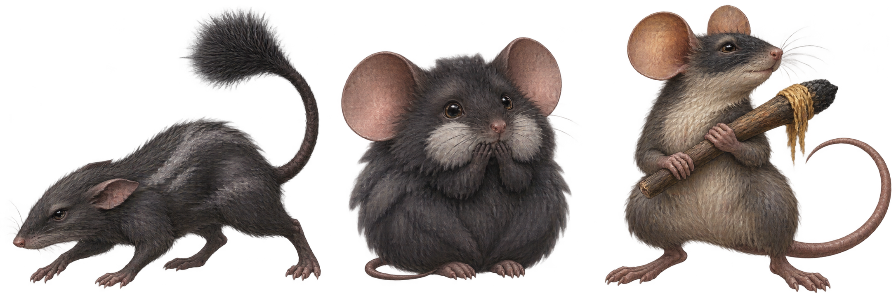
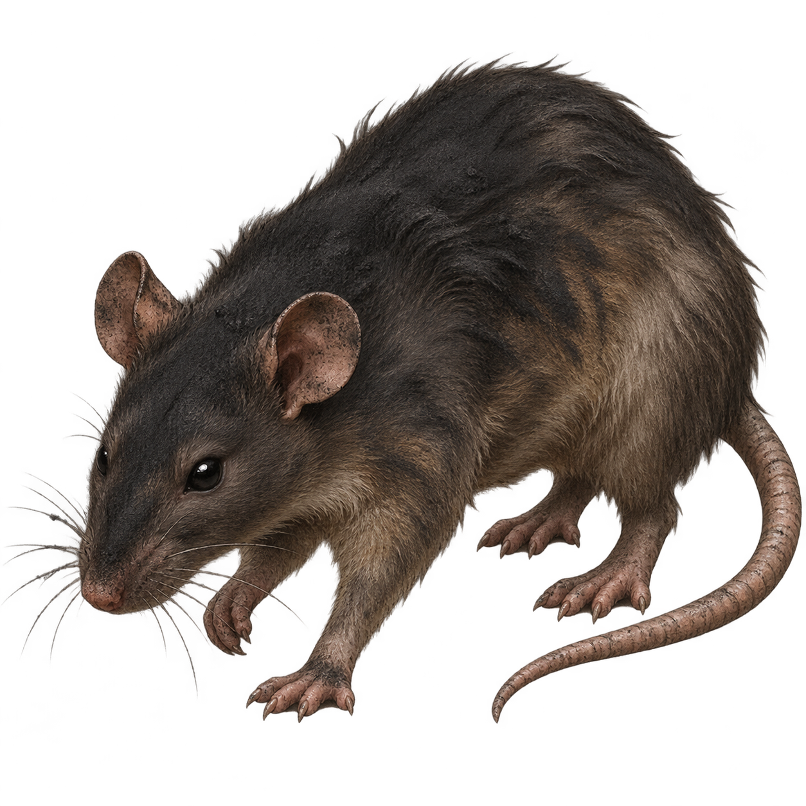

# 煤ネズミのデザイン記録

## 比較絵

**左「煙突掃除屋」**　細い胴を低く構え、長い尾の先だけが煤払いのブラシのように膨らんでいます。煙突を走るたびに尾が内壁をこすり、毛先に煤がたまる生き物です。

**中央「煤玉」**　丸まると煤の塊に見えます。前足で顔をぬぐう癖があり、両頬だけ地毛の白さがのぞきます。大きな耳と白い頬が目印で、戦闘画面で小さく表示しても顔を見分けやすい案です。

**右「松明泥棒」**　燃えさしの松明を両前足で抱え、物音に振り返った姿です。鼻先から目の周りまで煤で黒く、倒すと松明を落とす既存設定が絵から伝わります。

## 煤ネズミの単体絵

灰褐色のネズミが身を低くし、片方の前足をわずかに浮かせています。額から肩、背中にかけて乾いた黒い煤が毛並みにこびりつき、脇腹と喉元には地毛の色がのぞいています。耳の内側や足先にも細かな煤が残っています。

用途はデザイン検討用です。
