# 登場人物一覧

配布JSONの人物定義・素材参照から生成します。人物原稿は `authoring/characters.mjs`、追加10編は `authoring/story-q201.mjs` 〜 `story-q210.mjs`。q001〜q010の人物は安定したIDで定義し、同じリネを別人として増やさず、関所番と水門番を区別します。名無しの役割に本名を補わず、集団は集団実体として扱います。

外見・服装・小道具は美術設定です。NPCは探索隊員へ自動加入しません。旧AIPaint PNG・編集原稿・描画コマンドとカード用肖像を保存しています。

[肖像のプロンプト](../../assets/source/characters/imagegen-prompts.json) ／ [肖像のハッシュ](../../assets/source/characters/imagegen-manifest.json)

## 会話用の透過立ち絵

現在はNPC56定義中、48人の会話用画像を参照できます。人物のsprite指定を優先し、省略時はsprite_<ID>、それもなければ肖像へフォールバックします。以下にカード画像と会話画像を分けて示します。

2026-09-24の追加対象は人物30点とくらがり1点で、全31点の適用を完了しました。[回収・適用記録](../../assets/source/characters/recovery-2026-09-24.json)に対応とハッシュを保持します。各場面の配置演出や公開画面の通し確認まで完了したという意味ではありません。

2026-10-27にq201・q202の4人へ専用の透過人物画を接続しました。腰までの画像を肖像・立ち絵で共用し、既存の所在と出演条件を保持します。[原本・英語プロンプト・日本語訳・ハッシュ](../../assets/source/characters/kagaribi-2026-10-27.json)。

同日にq203のゲル・ユハ2人を追加し、篝火の専用人物画は6人になりました。試料瓶や油量を人物画へ固定せず、受渡し・燃焼量は既存の物語状態で扱います。[q203の原本・英日プロンプト・ハッシュ](../../assets/source/characters/kagaribi-q203-2026-10-27.json)。

同日にq204のエイン・リュカ2人を追加し、篝火の専用人物画は8人になりました。写し・証言書・封緘を人物画へ固定せず、同意と保持者は既存の物語状態で扱います。[q204の原本・英日プロンプト・ハッシュ](../../assets/source/characters/kagaribi-q204-2026-10-27.json)。

同日にq205のノノ・ダン2人を追加し、篝火の専用人物画は10人になりました。配合板を人物画へ固定せず、師弟の同席と灰溜まりの無人場面を既存castで切り替えます。[q205の原本・英日プロンプト・ハッシュ](../../assets/source/characters/kagaribi-q205-2026-10-27.json)。

同日にq206のミナ・ナギ2人を追加し、篝火の専用人物画は12人になりました。弁当を人物画へ固定せず、姉・弟それぞれの単独場面と同行帰着後の同席を既存castで切り替えます。[q206の原本・英日プロンプト・ハッシュ](../../assets/source/characters/kagaribi-q206-2026-10-27.json)。

q001では老人とルーキーを左、リネを右へ配置し、発話者を手前へ出します。[人物演出仕様](../ui/CHARACTER_STAGING.md)、[初期の立ち絵・ハッシュ](../../assets/source/characters/dialogue-sprites-manifest.json)、[使用プロンプト](../../assets/source/characters/dialogue-sprites-prompts.json)を参照してください。

## 所在モデルを持つ実装済み人物

### リネ (rine)

役割：灯番組合の連絡係。登場：q001・q010。動機：帰還者を名前で数え、取り残しを防ぐ。

q001とq010は同一人物。依頼受付・救助名簿・報告を担当する。

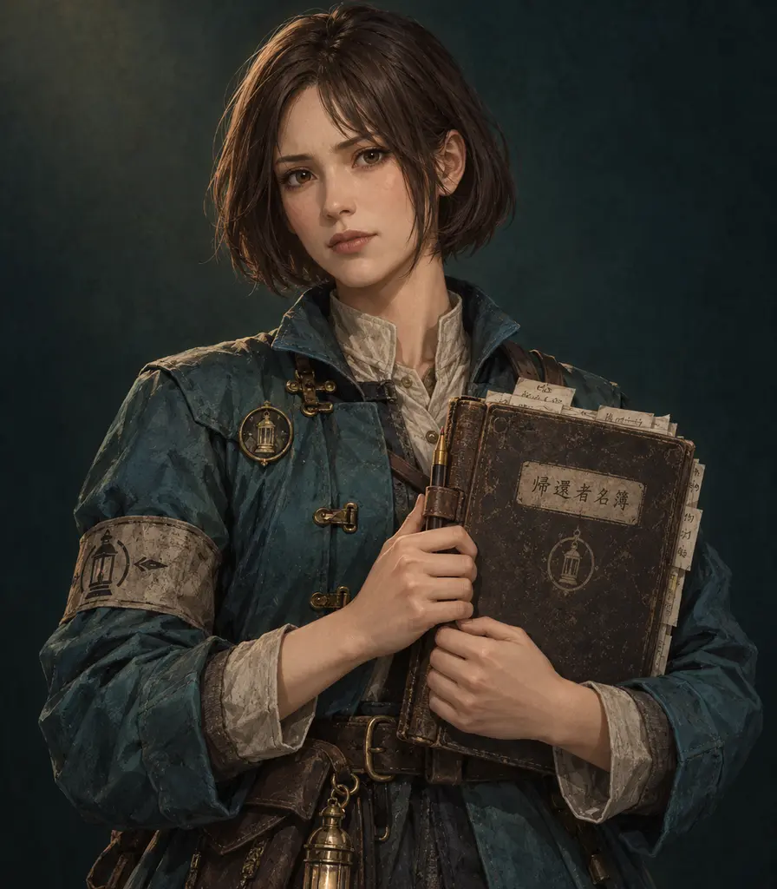

[会話用立ち絵](../../assets/images/characters/sprites/rine.webp)

[旧AIPaint PNG](../../assets/images/characters/rine.png) ／ [編集原稿](../../assets/source/characters/rine.paint.json) ／ [描画コマンド](../../assets/source/characters/rine.commands.json)

### 老灯番 (elder)

役割：行方不明の灯番。登場：q001。動機：新人を安全な入口へ帰し、自分も生きて戻る。

本名は未設定。新人へ油を渡し、最後の壁灯の下で救助を待つ。

[会話用立ち絵](../../assets/images/characters/sprites/elder.webp)

[旧AIPaint PNG](../../assets/images/characters/elder.png) ／ [編集原稿](../../assets/source/characters/elder.paint.json) ／ [描画コマンド](../../assets/source/characters/elder.commands.json)

### 新人灯番 (rookie)

役割：恐怖を抱える見習い。登場：q001。動機：暗闇が怖い。それでも老人と探索隊を助けたい。

本名は未設定。老人から受け取った油を保持する。

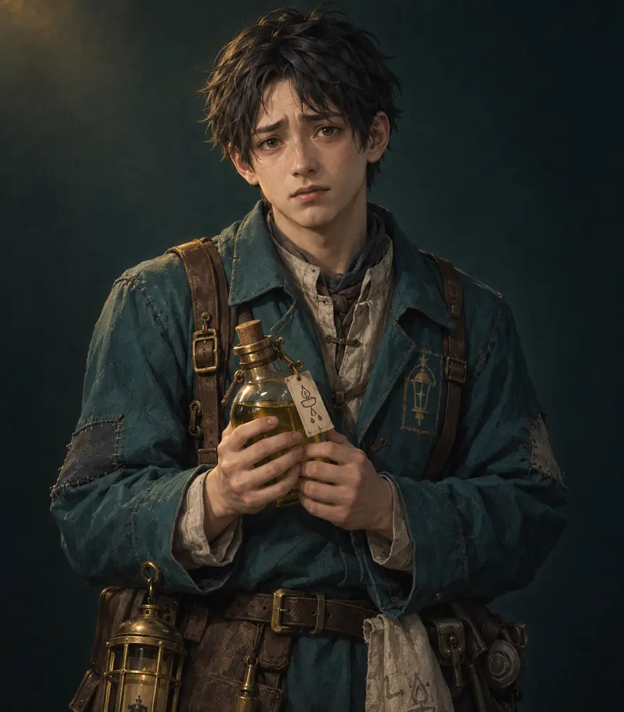

[会話用立ち絵](../../assets/images/characters/sprites/rookie.webp)

[旧AIPaint PNG](../../assets/images/characters/rookie.png) ／ [編集原稿](../../assets/source/characters/rookie.paint.json) ／ [描画コマンド](../../assets/source/characters/rookie.commands.json)

### 灯番救助隊 (rescuers)

役割：引継ぎ先の救助班。登場：q001。動機：地図に従って未帰還者を連れ戻す。

集団実体。人数や隊員名は固定せず、代表像を表示する。

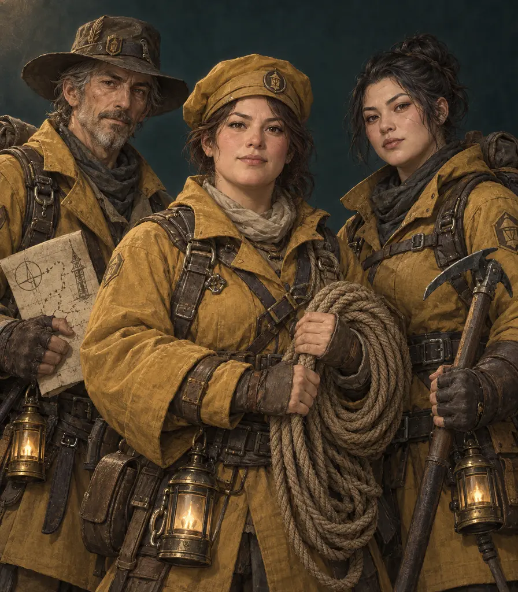

[会話用立ち絵](../../assets/images/characters/sprites/rescuers.webp)

[旧AIPaint PNG](../../assets/images/characters/rescuers.png) ／ [編集原稿](../../assets/source/characters/rescuers.paint.json) ／ [描画コマンド](../../assets/source/characters/rescuers.commands.json)

### ベルト (belt)

役割：運送人。登場：q002。動機：偽装の証拠となる荷札を回収し、一味の保険請求を通す。

生存する保険加入者を失踪者として届け出た一味から、標本を遺体に見せる仕事を受けた。骨箱を地下水路へ落とし、荷札だけを回収したがっている。

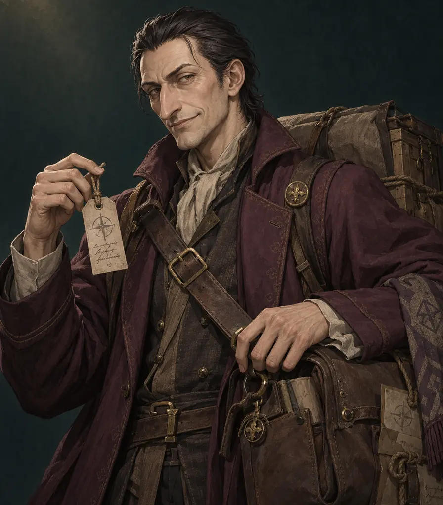

[会話用立ち絵](../../assets/images/characters/sprites/belt.webp)

[旧AIPaint PNG](../../assets/images/characters/belt.png) ／ [編集原稿](../../assets/source/characters/belt.paint.json) ／ [描画コマンド](../../assets/source/characters/belt.commands.json)

### 運搬人 (porter)

役割：標本の運搬を請けた荷役人。登場：q002。動機：仕事を失わずに標本を返したい。

保険加入者本人ではなく、ベルトの依頼で箱を運んだ証人。一味の偽装を知っているが、仕事を失うことを恐れている。証言には本人の同意が必要。

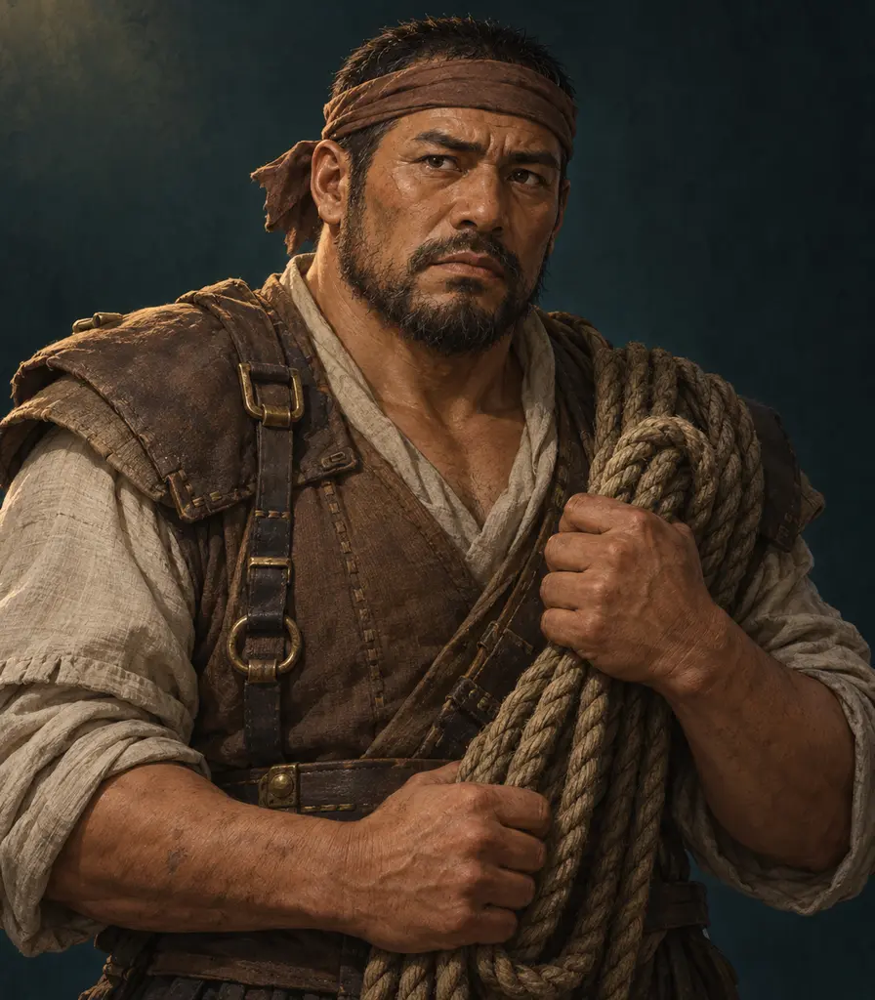

[会話用立ち絵](../../assets/images/characters/sprites/porter.webp)

[旧AIPaint PNG](../../assets/images/characters/porter.png) ／ [編集原稿](../../assets/source/characters/porter.paint.json) ／ [描画コマンド](../../assets/source/characters/porter.commands.json)

### 標本係 (curator)

役割：医学校の標本管理者。登場：q002。動機：標本と貸出台帳を学校へ戻す。

番号照合と回収を手伝う。

[会話用立ち絵](../../assets/images/characters/sprites/curator.webp)

[旧AIPaint PNG](../../assets/images/characters/curator.png) ／ [編集原稿](../../assets/source/characters/curator.paint.json) ／ [描画コマンド](../../assets/source/characters/curator.commands.json)

### 保険審査員 (examiner)

役割：死亡保険の審査担当。登場：q002。動機：標本番号・荷札・失踪届・保険請求書・証言を照合する。

審査所で失踪届と保険請求書を管理する。医学校の台帳、書き換えられた荷札、運搬人の証言を照合して不正を立証する。

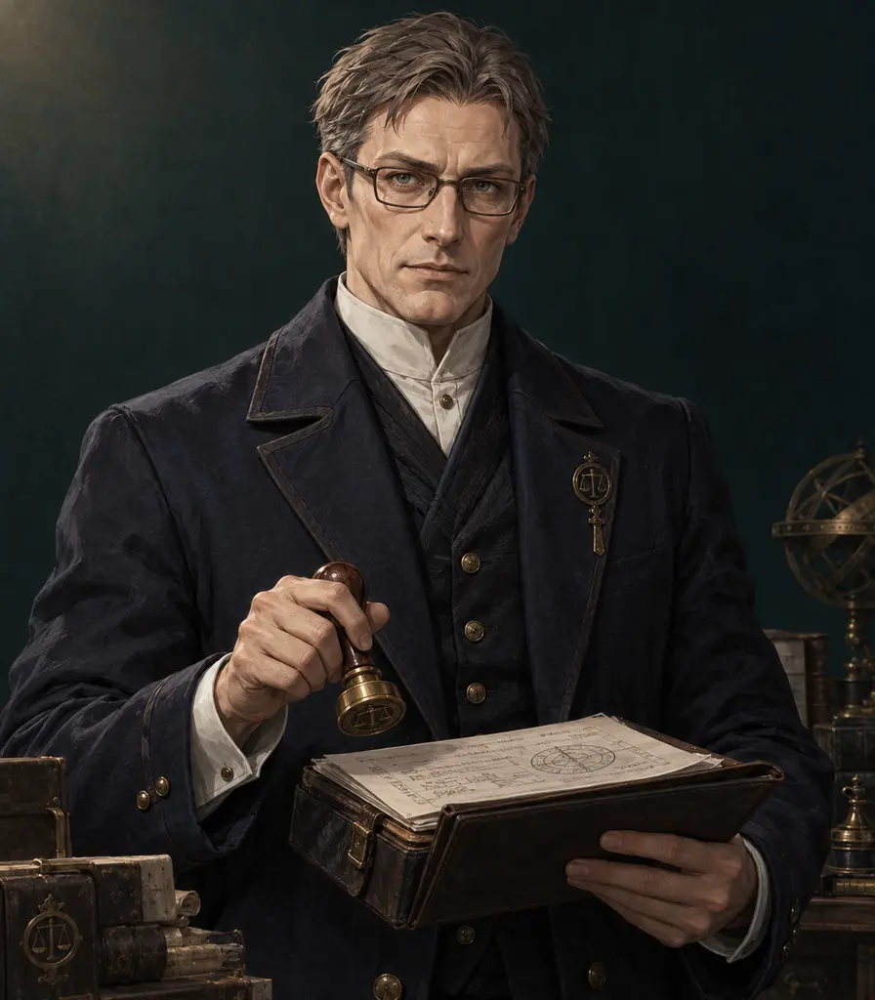

[会話用立ち絵](../../assets/images/characters/sprites/examiner.webp)

[旧AIPaint PNG](../../assets/images/characters/examiner.png) ／ [編集原稿](../../assets/source/characters/examiner.paint.json) ／ [描画コマンド](../../assets/source/characters/examiner.commands.json)

### ソラ (sora)

役割：水門役人。登場：q003。動機：警報の信頼を取り戻す。

鐘の機構を見張り、運用試験を担当する。

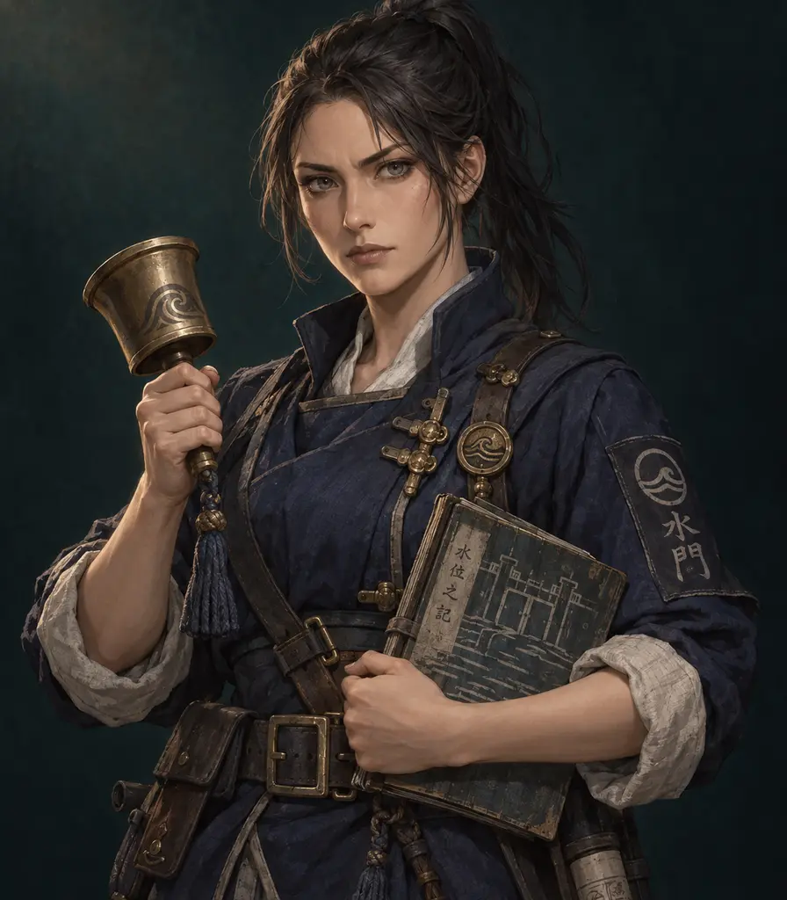

[会話用立ち絵](../../assets/images/characters/sprites/sora.webp)

[旧AIPaint PNG](../../assets/images/characters/sora.png) ／ [編集原稿](../../assets/source/characters/sora.paint.json) ／ [描画コマンド](../../assets/source/characters/sora.commands.json)

### 通行人たち (passers)

役割：低い通路の利用者。登場：q003。動機：荷とともに安全な通路へ出る。

集団実体。鐘を止める前に高所へ誘導する。

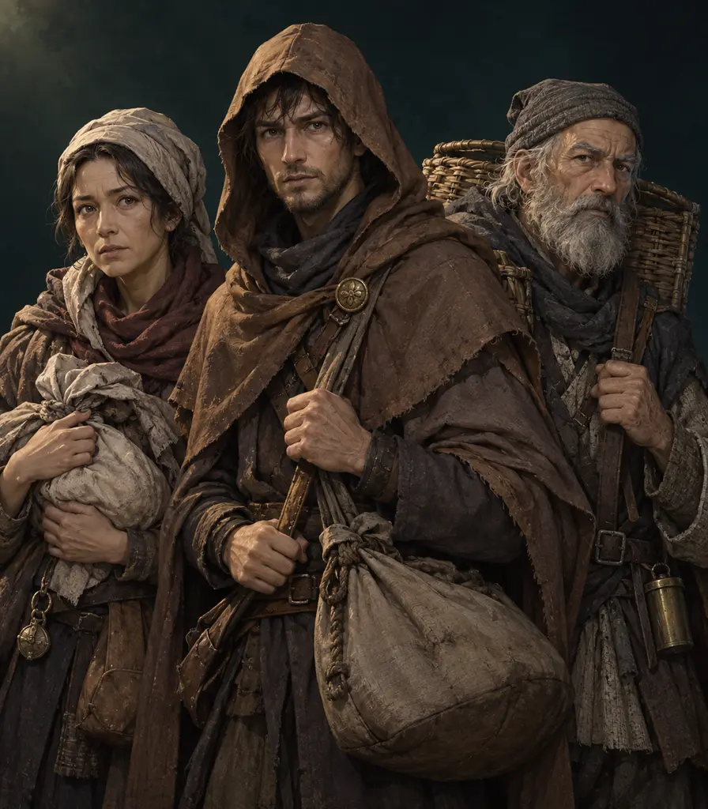

[会話用立ち絵](../../assets/images/characters/sprites/passers.webp)

[旧AIPaint PNG](../../assets/images/characters/passers.png) ／ [編集原稿](../../assets/source/characters/passers.paint.json) ／ [描画コマンド](../../assets/source/characters/passers.commands.json)

### 宿屋の主人 (innkeeper)

役割：私設汚水槽の管理者。登場：q003。動機：宿の営業と湯替えを維持する。

浴場・洗濯場・食堂の拡張で増えた使用済みの水を夜にまとめて排出していた。使用量の削減と排水時刻の分散を交渉する当事者。

[会話用立ち絵](../../assets/images/characters/sprites/innkeeper.webp)

[旧AIPaint PNG](../../assets/images/characters/innkeeper.png) ／ [編集原稿](../../assets/source/characters/innkeeper.paint.json) ／ [描画コマンド](../../assets/source/characters/innkeeper.commands.json)

### 水売り (seller)

役割：井戸水を樽で届ける商人。登場：q003。動機：水の商いによる収入を保つ。

宿へ届ける水の量が減れば収入も減る。

[会話用立ち絵](../../assets/images/characters/sprites/seller.webp)

[旧AIPaint PNG](../../assets/images/characters/seller.png) ／ [編集原稿](../../assets/source/characters/seller.paint.json) ／ [描画コマンド](../../assets/source/characters/seller.commands.json)

### 水位見張り当番 (waterwatch)

役割：水位観測と伝令の担当。登場：q003。動機：高所の鐘へ水位を伝える。

人手で鳴らす警報に必要な交代制の集団。

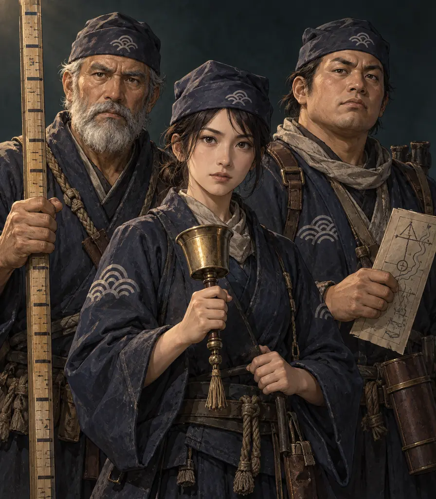

[会話用立ち絵](../../assets/images/characters/sprites/waterwatch.webp)

[旧AIPaint PNG](../../assets/images/characters/waterwatch.png) ／ [編集原稿](../../assets/source/characters/waterwatch.paint.json) ／ [描画コマンド](../../assets/source/characters/waterwatch.commands.json)

### イナ (ina)

役割：見習い冒険者。登場：q004。動機：関所に留置された姉を助ける。

写しを持つ妹。姉の原本と同じ資格番号を使った。

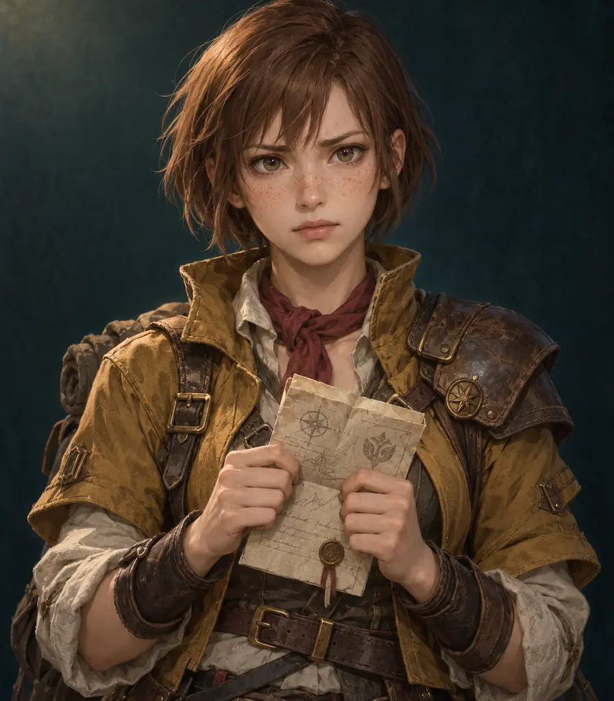

[会話用立ち絵](../../assets/images/characters/sprites/ina.webp)

[旧AIPaint PNG](../../assets/images/characters/ina.png) ／ [編集原稿](../../assets/source/characters/ina.paint.json) ／ [描画コマンド](../../assets/source/characters/ina.commands.json)

### イナの姉 (sister)

役割：留置された通行者。登場：q004。動機：妹を守り、自分も外へ戻る。

原本の資格者。本名は未設定。

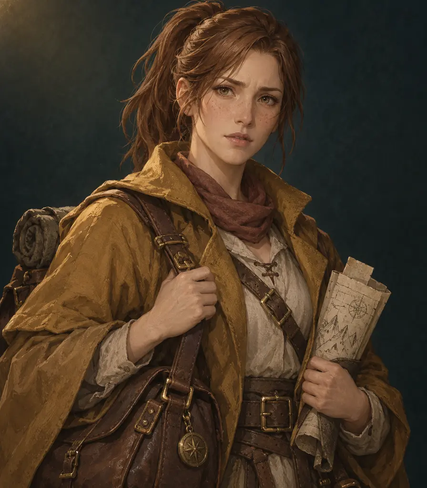

[会話用立ち絵](../../assets/images/characters/sprites/sister.webp)

[旧AIPaint PNG](../../assets/images/characters/sister.png) ／ [編集原稿](../../assets/source/characters/sister.paint.json) ／ [描画コマンド](../../assets/source/characters/sister.commands.json)

### 関所番 (passkeeper)

役割：地下関所の係員。登場：q004。動機：兄の名で続けた勤務を失いたくない。

水門番とは別人。死んだ兄は歴史上の人物で、生存NPCではない。

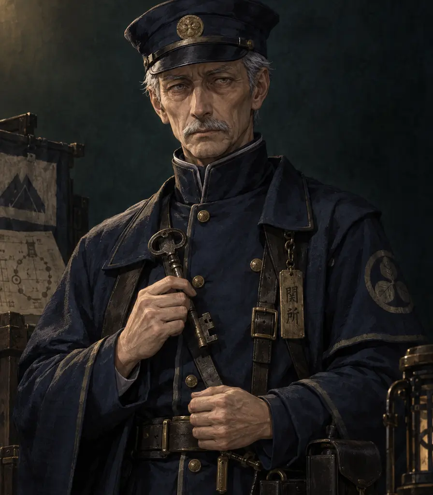

[会話用立ち絵](../../assets/images/characters/sprites/passkeeper.webp)

[旧AIPaint PNG](../../assets/images/characters/passkeeper.png) ／ [編集原稿](../../assets/source/characters/passkeeper.paint.json) ／ [描画コマンド](../../assets/source/characters/passkeeper.commands.json)

### 名義審査官 (reviewer)

役割：地上の資格審査担当。登場：q004。動機：本人と資格名義を照合する。

現場へ赴き申告を確認し、姉妹の仮証を発行する。

[会話用立ち絵](../../assets/images/characters/sprites/reviewer.webp)

[旧AIPaint PNG](../../assets/images/characters/reviewer.png) ／ [編集原稿](../../assets/source/characters/reviewer.paint.json) ／ [描画コマンド](../../assets/source/characters/reviewer.commands.json)

### トト (toto)

役割：菓子職人。登場：q005。動機：詰まりを取り除き、工房を再開する。

冷水試験の後に初めて、安全に食用へ回せるなら菌床を残したいと申し出る。分離槽の維持や、網を使う場合の清掃当番を引き受ける。

[会話用立ち絵](../../assets/images/characters/sprites/toto.webp)

[旧AIPaint PNG](../../assets/images/characters/toto.png) ／ [編集原稿](../../assets/source/characters/toto.paint.json) ／ [描画コマンド](../../assets/source/characters/toto.commands.json)

### ガロ (garo)

役割：工事頭。登場：q006。動機：未払いを隠し、石入りの給金箱を未開封で取り戻す。

工事費を使い切り、自ら石入りの箱を沈めて盗難に見せかけた。職人たちに第三者の捜索を求められて依頼する。一部払いには自分の荷車と予備工具を売る。

[会話用立ち絵](../../assets/images/characters/sprites/garo.webp)

[旧AIPaint PNG](../../assets/images/characters/garo.png) ／ [編集原稿](../../assets/source/characters/garo.paint.json) ／ [描画コマンド](../../assets/source/characters/garo.commands.json)

### 工事の職人たち (workers)

役割：未払い給金を待つ集団。登場：q006。動機：未払いを受け取り、仲間への疑いを解く。

証拠を引き受けた場合は自分たちで交渉する。

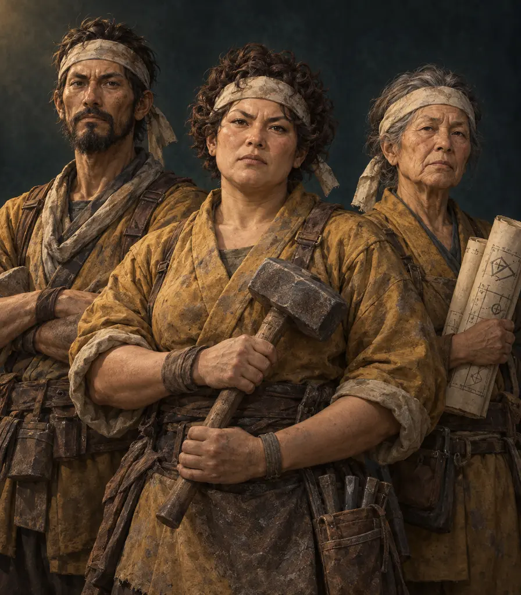

[会話用立ち絵](../../assets/images/characters/sprites/workers.webp)

[旧AIPaint PNG](../../assets/images/characters/workers.png) ／ [編集原稿](../../assets/source/characters/workers.paint.json) ／ [描画コマンド](../../assets/source/characters/workers.commands.json)

### 疑われた荷役人 (accused)

役割：給金箱の紛失を責められた人。登場：q006。動機：盗みの疑いを晴らす。

空の箱を最後に運んだが、盗んでも沈めてもいない。集団とは別の実体として所在を管理する。

[会話用立ち絵](../../assets/images/characters/sprites/accused.webp)

[旧AIPaint PNG](../../assets/images/characters/accused.png) ／ [編集原稿](../../assets/source/characters/accused.paint.json) ／ [描画コマンド](../../assets/source/characters/accused.commands.json)

### ミレ (mire)

役割：酒場で働く遺族。登場：q007。動機：亡夫の声の正体を自分で確かめる。

夫は故人。弟との面会や伝声口の封鎖を本人が選ぶ。

[会話用立ち絵](../../assets/images/characters/sprites/mire.webp)

[旧AIPaint PNG](../../assets/images/characters/mire.png) ／ [編集原稿](../../assets/source/characters/mire.paint.json) ／ [描画コマンド](../../assets/source/characters/mire.commands.json)

### ミレの夫の弟 (brother)

役割：手紙を預かる遺族。登場：q007。動機：兄の手紙を届けたいが、ミレに拒まれるのが怖い。

遺品から見つけた兄の未配達の手紙の原本を保持する。似た声を兄の話し方へ寄せ、伝声管を通して読んでいた。

[会話用立ち絵](../../assets/images/characters/sprites/brother.webp)

[旧AIPaint PNG](../../assets/images/characters/brother.png) ／ [編集原稿](../../assets/source/characters/brother.paint.json) ／ [描画コマンド](../../assets/source/characters/brother.commands.json)

### ヨル (yoru)

役割：葬送組合の担当者。登場：q008。動機：葬儀を終え、下流へ食料も届ける。

遺体を納める内室と別の外底に食料を隠した。

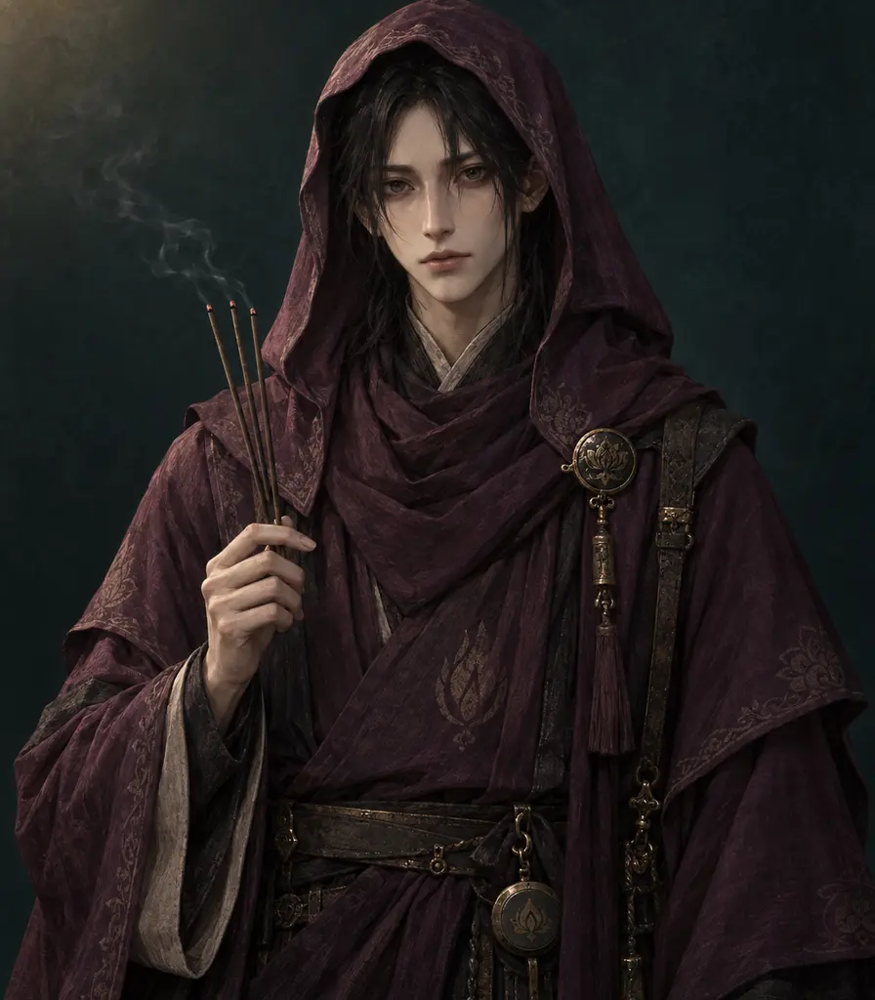

[会話用立ち絵](../../assets/images/characters/sprites/yoru.webp)

[旧AIPaint PNG](../../assets/images/characters/yoru.png) ／ [編集原稿](../../assets/source/characters/yoru.paint.json) ／ [描画コマンド](../../assets/source/characters/yoru.commands.json)

### 棺の遺族 (family)

役割：水葬を待つ家族。登場：q008。動機：故人を弔い、扱いを自分たちで決める。

外底の検査と葬儀の延期には了承を得る。

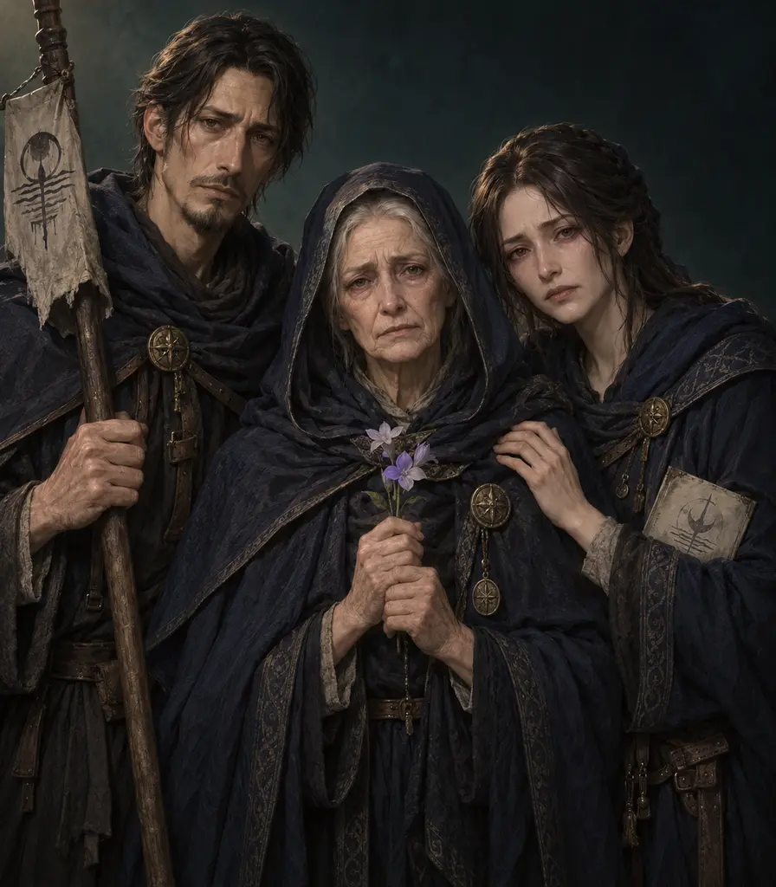

[会話用立ち絵](../../assets/images/characters/sprites/family.webp)

[旧AIPaint PNG](../../assets/images/characters/family.png) ／ [編集原稿](../../assets/source/characters/family.paint.json) ／ [描画コマンド](../../assets/source/characters/family.commands.json)

### 棺の担ぎ手 (bearers)

役割：葬送作業の担当者。登場：q008。動機：棺と遺体を傷めずに運ぶ。

棺の移動経路を家族や食料と分けて管理する。

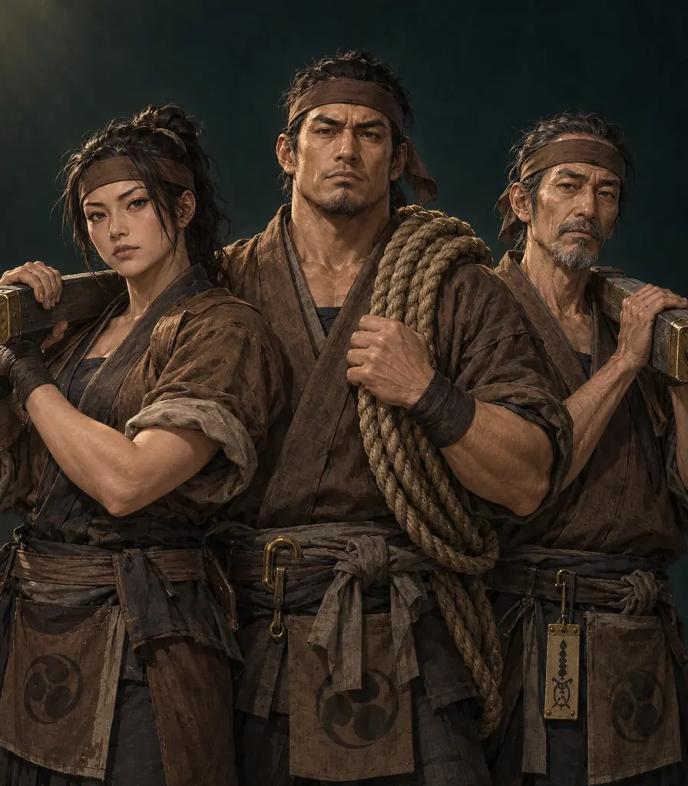

[会話用立ち絵](../../assets/images/characters/sprites/bearers.webp)

[旧AIPaint PNG](../../assets/images/characters/bearers.png) ／ [編集原稿](../../assets/source/characters/bearers.paint.json) ／ [描画コマンド](../../assets/source/characters/bearers.commands.json)

### 下流の受取人 (recipient)

役割：避難民側の食料受取担当。登場：q008。動機：食料を受け取り、待つ人々へ配る。

下流の葬送桟橋で待つ。棺が届いた場合は外底だけを外し、遺体を封じた内室を水葬経路へ戻す。岸や窓口へは案内に従って移動する。

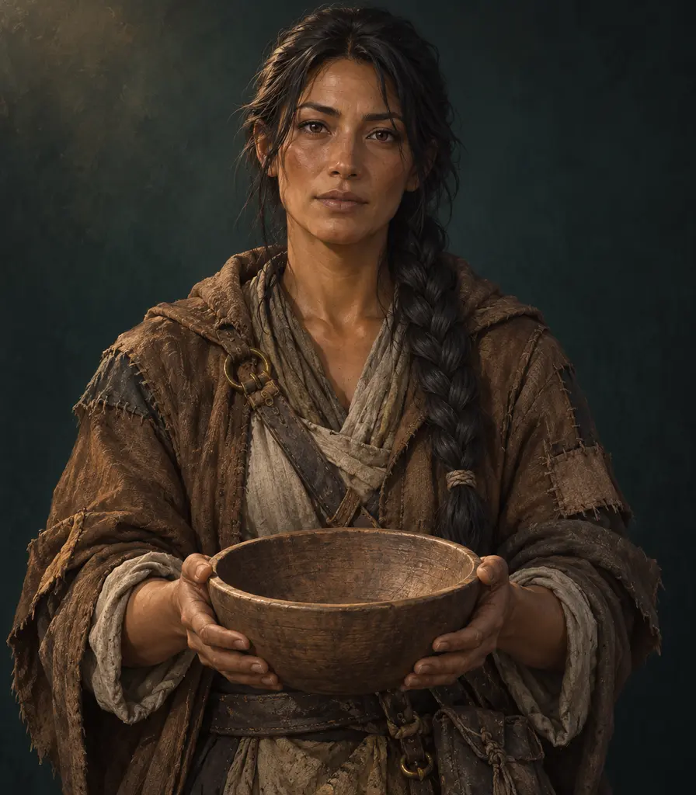

[会話用立ち絵](../../assets/images/characters/sprites/recipient.webp)

[旧AIPaint PNG](../../assets/images/characters/recipient.png) ／ [編集原稿](../../assets/source/characters/recipient.paint.json) ／ [描画コマンド](../../assets/source/characters/recipient.commands.json)

### 輸送検査官 (inspector)

役割：食料輸送の検査担当。登場：q008。動機：今回の荷と届け先を確かめる。

臨時許可を審査する。恒久的な制度変更はここでは決定しない。

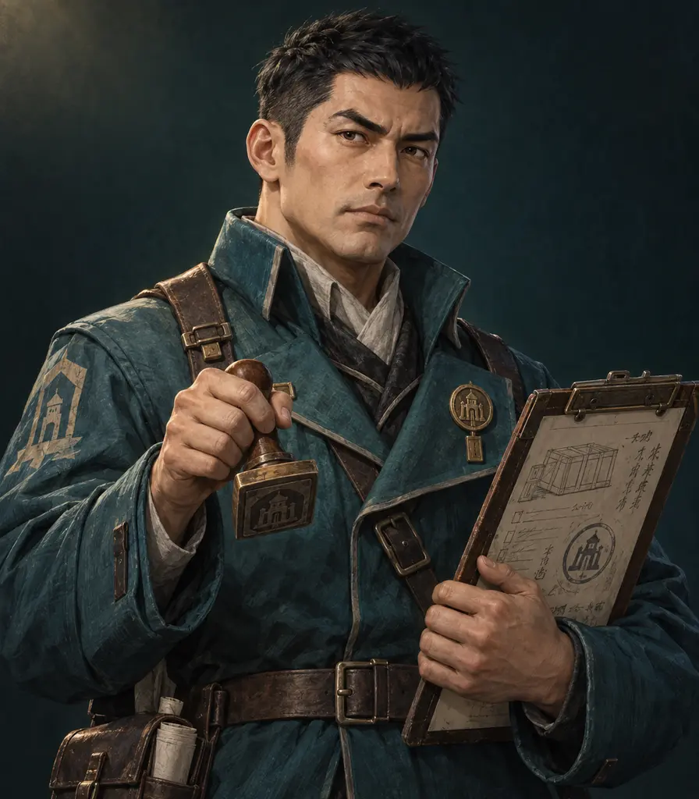

[会話用立ち絵](../../assets/images/characters/sprites/inspector.webp)

[旧AIPaint PNG](../../assets/images/characters/inspector.png) ／ [編集原稿](../../assets/source/characters/inspector.paint.json) ／ [描画コマンド](../../assets/source/characters/inspector.commands.json)

### エダ (eda)

役割：地下測量士。登場：q009。動機：鼠の異変と構造物の危険を切り分ける。

旧図、支柱の測点、亀裂、地下水位を比較する。この区画に新しい変位がないことを、他区画の安全と混同しない。

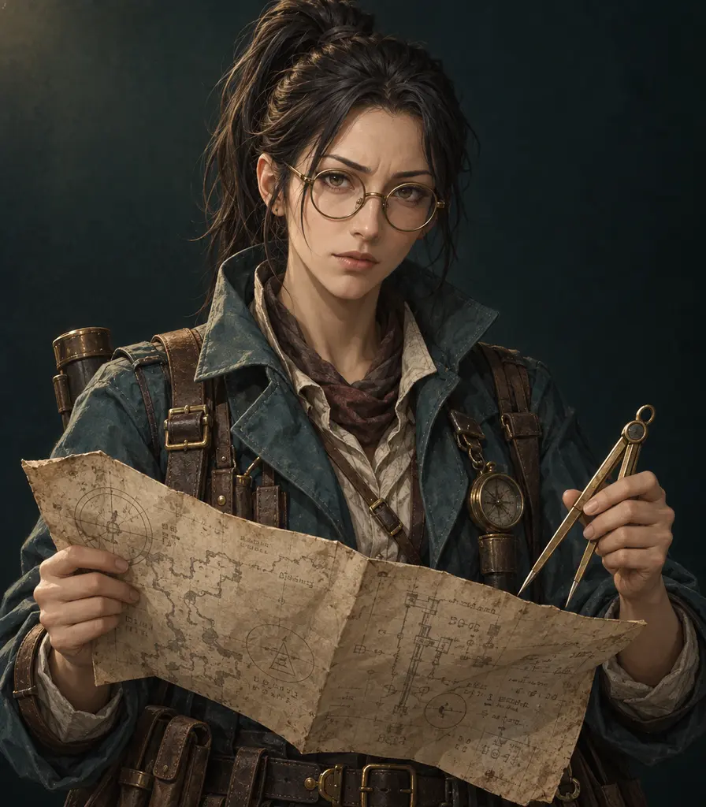

[会話用立ち絵](../../assets/images/characters/sprites/eda.webp)

[旧AIPaint PNG](../../assets/images/characters/eda.png) ／ [編集原稿](../../assets/source/characters/eda.paint.json) ／ [描画コマンド](../../assets/source/characters/eda.commands.json)

### 清掃係 (cleaners)

役割：石灰消毒の担当者。登場：q009。動機：担当区画を清潔に保つ。

合意した区画表は保存する。散布済みの薬は元に戻らない。

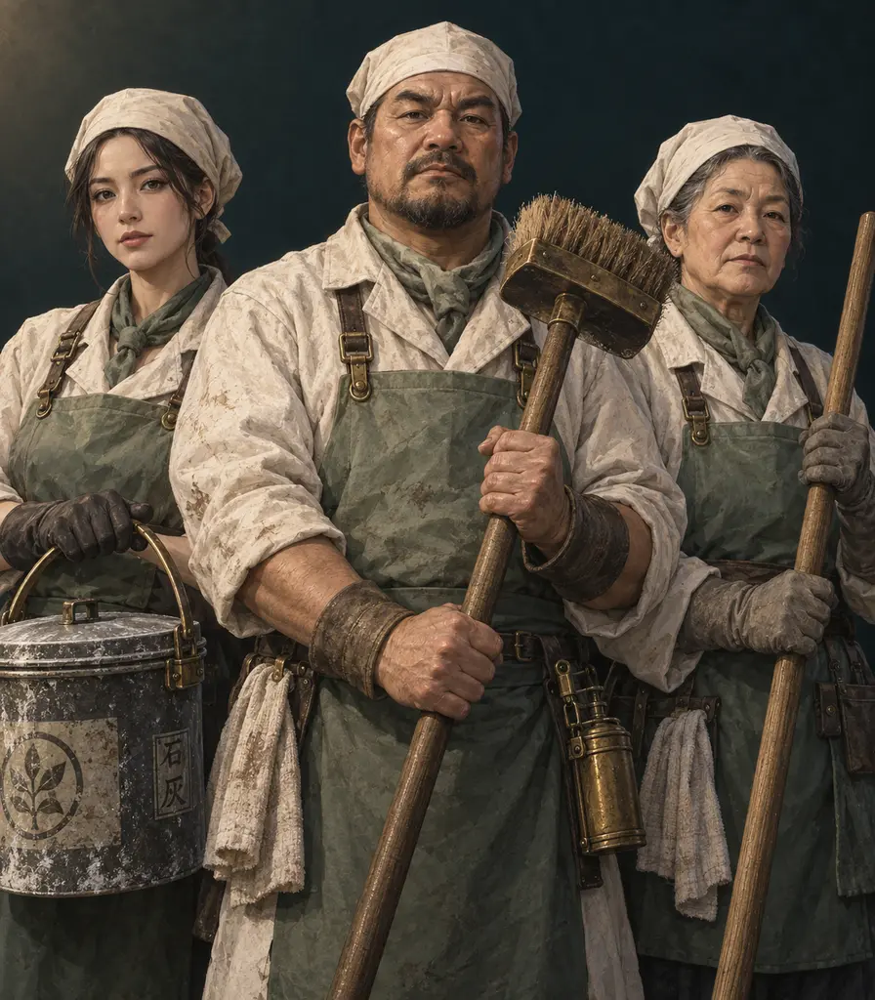

[会話用立ち絵](../../assets/images/characters/sprites/cleaners.webp)

[旧AIPaint PNG](../../assets/images/characters/cleaners.png) ／ [編集原稿](../../assets/source/characters/cleaners.paint.json) ／ [描画コマンド](../../assets/source/characters/cleaners.commands.json)

### 穀倉番 (storekeeper)

役割：穀物庫の管理者。登場：q009。動機：鼠から穀物を守る。

内扉を閉め、穀物への侵入を防いでいる。

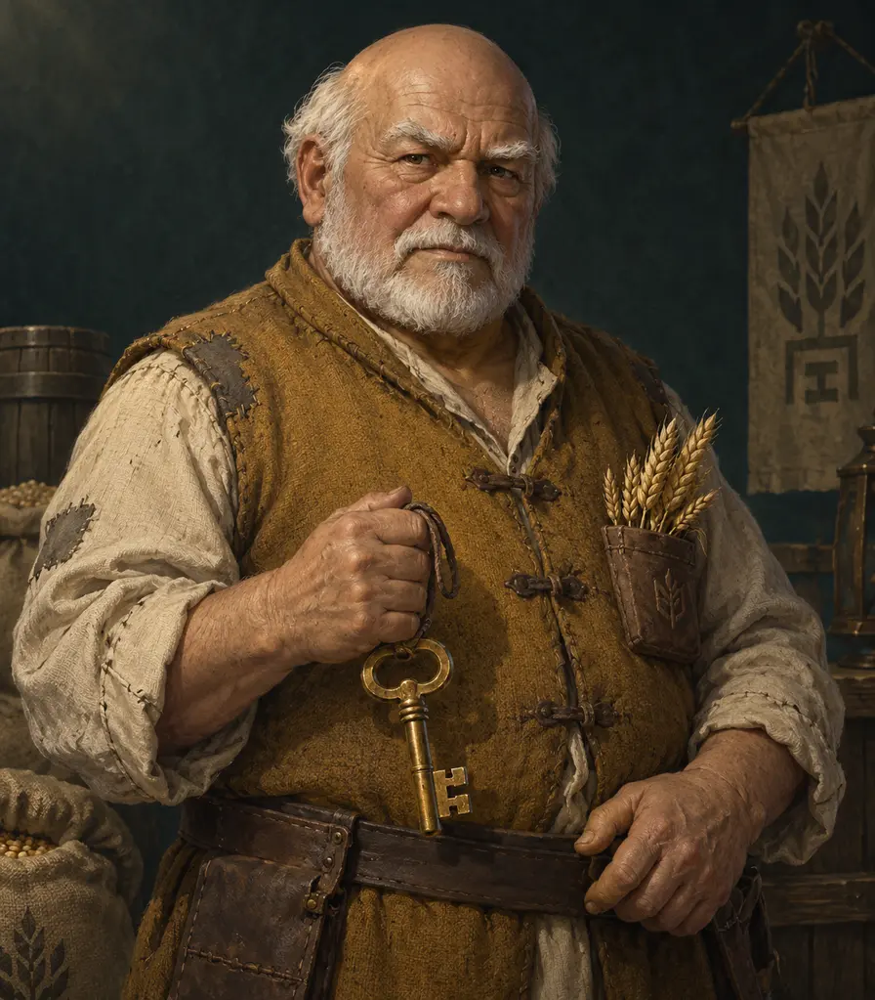

[会話用立ち絵](../../assets/images/characters/sprites/storekeeper.webp)

[旧AIPaint PNG](../../assets/images/characters/storekeeper.png) ／ [編集原稿](../../assets/source/characters/storekeeper.paint.json) ／ [描画コマンド](../../assets/source/characters/storekeeper.commands.json)

### 共同倉庫の受入れ係 (clerks)

役割：数量と配分の記録担当。登場：q009。動機：搬入数と出庫先を公開して管理する。

穀物を受け取った事実を記録する集団。

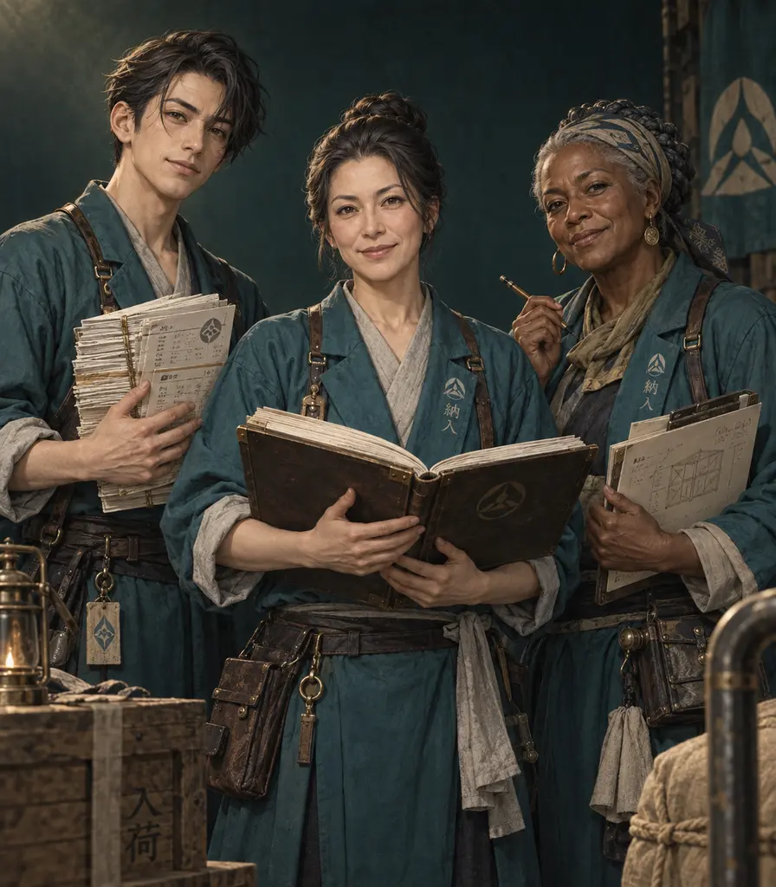

[会話用立ち絵](../../assets/images/characters/sprites/clerks.webp)

[旧AIPaint PNG](../../assets/images/characters/clerks.png) ／ [編集原稿](../../assets/source/characters/clerks.paint.json) ／ [描画コマンド](../../assets/source/characters/clerks.commands.json)

### 水門番 (gatekeeper)

役割：老朽水門の操作担当。登場：q010。動機：命令と取り残した住民の間で責任を決める。

関所番とは別人。安全側の操作室から閉門し、操作梯子で地上へ脱出できる。旧工事用の縦坑は上下両端の検査が済むまで避難路に使えない。未承認工事と閉門を遅らせた理由を証言できる。

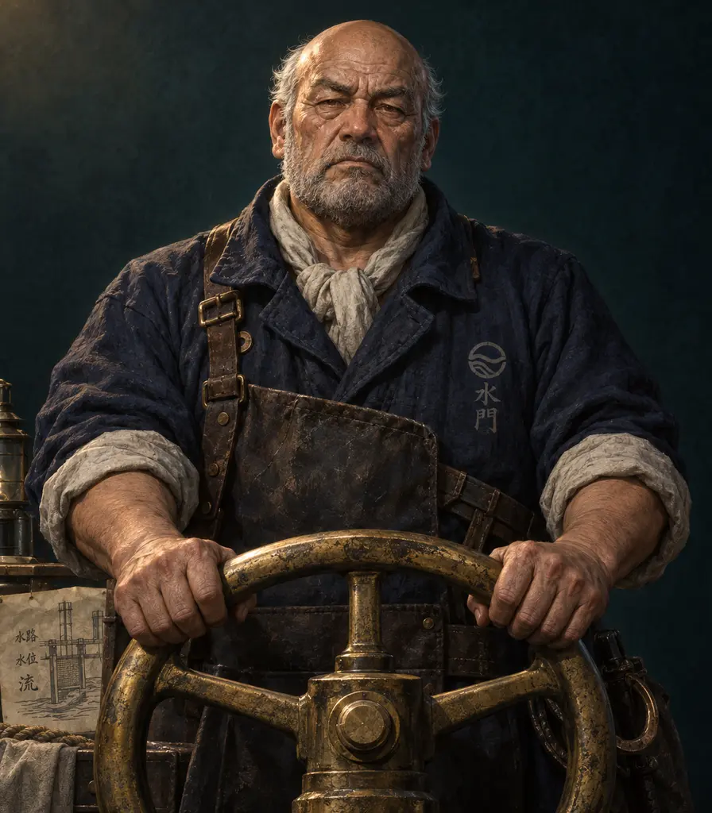

[会話用立ち絵](../../assets/images/characters/sprites/gatekeeper.webp)

[旧AIPaint PNG](../../assets/images/characters/gatekeeper.png) ／ [編集原稿](../../assets/source/characters/gatekeeper.paint.json) ／ [描画コマンド](../../assets/source/characters/gatekeeper.commands.json)

### 手前の住民三人 (nearpeople)

役割：避難通路で待つ住民。登場：q010。動機：三人で地上へ出る。

人数三人を固定。地上到着前に救出済みにしない。

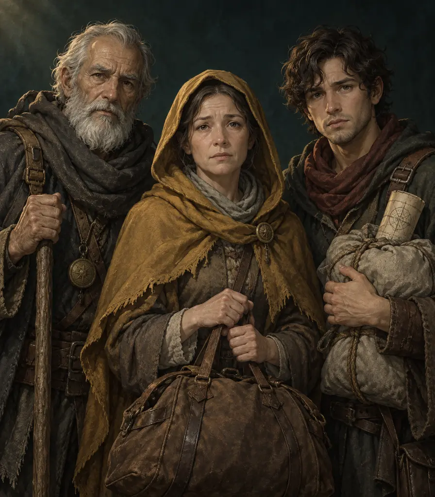

[会話用立ち絵](../../assets/images/characters/sprites/nearpeople.webp)

[旧AIPaint PNG](../../assets/images/characters/nearpeople.png) ／ [編集原稿](../../assets/source/characters/nearpeople.paint.json) ／ [描画コマンド](../../assets/source/characters/nearpeople.commands.json)

### 奥の住民二人 (deeppeople)

役割：作業区画で待つ住民。登場：q010。動機：渡りを越えて地上へ出る。

人数二人を固定。渡りには救助縄が必要。

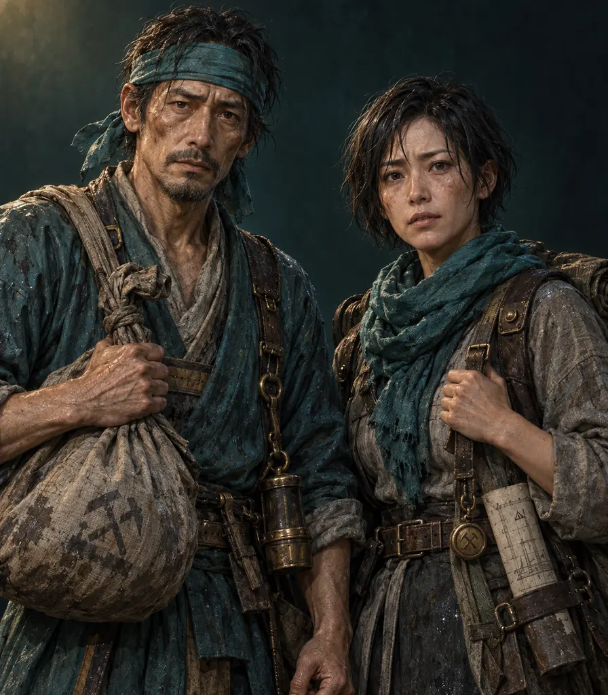

[会話用立ち絵](../../assets/images/characters/sprites/deeppeople.webp)

[旧AIPaint PNG](../../assets/images/characters/deeppeople.png) ／ [編集原稿](../../assets/source/characters/deeppeople.paint.json) ／ [描画コマンド](../../assets/source/characters/deeppeople.commands.json)

### 排水隊 (pumpcrew)

役割：閉門を延期する交代班。登場：q010。動機：現場を引き受け、避難の時間を稼ぐ。

連絡だけで引継ぎ済みとせず、操作室への到着を確認する。

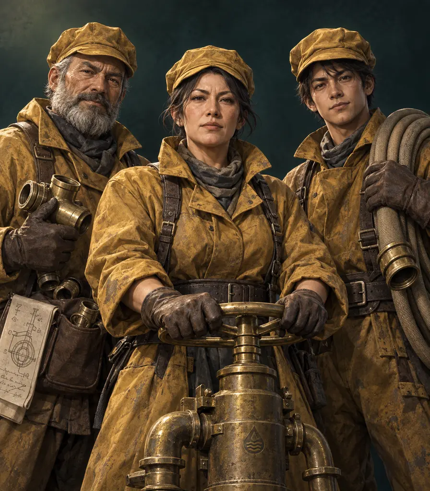

[会話用立ち絵](../../assets/images/characters/sprites/pumpcrew.webp)

[旧AIPaint PNG](../../assets/images/characters/pumpcrew.png) ／ [編集原稿](../../assets/source/characters/pumpcrew.paint.json) ／ [描画コマンド](../../assets/source/characters/pumpcrew.commands.json)

### ナヴィア (q201_clerk)

役割：油蔵の記帳係。登場：q201。動機：休憩の記録を確かめ、運搬人の給金を止めない。

休憩を命じた本人。給金規則を読んだが、例外の申請をしていない。

[会話用立ち絵](../../assets/images/characters/kagaribi/q201_clerk.webp)

[生成PNG原本](../../assets/source/characters/kagaribi-2026-10-27/q201_clerk.png) ／ [生成・変換記録](../../assets/source/characters/kagaribi-2026-10-27.json)

### エン (q201_porter)

役割：油の運搬人。登場：q201。動機：休んだことも働いたことも自分の名で残す。

休憩を命じられたことは知るが、休み印が消された理由は知らない。

[会話用立ち絵](../../assets/images/characters/kagaribi/q201_porter.webp)

[生成PNG原本](../../assets/source/characters/kagaribi-2026-10-27/q201_porter.png) ／ [生成・変換記録](../../assets/source/characters/kagaribi-2026-10-27.json)

### トマ (q202_trainee)

役割：別班の見習い灯番。登場：q202。動機：聞き落としを隠さず巡回を続ける。

幼い頃から左耳が聞こえにくい。試験の鐘は左後方から鳴った。q001の新人とは別人。

[会話用立ち絵](../../assets/images/characters/kagaribi/q202_trainee.webp)

[生成PNG原本](../../assets/source/characters/kagaribi-2026-10-27/q202_trainee.png) ／ [生成・変換記録](../../assets/source/characters/kagaribi-2026-10-27.json)

### セナ (q202_trainer)

役割：合図の教習係。登場：q202。動機：誰が担当しても伝わる手順を決める。

試験結果は見たが、トマの聴力については聞いていない。

[会話用立ち絵](../../assets/images/characters/kagaribi/q202_trainer.webp)

[生成PNG原本](../../assets/source/characters/kagaribi-2026-10-27/q202_trainer.png) ／ [生成・変換記録](../../assets/source/characters/kagaribi-2026-10-27.json)

### ゲル (q203_seller)

役割：油の納入商。登場：q203。動機：不良を認めても取引を失わずに済ませる。

雨ざらしの漏斗を使った。水が入った経緯は知るが、燃焼試験をしていない。

[会話用立ち絵](../../assets/images/characters/kagaribi/q203_seller.webp)

[生成PNG原本](../../assets/source/characters/kagaribi-q203-2026-10-27/q203_seller.png) ／ [生成・変換記録](../../assets/source/characters/kagaribi-q203-2026-10-27.json)

### ユハ (q203_tester)

役割：灯油の検品係。登場：q203。動機：使える量と使えない量を区別して記録する。

試験皿と目盛り管を持つ。納入時の作業は見ていない。

[会話用立ち絵](../../assets/images/characters/kagaribi/q203_tester.webp)

[生成PNG原本](../../assets/source/characters/kagaribi-q203-2026-10-27/q203_tester.png) ／ [生成・変換記録](../../assets/source/characters/kagaribi-q203-2026-10-27.json)

### エイン (q204_scribe)

役割：帰還記録の書記。登場：q204。動機：死者の名簿へ生存者を残さない。

二年前に未帰還の報告を受けてリュカの名を追悼欄へ写した。遺体を確認した記録ではない。

[会話用立ち絵](../../assets/images/characters/kagaribi/q204_scribe.webp)

[生成PNG原本](../../assets/source/characters/kagaribi-q204-2026-10-27/q204_scribe.png) ／ [生成・変換記録](../../assets/source/characters/kagaribi-q204-2026-10-27.json)

### リュカ (q204_survivor)

役割：追悼欄に名のある運搬人。登場：q204。動機：生きていることを伝えつつ、身を寄せる場所を守る。

事故後に別の出口から帰還し、暴力のある家へ戻らず働き始めた。現在地の公開を拒む。

[会話用立ち絵](../../assets/images/characters/kagaribi/q204_survivor.webp)

[生成PNG原本](../../assets/source/characters/kagaribi-q204-2026-10-27/q204_survivor.png) ／ [生成・変換記録](../../assets/source/characters/kagaribi-q204-2026-10-27.json)

### ノノ (q205_pupil)

役割：炭焼きの見習い。登場：q205。動機：師の仕事を引き継ぐため、配合板を回収する。

今ある木材は昔と違うと気づいたが、配合を変える許しをまだ求めていない。

[会話用立ち絵](../../assets/images/characters/kagaribi/q205_pupil.webp)

[生成PNG原本](../../assets/source/characters/kagaribi-q205-2026-10-27/q205_pupil.png) ／ [生成・変換記録](../../assets/source/characters/kagaribi-q205-2026-10-27.json)

### ダン (q205_master)

役割：引退を決めた炭焼き。登場：q205。動機：失敗した配合を弟子へ押しつけない。

今の湿った木材に古い配合を使って失敗し、板を灰溜まりへ捨てた。

[会話用立ち絵](../../assets/images/characters/kagaribi/q205_master.webp)

[生成PNG原本](../../assets/source/characters/kagaribi-q205-2026-10-27/q205_master.png) ／ [生成・変換記録](../../assets/source/characters/kagaribi-q205-2026-10-27.json)

### ミナ (q206_sister)

役割：炊事場で働く姉。登場：q206。動機：弟へ食事を届ける。

弟が退職を申し出たことは知らない。弁当は勤務の対価ではなく差し入れ。

[会話用立ち絵](../../assets/images/characters/kagaribi/q206_sister.webp)

[生成PNG原本](../../assets/source/characters/kagaribi-q206-2026-10-27/q206_sister.png) ／ [生成・変換記録](../../assets/source/characters/kagaribi-q206-2026-10-27.json)

### ナギ (q206_worker)

役割：退職を申し出た火運び。登場：q206。動機：姉に辞めたことを自分で伝える。

当番を終えて退職を申し出た。今は中継広間で帰る決心がつかずにいる。

[会話用立ち絵](../../assets/images/characters/kagaribi/q206_worker.webp)

[生成PNG原本](../../assets/source/characters/kagaribi-q206-2026-10-27/q206_worker.png) ／ [生成・変換記録](../../assets/source/characters/kagaribi-q206-2026-10-27.json)

### オセ (q207_surveyor)

役割：独立した測量師。登場：q207。動機：誤った通路幅を訂正する。

前回は震える手で竿を斜めに持ち、狭い値を記した。

専用画像は未制作。本文と人物名で登場し、既存人物の画像は流用しません。

### ハル (q207_assistant)

役割：測量の助手。登場：q207。動機：自分の測定を確認する機会を得る。

前回の竿の傾きを見ており、基準石で確認しようと提案した。

専用画像は未制作。本文と人物名で登場し、既存人物の画像は流用しません。

### メア (q208_keeper)

役割：私設追悼灯の世話役。登場：q208。動機：亡き職人を仲間として覚えておく。

フユの父を同僚として知る。家庭での暴力については知らない。

専用画像は未制作。本文と人物名で登場し、既存人物の画像は流用しません。

### フユ (q208_daughter)

役割：追悼された職人の娘。登場：q208。動機：父の追悼への参加を求められずに働く。

父の職場での働きは否定しないが、自分へ向けた暴力を忘れたくない。

専用画像は未制作。本文と人物名で登場し、既存人物の画像は流用しません。

### ゼド (q209_guard)

役割：帰還護衛を請ける傭兵。登場：q209。動機：エルの信頼を失わずに護衛の仕事を続ける。

以前は怪物と戦わず、仲間の盾を借りて荷運び人を帰した。討伐したという噂を訂正しなかった。

専用画像は未制作。本文と人物名で登場し、既存人物の画像は流用しません。

### エル (q209_pupil)

役割：護衛の見習い。登場：q209。動機：師の戦い方を実際に見て覚える。

討伐の現場は見ていない。噂と借りた盾の傷を根拠にゼドを評価した。

専用画像は未制作。本文と人物名で登場し、既存人物の画像は流用しません。

### スイ (q210_widow)

役割：亡夫を待つ人。登場：q210。動機：夫への願いを捨てずに、ここを離れる理由を見つける。

深火の蘇生伝承を聞いて来たが、蘇生が起きたところは見ていない。遺体はこの場に持ち込んでいない。

専用画像は未制作。本文と人物名で登場し、既存人物の画像は流用しません。

### リト (q210_maker)

役割：火入れの修理人。登場：q210。動機：直した箱を持ち主へ返す。

スイの思い出の箱を預かり、蝶番だけを修理した。深火を移す容器ではない。

専用画像は未制作。本文と人物名で登場し、既存人物の画像は流用しません。

## 歴史上・物語内で言及される人物

ミレの夫：q007、弟の兄。故人であり声の主ではありません。生存NPCの所在を持たせません。

関所番の兄：q004。故人であり、関所番が使う資格の名義人です。

棺の故人：q008。遺体を物品bodyとして棺の内室に保持し、生存NPCとして表示しません。

## 既存の探索隊員

[編成と能力](../battle/COMPANION_CATALOG.md)を参照してください。

アダ (ada)：32歳。元水門警備隊。新人にも必ず帰り道を教える剣士。

ニオ (nio)：24歳。地下の配達人出身。道を覚えるため毎晩靴底を描く斥候。

セラ (sera)：40歳。町の施療所から来た祈祷師。帰った後の食事まで気に掛ける。

イル (il)：29歳。書庫を追われた魔術師。暗所で読める灯火の術を磨いた。

ベルグ (berg)：54歳。引退した守衛。遅い足取りで誰より先に出口を確かめる。

ルカ (luka)：27歳。救助隊の槍使い。届く距離を測り、無理な一歩を踏まない。

トーマ (toma)：36歳。坑道の薬師。持ち運べる薬と集団の応急手当を研究する。

ミカ (mica)：24歳。機関廟で学んだ符術師。凍結と雷を使い分けて守りを崩す。

ドーラ (dora)：46歳。石工の盾兵。崩れた天井の下で人を庇った経験を持つ。

レン (ren)：31歳。旅の楽師。眠気を払う節と呼吸を整える声掛けが得意。

## q011〜q200の依頼人索引

原文の依頼人表記を列挙します。同名だけで同一人物とは確定せず、関係者の人物化は今後の対象です。この範囲の新規肖像と所在モデルは未実装です。

[q011 塩の花嫁](QUEST_CATALOG.md#q011-塩の花嫁)：坑夫のメル

[q012 三つのつるはし](QUEST_CATALOG.md#q012-三つのつるはし)：鍛冶屋のダン

[q013 呼吸する鉱脈](QUEST_CATALOG.md#q013-呼吸する鉱脈)：鉱石商のセイ

[q014 帰りの貨車](QUEST_CATALOG.md#q014-帰りの貨車)：貨車番のホド

[q015 泣く塩柱](QUEST_CATALOG.md#q015-泣く塩柱)：坑道礼拝堂のマヤ

[q016 無音の発破](QUEST_CATALOG.md#q016-無音の発破)：発破師のネフ

[q017 二度掘られた墓](QUEST_CATALOG.md#q017-二度掘られた墓)：坑夫遺族会

[q018 白い借金](QUEST_CATALOG.md#q018-白い借金)：質屋のオウ

[q019 底なしの計量器](QUEST_CATALOG.md#q019-底なしの計量器)：鉱山会計のルチ

[q020 坑道の王冠](QUEST_CATALOG.md#q020-坑道の王冠)：坑夫のメル

[q021 種を盗む鳥](QUEST_CATALOG.md#q021-種を盗む鳥)：庭師のユイ

[q022 緑の寝息](QUEST_CATALOG.md#q022-緑の寝息)：薬師のハナ

[q023 母樹の指輪](QUEST_CATALOG.md#q023-母樹の指輪)：旅人のアセ

[q024 食べられる地図](QUEST_CATALOG.md#q024-食べられる地図)：採集人のノム

[q025 地下の雨乞い](QUEST_CATALOG.md#q025-地下の雨乞い)：水運びのピノ

[q026 実らない約束](QUEST_CATALOG.md#q026-実らない約束)：果樹番のレイ

[q027 花粉の身代金](QUEST_CATALOG.md#q027-花粉の身代金)：採集人のノム

[q028 庭師の空席](QUEST_CATALOG.md#q028-庭師の空席)：庭師のユイ

[q029 赤い蜜の契約](QUEST_CATALOG.md#q029-赤い蜜の契約)：養蜂家のミナ

[q030 根の向こうの朝](QUEST_CATALOG.md#q030-根の向こうの朝)：薬師のハナ

[q031 遅れる祈り](QUEST_CATALOG.md#q031-遅れる祈り)：聖歌隊のキリ

[q032 片目の聖像](QUEST_CATALOG.md#q032-片目の聖像)：修復師のサイ

[q033 映らない巡礼者](QUEST_CATALOG.md#q033-映らない巡礼者)：宿坊のウラ

[q034 赦しの領収書](QUEST_CATALOG.md#q034-赦しの領収書)：商人のロア

[q035 鏡の向こうの施し](QUEST_CATALOG.md#q035-鏡の向こうの施し)：施療人のネイ

[q036 七番目の歌声](QUEST_CATALOG.md#q036-七番目の歌声)：聖歌隊のキリ

[q037 夜だけの告解](QUEST_CATALOG.md#q037-夜だけの告解)：告解係のオル

[q038 聖水の沈殿](QUEST_CATALOG.md#q038-聖水の沈殿)：施療人のネイ

[q039 顔を売る仮面](QUEST_CATALOG.md#q039-顔を売る仮面)：仮面師のチセ

[q040 砕けない祈り](QUEST_CATALOG.md#q040-砕けない祈り)：修復師のサイ

[q041 返却日のない本](QUEST_CATALOG.md#q041-返却日のない本)：司書のシフ

[q042 砂時計の残業](QUEST_CATALOG.md#q042-砂時計の残業)：記録係のテオ

[q043 墨を食う火](QUEST_CATALOG.md#q043-墨を食う火)：写本師のアリ

[q044 未来の訃報](QUEST_CATALOG.md#q044-未来の訃報)：新聞係のユズ

[q045 白紙の相続](QUEST_CATALOG.md#q045-白紙の相続)：代書人のサキ

[q046 迷子の索引](QUEST_CATALOG.md#q046-迷子の索引)：司書のシフ

[q047 一頁の戦争](QUEST_CATALOG.md#q047-一頁の戦争)：歴史家のオミ

[q048 眠る校正者](QUEST_CATALOG.md#q048-眠る校正者)：写本師のアリ

[q049 忘却の栞](QUEST_CATALOG.md#q049-忘却の栞)：探検家のルウ

[q050 止まった終章](QUEST_CATALOG.md#q050-止まった終章)：記録係のテオ

[q051 釣銭のない店](QUEST_CATALOG.md#q051-釣銭のない店)：行商人のコノ

[q052 幽霊の競り札](QUEST_CATALOG.md#q052-幽霊の競り札)：競売人のウメ

[q053 賞味期限の明日](QUEST_CATALOG.md#q053-賞味期限の明日)：料理人のキク

[q054 夢の質草](QUEST_CATALOG.md#q054-夢の質草)：質屋のユノ

[q055 値札のついた影](QUEST_CATALOG.md#q055-値札のついた影)：仕立屋のミク

[q056 閉店後の拍手](QUEST_CATALOG.md#q056-閉店後の拍手)：舞台主のトワ

[q057 無主の露店](QUEST_CATALOG.md#q057-無主の露店)：市場番のゼン

[q058 金貨の病](QUEST_CATALOG.md#q058-金貨の病)：両替商のエン

[q059 一人分の祝宴](QUEST_CATALOG.md#q059-一人分の祝宴)：料理人のキク

[q060 市場の目覚まし](QUEST_CATALOG.md#q060-市場の目覚まし)：市場番のゼン

[q061 濡れない海図](QUEST_CATALOG.md#q061-濡れない海図)：航海士のナギ

[q062 王の救命胴衣](QUEST_CATALOG.md#q062-王の救命胴衣)：潜水士のナオ

[q063 潮に逆らう階段](QUEST_CATALOG.md#q063-潮に逆らう階段)：城址調査団のミオ

[q064 届く砲声](QUEST_CATALOG.md#q064-届く砲声)：漁師のハル

[q065 水中の火葬](QUEST_CATALOG.md#q065-水中の火葬)：葬送師のアオ

[q066 珊瑚の軍議](QUEST_CATALOG.md#q066-珊瑚の軍議)：歴史家のオミ

[q067 人魚の筆談](QUEST_CATALOG.md#q067-人魚の筆談)：通訳のスイ

[q068 二つの錨](QUEST_CATALOG.md#q068-二つの錨)：救難船長のトウ

[q069 海王の通行税](QUEST_CATALOG.md#q069-海王の通行税)：漁師のハル

[q070 沈没城の浮上](QUEST_CATALOG.md#q070-沈没城の浮上)：航海士のナギ

[q071 止まれない門番](QUEST_CATALOG.md#q071-止まれない門番)：整備士のフウ

[q072 油の洗礼](QUEST_CATALOG.md#q072-油の洗礼)：機関司祭のイオ

[q073 天使の予備腕](QUEST_CATALOG.md#q073-天使の予備腕)：義肢職人のリン

[q074 祈祷の順番](QUEST_CATALOG.md#q074-祈祷の順番)：鐘番のユア

[q075 無給の聖者](QUEST_CATALOG.md#q075-無給の聖者)：修繕組合のセリ

[q076 鉄の子守歌](QUEST_CATALOG.md#q076-鉄の子守歌)：整備士のフウ

[q077 聖痕の配線](QUEST_CATALOG.md#q077-聖痕の配線)：機関司祭のイオ

[q078 部品の記憶](QUEST_CATALOG.md#q078-部品の記憶)：義肢職人のリン

[q079 九十九回の再起動](QUEST_CATALOG.md#q079-九十九回の再起動)：鐘番のユア

[q080 鉄胎の継承](QUEST_CATALOG.md#q080-鉄胎の継承)：修繕組合のセリ

[q081 落ちてこない星](QUEST_CATALOG.md#q081-落ちてこない星)：観測士のシオ

[q082 星売りの空瓶](QUEST_CATALOG.md#q082-星売りの空瓶)：商人のエル

[q083 地底の日食](QUEST_CATALOG.md#q083-地底の日食)：暦職人のツキ

[q084 帰還信号](QUEST_CATALOG.md#q084-帰還信号)：遭難者家族のマオ

[q085 方位のない羅針盤](QUEST_CATALOG.md#q085-方位のない羅針盤)：探検家のルウ

[q086 百年前の観測者](QUEST_CATALOG.md#q086-百年前の観測者)：観測士のシオ

[q087 願いを消す流星](QUEST_CATALOG.md#q087-願いを消す流星)：見習いのハク

[q088 観測窓の亀裂](QUEST_CATALOG.md#q088-観測窓の亀裂)：保守員のイチ

[q089 逆さまの天球儀](QUEST_CATALOG.md#q089-逆さまの天球儀)：暦職人のツキ

[q090 空を返す日](QUEST_CATALOG.md#q090-空を返す日)：遭難者家族のマオ

[q091 先に帰った足跡](QUEST_CATALOG.md#q091-先に帰った足跡)：案内人のノア

[q092 出口を持つ獣](QUEST_CATALOG.md#q092-出口を持つ獣)：救助人のヤチ

[q093 名を置く宿](QUEST_CATALOG.md#q093-名を置く宿)：宿守のネム

[q094 帰還税](QUEST_CATALOG.md#q094-帰還税)：深層組合のモリ

[q095 英雄の空白](QUEST_CATALOG.md#q095-英雄の空白)：記録係のテオ

[q096 忘れ物の隊列](QUEST_CATALOG.md#q096-忘れ物の隊列)：案内人のノア

[q097 生者の点呼](QUEST_CATALOG.md#q097-生者の点呼)：救助人のヤチ

[q098 最後の一室](QUEST_CATALOG.md#q098-最後の一室)：深層組合のモリ

[q099 帰らぬ者の灯](QUEST_CATALOG.md#q099-帰らぬ者の灯)：灯番組合のリネ

[q100 百の帰還](QUEST_CATALOG.md#q100-百の帰還)：帰還者たち

[q101 三度目の戸締まり](QUEST_CATALOG.md#q101-三度目の戸締まり)：鍵屋の娘ミナ

[q102 弔鐘は誰のために](QUEST_CATALOG.md#q102-弔鐘は誰のために)：鐘番ロウ

[q103 一枚多い食券](QUEST_CATALOG.md#q103-一枚多い食券)：料理人トマ

[q104 雨を売る少年](QUEST_CATALOG.md#q104-雨を売る少年)：花売りの少年

[q105 花嫁の片方の靴](QUEST_CATALOG.md#q105-花嫁の片方の靴)：婚約者ダン

[q106 パン泥棒の影](QUEST_CATALOG.md#q106-パン泥棒の影)：夜市のパン屋

[q107 六人目の客](QUEST_CATALOG.md#q107-六人目の客)：宿主モラ

[q108 猫に付いた懸賞](QUEST_CATALOG.md#q108-猫に付いた懸賞)：魚屋と隣の鳥屋

[q109 火のない鍛冶場](QUEST_CATALOG.md#q109-火のない鍛冶場)：老鍛冶師エン

[q110 明日までの英雄](QUEST_CATALOG.md#q110-明日までの英雄)：退役兵イーロ

[q111 白旗の荷馬車](QUEST_CATALOG.md#q111-白旗の荷馬車)：御者ハンナ

[q112 置いていく灯](QUEST_CATALOG.md#q112-置いていく灯)：監督リオ

[q113 雪解けを待たない男](QUEST_CATALOG.md#q113-雪解けを待たない男)：庭師オド

[q114 二人分の通行料](QUEST_CATALOG.md#q114-二人分の通行料)：旅芸人ネラ

[q115 追手のいない逃亡](QUEST_CATALOG.md#q115-追手のいない逃亡)：料理人サビ

[q116 帰り道だけの地図](QUEST_CATALOG.md#q116-帰り道だけの地図)：地図師フェン

[q117 空の棺の護送](QUEST_CATALOG.md#q117-空の棺の護送)：老騎士ヴァル

[q118 聞こえない救難笛](QUEST_CATALOG.md#q118-聞こえない救難笛)：川の監視所

[q119 寝返りの見張り](QUEST_CATALOG.md#q119-寝返りの見張り)：商隊長デク

[q120 最後尾の旗](QUEST_CATALOG.md#q120-最後尾の旗)：巡礼団の先導役

[q121 百匹目の狼](QUEST_CATALOG.md#q121-百匹目の狼)：牧場主と老猟師バスク

[q122 逃げた竜殺し](QUEST_CATALOG.md#q122-逃げた竜殺し)：竜狩りのレク

[q123 討伐数ゼロの勲章](QUEST_CATALOG.md#q123-討伐数ゼロの勲章)：城門の守備隊長

[q124 二度死んだ大猪](QUEST_CATALOG.md#q124-二度死んだ大猪)：村の鍛冶屋

[q125 弓を置く日](QUEST_CATALOG.md#q125-弓を置く日)：森番ユノ

[q126 獲物のいない狩猟祭](QUEST_CATALOG.md#q126-獲物のいない狩猟祭)：祭主催コル

[q127 魔物の借金](QUEST_CATALOG.md#q127-魔物の借金)：傭兵組合の帳簿係

[q128 鎧を食う蛾](QUEST_CATALOG.md#q128-鎧を食う蛾)：武器商ベル

[q129 傷を見せない隊長](QUEST_CATALOG.md#q129-傷を見せない隊長)：隊長ノエと副官

[q130 最弱の王](QUEST_CATALOG.md#q130-最弱の王)：案内役の新米テオ

[q131 逆向きの足跡](QUEST_CATALOG.md#q131-逆向きの足跡)：考古学者シェル

[q132 宝箱の底の椅子](QUEST_CATALOG.md#q132-宝箱の底の椅子)：財宝庫の管理人

[q133 一段足りない階段](QUEST_CATALOG.md#q133-一段足りない階段)：建築師ドマ

[q134 敗者の宝物庫](QUEST_CATALOG.md#q134-敗者の宝物庫)：剣士ザグ

[q135 水底の朝食](QUEST_CATALOG.md#q135-水底の朝食)：潜水具職人アネ

[q136 翻訳しない扉](QUEST_CATALOG.md#q136-翻訳しない扉)：言語学者トゥリ

[q137 燃え残る図書館](QUEST_CATALOG.md#q137-燃え残る図書館)：写本師エル

[q138 行き止まりの探検家](QUEST_CATALOG.md#q138-行き止まりの探検家)：探索組合

[q139 ふたつの出口](QUEST_CATALOG.md#q139-ふたつの出口)：救助責任者セナ

[q140 迷宮の休業日](QUEST_CATALOG.md#q140-迷宮の休業日)：探索組合

[q141 音の出ない優勝旗](QUEST_CATALOG.md#q141-音の出ない優勝旗)：楽団長ポル

[q142 偽物職人の本物](QUEST_CATALOG.md#q142-偽物職人の本物)：偽宝石職人キオ

[q143 辛くない火吹き料理](QUEST_CATALOG.md#q143-辛くない火吹き料理)：料理祭の店主メメ

[q144 祭の悪役](QUEST_CATALOG.md#q144-祭の悪役)：悪竜役のジル

[q145 花を咲かせない庭](QUEST_CATALOG.md#q145-花を咲かせない庭)：庭師ロマ

[q146 染め直せない軍服](QUEST_CATALOG.md#q146-染め直せない軍服)：染物屋ニア

[q147 一番遅い配達](QUEST_CATALOG.md#q147-一番遅い配達)：運送店主

[q148 贋金より軽い金](QUEST_CATALOG.md#q148-贋金より軽い金)：市場の両替人

[q149 売らない剣](QUEST_CATALOG.md#q149-売らない剣)：武具商と鍛冶師

[q150 大道芸人の弟子](QUEST_CATALOG.md#q150-大道芸人の弟子)：曲芸師リッツ

[q151 暗殺者の遅刻](QUEST_CATALOG.md#q151-暗殺者の遅刻)：領主の側近

[q152 密書を読ませる仕事](QUEST_CATALOG.md#q152-密書を読ませる仕事)：密偵カナ

[q153 招待されなかった伯爵](QUEST_CATALOG.md#q153-招待されなかった伯爵)：城の侍従

[q154 鍵を盗まない泥棒](QUEST_CATALOG.md#q154-鍵を盗まない泥棒)：盗賊エノ

[q155 味方の密告](QUEST_CATALOG.md#q155-味方の密告)：反乱軍のベルナ

[q156 降伏しない人質](QUEST_CATALOG.md#q156-降伏しない人質)：外交官救出隊

[q157 影武者の休日](QUEST_CATALOG.md#q157-影武者の休日)：影武者アリ

[q158 成功させてはいけない救出](QUEST_CATALOG.md#q158-成功させてはいけない救出)：商会員トルの兄

[q159 二重に売れた地図](QUEST_CATALOG.md#q159-二重に売れた地図)：二つの探検隊

[q160 拍手する裏切り者](QUEST_CATALOG.md#q160-拍手する裏切り者)：密偵長

[q161 治さない傷](QUEST_CATALOG.md#q161-治さない傷)：祈祷師イネ

[q162 騎士の盾を借りる](QUEST_CATALOG.md#q162-騎士の盾を借りる)：騎士エルド

[q163 盗賊の初仕事](QUEST_CATALOG.md#q163-盗賊の初仕事)：元盗賊の鍵師ソム

[q164 吟遊詩人抜きの宴](QUEST_CATALOG.md#q164-吟遊詩人抜きの宴)：帰り火亭の常連

[q165 仲間を外す依頼](QUEST_CATALOG.md#q165-仲間を外す依頼)：商人リナ

[q166 最後の一撃を譲れ](QUEST_CATALOG.md#q166-最後の一撃を譲れ)：弟子戦士ルウ

[q167 軍師のいない勝利](QUEST_CATALOG.md#q167-軍師のいない勝利)：病欠した軍師ユウナの隊

[q168 ふたりでひとり分の報酬](QUEST_CATALOG.md#q168-ふたりでひとり分の報酬)：双子の術師ネムとノム

[q169 誰にも贈れない指輪](QUEST_CATALOG.md#q169-誰にも贈れない指輪)：騎士マオ

[q170 別れるための冒険](QUEST_CATALOG.md#q170-別れるための冒険)：旅仲間セフ

[q171 足音を持ち帰る](QUEST_CATALOG.md#q171-足音を持ち帰る)：靴職人ダイの妻

[q172 名前を返す井戸](QUEST_CATALOG.md#q172-名前を返す井戸)：織工ルイ

[q173 夜だけ帰る兵士](QUEST_CATALOG.md#q173-夜だけ帰る兵士)：寡婦テラ

[q174 泣かない葬列](QUEST_CATALOG.md#q174-泣かない葬列)：村長

[q175 狩人を待つ獣](QUEST_CATALOG.md#q175-狩人を待つ獣)：猟師ミロの妹

[q176 神様の忘れ物](QUEST_CATALOG.md#q176-神様の忘れ物)：小さな街道神

[q177 嘘をつかない鏡](QUEST_CATALOG.md#q177-嘘をつかない鏡)：鏡を売る商人

[q178 扉の向こうの明日](QUEST_CATALOG.md#q178-扉の向こうの明日)：宿主と旅立つ娘

[q179 墓を増やす庭](QUEST_CATALOG.md#q179-墓を増やす庭)：墓守

[q180 最後の怪談](QUEST_CATALOG.md#q180-最後の怪談)：宿主と語り部ムイ

[q181 白い矢筒](QUEST_CATALOG.md#q181-白い矢筒)：新任の弓兵隊長

[q182 一発も撃たない砲手](QUEST_CATALOG.md#q182-一発も撃たない砲手)：魔導砲手オル

[q183 勝者の洗濯場](QUEST_CATALOG.md#q183-勝者の洗濯場)：戦後の洗濯場の係長

[q184 捕虜の鍋](QUEST_CATALOG.md#q184-捕虜の鍋)：捕虜収容所の料理係

[q185 橋を落とさない理由](QUEST_CATALOG.md#q185-橋を落とさない理由)：撤退軍と橋守ネヴ

[q186 返事のない停戦](QUEST_CATALOG.md#q186-返事のない停戦)：交渉官ハス

[q187 旗を持たない兵士](QUEST_CATALOG.md#q187-旗を持たない兵士)：国境村

[q188 帰還兵の席](QUEST_CATALOG.md#q188-帰還兵の席)：帰還兵ラフ

[q189 敵国の子守歌](QUEST_CATALOG.md#q189-敵国の子守歌)：避難所の薬売りアサ

[q190 終戦翌日の魔物](QUEST_CATALOG.md#q190-終戦翌日の魔物)：兵站係フウ

[q191 勇者を通さない門](QUEST_CATALOG.md#q191-勇者を通さない門)：名の知られた勇者の従者

[q192 消えた依頼板](QUEST_CATALOG.md#q192-消えた依頼板)：組合長メナ

[q193 祈りの届かない場所](QUEST_CATALOG.md#q193-祈りの届かない場所)：谷の若者ルネ

[q194 売れた故郷](QUEST_CATALOG.md#q194-売れた故郷)：移動集落の住人サナ

[q195 魔王の畑](QUEST_CATALOG.md#q195-魔王の畑)：魔王領だった村の農夫

[q196 英雄の名を消す日](QUEST_CATALOG.md#q196-英雄の名を消す日)：広場の記録係

[q197 忘れられる勝利](QUEST_CATALOG.md#q197-忘れられる勝利)：封印の記録官エル

[q198 旅の終わりの道標](QUEST_CATALOG.md#q198-旅の終わりの道標)：道標職人ユノ

[q199 帰らない依頼人](QUEST_CATALOG.md#q199-帰らない依頼人)：時計師の娘ミル

[q200 帰還印の向こう側](QUEST_CATALOG.md#q200-帰還印の向こう側)：帰還印の修理師トワ
