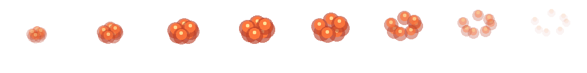
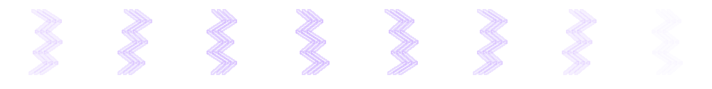
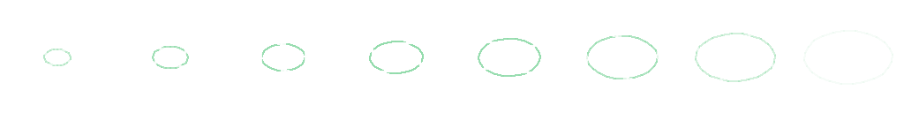
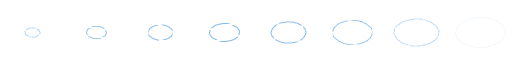

# 戦闘・フィールドエフェクト一覧

定義項目・単位・キーフレーム・音との同期と記述例は[音・戦闘演出の記述形式](SOUND_AND_EFFECT_FORMAT.md)を参照してください。

確認日: 2026-09-27。作品版1.22.0、表示効果31種。

2026-09-09に確定した一覧を実装済みです。既存のスクリプト式8種・連番画像8種・フィールド8種に、物理攻撃の軌跡3種・反動3種・敵の予備動作1種を追加しました。2026-11-09に味方の踏み込み・詠唱・矢の飛翔を加え、計34効果になりました。既存の青緑と琥珀色の画面、古典的なピクセル演出に合わせます。

ID：hit_shake / 効果：小振動 / 基準時間：280 ms / 方式：JSONの動き・色・分割だけ

ID：heavy_shake / 効果：強い振動 / 基準時間：420 ms / 方式：JSONの動き・色・分割だけ

ID：spin / 効果：回転 / 基準時間：460 ms / 方式：JSONの動き・色・分割だけ

ID：skew / 効果：スキュ / 基準時間：400 ms / 方式：JSONの動き・色・分割だけ

ID：squash / 効果：伸縮 / 基準時間：380 ms / 方式：JSONの動き・色・分割だけ

ID：split_vertical / 効果：縦切断 / 基準時間：430 ms / 方式：JSONの動き・色・分割だけ

ID：split_diagonal / 効果：斜め切断 / 基準時間：430 ms / 方式：JSONの動き・色・分割だけ

ID：fade_out / 効果：消散 / 基準時間：480 ms / 方式：JSONの動き・色・分割だけ

ID：slash_arc / 効果：斬撃の弧 / 基準時間：560 ms / 方式：8コマの透過PNGシート

ID：impact_burst / 効果：打撃の火花 / 基準時間：560 ms / 方式：8コマの透過PNGシート

ID：fire_burst / 効果：炎の噴出 / 基準時間：560 ms / 方式：8コマの透過PNGシート

ID：ice_shards / 効果：氷片の飛散 / 基準時間：560 ms / 方式：8コマの透過PNGシート

ID：lightning_arc / 効果：枝分かれする雷 / 基準時間：560 ms / 方式：8コマの透過PNGシート

ID：healing_ring / 効果：治療の輪 / 基準時間：560 ms / 方式：8コマの透過PNGシート

ID：poison_cloud / 効果：毒の雲 / 基準時間：560 ms / 方式：8コマの透過PNGシート

ID：mana_orbit / 効果：魔力の軌道 / 基準時間：560 ms / 方式：8コマの透過PNGシート

ID：field_shake / 効果：地響き / 基準時間：420 ms / 方式：JSONの動き・色・分割だけ

ID：field_damage / 効果：被害の赤色化 / 基準時間：650 ms / 方式：JSONの動き・色・分割だけ

ID：field_dark / 効果：暗転 / 基準時間：650 ms / 方式：JSONの動き・色・分割だけ

ID：field_shade / 効果：周辺シェード / 基準時間：650 ms / 方式：JSONの動き・色・分割だけ

ID：field_reveal / 効果：発見の光 / 基準時間：650 ms / 方式：JSONの動き・色・分割だけ

ID：field_recover / 効果：泉・休息の光 / 基準時間：650 ms / 方式：JSONの動き・色・分割だけ

ID：field_transition / 効果：移動の暗幕 / 基準時間：650 ms / 方式：JSONの動き・色・分割だけ

ID：field_poison / 効果：毒の紫色化 / 基準時間：650 ms / 方式：JSONの動き・色・分割だけ

## 命中の同期と物理攻撃

戦闘のcueには任意の `battle: {impact: 130, anticipation: "enemy_advance"}` を設定できます。開始から130ms後の同じイベントに、命中の形・反動・SE・ダメージ数字をまとめます。敵が味方へダメージ技能を使うときは、開始時に攻撃元の魔物が6px引いてから12px踏み込み、130msで最も前へ出ます。回復・防御では敵を突進させません。画面生成と音声再生は共通の開始時刻を使います。

1. `strike_slash`（240ms）は鋭い弧と白い刃筋が斜めに抜けます。`recoil_slash`（240ms）は攻撃元から離れる方向への小さな押し戻しです。
2. `strike_blunt`（320ms）は一点の白い光と8方向の火花です。`recoil_blunt`（400ms）は潰れて押し戻され、命中後40〜90msの50ms間、同じ姿勢を保ちます。静止するのは表示だけです。
3. `strike_pierce`（220ms）は攻撃元から対象へ向く細い直線です。`recoil_pierce`（260ms）はわずかに縮んで奥へ押し込まれる反動です。
4. `enemy_advance`（260ms）は敵の予備動作・踏み込み・復帰です。同じ対象の反動と予備動作が重なったら、前の動きを終えて新しい動きへ移り、画像を二重表示しません。

新しい軌跡は表示側の幾何図形で描画し、形と色をJSONで指定します。`kind: "strike"` の `pattern` は `slash` / `blunt` / `pierce`、色は6桁16進です。`motion` の `directed: true` は移動ベクトルを攻撃元から対象へ向けます。既存のPNGシートと効果IDも維持します。

数字はCoreが計算した技能ダメージを使用し、かばう成立後の実対象へ出します。同一技能内で複数回ダメージを与える場合は対象ごとの合計です。オーバーキルでもログの計算値と一致し、HP差分から再計算しません。回復・防御にはダメージ数字を出しません。全体攻撃は対象別の数字を同時に出し、SEと予備動作は一度です。連続して同じ対象が被弾した数字は上下へずらします。

幅の狭い画面で味方の肖像が非表示なら、表示中の人物カードを着弾位置にします。カードには色変化と小さな踏み込み・反動を使います。背景内ビューでは命中・数字・移動画像をHUDの上、管理ウィンドウの下へ重ねます。とどめ後に敵の要素が消えても直前の位置と画像を使用します。戦闘中は命中時刻まで前のHPと戦場を保持し、命中時にHP表示を更新します。決定・キャンセル・演出を省略で確定済みの結果へ進みます。再描画・ロード・表示切替では予約と重ね画像を破棄し、最新の状態へ戻します。演出設定「動きを控える」とOSの軽減設定では薄い色変化と移動しない数字、「切」では数字を含め表示演出を省きます。結果は常に戦闘ログへ残ります。

## 定義と合成

スクリプト式はJSONのキーフレーム（位置・角度・スキュ・伸縮・不透明度）、色の重ね合わせ、二分割の表示で定義します。画像式はAIPaintの図形命令から8コマの透過画像を作り、PNGシートとして再生します。斬撃・炎・氷片等は抽象的な戦闘記号です。切断は画像の見た目だけを分割し、元画像や敵データを変更しません。

一つのcueへ複数effectと一つのSEを指定でき、同じ開始時刻で動作します。技能とcueの対応もJSONです。effect.playでシナリオから単独再生でき、audio.seで単発音を指定できます。遅延は同じ入力処理の開始からのミリ秒です。

## フィールド

壁・罠は振動、罠は赤、毒歩行は紫、階層移動・帰還は暗幕、宝箱や補給は光、泉・休息は緑の回復演出へ接続します。灯油が25以下になると暗さが徐々に増し、周辺シェードは探索画面だけに掛けます。補充すれば暗さは戻ります。screen.set / screen.clearではシナリオ独自の持続色・シェードを最大4層まで指定でき、保存・復元します。

## ビューと進行の分離

ゲームは対象・演出ID・タイミングだけを通知し、DOMや描画APIを呼びません。表示側が実行する演出はゲームのHP・報酬・乱数・継続位置を変更しません。戦闘演出中の決定・キャンセルは省略だけを行い、次の戦闘行動を同時に実行しません。演出オフでは即時表示です。瞬間的な演出とSEはセーブしないため、ロード直後の再発火を防ぎます。倒した敵の最後の斬撃は直前の画像位置を使って表示します。

OSの動きを減らす設定と、ゲームの演出設定に対応します。軽減時は大きな変形・切断・振動を省き、一回の薄い色変化に置き換えます。短い明滅の反復は使用しません。

実装済みです。以下に画像シート、JSON例、技能対応一覧と検証結果を記載します。

## 画像アニメーション

全8種、各8コマ、1コマ128×128、シート1024×128の透過PNGです。左から右へ560msで再生します。AIPaintの図形命令で発生・広がり・消散を描き分けています。

アニメーション：斬撃の弧 / コマ一覧： / AIPaint命令：[命令JSON](../../assets/source/effects/fx_slash_arc.paint.commands.json)

アニメーション：打撃の火花 / コマ一覧： / AIPaint命令：[命令JSON](../../assets/source/effects/fx_impact_burst.paint.commands.json)

アニメーション：炎の噴出 / コマ一覧： / AIPaint命令：[命令JSON](../../assets/source/effects/fx_fire_burst.paint.commands.json)

アニメーション：氷片の飛散 / コマ一覧： / AIPaint命令：[命令JSON](../../assets/source/effects/fx_ice_shards.paint.commands.json)

アニメーション：枝分かれする雷 / コマ一覧： / AIPaint命令：[命令JSON](../../assets/source/effects/fx_lightning_arc.paint.commands.json)

アニメーション：治療の輪 / コマ一覧： / AIPaint命令：[命令JSON](../../assets/source/effects/fx_healing_ring.paint.commands.json)

アニメーション：毒の雲 / コマ一覧： / AIPaint命令：[命令JSON](../../assets/source/effects/fx_poison_cloud.paint.commands.json)

アニメーション：魔力の軌道 / コマ一覧： / AIPaint命令：[命令JSON](../../assets/source/effects/fx_mana_orbit.paint.commands.json)

## 技能と演出・SEの対応

1回の技能につき1つのcueを発行します。全体技は対象全員へ同時に画像効果を適用しますが、SEは1回です。通常の戦闘cueは予備時間130ms＋命中後の間隔240msで、次の行動の予備動作へ移ります。表示の長い余韻は重なります。撃破時は160ms後に消散を始め、決着音が命中音と重ならない間を取ります。省略操作は結果表示まで進め、次のコマンドは別の決定で実行します。

技能：攻撃（attack） / cue：attack / 効果：鋭い斬撃＋斬撃の押し戻し / SE：斬撃

技能：強打（power） / cue：power / 効果：打撃の集中火花＋重打の反動と静止 / SE：重打

技能：灯火の術（fire） / cue：fire / 効果：炎の噴出＋小振動 / SE：炎

技能：手当の祈り（heal） / cue：heal / 効果：治療の輪 / SE：回復

技能：防御（guard） / cue：guard / 効果：伸縮 / SE：防御

技能：毒の刃（venom） / cue：venom / 効果：毒の雲＋小振動 / SE：毒

技能：解毒（cleanse） / cue：cleanse / 効果：治療の輪＋伸縮 / SE：回復

技能：貫通突き（pierce） / cue：pierce / 効果：貫く直線＋刺突の押し込み / SE：貫通

技能：氷の符（ice） / cue：ice / 効果：氷片の飛散＋スキュ / SE：氷

技能：雷の符（lightning） / cue：lightning / 効果：枝分かれする雷＋小振動 / SE：雷

技能：薬草の霧（group_heal） / cue：heal / 効果：治療の輪 / SE：回復

技能：盾の壁（party_guard） / cue：guard / 効果：伸縮 / SE：防御

技能：気付けの節（inspire） / cue：mana / 効果：魔力の軌道 / SE：魔力

技能：水車の尾（water_tail） / cue：power / 効果：打撃の集中火花＋重打の反動と静止 / SE：重打

技能：水門落とし（gate_slam） / cue：power / 効果：打撃の集中火花＋重打の反動と静止 / SE：重打

技能：螺旋突進（drill_thrust） / cue：pierce / 効果：貫く直線＋刺突の押し込み / SE：貫通

技能：殻の体当たり（shell_roll） / cue：roll / 効果：打撃の集中火花＋回転 / SE：重打

技能：蜜蝋の火（wax_flame） / cue：fire / 効果：炎の噴出＋小振動 / SE：炎

技能：引き鋸（saw_cut） / cue：cut / 効果：鋭い斬撃＋斜め切断 / SE：斬撃

技能：虹彩光線（iris_ray） / cue：lightning / 効果：枝分かれする雷＋小振動 / SE：雷

技能：硝子の刃（glass_shards） / cue：cut / 効果：鋭い斬撃＋斜め切断 / SE：斬撃

技能：活字の針（type_needles） / cue：pierce / 効果：貫く直線＋刺突の押し込み / SE：貫通

技能：墨すすり（ink_sip） / cue：drain / 効果：魔力の軌道＋スキュ / SE：魔力

技能：金庫の歯（vault_bite） / cue：power / 効果：打撃の集中火花＋重打の反動と静止 / SE：重打

技能：縫い直し（stitch_mend） / cue：heal / 効果：治療の輪 / SE：回復

技能：肋骨の雨（bone_rain） / cue：power / 効果：打撃の集中火花＋重打の反動と静止 / SE：重打

技能：碇打ち（anchor_strike） / cue：power / 効果：打撃の集中火花＋重打の反動と静止 / SE：重打

技能：殻の放電（discharge） / cue：lightning / 効果：枝分かれする雷＋小振動 / SE：雷

技能：列車突進（rail_charge） / cue：power / 効果：打撃の集中火花＋重打の反動と静止 / SE：重打

技能：尾針突き（needle_lunge） / cue：pierce / 効果：貫く直線＋刺突の押し込み / SE：貫通

技能：月輪払い（moon_sweep） / cue：cut / 効果：鋭い斬撃＋斜め切断 / SE：斬撃

技能：すれ違い斬り（blade_pass） / cue：cut / 効果：鋭い斬撃＋斜め切断 / SE：斬撃

技能：姿勢を立て直す（recover_stance） / cue：guard / 効果：伸縮 / SE：防御

技能：毒牙（poison_bite） / cue：venom / 効果：毒の雲＋小振動 / SE：毒

技能：傷薬（potion） / cue：heal / 効果：治療の輪 / SE：回復

技能：解毒薬（antidote） / cue：cleanse / 効果：治療の輪＋伸縮 / SE：回復

## JSONで作る

`data/effects.json`に追加するスクリプト式の例です。durationはミリ秒、atは0〜1です。JavaScriptやCSS文字列の埋め込みはせず、許可された数値だけを使います。

```json
{
  "turn_and_skew": {
    "name": "回りながら歪む",
    "category": "script",
    "duration": 500,
    "tracks": [
      {
        "kind": "motion",
        "frames": [
          {"at": 0, "rotate": 0, "skewX": 0},
          {"at": 0.5, "rotate": 180, "skewX": 16},
          {"at": 1, "rotate": 360, "skewX": 0}
        ]
      }
    ]
  }
}
```

シナリオから使う例です。同じdelayならSEと効果が同時刻に予約されます。効果を再生する命令自体は待機せず、narrateやchoiceがプレイヤーの入力を待ちます。

```json
{
  "scripts": {
    "example.rumble": {
      "commands": [
        {"op": "screen.set", "layer": "mist", "color": "#344652", "opacity": 0.3, "shade": true},
        {"op": "effect.play", "effect": "field_shake", "target": "scene", "delay": 0},
        {"op": "audio.se", "asset": "se_trap", "volume": 0.8, "delay": 0},
        {"op": "effect.play", "effect": "field_damage", "target": "scene", "delay": 180},
        {"op": "narrate", "text": "石の向こうから振動が伝わり、薄い靄が灯を包んだ。"},
        {"op": "screen.clear", "layer": "mist"}
      ]
    }
  }
}
```

演出のtargetはscene（探索画面。町では主画面）、screen（主画面）、party（隊の欄）、actor:adaのような仲間ID、enemy:enemy_0のような戦闘内の敵IDです。切断は画像対象で使用します。画像のない対象では薄い色の効果へ置き換えます。screen.setの持続色は探索・戦闘の景色に重ね、町には持続表示しません。

motionのキーはx/y（±200px）、rotate（±360度）、skewX/skewY（±40度）、scaleX/scaleY（0.1〜3）、opacity（0〜1）。開始at=0、終了at=1とし、昇順に2〜32コマを記述します。tint/shadeはcolorとopacity（0〜0.65）、splitはaxis（vertical/diagonal）・distance（0〜100px）・rotate（±45度）、spriteはasset・frames・columns・cell・scaleを指定します。1効果は最大8トラック、50〜5000ms、1入力処理は最大64イベント、遅延は最大5000msです。

音と効果をまとめる定義は `data/presentation.json` のcues、技能・道具・移動との対応はbindingsです。原稿から再生成する場合はconfig/presentation.jsonを編集してください。`data/schemas/effects.schema.json`、`sounds.schema.json`、`script.schema.json`と実行時検証器が形式と参照を検査します。

## 表示だけを調整する

[ビュー用プレビュー](../../view-preview.html)で表示例と効果・対象を選び、「演出を再生」を押します。「新種の二体戦」なら切断・振動を敵の画像で確認できます。SEの選択と試聴も同じページにあります。画像配置・クリップ・再生方法の変更はsrc/view/effects.jsとstyle.cssで行い、ゲームの判定は変更しません。

## 検証結果と範囲

表示効果の導入時は全469テストに関連検証を含めました。演出の有無で同じ入力・seedから同じ保存状態になること、持続レイヤー、予約取消し、SE重複防止、不正な定義の拒否を検査しています。2026-11-09の命中同期実装では `npm run check` が全2,705試験を含め成功しました。

全8シートをデコードし、透過と64コマの非空・差異を検査しました。SE全28種はOGGをデコードして音量・有限値を測定しました。実ブラウザー上の動きとOSの動き軽減との連携は下記CIで検証済みです。端末での聴感は未評価です。

## 今回の検証

命中とSEの予約時刻、敵の予備動作、実ダメージ、かばう、全体攻撃、とどめ、ゲーム状態不変、軽減設定、重ね画像の破棄を自動試験で確認します。ブラウザの再現手順は `node tools/browser-effects-smoke.mjs` です。PlaywrightとChromiumを用意し、任意の実行ファイルは `ADV_BROWSER_EXECUTABLE`、画像と結果JSONの出力先は `ADV_BROWSER_OUTPUT` で指定します。音声アダプターの発音指示を測定し、スピーカーでの聴感とは区別します。

## 2026-11-09：命中とHP・操作の同期

通常攻撃は装備の種類から演出を選びます。剣は斬撃、短剣・槍は刺突、斧・拳・杖・道具・楽器は打撃、弓は飛翔と刺突です。対応は `config/presentation.json` の `bindings.weapons` です。技能固有の演出は維持します。

実際の命中結果から会心・弱点・軽減・防御・回避と回復量、付与・解除した状態を表示します。回避には命中音と反動を出しません。既存28種のSEを使用し、全体技も命中SEは1回です。Frontlineの切り抜き済みcanvasは画素を直接複写し、Base64化しません。

`battle-engine-playtest.html` に演出切替と音声再生を接続しました。音は利用者がボタンで有効にします。実ゲームの保存領域は使用しません。

`BattlePlayback` はViewだけの一時状態です。計算・支払い・乱数・自動保存は即時に完了し、再生と省略はゲームを再実行しません。戦闘終了後のBGM切替と自動進行は表示完了後へ揃えます。

追加回帰は `tests/battle-playback.test.mjs`、実Chromium検査は `.github/workflows/battle-feedback.yml` です。関連17試験と全体検査が成功しました。実装コミット `ec469db3988e852c14af67425d2bc4d4c1c697c8` の [Chromium検証](https://github.com/TomTomYoung/adv/actions/runs/42532455228) も成功し、Scene／ClassicとClassic／Grid／Frontlineの6組、命中前後のHP、保存状態不変、武器差、PC／390px表示、撃破、軽減・オフ、再描画取消を確認しました。斬撃、前線表示、390pxの被弾画面も目視しました。

ローカルChromiumはsocketの権限制限、共有ブラウザーはローカルHTTPへの接続失敗で実行できなかったため、CIで実画面を検証しました。音はアダプターへの発音指示と数字表示の時刻差を測定しています。聴感の評価とは区別します。

## 2026-11-09：火花・衝撃波とSEの重ね合わせ

`src/battle-accent.js` が命中結果を分類し、`src/view/battle-impact.js` と `src/application/battle-sound.js` が同じ結果を表示・発音へ変換します。会心の火花と衝撃波、強打の衝撃波、防御の青い円弧、回復で上昇する光、属性色の火花、撃破時の粒子を追加しました。動き軽減・演出オフではこれらの動く追加効果を抑制します。

SEは既存28種にWeb Audioで生成する短い音を重ねます。斬撃は風切りと衝撃、刺突は高い短音、強打は低音、会心は高い響きと低音、防御は金属音、回復は3音の上昇音、撃破は低下する音です。炎・氷・雷も別の音色を使います。強打・会心・撃破ではBGM音量を64%へ下げ、190msで戻してSEを聞き取りやすくします。

合成音はマスター音量・SE音量・ミュートに従います。音声の有効化操作で音源を準備し、Web Audioが使えない環境でも既存SEは再生します。音源は最大24声に制限し、演出省略・再描画・読込で予約音、発音中の音、BGM音量の復帰予約を破棄します。ゲーム用の乱数と保存データは使用しません。

回帰試験は `tests/battle-impact.test.mjs` です。Chromium検査は会心・回復・撃破の代表画像と、既存SEを合成音へ重ねた10種類の実波形を出力・測定します。波形の実効値・ピーク・音色差を検査し、スピーカーでの聴感評価とは区別します。実行結果はPR #223に記録します。
